# 带图看题目：输入、目标、错误和 GT

这是研究者看答案的示例页。实际模型只按接口请求观察，不会收到这里的错误标签或 GT。

## Danone Promotional Set: Cow · 2132-1

**范围**：从白色凸点底板开始，拼好整个物件。原物件 10 件，本题操作 10 件；长度 medium。

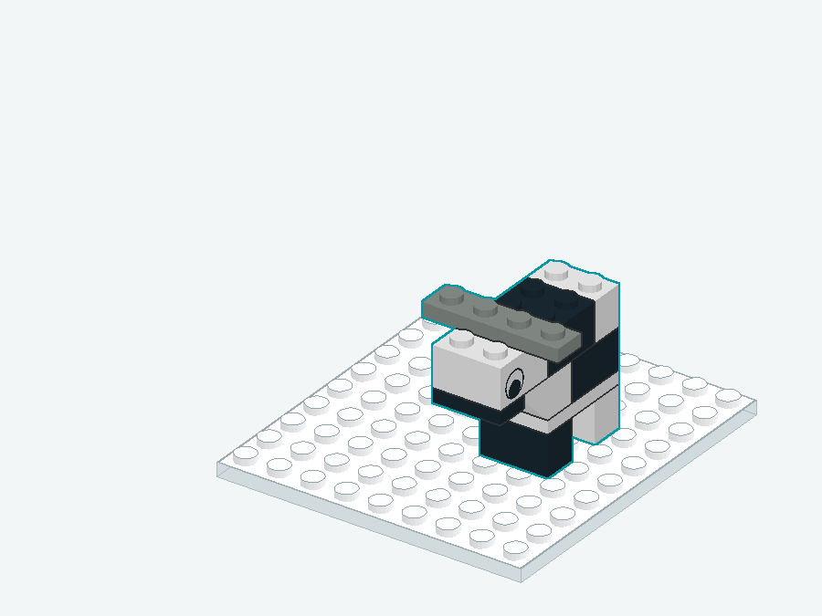

| 初始状态 | 唯一验收目标 |
|---|---|
| 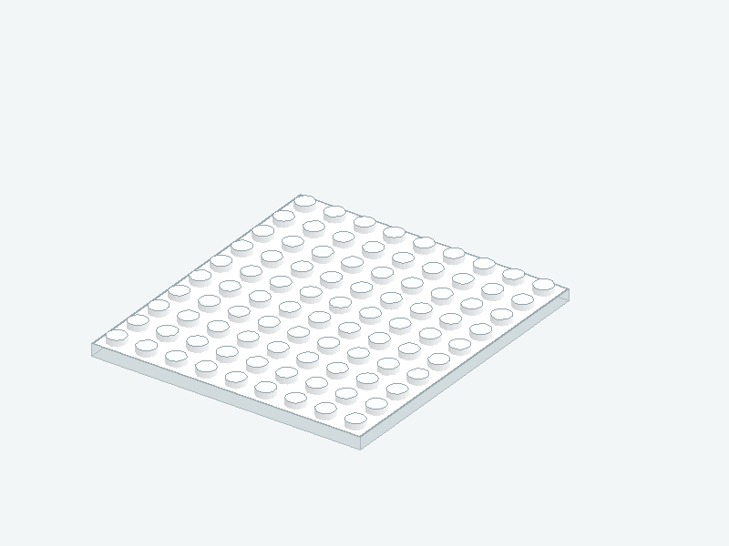 | 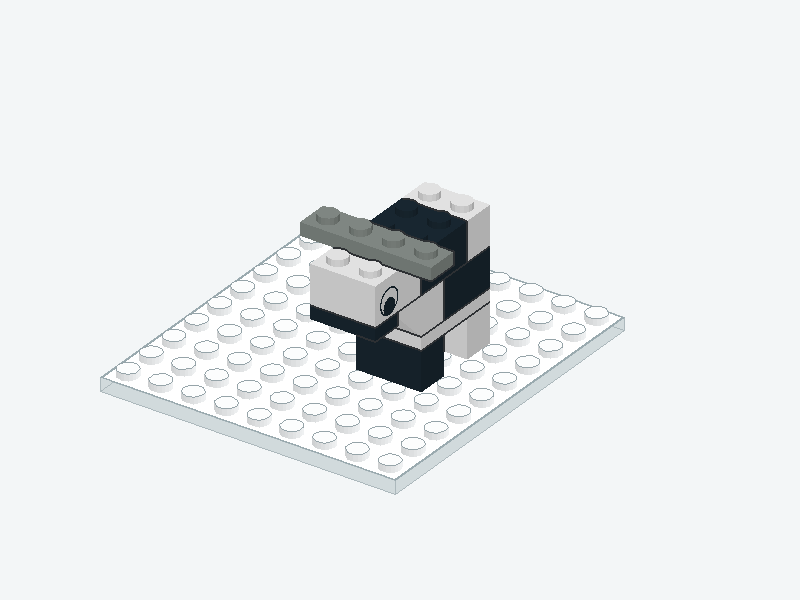 |

**动态输入**：任务说明、接口和库存／候选位置入口；模型用 `observe` 请求当前、目标、多视角、说明步骤等图片。每次 `attach` 或 `detach` 只操作一块，完成后 `finish`。

正常题：`SC:2132-1:dynamic:control`，参考物理动作 10 次。
修复题：`SC:2132-1:dynamic:multiple-missing-then-offset`，连续多次干扰，2 次干扰；参考物理动作共 13 次。

| 第一次事件之前 | 第一次事件之后 |
|---|---|
| 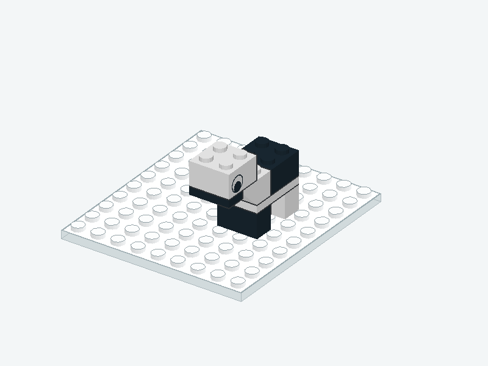 | 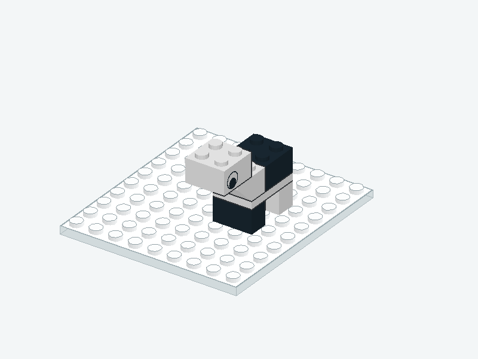 |

**静态题**：`SC:2132-1:static:offset`，位置偏移。输入下方当前图和相同视角目标图；有错则修复，正确则结束。

| 静态当前 | 静态目标 |
|---|---|
| 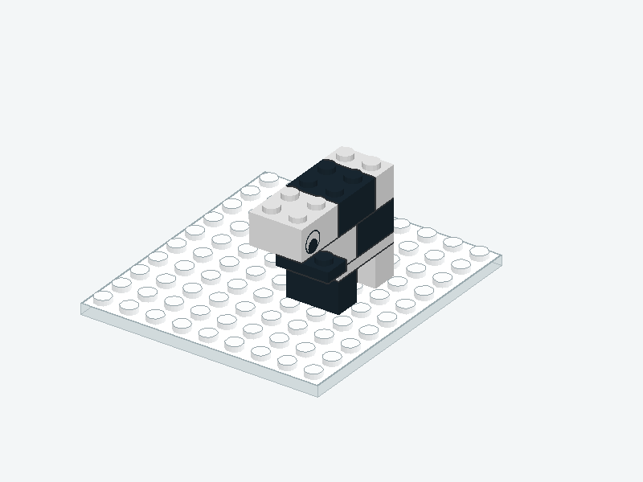 | 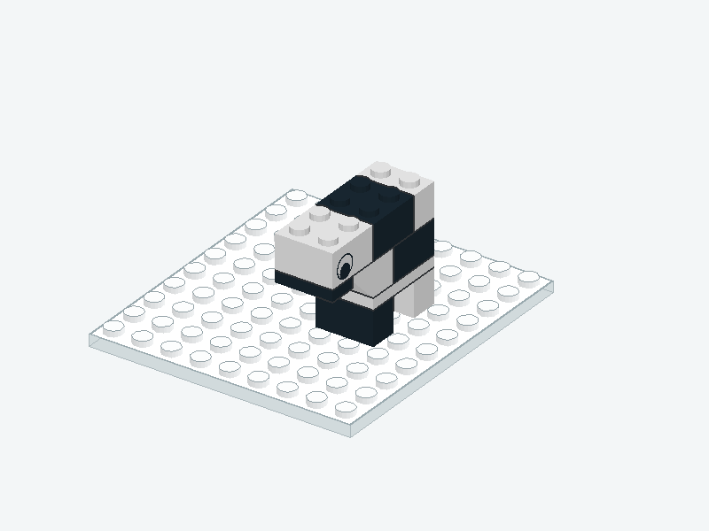 |

**GT**：`private/2132-1/cases.private.json.gz`，按题目 ID 找 `referenceActions`。它是一条验证可行的参考解，不限制模型用其他合法顺序，也不保证最短。
[打开此模型，展开 GT 查看具体每步操作](index.html#sc-2132-1)

## Truck · 7223-1-alt-831

**范围**：补完物件上方标出的收尾部分；下方主体已完成。原物件 33 件，本题操作 8 件；长度 medium。

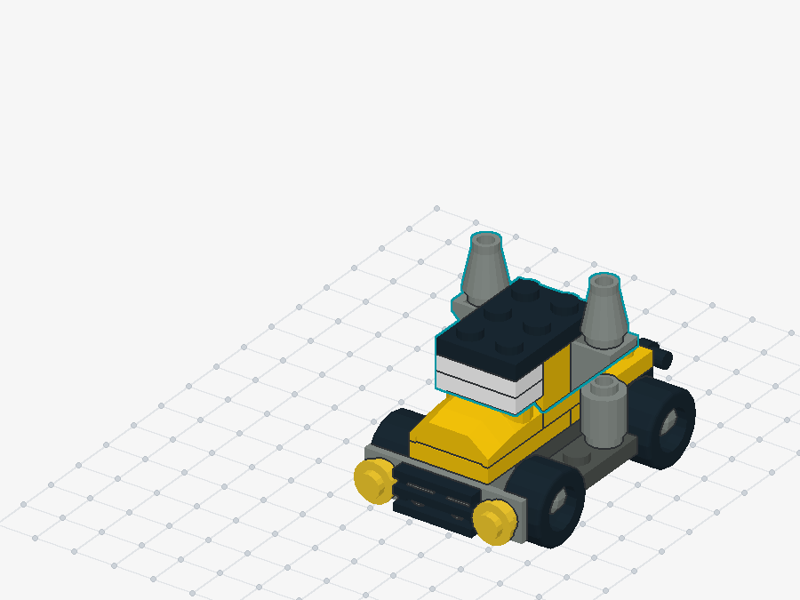

| 初始状态 | 唯一验收目标 |
|---|---|
| 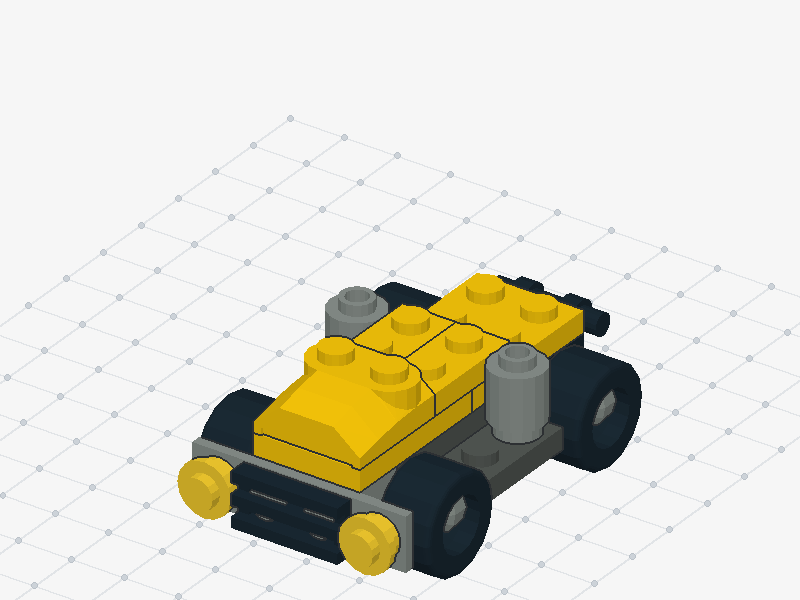 | 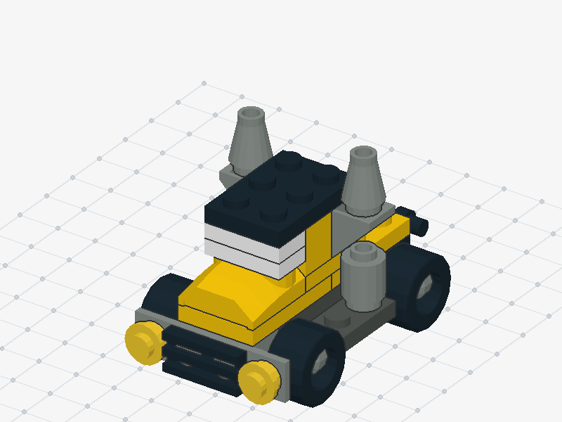 |

**动态输入**：任务说明、接口和库存／候选位置入口；模型用 `observe` 请求当前、目标、多视角、说明步骤等图片。每次 `attach` 或 `detach` 只操作一块，完成后 `finish`。

正常题：`SC:7223-1-alt-831:dynamic:control`，参考物理动作 8 次。
修复题：`SC:7223-1-alt-831:dynamic:multiple-missing-then-repeat-omission`，连续多次干扰，2 次干扰；参考物理动作共 11 次。

| 第一次事件之前 | 第一次事件之后 |
|---|---|
|  | 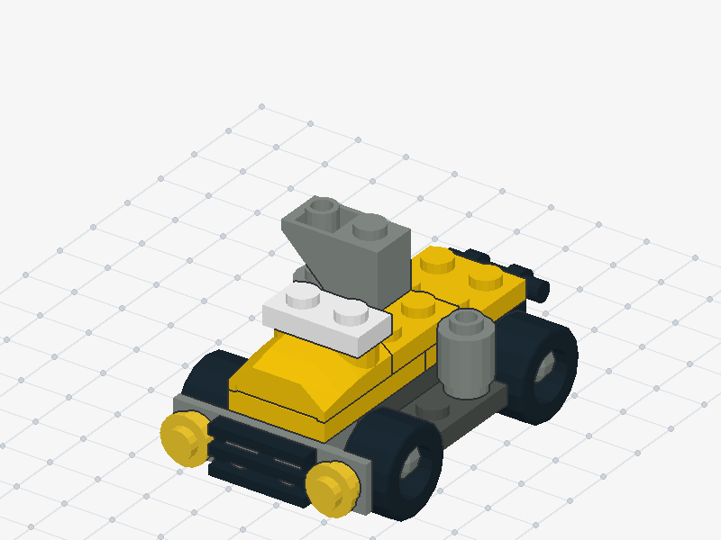 |

**静态题**：`SC:7223-1-alt-831:static:control`，正常、无错误。输入下方当前图和相同视角目标图；有错则修复，正确则结束。

| 静态当前 | 静态目标 |
|---|---|
| 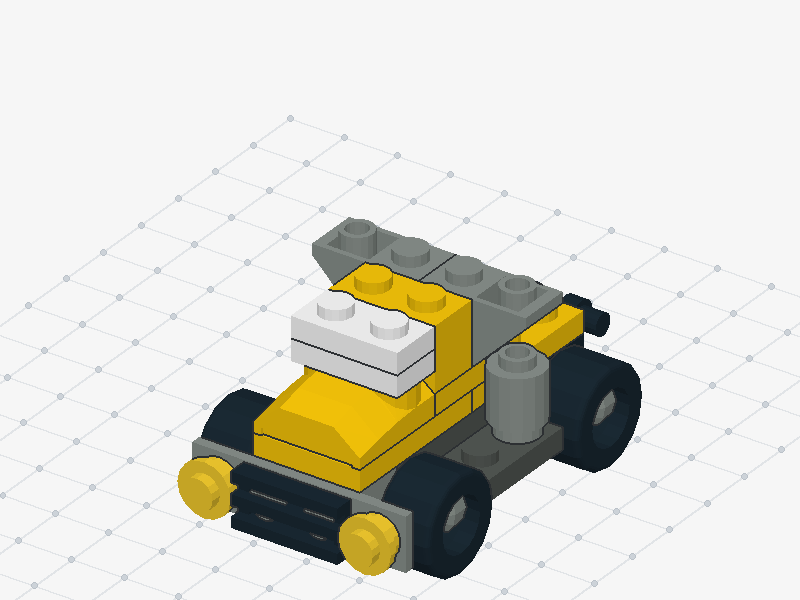 |  |

**GT**：`private/7223-1-alt-831/cases.private.json.gz`，按题目 ID 找 `referenceActions`。它是一条验证可行的参考解，不限制模型用其他合法顺序，也不保证最短。
[打开此模型，展开 GT 查看具体每步操作](index.html#sc-7223-1-alt-831)

## 双层书架 · obj-bookshelf

**范围**：从白色凸点底板开始，拼好整个物件。原物件 11 件，本题操作 11 件；长度 medium。

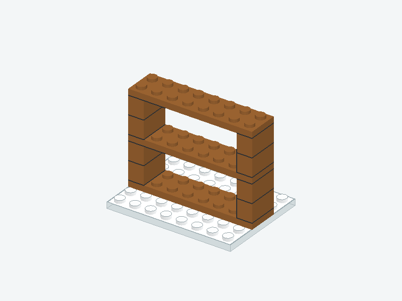

| 初始状态 | 唯一验收目标 |
|---|---|
| 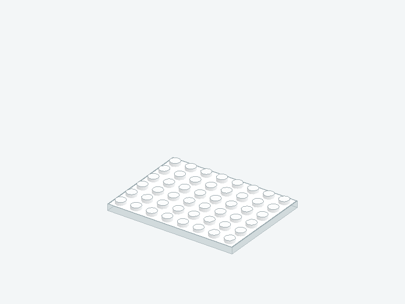 |  |

**动态输入**：任务说明、接口和库存／候选位置入口；模型用 `observe` 请求当前、目标、多视角、说明步骤等图片。每次 `attach` 或 `detach` 只操作一块，完成后 `finish`。

正常题：`D:obj-bookshelf--t3--control`，参考物理动作 11 次。
修复题：`D:obj-bookshelf--t3--buried_wrong_color--v01`，拆上层返修，1 次干扰；参考物理动作共 17 次。

| 第一次事件之前 | 第一次事件之后 |
|---|---|
|  | 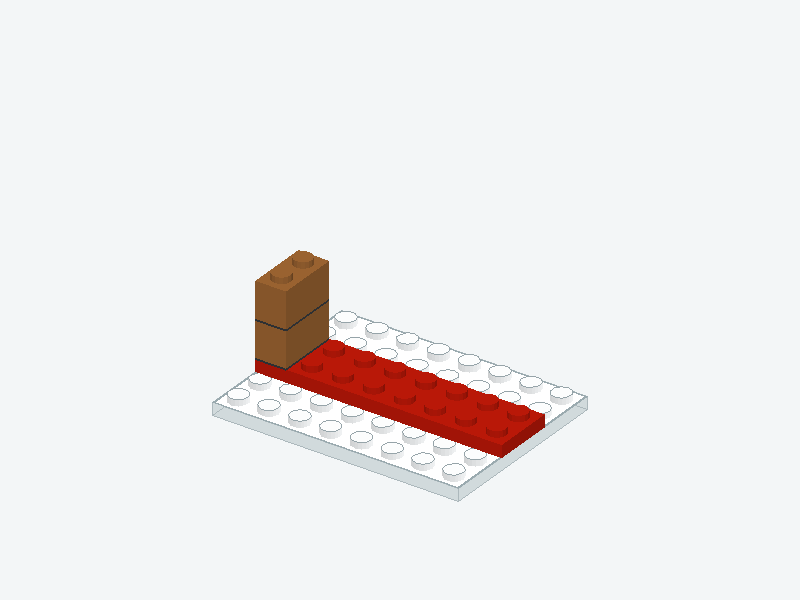 |

**GT**：`legacy/checks/obj-bookshelf.json`，按题目 ID 找 `referenceActions`。它是一条验证可行的参考解，不限制模型用其他合法顺序，也不保证最短。
[打开此模型，展开 GT 查看具体每步操作](index.html#obj-bookshelf)

## House with Arch · 4956-1-alt-1358

**范围**：补完物件上方标出的收尾部分；下方主体已完成。原物件 631 件，本题操作 25 件；长度 long。

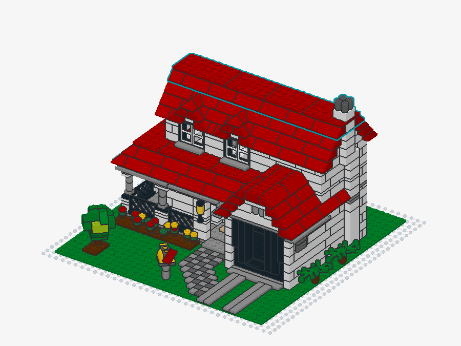

| 初始状态 | 唯一验收目标 |
|---|---|
| 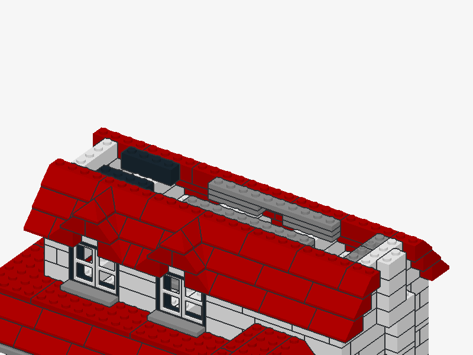 | 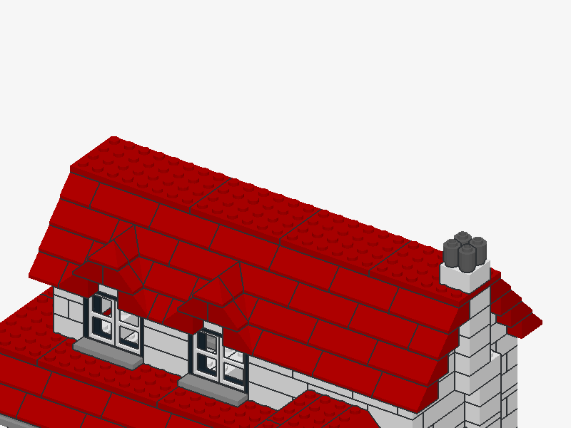 |

**动态输入**：任务说明、接口和库存／候选位置入口；模型用 `observe` 请求当前、目标、多视角、说明步骤等图片。每次 `attach` 或 `detach` 只操作一块，完成后 `finish`。

正常题：`SC:4956-1-alt-1358:dynamic:control`，参考物理动作 25 次。
修复题：`SC:4956-1-alt-1358:dynamic:multiple-missing-then-repeat-omission`，连续多次干扰，2 次干扰；参考物理动作共 28 次。

| 第一次事件之前 | 第一次事件之后 |
|---|---|
| 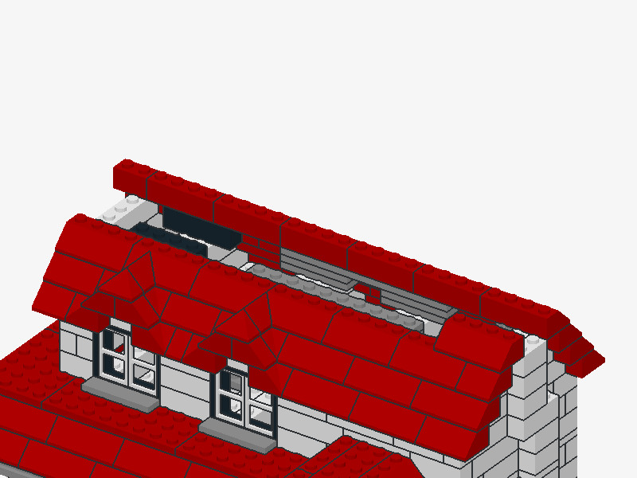 |  |

**静态题**：`SC:4956-1-alt-1358:static:repeat-omission`，重复结构漏装。输入下方当前图和相同视角目标图；有错则修复，正确则结束。

| 静态当前 | 静态目标 |
|---|---|
| 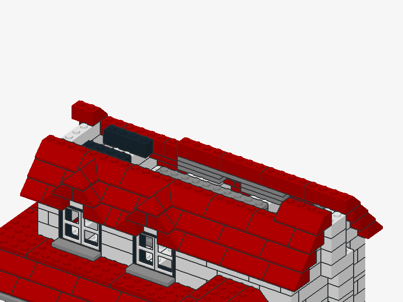 |  |

**GT**：`private/4956-1-alt-1358/cases.private.json.gz`，按题目 ID 找 `referenceActions`。它是一条验证可行的参考解，不限制模型用其他合法顺序，也不保证最短。
[打开此模型，展开 GT 查看具体每步操作](index.html#sc-4956-1-alt-1358)

## Solomon R. Guggenheim Museum · 21035-1

**范围**：补完物件上方标出的收尾部分；下方主体已完成。原物件 743 件，本题操作 25 件；长度 long。

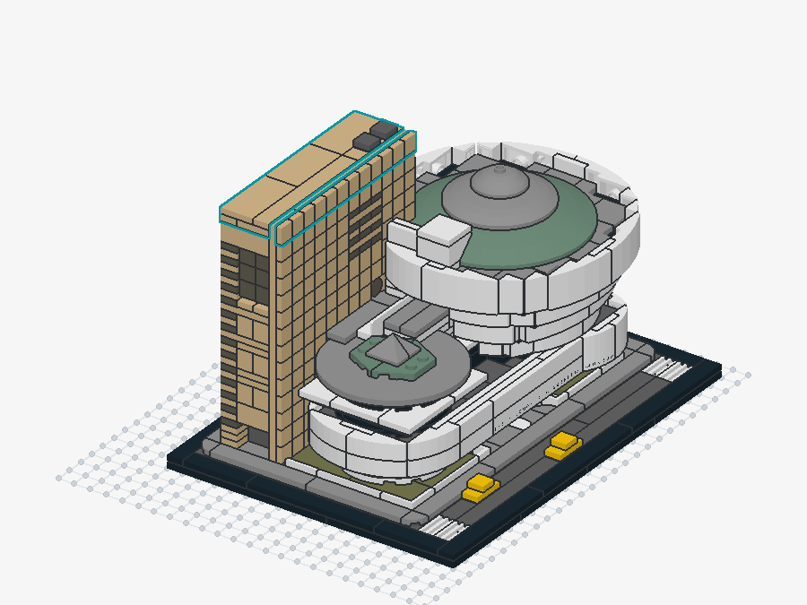

| 初始状态 | 唯一验收目标 |
|---|---|
|  | 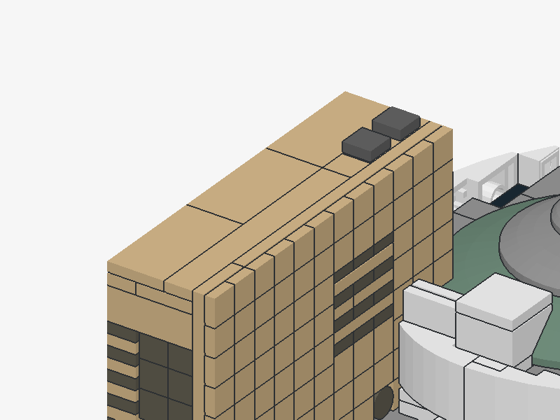 |

**动态输入**：任务说明、接口和库存／候选位置入口；模型用 `observe` 请求当前、目标、多视角、说明步骤等图片。每次 `attach` 或 `detach` 只操作一块，完成后 `finish`。

正常题：`SC:21035-1:dynamic:control`，参考物理动作 25 次。
修复题：`SC:21035-1:dynamic:multiple-missing-then-wrong-color`，连续多次干扰，2 次干扰；参考物理动作共 28 次。

| 第一次事件之前 | 第一次事件之后 |
|---|---|
| 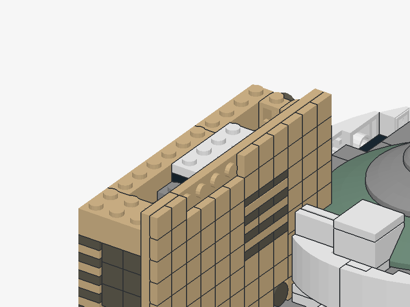 | 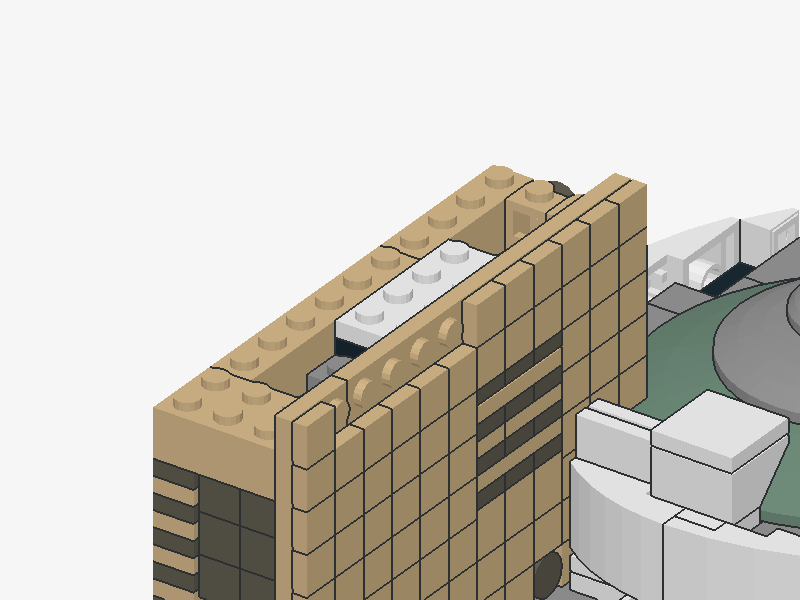 |

**静态题**：`SC:21035-1:static:wrong-color`，颜色错误。输入下方当前图和相同视角目标图；有错则修复，正确则结束。

| 静态当前 | 静态目标 |
|---|---|
| 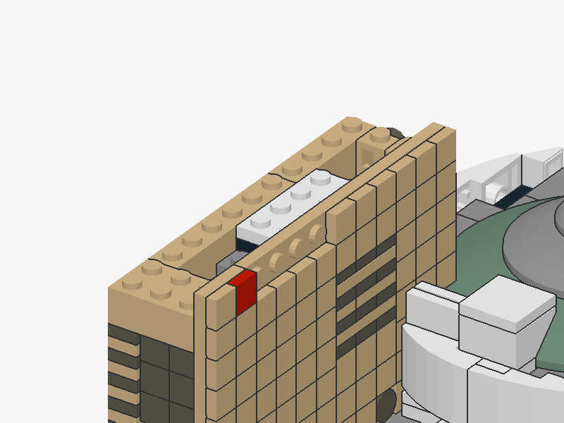 |  |

**GT**：`private/21035-1/cases.private.json.gz`，按题目 ID 找 `referenceActions`。它是一条验证可行的参考解，不限制模型用其他合法顺序，也不保证最短。
[打开此模型，展开 GT 查看具体每步操作](index.html#sc-21035-1)

## 查看真实接口回放

以下均为程序参考动作，不是 API 模型成绩：

- [小牛：正常拼装](http://127.0.0.1:8810/?run=release-check-2132-1-normal)
- [小牛：两次干扰](http://127.0.0.1:8810/?run=release-check-2132-1-incident)
- [替代拼法卡车：干扰修复](http://127.0.0.1:8810/?run=release-check-7223-1-alt-831-incident)
- [25 件收尾模块：干扰修复](http://127.0.0.1:8810/?run=release-check-21035-1-incident)
