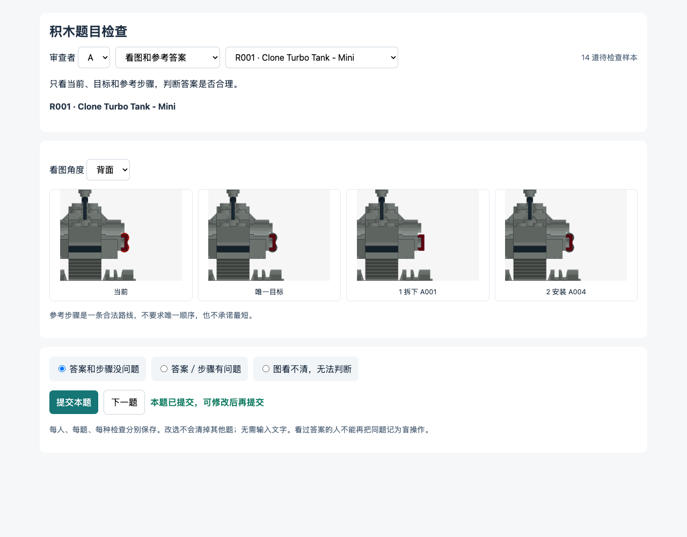
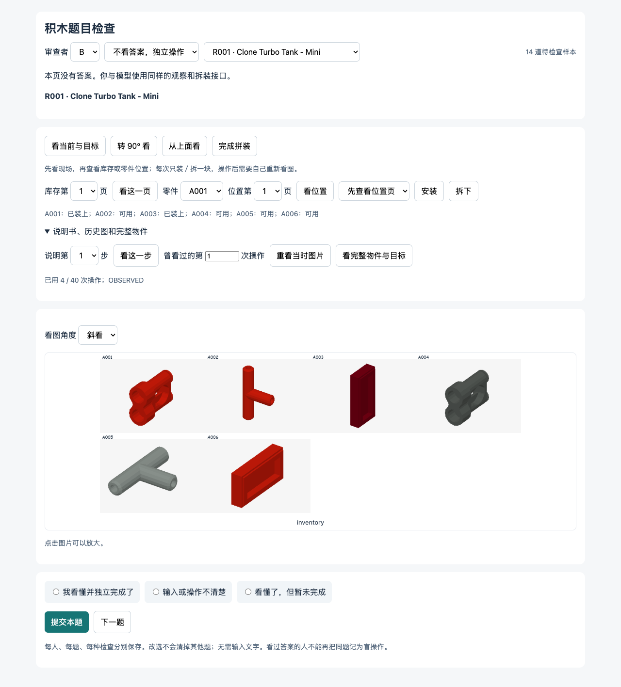

# 四项修复：输入、公平比较、独立检查、独立运行

更新：2026-10-30。针对当前 **310 个物件、4,685 道题（静态 1,600／动态 3,085）** 的运行与验证流程。本轮没有增加题量，没有调用付费 API。

## 1. 这次具体改了什么

| 问题 | 现在的做法 | 已有证据／还差什么 |
|---|---|---|
| 一轮发 9、18、12 张图，负担过大 | 静态和动态共用主动观察接口；默认 0 张图，主动请求后每轮最多 2 张；库存、位置和说明书逐页查看 | 脚本实测通过；新接口下的模型成绩还没跑，旧成绩不与新版混算 |
| 静态和动态的故障现场不同 | 从真实发生事故的那一刻复制两份现场；一份保留此前执行历史，另一份从当前状态重新开始 | 相同状态、目标、库存、动作规则、相机和剩余预算的哈希核验通过；两份脚本均能完成 |
| 看过 GT 就算题目验证通过 | 分成看答案、盲操作、单步拆装检查，分别保存、分别统计 | 新页面和保存流程已测；需要真人提交，不能拿自动点击当真人结果 |
| 运行依赖作者电脑上的缓存 | 提供约 39 MB 的运行包，附带当前题库需要的 919 份碰撞网格、来源说明和固定版本依赖 | 用项目外目录和全新 Python 环境复跑；详细范围见安装记录 |

### 图片怎样发

| 模型做什么 | 下轮收到什么 |
|---|---|
| 刚进入题目 | 任务、唯一目标规则、工具、预算、零件编号；0 张图 |
| 看当前和目标 | 1 张左右对照图；两边各 800×600，相机、缩放和外层画布一致 |
| 同时看当前、目标和库存 | 上面的对照图＋库存的指定一页，共 2 张 |
| 查一个零件的位置 | 1 张位置页，每页最多 12 个位置；不标答案或合法性 |
| 看说明书 | 1 步，1 张参考图；不自动发送后续步骤 |
| 装／拆一个零件 | 操作反馈；0 张新图。模型自行决定何时重新观察 |
| 回看历史 | 只返回曾经请求过的那次图片；明确是历史状态 |

不是把十几张图压成一张超长图：对照图只有当前和目标两个场景，库存和候选位置都限制每页 12 项。库存文字也只返回所看这一页的可用状态。完整物件、多角度、后续页都需要另行请求。过去图片不在每轮重复发送，历史动作和反馈保留为文字；可以用 `recall` 重看已请求的图片。

当前截图：

## 2. 静态和动态到底如何公平比较

原题库里的任意一道静态题和任意一道动态题，不能直接相减。新增的比较方法是：

1. 同一个模型先在关闭事故的正常分支完成该物件。没完成时，正常拼装的结果照常报告，主修复结果不适用。
2. 再由模型实际执行有事故的任务。必须等到事故真的发生，并且确实改变了现场；没有触发就写“未触发”。
3. 在事故刚发生、模型还没做下一步时，复制当前环境。
4. **持续分支**保留模型此前的动作、反馈和可回看的观察；**重新开始分支**只从相同故障现场开始，不带此前历史。
5. 两边使用同一模型、同一目标、同一库存和候选编号、同一相机、同一拆装规则，以及相同的剩余工具调用次数。为隔离历史的影响，这次两分支比较不再加入后续事故。

因此它回答的是：**同一个故障现场，已经连续做了一段时间的模型，与从现场重新开始的模型，完成情况有什么不同？** 历史是有意改变的条件。它不等于“有事故与没事故”的因果对照，也不是单独证明“记忆不足”或“规划不足”。新的配对记录与原来的静态／动态总题量分开保存，不重复计入题数。

每次观察、翻页、安装、拆卸、回看、提交都算一次工具调用；错误格式和非法动作也占一次。服务拒绝、限流、超时、运行程序错误另记，不能充当能力失败。比较结果同时保留完成率、动作合法性、观察次数、图片数、像素数和请求字节量；服务中断的配对差值为 `null`。

## 3. 请真人检查什么

本机启动方法见 [运行说明](RUN.zh-CN.md)。三个入口默认分工如下，也可以在页头切换身份与检查方式：

- [A：只看图和参考答案](http://127.0.0.1:8820/?person=A&role=gt)
- [B：不给答案，独立观察和操作](http://127.0.0.1:8820/?person=B&role=blind)
- [C：检查指定的一步能不能拆装](http://127.0.0.1:8820/?person=C&role=physics)

| 检查 | 人需要做什么 | 能说明什么 | 不能据此说明什么 |
|---|---|---|---|
| 看 GT | 看当前、唯一目标、参考步骤；选没问题／有问题／看不清 | 参考答案是否合理、图片是否易读 | 不证明陌生人能独立找到答案 |
| 盲操作 | 使用与模型相同的观察、翻页、装拆、说明书和回看工具；不显示 GT | 输入和操作是否足以支持实际完成 | 单人成功不代表所有人、所有题都清楚 |
| 单步拆装 | 看动作前后和移动零件；可下载 LDraw 场景到第三方软件或用实物检查 | 裁判是否错误接受或拒绝该动作 | 单看图片不证明精确碰撞、连接和真实力学 |

每题只需三选一，**不用写文字**。答案按题目版本、审查者、检查方式、题号分别保存，修改会保留旧记录；切题和刷新不会清掉其他答案。同一人看过同题答案或拆装提示后，不能再将该题计为盲操作。B 页的“独立完成”还需要引擎确认实际完成，勾选本身不等于成功。

本轮提供 **14 道题、14 个不同物件**：短／中／长操作范围各覆盖错色、少件、埋藏返修、方向错误；另有单次和连续事故各一题。这是有针对性的抽查，不是全库错误率的随机估计。上一轮真人结果属于原题目和原页面版本，不自动冒充这次新增检查的结果。

### 独立拆装检查的当前发现

用另一套几何计算程序 Manifold3D 对 6 个物件、12 个动作做了交叉检查，薄障碍穿越和无障碍路径校准通过。**10 个动作与引擎接受结果一致；2 个待确认**：

| 编号 | 题目 | 暂不能下结论的原因 |
|---|---|---|
| P004 | `SC:20015-1:static:missing` | 背景中部分零件仅有保守几何，不能独立确认所有拆卸阻挡 |
| P007 | `SC:10241-1:static:buried-repair` | 同上；不能删除背景零件后声称原动作可行 |

两项都保留了原始证据和第三方检查入口，未改成“通过”。独立程序与引擎仍共用来源网格，因此它检查的是**另一套代码算出的端点碰撞和连续直线通路**，尚未独立验证连接语义、网格本身和实物中的摩擦、重力、卡扣力度。题目允许夹具托住结构。

## 4. 交付与复现

- [安装与运行](RUN.zh-CN.md)
- [公开输入、输出与配对规则](INPUT-AND-PAIRED-PROTOCOL.zh-CN.md)
- [独立运行包](release/brick-atlas-runtime.zip)：评价程序用，**包含私有答案与事故配置，不是发给模型的输入包**。
- [文件哈希清单](release/package-manifest.json)／[包大小与哈希](release/package-summary.json)
- [来源许可与署名记录](release/source-rights.json)
- [接口、配对、正常拼装和修复的脚本检查](checks/report.json)
- [页面检查记录](checks/review-ui-check.json)
- [干净环境运行记录](checks/clean-install.json)
- [独立几何抽查记录，评价者专用](review/geometry.private.json)

437 条来源记录都核对了原始文件哈希、作者和许可声明；其中 263 个社区物件进入当前题库，另有 47 个保留的设计物件。零件网格逐件记录来源与许可，保留原作者署名。仓库代码的 MIT 许可不覆盖所有来源模型；整体数据集统一授权仍需作者确认，不能用一个 MIT 标签覆盖他人的几何。LDraw 的许可应按原文件声明保留，见 [官方说明](https://library.ldraw.org/documentation/licenses-and-legal/ldraworg-contributor-agreement)。

碰撞依赖固定为 BrickNet 0.1.0。上游后续版本改变了默认碰撞表示，随意升级会改变裁判语义，见 [BrickNet 官方说明](https://github.com/kulits/BrickNet/blob/master/README.md) 和 [数据说明](https://github.com/kulits/BrickNet/blob/master/DATA.md)。本包只附带当前物件及候选位置需要的网格，不依赖再次下载完整上游网格。

## 5. 修复后，哪些话现在能说

可以说：默认输入负担有明确上限；静态接手与动态持续执行有可运行的同现场比较；三类人工证据能分开收集；当前题库的裁判运行包已提供。

**还不能说全库已被独立验证，也不能把脚本完成率当成模型成绩。** 接下来需要真人提交、对两项几何疑点做第三方复核，以及在新版接口下跑正式模型实验。干净环境检查覆盖同一台 macOS 的独立目录与新 Python 环境；Linux／Windows 和全部 4,685 题逐题重放不是本次干净环境检查的结论。
