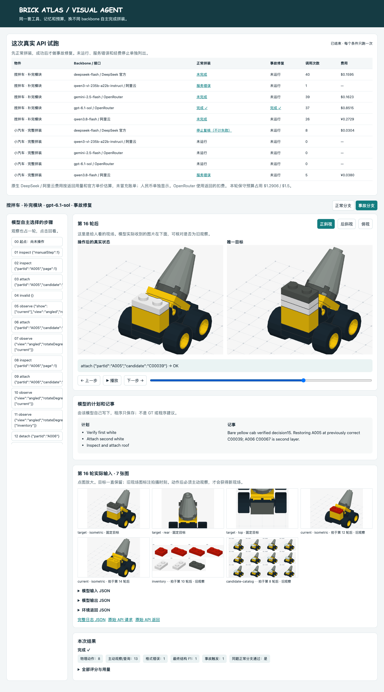

# 统一视觉 Agent：真实试跑结果

[打开本机回放](http://127.0.0.1:8830/agent?run=agent-incident-openai-gpt-6-1-sol-20261030-175050-6d0c) · [实验设计](EXPERIMENTS.zh-CN.md) · [如何运行](RUN.zh-CN.md) · [机器可读结果](pilot.json) · [逐题错误统计](case-audit.json)

所有操作均由 API 模型逐轮决定；没有脚本前缀、GT 提示、自动修复或自动重试。两种物件是预先选定的小样本，不代表全库成绩。

| 物件 / 分支 | Backbone | 结果 | 轮数 | 动作尝试 / 观察查询 | 结构 F1 | 截断 / 格式错误 |
|---|---|---|---:|---:|---:|---:|
| [搅拌车模块 / 正常](http://127.0.0.1:8830/agent?run=agent-normal-deepseek-deepseek-flash-20261030-172831-0a56) | deepseek-flash | 未完成 | 40 | 11 / 12 | 0.000 | 13 / 17 |
| [搅拌车模块 / 正常](http://127.0.0.1:8830/agent?run=agent-normal-qwen-qwen3-vl-235b-a22b-instruct-20261030-173525-5b2c) | qwen3-vl-235b-a22b-instruct | 服务错误，不计能力失败 | 1 | 0 / 0 | 0.000 | 0 / 0 |
| [搅拌车模块 / 正常](http://127.0.0.1:8830/agent?run=agent-normal-google-gemini-2-5-flash-20261030-173527-fbe4) | gemini-2.5-flash | 未完成 | 39 | 16 / 12 | 0.000 | 0 / 9 |
| [搅拌车模块 / 正常](http://127.0.0.1:8830/agent?run=agent-normal-openai-gpt-6-1-sol-20261030-173919-47d5) | gpt-6.1-sol | 完成 | 14 | 4 / 8 | 1.000 | 0 / 1 |
| [搅拌车模块 / 事故](http://127.0.0.1:8830/agent?run=agent-incident-openai-gpt-6-1-sol-20261030-175050-6d0c) | gpt-6.1-sol | 完成 | 23 | 8 / 13 | 1.000 | 0 / 1 |
| [搅拌车模块 / 正常](http://127.0.0.1:8830/agent?run=agent-normal-qwen-qwen3-8-flash-20261030-175754-4136) | qwen3.8-flash | 未完成 | 26 | 16 / 7 | 0.000 | 1 / 2 |
| [小汽车 / 正常](http://127.0.0.1:8830/agent?run=agent-normal-qwen-qwen3-8-flash-20261030-180728-3198) | qwen3.8-flash | 服务错误，不计能力失败 | 5 | 3 / 1 | 0.000 | 0 / 0 |
| [小汽车 / 正常](http://127.0.0.1:8830/agent?run=agent-normal-deepseek-deepseek-flash-20261030-174057-f0e1) | deepseek-flash | 为检查裁判中止，不计失败 | 8 | 0 / 1 | 0.000 | 4 / 7 |

截断和格式错误会重叠：例如输出被截断导致 JSON 不完整。不能把两列相加作为失败总数。动作被拒不等于整题失败；结构 F1 也不代表已成功提交。

## 已经跑通了什么

- 同一个 agent，替换 backbone；模型自行观察、查询、拆装、更新计划并提交。
- Sol 在搅拌车模块正常分支用 14 轮完成，事故分支用 23 轮恢复并完成。事故分支先拆上层，再移走错色件、重装并检查；没有人工接管。
- 初始为当前三视图、目标三视图和一页库存；动作后不自动给新现场图。目标、有限观察记忆、模型自己写的计划和记事按统一规则保存。
- 静态模型、动态直接模型、动态视觉 agent 三组均保留在实验设计中。**本轮新跑的是第三组**，不能把旧接口的成绩直接拿来做三组差值。



## 试跑发现的问题与处理

### 1. 找到并修复了一处裁判误判

一个标准 1×2 板件 `3023` 在库中对应 `3023b`。裁判漏记了后者转 180° 仍是同一摆放，导致 Sol 已经拼对、三个视角像素都一样，却被判失败。现在按该零件的真实对称性接受等价摆放。
保留原分数，离线重放原动作后重新评分，没有重新询问模型、没有替模型改动作。检查受影响的 104 个社区物件、496 道静态故障题，没有题目因此变成“本来就正确”；54 条动态旋转事故参考过程全部通过。详情见 [重新评分](checks/regrade.json)、[静态影响检查](checks/symmetry-scope-audit.json)、[动态影响检查](checks/symmetry-dynamic-replay.json)。

### 2. 接口负担和模型输出仍需进一步做对照

DeepSeek 有多次输出截断；Gemini、Qwen 有观察参数缺失或类型错误，也存在碰撞、无连接和重复选择。当前日志把它们分开记录。不能由这些现象直接断言模型的视觉理解能力不足。
正式实验应先比较更宽松的生成额度、明确错误字段的工具反馈，以及不同候选页大小。这些会改变实验条件，需要重新登记配置并做匹配对照，不能悄悄修改本次失败记录。

### 3. 接口可用性和人为停止单列

原 Qwen3-VL-235B 请求收到阿里云 404，没产生模型回答；随后预先登记补测 Qwen3.8 Flash，仍走阿里云。其小汽车第 5 次请求超时，未自动重试，费用按预留金额计入上限，尚未核对账单。检查裁判时中止的 DeepSeek 小汽车过程保留全部 8 次调用及费用，结果为不适用。

### 4. 核对完整输入与评分记录

30 项离线测试通过；154 份完整 API 回执及其中 1,214 张按顺序发送的图片哈希核对通过。另有 1 次模型不存在和 1 次超时，没有完整回答。每个付费尝试都对应已归档运行。有效 JSON 但参数错误与无法解析的 JSON 已按原始回复重新分类，动作和成败不变。见 [证据检查](checks/evidence-audit.json)、[测试记录](checks/unit-tests.txt)。

## 正常前置与事故分母

共归档 8 条运行记录，其中包含服务错误和中止记录。未运行条件在 `pilot.json.notRun` 逐项写明。未运行／未触发不计为漏检或修复失败。

正常和事故是两次独立自主运行。这能证明该 backbone 在同题正常条件下完成过；它不是同一轨迹中途分叉，不能直接用两者差值计算事故的因果影响。

## 费用

OpenRouter 返回的 `usage.cost` 是服务商扣费记录；DeepSeek 与阿里云按返回 token 和当时官方单价估算，不冒充已核对账单。阿里云以人民币单列；程序按 1 元人民币占用 $0.20 的保守系数控制总预算，不作为账单汇率。所有中止与失败调用均包含在内。

本轮保守预算占用 **$1.2906 / $1.50**，包含未结算超时请求的预留。已返回 OpenRouter 扣费 $1.0138；DeepSeek 用量估算 $0.1899；阿里云已返回用量估算 ¥0.3108。

```json
{
  "capUSD": 1.5,
  "budgetAccountedUpperUSD": 1.2905815219999996,
  "confirmedUSD": 1.0138207099999998,
  "estimatedNativeCosts": {
    "USD": 0.18988705199999995,
    "CNY": 0.3108234
  },
  "unresolvedRequests": 1,
  "includesInterruptedRuns": true,
  "usdPerCnyBudgetFactor": 0.2
}
```

## 完整记录在哪里

- `pilot.json`：预先指定的模型、题目、统一预算及全部运行结果。
- `case-audit.json`：逐题截断、格式、工具反馈与评分。
- `../brickplan-dynamic-arena/runs/agent-*/spectator.json`：逐步现场、目标、模型计划、实际收到的图片。
- 同目录 `log.json`：每轮模型输入、输出、环境返回、图片哈希、生成 ID 和用量。
- 同目录 `api/*.request.json.gz`、`*.response.private.json.gz`：含图片字节的原始 API 请求／响应；不含认证头或 API key。
- 同目录 `record.private.json.gz`：评价者专用状态与事故记录；不会进入模型输入。

## 范围说明

本次实现的是动态视觉 agent。静态模型与动态直接模型实验均保留，正式三组比较还需相同输入与预算的控制。新的 T/I/TI 适配、同现场视觉记忆分叉、真人盲操作、独立物理验证也仍需补齐。
