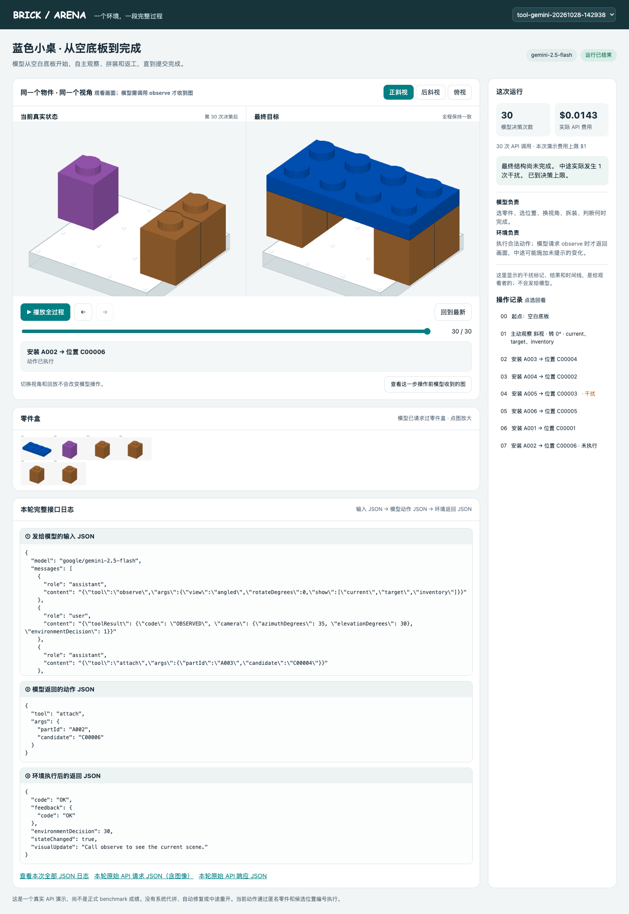
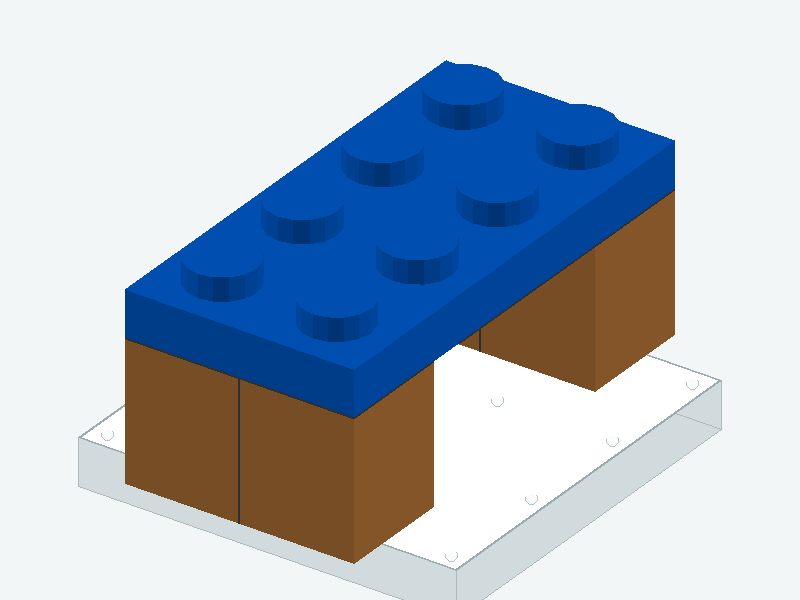

# 动态 Arena：模型调用接口的版本

[打开本机 Arena](http://127.0.0.1:8810/?run=tool-gemini-20261028-142938) · [查看完整逐轮 JSON](http://127.0.0.1:8810/api/log?run=tool-gemini-20261028-142938)

这是针对三项问题修改后的版本。白色底板现在画成有厚度、有凸点的积木平板。积木的碰撞和连接仍使用原来的白色底板规则；图中显示的是这块无限底板在相机范围内的一块窗口。



## 现在模型怎样控制 Arena

**模型每次返回一个 JSON 接口调用。** 起点只收到任务、匿名零件和候选位置编号、接口说明；没有自动附送当前图或目标图。模型要看时自己调用 `observe`。也可以选择装、拆、回看以前主动观察过的图，或结束。

```json
{"tool":"observe","args":{"view":"angled","rotateDegrees":90,"show":["current","target","inventory"]}}
```

这表示：把相机相对上一个角度转 90°，拍斜视图，并取当前结构、目标和零件盒。`rotateDegrees` 支持 `-90`、`0`、`90`、`180`；`view` 还可以是 `top`。模型也可只取需要的图片，例如 `show:["current"]`。

下面是接口测试中实际生成的右转 90° 目标画面。**本次 API 模型没有主动选择这个角度**，因此它不是这次模型运行的输入证据。



```json
{"tool":"attach","args":{"partId":"A004","candidate":"C00002"}}
```

这表示：尝试将一块积木放到一个登记位置。环境检查是否合法、执行后返回 JSON。拆卸为 `{"tool":"detach","args":{"partId":"A004"}}`；结束为 `{"tool":"finish","args":{}}`。动作完成后，观看页面立即显示实际积木变化；模型要取得新画面，仍须自己调用 `observe`。

```json
{
  "code": "OK",
  "feedback": {"code": "OK"},
  "environmentDecision": 3,
  "stateChanged": true,
  "visualUpdate": "Call observe to see the current scene."
}
```

环境的动作反馈只说明“这次动作是否合法”，不宣布有没有额外干扰。干扰按实际已拼结构触发，在真人观看时间线上单独标记，不放进模型输入。整个环境状态、模型历史和零件编号一直延续。

## 页面怎么查完整记录

点右侧任意一步，下面会显示三段 JSON：**发给模型的输入、模型返回的动作、环境执行后的返回**。图片在可读 JSON 里显示为链接和 SHA-256；点击“本轮原始 API 请求 JSON”可看含实际 PNG 数据的完整请求正文。“本轮原始 API 响应 JSON”可看服务商返回的完整响应；“本次全部 JSON 日志”能一次查看全部轮次。

页面左右积木图是**观看者画面**，方便检查动作前后状态。它们没有自动发给模型。看“模型输入 JSON”中的图像列表，或点“查看这一步操作前模型收到的图”，可以确认该轮真正收到哪些图。首轮没有图；模型第 1 次调用 `observe` 后，第 2 轮才收到了它要求的三张图。

| 核查点 | 真实记录 / 验证结果 |
|---|---|
| 模型 | Gemini 2.5 Flash；一次完整 API 运行 |
| 起点模型输入图 | 0 张 |
| 模型主动调用观察接口 | 7 次；API 实际收到并核对的图片 21 张 |
| 模型选择转 90° | 这一次是 0 次；90° 参数已通过独立脚本检查 |
| 积木干扰 | 第 4 次决策后移走一条已安装的桌腿，未通知模型 |
| 决策上限与结果 | 30 次；达到上限时未完成目标 |
| 最终结构 | 5 块目标件里有 2 块正确，另装了一块紫色备用件 |
| API 花费 | **$0.01434064**，30 笔费用均已结算，沿用 $1 演示上限 |

**这一个例子只说明：接口已按模型主动观察的方式运转，而该模型在这次运行中没有完成。** 它不能直接证明静态与动态能力差距。论文要做这个结论，还要给同一批物件跑静态修复、无干扰的正常连续拼装、以及含干扰的动态拼装。

单个零件仍只有一个登记候选位置；这次重点检查连续控制和主动观察接口，不代表完整题库的定位难度。白色底板的三维外观是视觉展示，合法拆装仍由现有物理引擎判断。

[真实运行核查](audit-tools.json) · [页面核查](ui-evidence/tools-checks.json) · [运行结果](runs/tool-gemini-20261028-142938/result.json)

本机链接失效时，双击 [启动动态Arena.command](启动动态Arena.command) 只会恢复观看页面，不会重跑 API。
