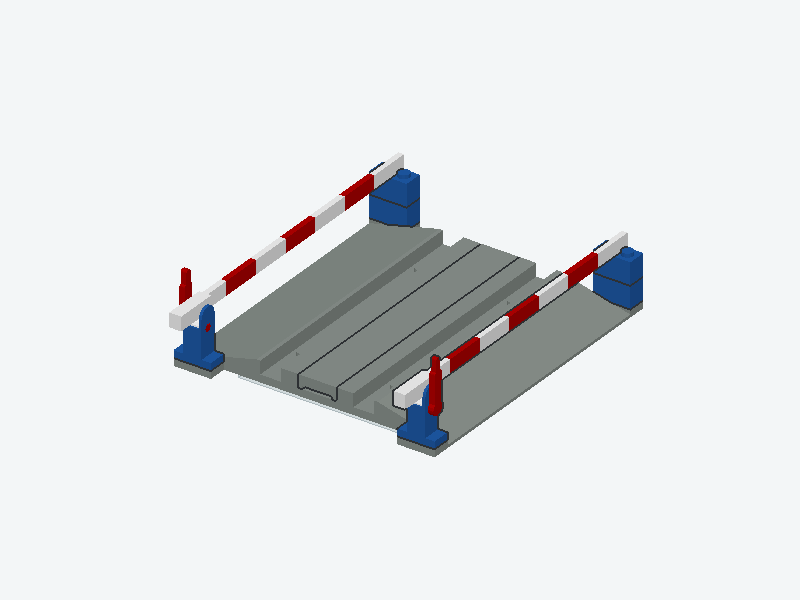
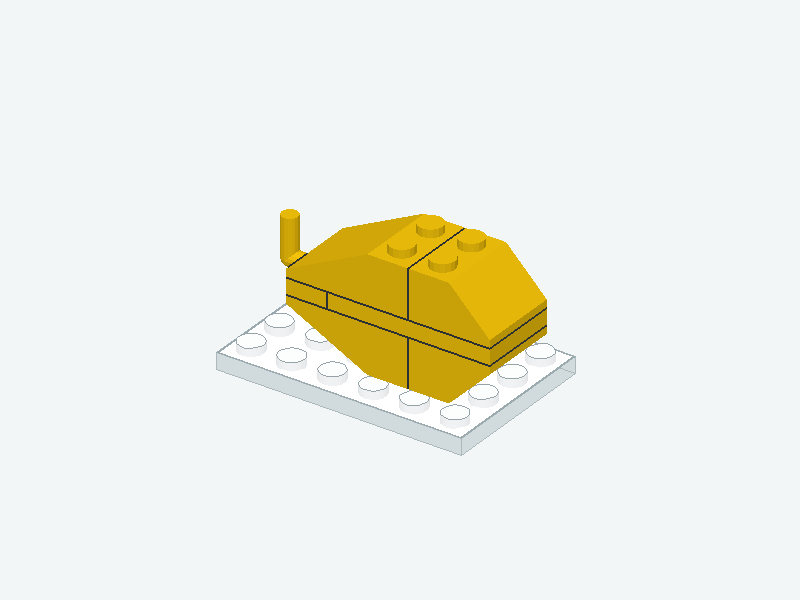

> 本文是清理前的 400 来源历史快照。当前无小人模型库和新增题目请看 [最新整理](NO-FIGURES-AND-NEW-CASES.zh-CN.md)。

# 动态 Arena 迁移与 400 个 LDraw 来源物件

[打开本机题库与物件库](http://127.0.0.1:8810/library) · [查看已有 API 运行回放](http://127.0.0.1:8810/arena?run=incident-anthropic-claude-sonnet-5-5-obj-city-car-20261028-154133)

## 本轮做到哪里

- 当前有效动态题已接到同一个 Arena：**2,138 个运行条件，去除别名后 2,046 道不同任务，103 个物件／模块**。历史结构题保留诊断标记。
- 每道题都有关闭干扰的正常分支；修复分支要求同题、同模型、同库存与接口、同预算的正常分支先成功。
- 前端可选题、看起点和目标、播放逐步拆装、切三视角、放大图、查看当轮模型输入、动作、环境返回和完整日志。
- 库存可翻页，候选位置可分页查看，说明书按需查看；不再自动给模型发每一步的图片。
- 修掉题号泄露错误类别的问题：模型只看到随机回合编号，真实题号只留在评估记录。
- **LDraw 来源库已达到 400 个不同套装：原有 140 个，本轮新增 260 个。** 原文件、作者、许可、来源页面、完整零件列表均保留。没有靠改色、裁切或增加同物件题数凑这个数量。

**必须分清：400 是来源物件／套装数量，不是 400 个已经合格、可运行的动态物件。** 本轮新增来源中，2 个通过完整拼装与缺件修复检查，已生成 4 个新动态条件；134 个在拆装检查中被挡住，124 个还没做完整拆装检查。当前真正接入动态题的物件／模块共 103 个，不能在论文中写成“400 个可运行动态物件”。

## 动态题现在有哪些

| 类型 | 运行条件数 | 模型在里面做什么 |
| --- | ---: | --- |
| 正常拼装 | 193 | 不加干扰，自己把目标拼完 |
| 一次中途干扰 | 1865 | 拼装中发生变化，自己观察、修复并继续 |
| 连续干扰 | 78 | 一回合发生两次或更多变化，包括修复未结束时再受干扰 |
| 库存变化与调配 | 2 | 库存不再支持原拼法，需要拆开重配 |

| 物件范围 | 运行条件数 |
| --- | ---: |
| 完整物件 | 1630 |
| 指定部分收尾 | 221 |
| 零件调配 | 2 |
| 历史结构诊断 | 241 |
| 历史局部诊断 | 44 |

两类历史诊断题共 285 个条件，不混进完整物件的主结论。已移除的洛克菲勒大楼和博物馆屋顶没有重新加回来。

## 这次新接入的完整物件

| 物件 | 参考正常拼装 | 中途修复 | 完整来源 |
| --- | --- | --- | --- |
| 铁路道口 | 从白色凸点底板开始，8 个原始零件全部可操作 | 中途移走一件，再修好；实际干扰要通过可见性检查 | [158-1](https://library.ldraw.org/omr/sets/1021) |
| 芒果 | 从白色凸点底板开始，6 个原始零件全部可操作 | 中途移走一件，再修好；实际干扰要通过可见性检查 | [7276-1](https://library.ldraw.org/omr/sets/183) |

[铁路道口程序检查回放](http://127.0.0.1:8810/arena?run=check-railroad-incident-v3) · [芒果程序检查回放](http://127.0.0.1:8810/arena?run=check-mango-incident-v3)

这些是程序动作检查，用来验证题目能拼、能修；不是 API 模型成绩，也没有经过本轮真人复核。

## 已做的检查

- 全部旧题号能找到原始题目；对全部 127 个“题库适配器 × 物件”组合，实际打开环境并读取工具输入。
- 八种题库适配器逐一检查了：无干扰分支保留相同起点和目标、主动换角度、最后一页库存、候选位置、说明书和历史回看。
- 7 个代表场景各跑正常和干扰分支，共 14 次完整程序回放：椅子、四层书架、小卡车顶部、书架连续干扰、库存返工、铁路道口、芒果，均到达合法目标。
- 正常前提检查会拒绝不同模型、不同题目、失败的正常运行、不同预算以及不同库存。
- 页面检查覆盖题目选择、预览、三视角、回放、模型实际看到的图、JSON 日志、手机宽度。
- 新增 260 个来源逐一检查原文件哈希、完整零件展开、作者、许可、去重与零件不丢失。

核查文件：[全部物件加载](migration-catalogue-check.json)、[观察接口](migration-sensor-check.json)、[完整回放](migration-replay-check.json)、[正常前提](normal-prerequisite-check.json)、[来源审计](source-audit.json)、[页面检查](ui-evidence/migration/checks.json)。

## 400 个来源为什么不能立即全算合格题

主要障碍是当前物理引擎：不少车轮、座椅、车窗、装饰件的 LDraw 网格没有封闭；部分嵌入零件还缺少可用的碰撞定义；一些原始变换不符合引擎目前的刚体检查。也有来源没找到合法的完整拆装路线。

未通过的来源保留完整零件和原始位置，页面标明检查状态。这些来源可以在物件库查看，但尚未成为正式可评分的动态题。较大来源下一步应该选有明确含义的收尾模块，并保留整个物件背景；不能随意裁一团零件就当成新物件。

后续要把“400 个来源”变成更多合格动态题，需要补这些零件的碰撞与连接支持，再逐个检查正常拼装、干扰可修复性、画面清晰度和真人可读性。

## 怎么使用与费用

双击同目录 `启动动态Arena.command`，会打开题库。页面预览和回放不调用模型。运行 API 的命令和输入输出例子见 [Arena 协议](../../benchmark/brickplan-repair/dynamic_arena/PROTOCOL.zh-CN.md)。

**本轮新增 API 费用：$0。** 只做来源下载、环境检查与程序回放；此前真实 API 记录仍保留，可在运行列表查看。

[400 个来源完整列表](MODEL-LIBRARY-400.zh-CN.md) · [机器可读来源库](source-library.json) · [动态题清单](catalogue.json)
