# 无小人模型整理与新题说明

更新：2026-10-29。原库 400 个；其中 218 个整件移出；新增保留 17 个；当前来源库 **199 个**。

**没有为了凑回 400 个而保留人物或把同一个模型换色重复计数。来源数量不是合格动态题数量。**

本次新增可运行物件／模块 **6 个，30 道题**。原有铁路道口和芒果也补齐了静态／动态配对条件。每个物件最多 5 道。

所有新题通过程序合法动作回放和错误可见性检查；尚未经过这轮真人确认，也没有调用付费 API。

## 怎么筛选

- 检查完整零件清单、零件名称、别名及组合件；人头、躯干、手脚、Friends 人偶、微型人形雕像都排除。座椅、杯子等配件不会仅因名字带 Minifig 而误删。
- 带人物的整件来源退出，同时阻止其旧模块进入当前 Arena；原文件和历史实验记录保留。
- 新增优先考虑动物、植物、建筑和机械；重复角色、相似造型、多个对象混在一起或没有可核对预览的候选先留在候选记录中。
- 最终结构和合法性决定成功，GT 动作只是一个可行例子，不要求模型按唯一顺序拼。

## 当前来源类别

|类别|来源数|
|---|---:|
|铁路|13|
|房屋、建筑|23|
|道路车辆|57|
|飞机|23|
|航天器|16|
|动物|27|
|机器人、机械|17|
|植物、食物|9|
|船艇|8|
|家具、日常物件|2|
|其他|4|

## 本次补充的模型

|原模型预览|来源|类别／零件数|当前用途|
|---|---|---|---|
|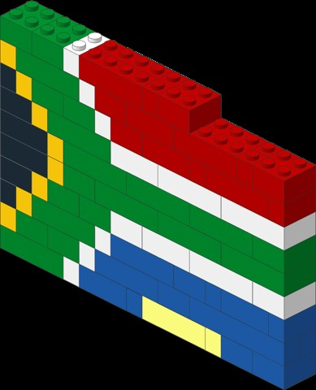|[1869-1 South African Flag](https://library.ldraw.org/omr/sets/37)|家具、日常物件 / 82|指定模块：积木旗帜：顶部完整一行|
||[561412-1 Christmas Tree](https://library.ldraw.org/omr/sets/1472)|植物、食物 / 34|指定模块：圣诞树：树梢收尾|
|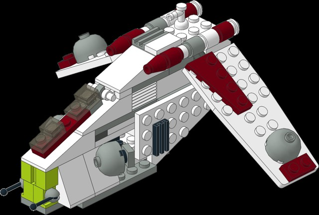|[4490-1 Republic Gunship - Mini](https://library.ldraw.org/omr/sets/519)|航天器 / 90|来源候选；尚不算合格题目|
|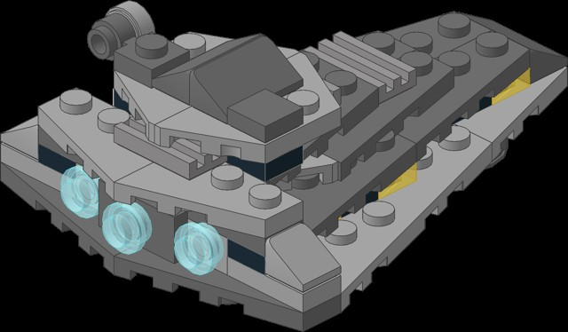|[30277-1 First Order Star Destroyer](https://library.ldraw.org/omr/sets/997)|航天器 / 56|来源候选；尚不算合格题目|
|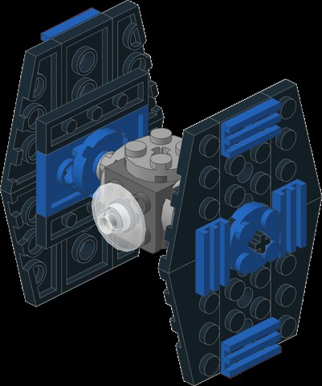|[8028-1 TIE Fighter - Mini](https://library.ldraw.org/omr/sets/120)|航天器 / 44|来源候选；尚不算合格题目|
|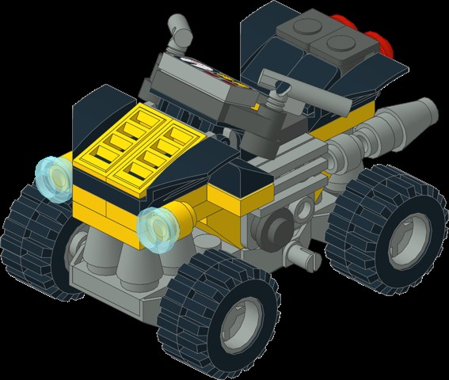|[20014-1 4 x 4 Dynamo](https://library.ldraw.org/omr/sets/25)|机器人、机械 / 69|来源候选；尚不算合格题目|
|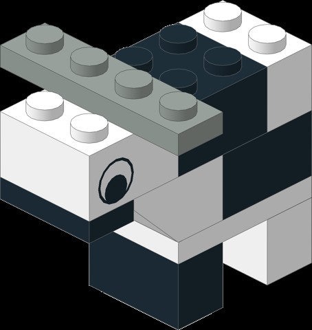|[2132-1 Danone Promotional Set: Cow](https://library.ldraw.org/omr/sets/1042)|动物 / 10|完整物件：Danone Promotional Set: Cow|
|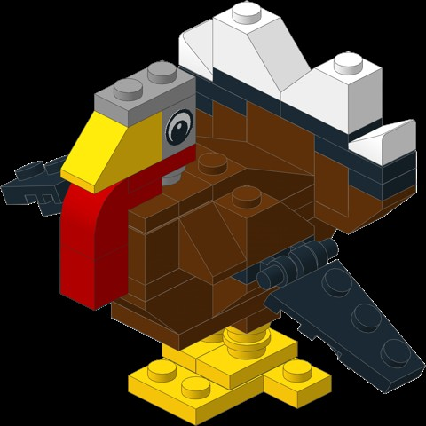|[40011-1 Thanksgiving Turkey](https://library.ldraw.org/omr/sets/1439)|动物 / 54|指定模块：火鸡：扇形尾羽|
|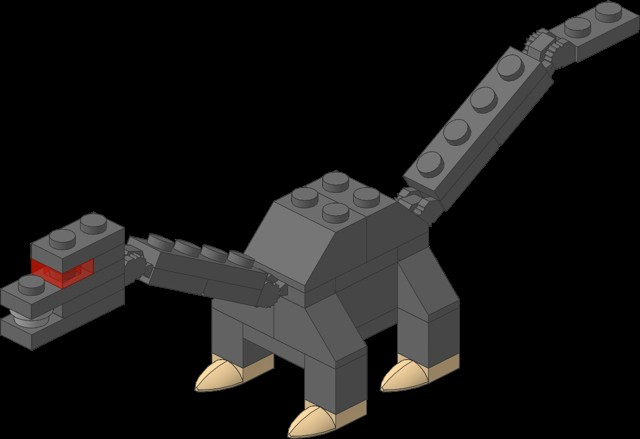|[7210-1 Apatosaurus](https://library.ldraw.org/omr/sets/160)|动物 / 33|来源候选；尚不算合格题目|
|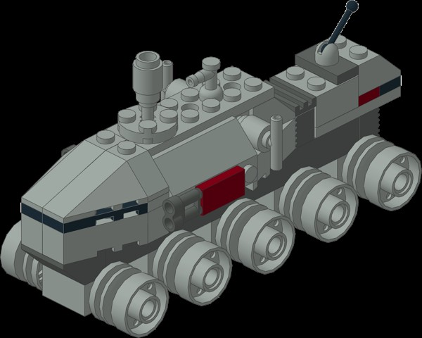|[20006-1 Clone Turbo Tank - Mini](https://library.ldraw.org/omr/sets/873)|航天器 / 65|来源候选；尚不算合格题目|
|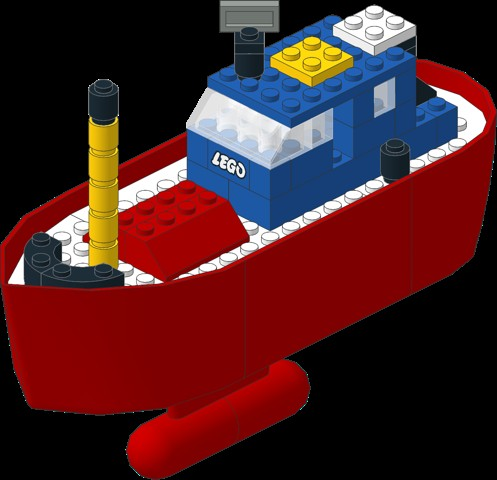|[310-3 Tug](https://library.ldraw.org/omr/sets/232)|船艇 / 44|来源候选；尚不算合格题目|
|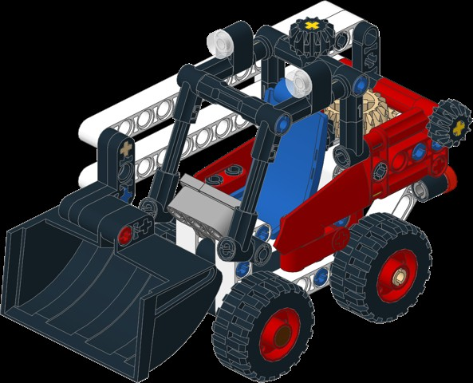|[42116-1 Skid Steer Loader](https://library.ldraw.org/omr/sets/1365)|机器人、机械 / 140|来源候选；尚不算合格题目|
||[40148-1 Year Of The Sheep](https://library.ldraw.org/omr/sets/207)|动物 / 99|来源候选；尚不算合格题目|
|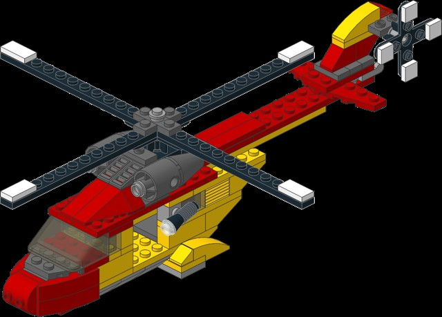|[5866-1 Rotor Rescue](https://library.ldraw.org/omr/sets/1391)|飞机 / 149|来源候选；尚不算合格题目|
|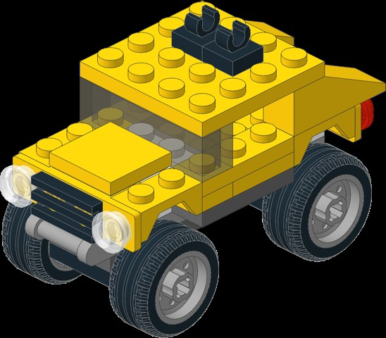|[30283-1 Off-Road](https://library.ldraw.org/omr/sets/260)|道路车辆 / 40|来源候选；尚不算合格题目|
|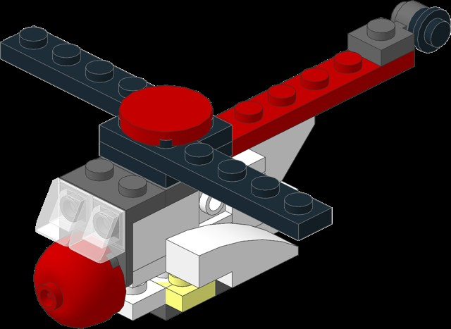|[7609-1 Helicopter](https://library.ldraw.org/omr/sets/140)|飞机 / 28|指定模块：小直升机：主旋翼|
|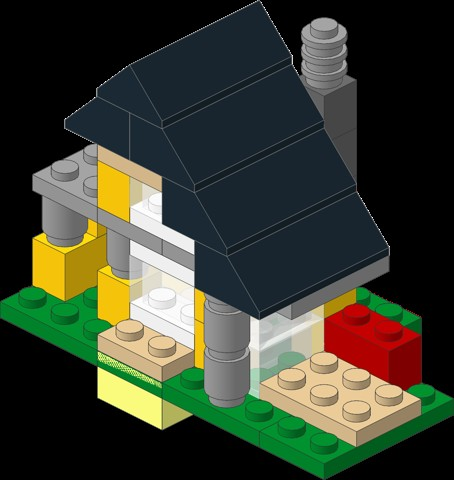|[7796-1 House](https://library.ldraw.org/omr/sets/142)|房屋、建筑 / 56|指定模块：小房屋：完整斜屋顶|

## 题目如何输入、输出和判分

|题型|给模型什么|模型输出什么|GT 与判分|
|---|---|---|---|
|正常拼装|唯一目标、库存、动作接口；通过 observe 请求当前图或目标图，通过 inspect 看零件、位置、说明书|observe / inspect / attach / detach / finish 及参数|无干扰完成全部目标；不限定合法顺序|
|静态修复|出错的当前状态、当前阶段的唯一验收目标、可用零件与操作接口|拆装动作序列或完成声明|恢复当前阶段目标；不强迫提前完成后续步骤|
|动态修复|从白色凸点底板或明确预装模块开始，模型持续接管；中途发生隐藏变化|模型主动观察、拆装、继续完成|实际触发后是否恢复并继续成功；未触发单列，接口错误单列|

下面的错误起点、GT 和触发详情用于人工审查，不会提前透露给模型。

## Railroad Crossing Gate

完整物件；操作 8 块；**中等流程**。这只是步骤规模分组，还不是经过真人表现验证的难度结论。

|Case ID|类型|错误|GT 动作数|
|---|---|---|---:|
|`A4:arena-158-1::control`|正常拼装|正常拼装|8|
|`A4:arena-158-1::missing`|动态修复|少装／被拆走|9|
|`A4:arena-158-1::static-missing`|静态修复|少装／被拆走|1|
|`A4:arena-158-1::wrong-color`|动态修复|颜色被换错|10|
|`A4:arena-158-1::static-wrong-color`|静态修复|颜色被换错|2|

完整 GT（目标状态、合法动作、触发记录）：[数据文件](../../deliverables/brickplan-dynamic-arena/new-objects/arena-158-1/cases.private.json.gz)。

### 少装／被拆走：当前状态与正确目标

|当前：正面斜视|目标：相同视角|当前：背面斜视|目标：相同视角|
|---|---|---|---|
|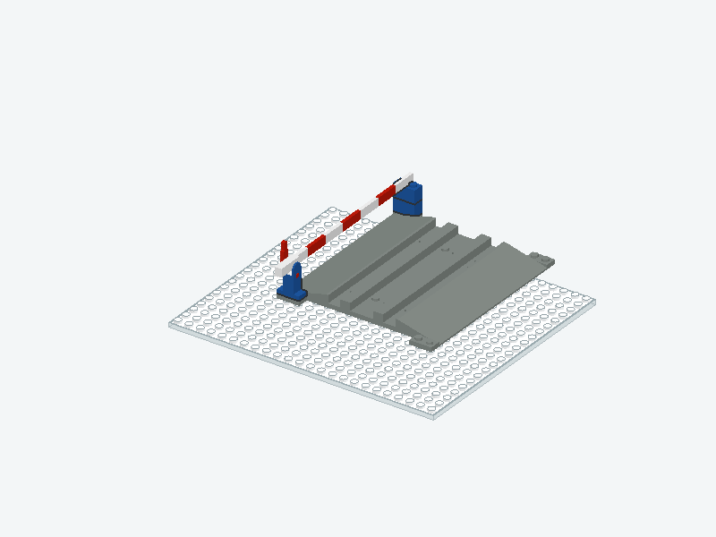||||

GT 可行操作（不是唯一顺序）：

1. 安装 `P1`（812，Train Level Crossing Centre Rail Cap Insert），位置 `P1:goal`。

### 颜色被换错：当前状态与正确目标

|当前：正面斜视|目标：相同视角|当前：背面斜视|目标：相同视角|
|---|---|---|---|
|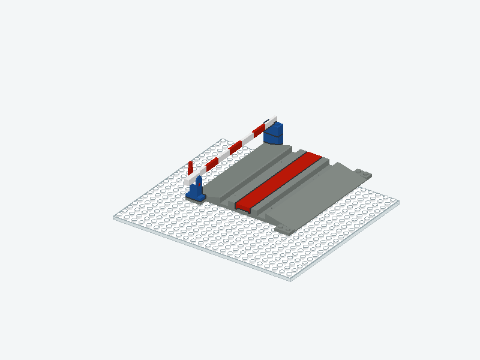||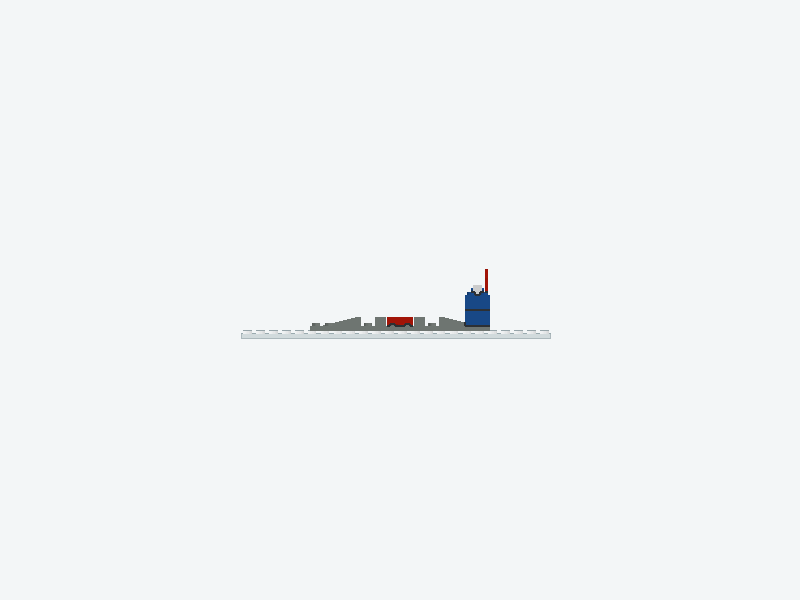|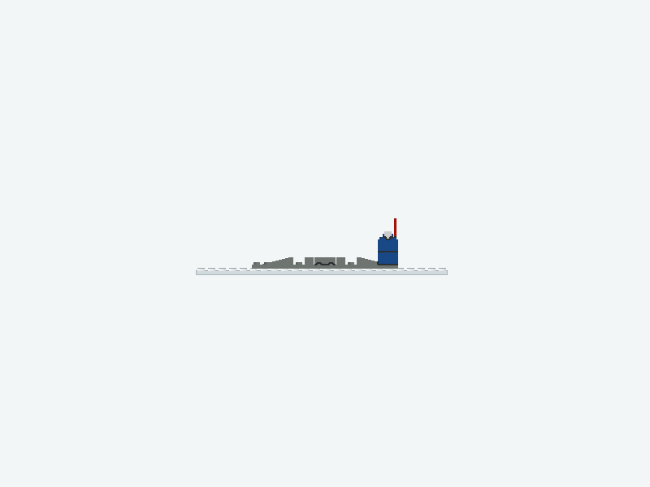|

GT 可行操作（不是唯一顺序）：

1. 拆下 `V7W_P1`（812，Train Level Crossing Centre Rail Cap Insert）。
2. 安装 `P1`（812，Train Level Crossing Centre Rail Cap Insert），位置 `P1:goal`。

## Mango - Suntory Promotional

完整物件；操作 6 块；**短流程**。这只是步骤规模分组，还不是经过真人表现验证的难度结论。

|Case ID|类型|错误|GT 动作数|
|---|---|---|---:|
|`A4:arena-7276-1::control`|正常拼装|正常拼装|6|
|`A4:arena-7276-1::missing`|动态修复|少装／被拆走|7|
|`A4:arena-7276-1::static-missing`|静态修复|少装／被拆走|1|
|`A4:arena-7276-1::wrong-color`|动态修复|颜色被换错|8|
|`A4:arena-7276-1::static-wrong-color`|静态修复|颜色被换错|2|

完整 GT（目标状态、合法动作、触发记录）：[数据文件](../../deliverables/brickplan-dynamic-arena/new-objects/arena-7276-1/cases.private.json.gz)。

### 少装／被拆走：当前状态与正确目标

|当前：正面斜视|目标：相同视角|当前：背面斜视|目标：相同视角|
|---|---|---|---|
|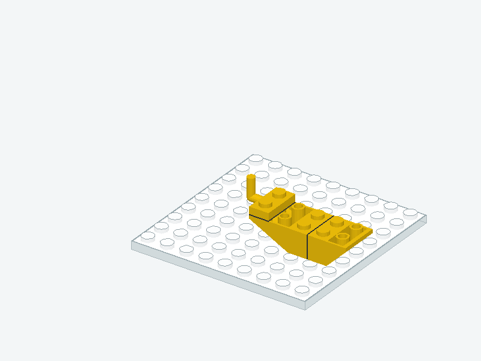||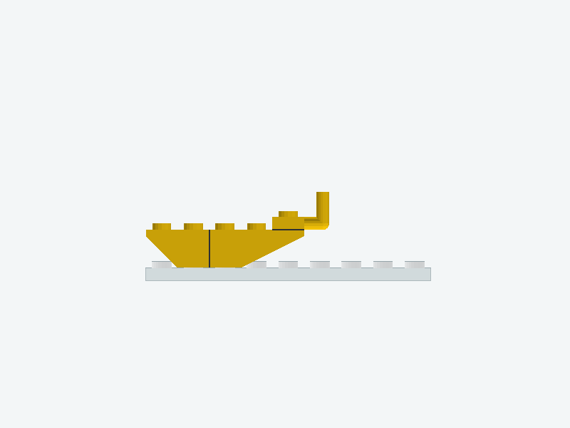|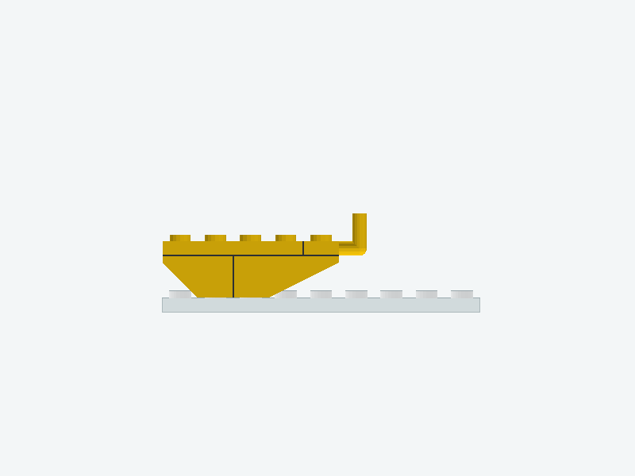|

GT 可行操作（不是唯一顺序）：

1. 安装 `P5`（3020，Plate  2 x  4），位置 `P5:goal`。

### 颜色被换错：当前状态与正确目标

|当前：正面斜视|目标：相同视角|当前：背面斜视|目标：相同视角|
|---|---|---|---|
|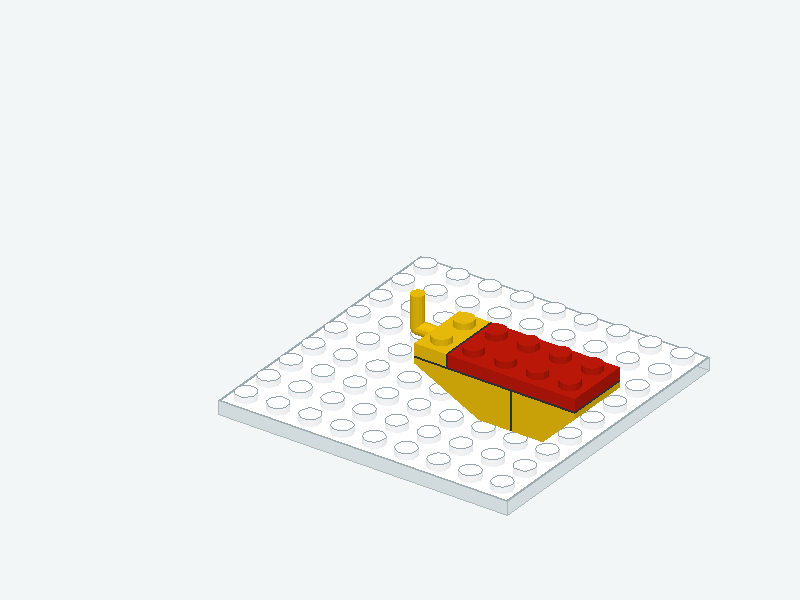||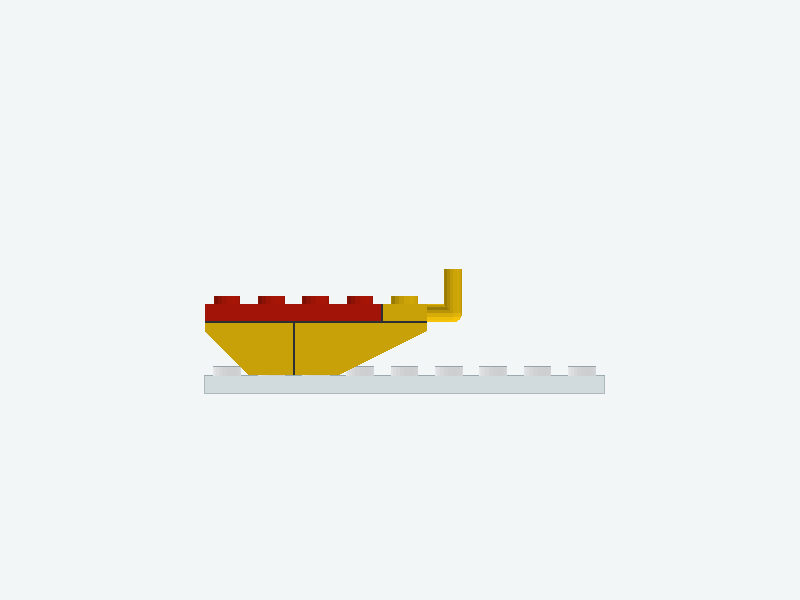||

GT 可行操作（不是唯一顺序）：

1. 拆下 `V7W_P5`（3020，Plate  2 x  4）。
2. 安装 `P5`（3020，Plate  2 x  4），位置 `P5:goal`。

## Danone Promotional Set: Cow

完整物件；操作 10 块；**中等流程**。这只是步骤规模分组，还不是经过真人表现验证的难度结论。

|Case ID|类型|错误|GT 动作数|
|---|---|---|---:|
|`A4:arena-2132-1::control`|正常拼装|正常拼装|10|
|`A4:arena-2132-1::missing`|动态修复|少装／被拆走|11|
|`A4:arena-2132-1::static-missing`|静态修复|少装／被拆走|1|
|`A4:arena-2132-1::rotated`|动态修复|方向装反|12|
|`A4:arena-2132-1::static-rotated`|静态修复|方向装反|2|

完整 GT（目标状态、合法动作、触发记录）：[数据文件](../../deliverables/brickplan-dynamic-arena/new-objects/arena-2132-1/cases.private.json.gz)。

### 少装／被拆走：当前状态与正确目标

|当前：正面斜视|目标：相同视角|当前：背面斜视|目标：相同视角|
|---|---|---|---|
|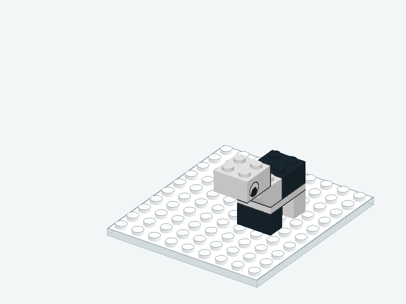||||

GT 可行操作（不是唯一顺序）：

1. 安装 `P6`（3023，~Moved to 3023b），位置 `P6:goal`。

### 方向装反：当前状态与正确目标

|当前：正面斜视|目标：相同视角|当前：背面斜视|目标：相同视角|
|---|---|---|---|
|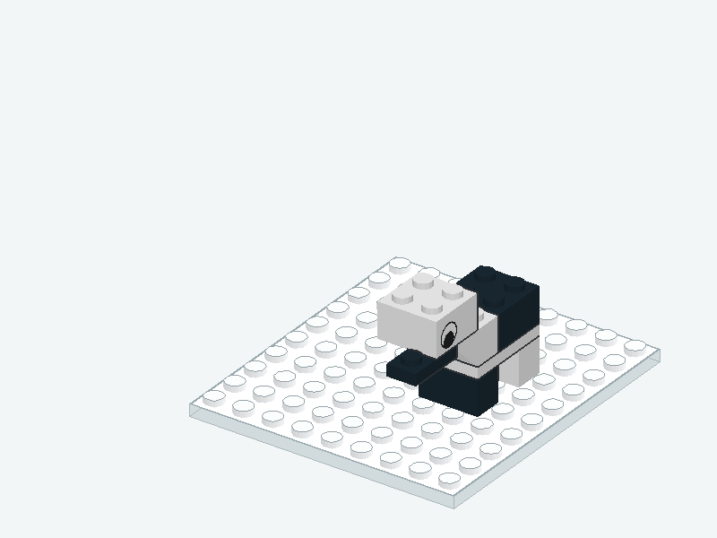|||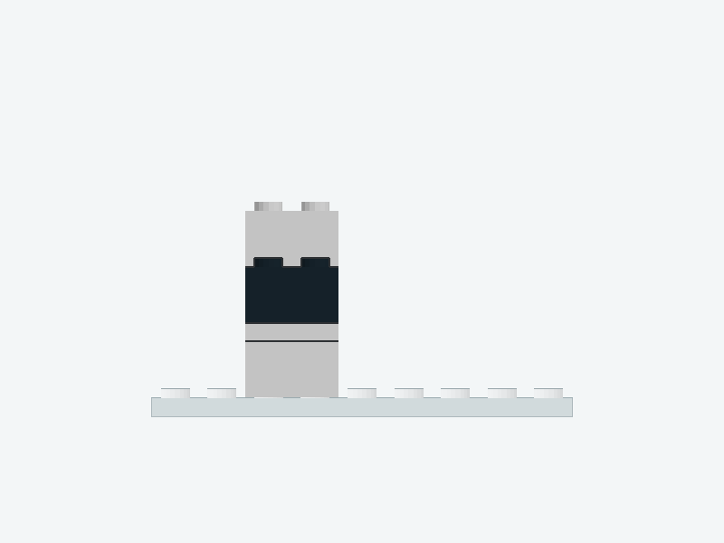|

GT 可行操作（不是唯一顺序）：

1. 拆下 `P6`（3023，~Moved to 3023b）。
2. 安装 `P6`（3023，~Moved to 3023b），位置 `P6:goal`。

## 小房屋：完整斜屋顶

指定模块；操作 5 块；**短流程**。这只是步骤规模分组，还不是经过真人表现验证的难度结论。

|Case ID|类型|错误|GT 动作数|
|---|---|---|---:|
|`QN:house-roof-7796::dynamic::control`|正常拼装|正常拼装|5|
|`QN:house-roof-7796::static::missing`|静态修复|少装／被拆走|1|
|`QN:house-roof-7796::dynamic::missing`|动态修复|少装／被拆走|6|
|`QN:house-roof-7796::static::wrong-color`|静态修复|颜色被换错|2|
|`QN:house-roof-7796::dynamic::wrong-color`|动态修复|颜色被换错|7|

完整 GT（目标状态、合法动作、触发记录）：[数据文件](../../deliverables/brickplan-quality-round/source-expansion/models/house-roof-7796/cases.private.json.gz)。

### 少装／被拆走：当前状态与正确目标

|当前：正面斜视|目标：相同视角|当前：背面斜视|目标：相同视角|
|---|---|---|---|
|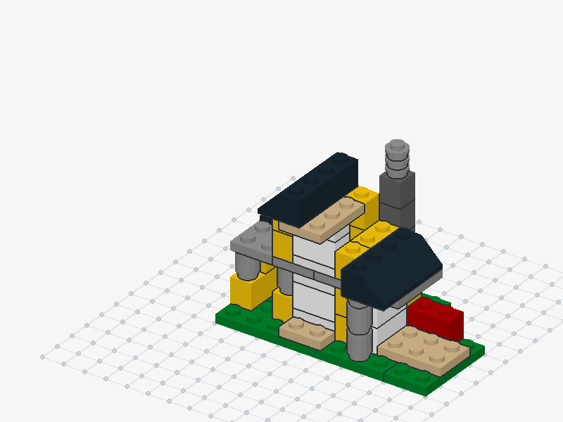|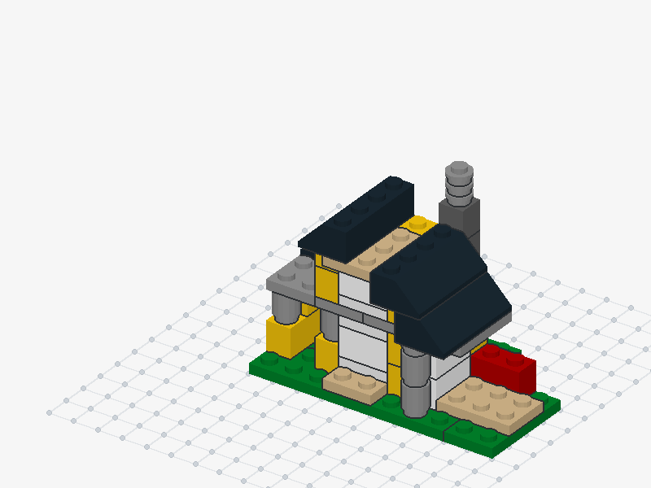|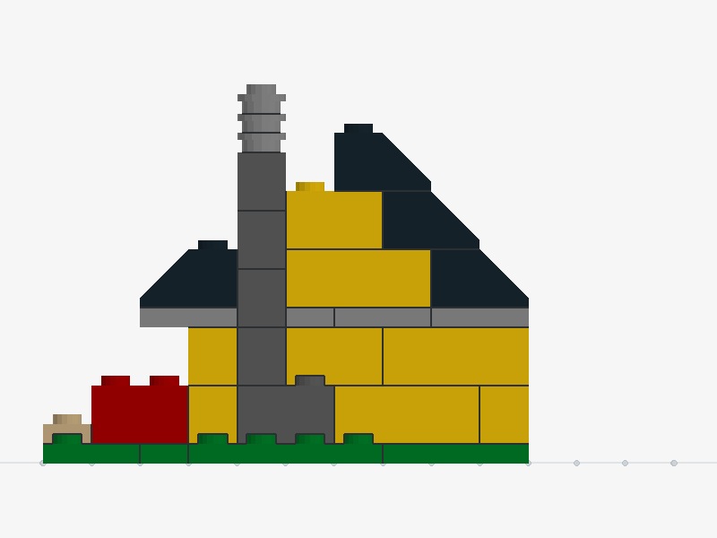||

GT 可行操作（不是唯一顺序）：

1. 安装 `P52`（3037，Slope Brick 45  2 x  4），位置 `P52:goal`。

### 颜色被换错：当前状态与正确目标

|当前：正面斜视|目标：相同视角|当前：背面斜视|目标：相同视角|
|---|---|---|---|
|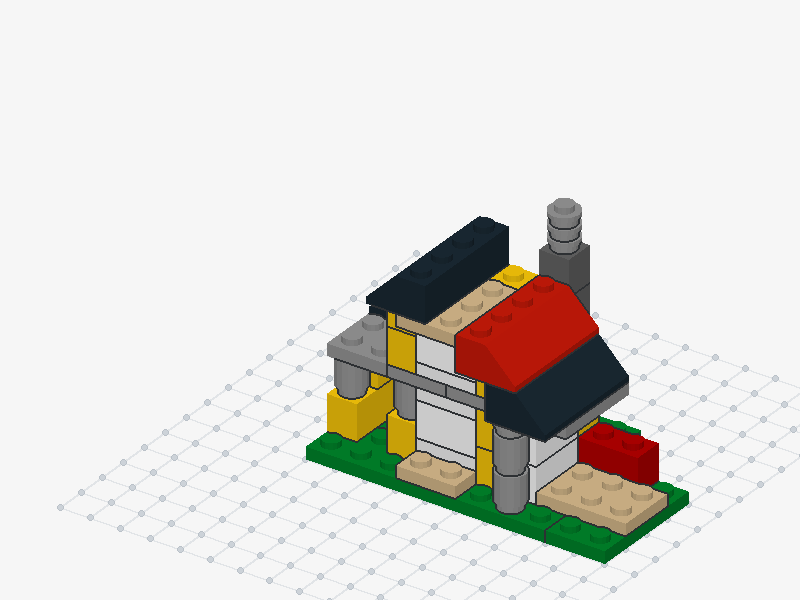||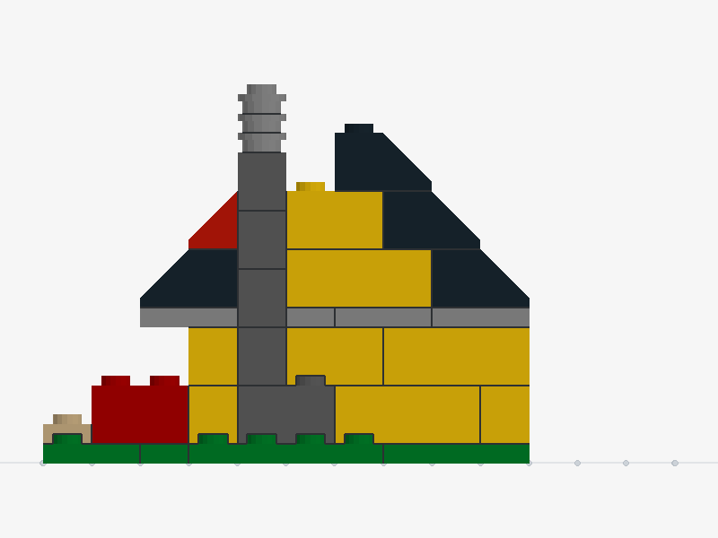|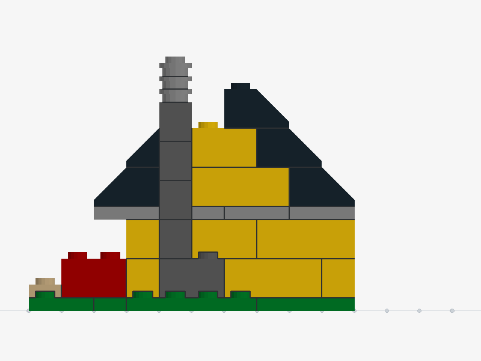|

GT 可行操作（不是唯一顺序）：

1. 拆下 `V7W_P52`（3037，Slope Brick 45  2 x  4）。
2. 安装 `P52`（3037，Slope Brick 45  2 x  4），位置 `P52:goal`。

## 圣诞树：树梢收尾

指定模块；操作 6 块；**短流程**。这只是步骤规模分组，还不是经过真人表现验证的难度结论。

|Case ID|类型|错误|GT 动作数|
|---|---|---|---:|
|`QN:christmas-treetop-561412::dynamic::control`|正常拼装|正常拼装|6|
|`QN:christmas-treetop-561412::static::missing`|静态修复|少装／被拆走|1|
|`QN:christmas-treetop-561412::dynamic::missing`|动态修复|少装／被拆走|7|
|`QN:christmas-treetop-561412::static::wrong-color`|静态修复|颜色被换错|2|
|`QN:christmas-treetop-561412::dynamic::wrong-color`|动态修复|颜色被换错|8|

完整 GT（目标状态、合法动作、触发记录）：[数据文件](../../deliverables/brickplan-quality-round/source-expansion/models/christmas-treetop-561412/cases.private.json.gz)。

### 少装／被拆走：当前状态与正确目标

|当前：正面斜视|目标：相同视角|当前：背面斜视|目标：相同视角|
|---|---|---|---|
|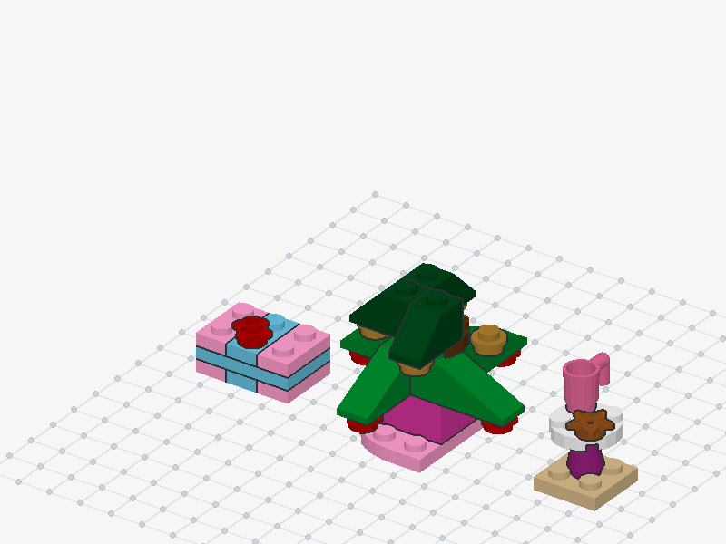||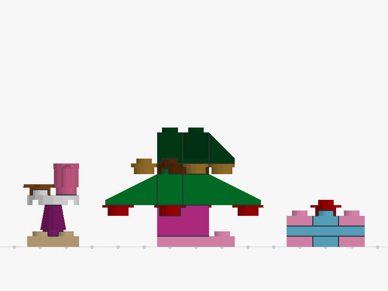|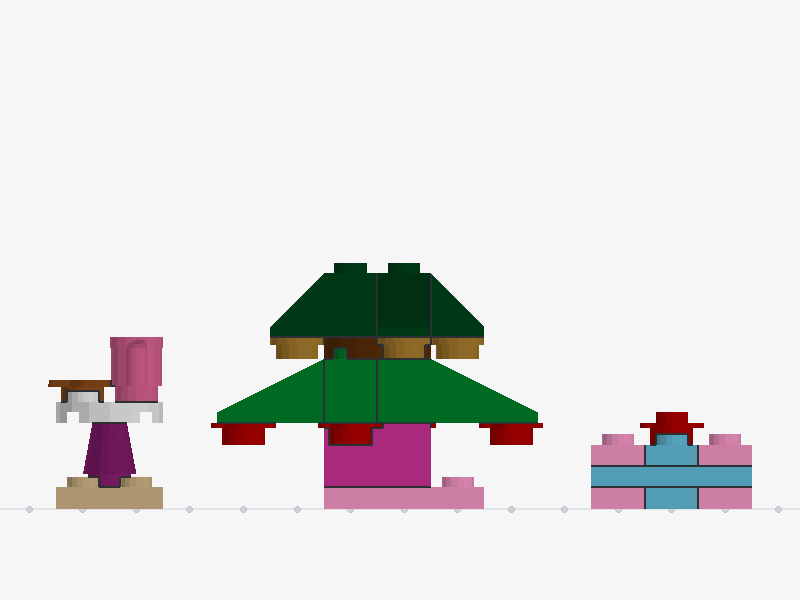|

GT 可行操作（不是唯一顺序）：

1. 安装 `P18`（3040b，Slope Brick 45  2 x  1），位置 `P18:goal`。

### 颜色被换错：当前状态与正确目标

|当前：正面斜视|目标：相同视角|当前：背面斜视|目标：相同视角|
|---|---|---|---|
|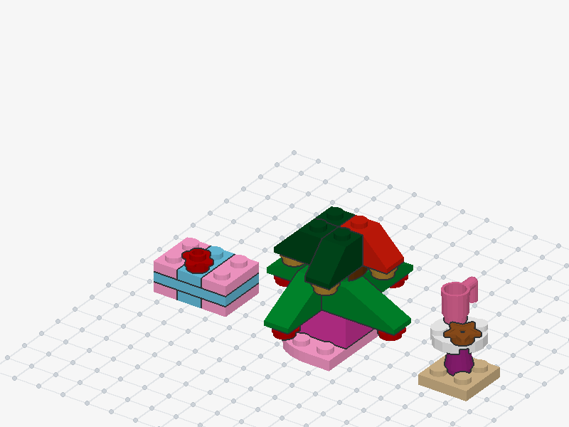|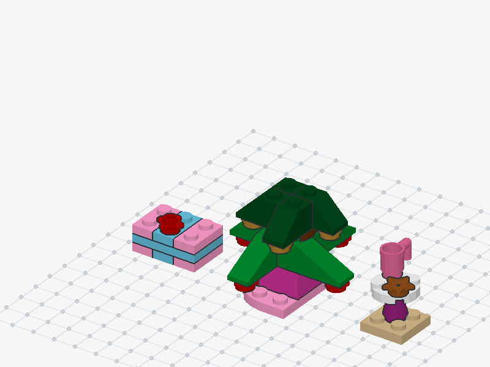|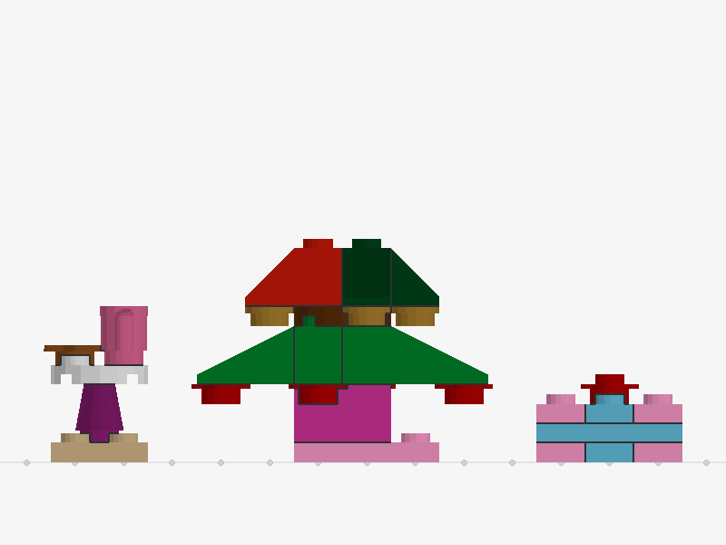||

GT 可行操作（不是唯一顺序）：

1. 拆下 `V7W_P18`（3040b，Slope Brick 45  2 x  1）。
2. 安装 `P18`（3040b，Slope Brick 45  2 x  1），位置 `P18:goal`。

## 火鸡：扇形尾羽

指定模块；操作 13 块；**较长流程**。这只是步骤规模分组，还不是经过真人表现验证的难度结论。

|Case ID|类型|错误|GT 动作数|
|---|---|---|---:|
|`QN:turkey-tail-40011::dynamic::control`|正常拼装|正常拼装|13|
|`QN:turkey-tail-40011::static::missing`|静态修复|少装／被拆走|1|
|`QN:turkey-tail-40011::dynamic::missing`|动态修复|少装／被拆走|14|
|`QN:turkey-tail-40011::static::wrong-color`|静态修复|颜色被换错|2|
|`QN:turkey-tail-40011::dynamic::wrong-color`|动态修复|颜色被换错|15|

完整 GT（目标状态、合法动作、触发记录）：[数据文件](../../deliverables/brickplan-quality-round/source-expansion/models/turkey-tail-40011/cases.private.json.gz)。

### 少装／被拆走：当前状态与正确目标

|当前：正面斜视|目标：相同视角|当前：背面斜视|目标：相同视角|
|---|---|---|---|
|||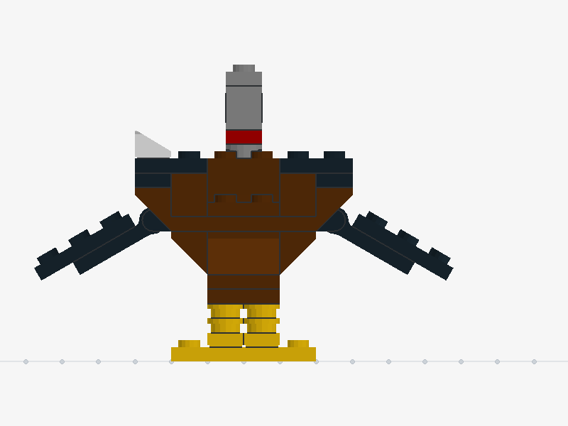||

GT 可行操作（不是唯一顺序）：

1. 安装 `P31`（54200，Slope Brick 31  1 x  1 x  0.667），位置 `P31:goal`。

### 颜色被换错：当前状态与正确目标

|当前：正面斜视|目标：相同视角|当前：背面斜视|目标：相同视角|
|---|---|---|---|
|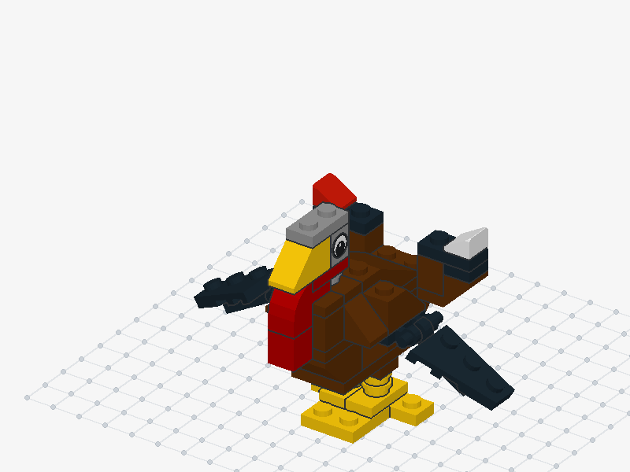|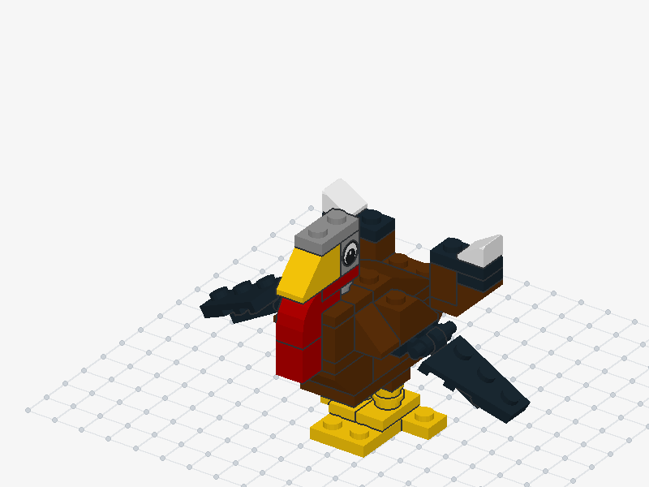|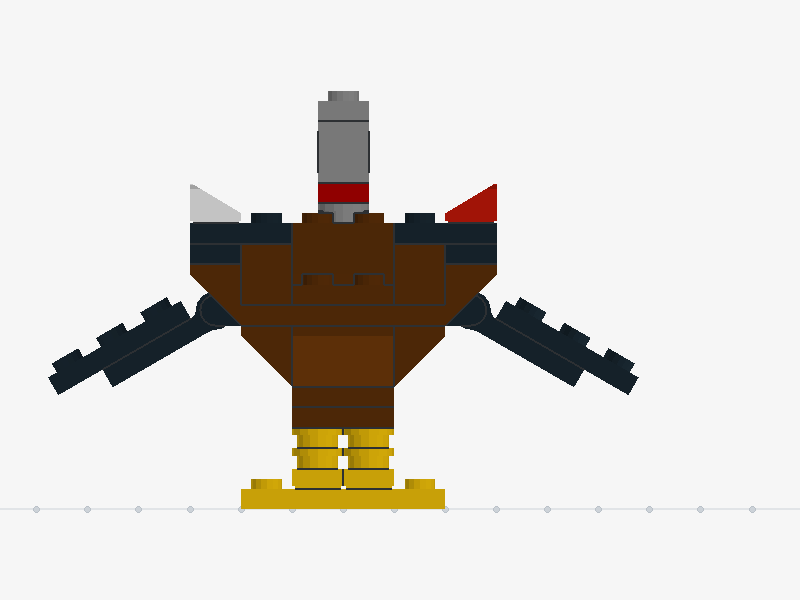||

GT 可行操作（不是唯一顺序）：

1. 拆下 `V7W_P31`（54200，Slope Brick 31  1 x  1 x  0.667）。
2. 安装 `P31`（54200，Slope Brick 31  1 x  1 x  0.667），位置 `P31:goal`。

## 积木旗帜：顶部完整一行

指定模块；操作 8 块；**中等流程**。这只是步骤规模分组，还不是经过真人表现验证的难度结论。

|Case ID|类型|错误|GT 动作数|
|---|---|---|---:|
|`QN:flag-top-1869::dynamic::control`|正常拼装|正常拼装|8|
|`QN:flag-top-1869::static::missing`|静态修复|少装／被拆走|1|
|`QN:flag-top-1869::dynamic::missing`|动态修复|少装／被拆走|9|
|`QN:flag-top-1869::static::wrong-color`|静态修复|颜色被换错|2|
|`QN:flag-top-1869::dynamic::wrong-color`|动态修复|颜色被换错|10|

完整 GT（目标状态、合法动作、触发记录）：[数据文件](../../deliverables/brickplan-quality-round/source-expansion/models/flag-top-1869/cases.private.json.gz)。

### 少装／被拆走：当前状态与正确目标

|当前：正面斜视|目标：相同视角|当前：背面斜视|目标：相同视角|
|---|---|---|---|
|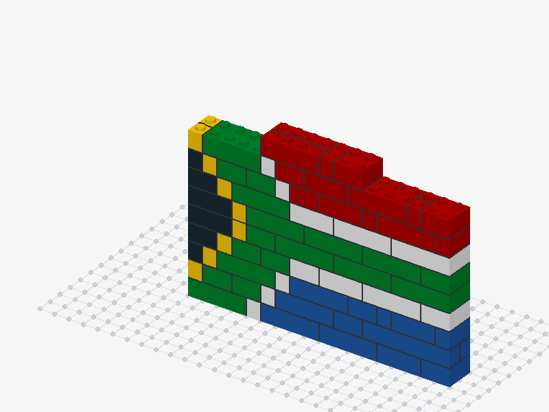|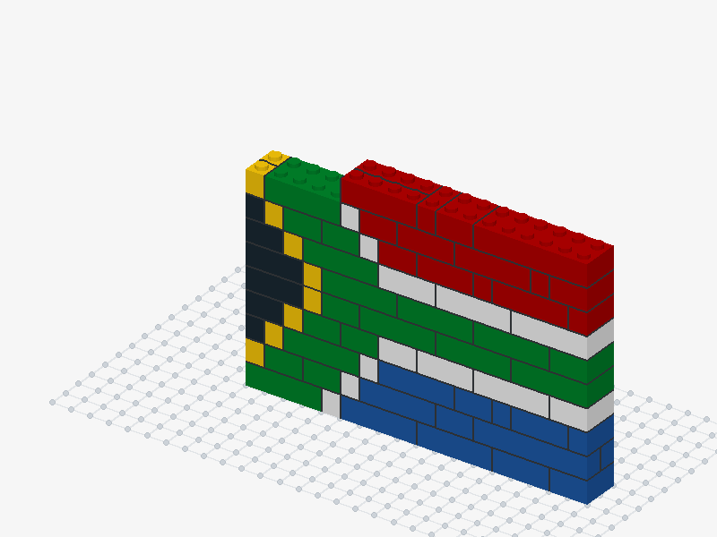|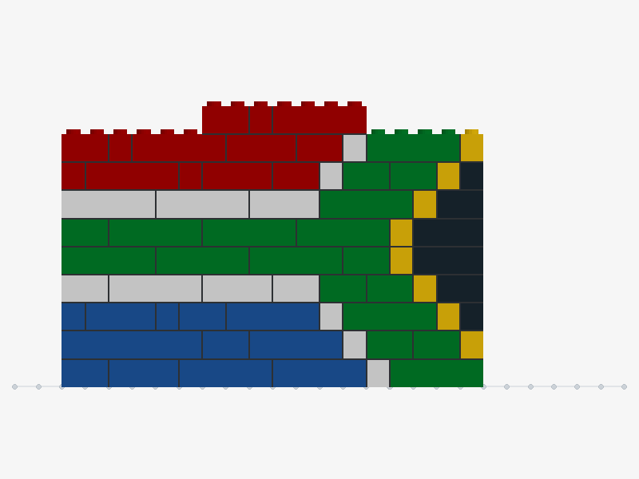|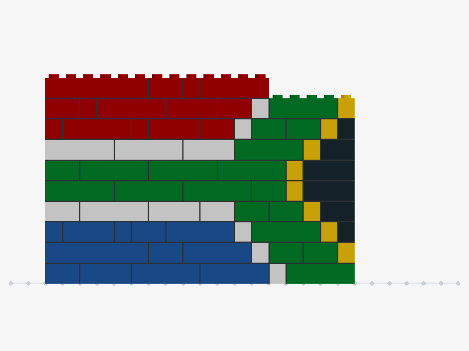|

GT 可行操作（不是唯一顺序）：

1. 安装 `P81`（2456，Brick  2 x  6），位置 `P81:goal`。

### 颜色被换错：当前状态与正确目标

|当前：正面斜视|目标：相同视角|当前：背面斜视|目标：相同视角|
|---|---|---|---|
|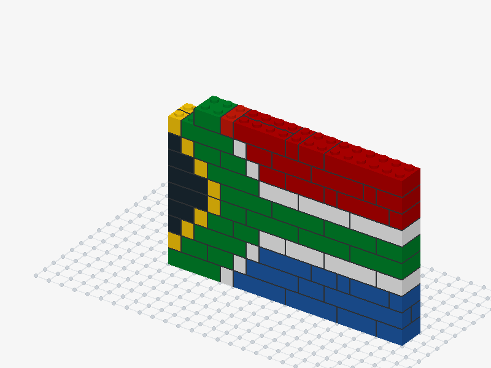|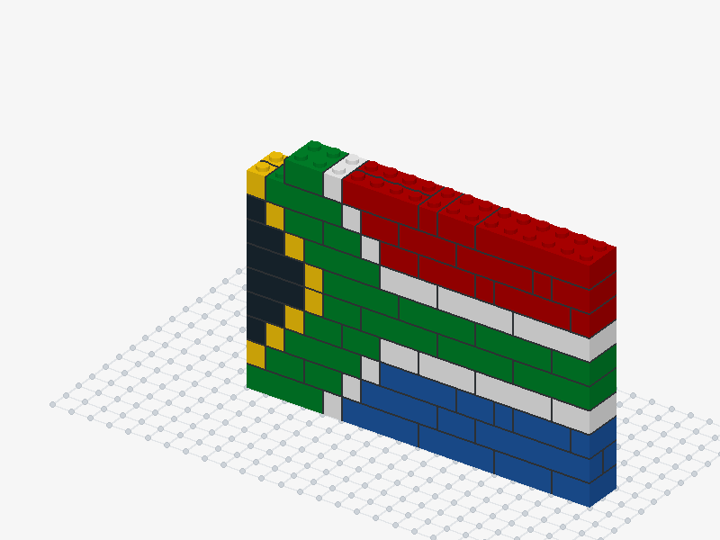|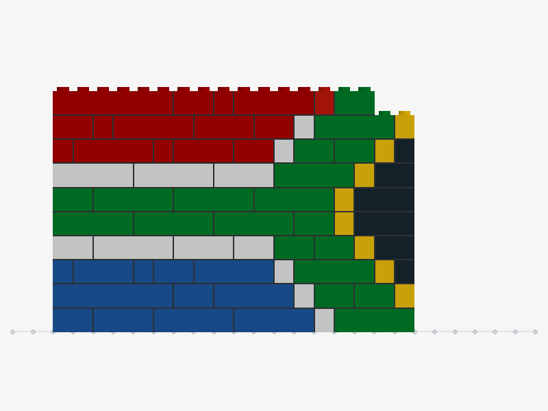||

GT 可行操作（不是唯一顺序）：

1. 拆下 `V7W_P76`（3004，Brick  1 x  2）。
2. 安装 `P76`（3004，Brick  1 x  2），位置 `P76:goal`。

## 小直升机：主旋翼

指定模块；操作 5 块；**短流程**。这只是步骤规模分组，还不是经过真人表现验证的难度结论。

|Case ID|类型|错误|GT 动作数|
|---|---|---|---:|
|`QN:helicopter-rotor-7609::dynamic::control`|正常拼装|正常拼装|5|
|`QN:helicopter-rotor-7609::static::missing`|静态修复|少装／被拆走|1|
|`QN:helicopter-rotor-7609::dynamic::missing`|动态修复|少装／被拆走|6|
|`QN:helicopter-rotor-7609::static::offset`|静态修复|位置偏移|2|
|`QN:helicopter-rotor-7609::dynamic::offset`|动态修复|位置偏移|7|

完整 GT（目标状态、合法动作、触发记录）：[数据文件](../../deliverables/brickplan-quality-round/source-expansion/models/helicopter-rotor-7609/cases.private.json.gz)。

### 少装／被拆走：当前状态与正确目标

|当前：正面斜视|目标：相同视角|当前：背面斜视|目标：相同视角|
|---|---|---|---|
|||||

GT 可行操作（不是唯一顺序）：

1. 安装 `P25`（3666，Plate  1 x  6），位置 `P25:goal`。

### 位置偏移：当前状态与正确目标

|当前：正面斜视|目标：相同视角|当前：背面斜视|目标：相同视角|
|---|---|---|---|
|||||

GT 可行操作（不是唯一顺序）：

1. 拆下 `P25`（3666，Plate  1 x  6）。
2. 安装 `P25`（3666，Plate  1 x  6），位置 `P25:goal`。

## 还没有通过的部分

部分新来源仍缺少闭合碰撞网格、连接定义或完整合法拼装路径，仍留在来源候选层，不拿它们统计模型失败。模块题的预装上下文作为固定装配体；不声称验证了整套大模型从零拼装。像素差异检查也不等同于真人一定看得懂。

## 移出的原库模型

|套装|名称|依据|
|---|---|---|
|10001-1|Metroliner|Minifig Head with Standard Grin Pattern (Blocked Hollow Stud)；~Minifig Hips (Obsolete)|
|10036-1|Pizza To Go|Minifig Head with Standard Grin and Pointed Moustache Pattern；Minifig Torso with Chef Pattern|
|10128-1|Train Level Crossing|Minifig Head with Standard Grin Pattern (Blocked Hollow Stud)；Minifig Torso|
|10156-1|LEGO Truck|Minifig Head with Standard Grin and Sunglasses Pattern；Minifig Torso with Zipper Jacket and  3 Pockets Pattern|
|10159-1|City Airport|~Minifig Hips (Obsolete)；Minifig Arm Right|
|10213-1|Shuttle Adventure|~Minifig Hips (Obsolete)；~Minifig Leg Right (Obsolete)|
|31009-1|Small Cottage|~Minifig Hips and Legs (Obsolete)；Minifig Torso|
|1808-1|Light Aircraft and Ground Support|~Minifig Leg Right (Obsolete)；~Minifig Leg Left (Obsolete)|
|4002-1|Riptide Racer|Minifig Torso with #1 Racing Pattern；~Minifig Hips (Obsolete)|
|4005-1|Tug Boat|~Minifig Hips (Obsolete)；~Minifig Leg Right (Obsolete)|
|7810-1|Steam Engine|~Minifig Leg Right (Obsolete)；~Minifig Leg Left (Obsolete)|
|10037-1|Breezeway Cafe|~Minifig Hips (Obsolete)；~Minifig Leg Right (Obsolete)|
|10158-1|High Speed Train Car|Minifig Head with Standard Grin Pattern (Blocked Hollow Stud)；Minifig Torso|
|10184-1|Town Plan|Minifig Head with Standard Grin Pattern (Blocked Hollow Stud)；Minifig Torso with Town Vest with Pockets and Striped Tie Pattern|
|10194-1|Emerald Night|Minifig Torso with Suit and Red Tie with Train Logo Pattern；~Minifig Leg Right (Obsolete)|
|10233-1|Horizon Express|Minifig Head with Hollow Stud；Minifig Head with Standard Grin Pattern (Hollow Stud)|
|10261-1|Roller Coaster|~Minifig Hips and Legs (Obsolete)；~Minifig Torso without Front or Back|
|10271-1|Fiat 500|Minifig Head with Hollow Stud|
|1472-1|Holiday Home|~Minifig Leg Right (Obsolete)；~Minifig Leg Left (Obsolete)|
|1484-1|Weetabix Town House|Minifig Head with Standard Grin Pattern (Blocked Hollow Stud)；Minifig Torso with Red Horizontal Stripes Pattern|
|1489-1|Mobile Car Crane|Minifig Head with Standard Grin Pattern (Blocked Hollow Stud)；Minifig Torso with Red Dungarees Pattern|
|1490-1|Town Bank|~Minifig Leg Right (Obsolete)；~Minifig Leg Left (Obsolete)|
|1572-1|Super Tow Truck|~Minifig Hips and Legs (Obsolete)；Minifig Torso with Blue Dungarees Pattern|
|1682-1|Space Shuttle|~Minifig Hips (Obsolete)；~Minifig Leg Left (Obsolete)|
|1775-1|Jet|~Minifig Leg Right (Obsolete)；~Minifig Leg Left (Obsolete)|
|1792-1|Pleasure Cruiser|Minifig Head with Standard Grin and Sunglasses Pattern；Minifig Torso|
|1854-1|House with Roof-Windows ( Velux )|Minifig Head with Standard Woman Pattern；Minifig Torso with Plain Shirt with Pockets Pattern|
|21006-1|The White House|Minifig Head with Blocked Hollow Stud|
|21318-1|Tree House|Minifig Hips and Legs Short without Hole；Minifig Torso|
|21325-1|Medieval Blacksmith|Minifig Head with Hollow Stud|
|30311-1|Swamp Police Helicopter|~Minifig Hips (Obsolete)；~Minifig Leg Left (Obsolete)|
|30312-1|Demolition Driller|~Minifig Hips (Obsolete)；~Minifig Leg Left (Obsolete)|
|31025-1|Mountain Hut|~Minifig Hips and Legs (Obsolete)；Minifig Torso|
|31038-1|Changing Seasons|Minifig Head with Hollow Stud；Minifig Head with Brown Eyebrows, Open Lopsided Grin and White Pupils Pattern (Hollow Stud)|
|31048-1|Lakeside Lodge|~Minifig Hips and Legs (Obsolete)；Minifig Torso with Blue Plaid Shirt Pattern|
|31063-1|Beachside Vacation|~Minifig Hips (Obsolete)；~Minifig Leg Right (Obsolete)|
|31066-1|Space Shuttle Explorer|~Minifig Hips (Obsolete)；~Minifig Leg Right (Obsolete)|
|31084-1|Pirate Roller Coaster|Minifig Head with Black Skull Type 1 (Smiling) (Blocked Hollow Stud) Pattern；~Minifig Hips and Legs (Obsolete)|
|3178-1|Seaplane|Minifig Head with Silver Sunglasses, Eyebrows Wavy and Thin Grin Pattern；Minifig Torso with Blue Plaid Shirt Pattern|
|3179-1|Repair Truck|Minifig Head with Glasses, Thin Brown Eyebrows, Smile Pattern (Hollow Stud)；Minifig Torso with Blue Shirt and Safety Stripes Pattern|
|3181-1|Passenger Plane|Minifig Head with Teeth, Pupils, Brown Eyebrows Pattern；Minifig Torso with Jacket over White Button Down Shirt Pattern|
|3221-1|LEGO Truck|Minifig Head with Standard Grin Pattern (Blocked Hollow Stud)；Minifig Torso with V-Neck Shirt and Blue Overalls Pattern|
|6678-1|Pneumatic Crane|Minifig Head with Standard Grin Pattern (Blocked Hollow Stud)；Minifig Torso|
|6679-1|Dark Shark|Minifig Head with Standard Grin Pattern (Solid Stud)；Minifig Torso|
|6682-1|Cement Mixer|Minifig Head with Standard Grin Pattern (Blocked Hollow Stud)；Minifig Torso with Black Dungarees Pattern|
|6683-1|Burger Stand|Minifig Head with Standard Grin Pattern (Blocked Hollow Stud)；Minifig Torso with Chef Pattern|
|6689-1|Post-Station|Minifig Head with Standard Grin Pattern (Blocked Hollow Stud)；~Minifig Hips (Obsolete)|
|6690-1|Snorkel Pumper|Minifig Torso with Yellow Buttons and Grey Belt Sticker；~Minifig Hips and Legs (Standing) (Obsolete)|
|6698-1|RV with Speedboat|Minifig Head with Standard Grin Pattern (Blocked Hollow Stud)；Minifig Torso|
|6699-1|Cycle Fix-It Shop|~Minifig Hips (Obsolete)；~Minifig Leg Right (Obsolete)|
|10002-1|Railroad Club Car|Minifig Head with Freckle Nose and Standard Grin Pattern；Minifig Torso with Palm Tree Pattern|
|6102-1|Castle Mini Figures|~Minifig Hips (Obsolete)；~Minifig Leg Left (Obsolete)|
|3718-1|Small Cafe|Figure Fabuland Torso with Red Collar Pattern|
|6507-1|Mini Dumper|Minifig Head with Standard Grin Pattern (Blocked Hollow Stud)；Minifig Torso with Blue Dungarees Pattern|
|1969-1|Mini Robot|Minifig Head with Headset Over Fabuland Red Hair and Eyebrows Pattern；Minifig Torso with Space Police II and Radio Pattern|
|7246-1|Mini Digger|~Minifig Leg Right (Obsolete)；~Minifig Leg Left (Obsolete)|
|30091-1|Desert Rover|~Minifig Hips and Legs, Sitting (Obsolete)；Minifig Torso with Waistcoat, White Shirt and Bandolier Pattern|
|30102-1|Desk|Minifig Head with Blocked Hollow Stud|
|30210-1|Frodo with Cooking Corner|Minifig Head with LOTR Worried / Smile 2-Sided Pattern；Minifig Torso with LOTR Button Shirt with Braces Pattern|
|167-1|Loading Ramp and Car Transport Wagon|Minifig Head with Standard Grin Pattern (Blocked Hollow Stud)；Minifig Torso with Suit and Tie Pattern|
|605-1|Street Sweeper|Minifig Head with Standard Grin Pattern (Solid Stud)；Minifig Torso|
|620-1|Fireman's Car|Minifig Head with Standard Grin Pattern (Blocked Hollow Stud)；Minifig Torso with Yellow Buttons and Grey Belt Sticker|
|361-2|Garage|~Minifig Hips (Obsolete)；~Minifig Leg Right (Obsolete)|
|6609-1|Race Car|~Minifig Hips and Legs (Obsolete)；Minifig Torso with Vertical Striped Red/Blue Pattern|
|6600-1|Police Patrol|~Minifig Hips and Legs (Obsolete)；Minifig Torso with White Buttons and Police Badge Plain Sticker|
|6602-1|Fire Chief's Car|~Minifig Hips and Legs (Obsolete)；Minifig Torso with Fire Fighter Five Button Pattern|
|6611-1|Fire Chief's Car|Minifig Torso with Fire Fighter Five Button Pattern；Minifig Head with Standard Grin Pattern (Blocked Hollow Stud)|
|6629-1|Ambulance|~Minifig Leg Right (Obsolete)；~Minifig Leg Left (Obsolete)|
|6680-1|Ambulance|~Minifig Leg Right (Obsolete)；~Minifig Leg Left (Obsolete)|
|6691-1|Red Cross Helicopter|~Minifig Hips and Legs (Obsolete)；Minifig Torso with Red Cross Pattern|
|7815-1|Passenger Carriage / Sleeper|Minifig Head with Standard Grin Pattern (Solid Stud)；Minifig Torso|
|7821-1|Overhead Gantry and Lighting Maintenance Wagon|Minifig Head with Standard Grin Pattern (Blocked Hollow Stud)；Minifig Torso with Patch Pocket Pattern|
|7866-1|Remote Controlled Road Crossing|Minifig Head with Standard Grin Pattern (Blocked Hollow Stud)；Minifig Torso with Patch Pocket Pattern|
|106-1|UNICEF Van|Minifig Head with Standard Grin Pattern (Blocked Hollow Stud)；Minifig Torso with Patch Pocket Pattern|
|6368-1|Jet Airliner|~Minifig Leg Right (Obsolete)；~Minifig Leg Left (Obsolete)|
|6603-1|Shovel Truck|Minifig Head with Standard Grin Pattern (Blocked Hollow Stud)；Minifig Torso with Autoroute Pattern|
|6604-1|Formula-I Racer|Minifig Head with Standard Grin Pattern (Solid Stud)；Minifig Torso|
|6631-1|Steam Shovel|Minifig Head with Standard Grin Pattern (Blocked Hollow Stud)；Minifig Torso with Black Dungarees Pattern|
|1528-1|Dragster|~Minifig Leg Right (Obsolete)；~Minifig Leg Left (Obsolete)|
|6612-1|Fire Chief's Car|~Minifig Hips and Legs (Obsolete)；Minifig Torso with Fire Fighter Five Button Pattern|
|6522-1|Highway Patrol|Minifig Head with Standard Grin Pattern (Solid Stud)；Minifig Torso with Zipper and Police Badge Plain Pattern|
|6523-1|Red Cross|~Minifig Leg Right (Obsolete)；~Minifig Leg Left (Obsolete)|
|6357-1|Stunt 'Copter N' Truck|Minifig Torso with "S" Logo Red / Black Pattern；Minifig Head with Standard Grin Pattern (Solid Stud)|
|6530-1|Sport Coupe|~Minifig Leg Right (Obsolete)；~Minifig Leg Left (Obsolete)|
|4543-1|Railroad Tractor Flatbed|~Minifig Leg Right (Obsolete)；~Minifig Leg Left (Obsolete)|
|6531-1|Flame Chaser|~Minifig Hips and Legs, Sitting (Obsolete)；Minifig Torso with White Diagonal Zip and Pocket Pattern|
|6351-1|Surf N' Sail Camper|Minifig Head with Standard Grin Pattern (Blocked Hollow Stud)；Minifig Torso with Red Truck Pattern|
|6512-1|Landscape Loader|Minifig Head with Standard Grin Pattern (Blocked Hollow Stud)；Minifig Torso with Red Dungarees Pattern|
|6344-1|Jet Speed Justice|~Minifig Hips and Legs (Obsolete)；Minifig Torso with Jacket, Tie and Police Badge Yellow Star Pattern|
|6536-1|Aero Hawk|Minifig Head with Standard Grin and Sunglasses Pattern；Minifig Torso with Bomber Jacket & Black Shirt Pattern|
|1702-1|Fire Fighter 4 x 4|Minifig Head with Standard Grin Pattern (Blocked Hollow Stud)；~Minifig Hips (Obsolete)|
|4544-1|Car Transport Wagon with Car|~Minifig Leg Right (Obsolete)；~Minifig Leg Left (Obsolete)|
|6625-1|Speed Trackers|Minifig Head with Standard Grin and Sunglasses Pattern；Minifig Torso with Zipper Jacket and Police Logo Pattern|
|2882-1|Speedboat|~Minifig Leg Right (Obsolete)；~Minifig Leg Left (Obsolete)|
|6490-1|Amazon Crossing|~Minifig Leg Right (Obsolete)；~Minifig Leg Left (Obsolete)|
|6325-1|Package Pick-Up|~Minifig Hips and Legs (Obsolete)；Minifig Arm Left|
|6470-1|Mini Dump Truck|Minifig Head with Standard Grin Pattern (Blocked Hollow Stud)；Minifig Torso with Blue Shirt and Safety Stripes Pattern|
|30090-1|Desert Glider|~Minifig Hips and Legs, Sitting (Obsolete)；Minifig Torso with Aviator Jacket with Eagle and "SMH" on Back Pattern|
|30201-1|Ghost|Minifig Head with Blocked Hollow Stud；Minifig Torso|
|30313-1|Garbage Truck|~Minifig Hips (Obsolete)；~Minifig Leg Left (Obsolete)|
|164-1|Passenger Wagon|~Minifig Leg Right (Obsolete)；~Minifig Leg Left (Obsolete)|
|166-1|Flat Wagon|Minifig Head with Standard Grin Pattern (Blocked Hollow Stud)；Minifig Torso with Suit and Tie Pattern|
|376-2|Town House with Garden|Minifig Head with Standard Grin Pattern (Blocked Hollow Stud)；Minifig Torso|
|604-1|Shell Service Car|Minifig Head with Standard Grin Pattern (Blocked Hollow Stud)；Minifig Torso with Shell Logo on White Background Sticker|
|606-1|Ambulance|Minifig Head with Standard Grin Pattern (Blocked Hollow Stud)；Minifig Torso|
|621-1|Police Car|Minifig Head with Standard Grin Pattern (Blocked Hollow Stud)；Minifig Torso with White Buttons and Police Badge Plain Sticker|
|6364-1|Paramedic Unit|~Minifig Leg Right (Obsolete)；~Minifig Leg Left (Obsolete)|
|6627-1|Convertible|~Minifig Hips (Obsolete)；~Minifig Leg Right (Obsolete)|
|6679-2|Exxon Tow Truck|Minifig Torso；~Minifig Hips and Legs (Obsolete)|
|7760-1|Diesel Shunter Locomotive|Minifig Head with Standard Grin Pattern (Blocked Hollow Stud)；Minifig Torso with Suit and Tie Pattern|
|7816-1|Shell Tanker Wagon|Minifig Head with Standard Grin Pattern (Blocked Hollow Stud)；Minifig Torso with Shell Logo 1971 Pattern|
|7834-1|Level Crossing Manual|Minifig Head with Standard Grin Pattern (Solid Stud)；Minifig Torso|
|6630-1|Bucket Loader|Minifig Head with Standard Grin Pattern (Blocked Hollow Stud)；~Minifig Hips (Obsolete)|
|6681-1|Police Van|Minifig Head with Standard Grin Pattern (Blocked Hollow Stud)；Minifig Torso with Zipper and Police Badge Plain Pattern|
|6372-1|Town House|Minifig Head with Solid Stud；Minifig Torso with Straight Zipper Jacket Pattern|
|6607-1|Service Truck|~Minifig Hips and Legs (Obsolete)；Minifig Head with Standard Grin Pattern (Solid Stud)|
|6608-1|Tractor|~Minifig Hips and Legs (Obsolete)；Minifig Head with Standard Grin Pattern (Solid Stud)|
|6606-1|Road Repair Set|~Minifig Hips and Legs (Obsolete)；Minifig Torso with Patch Pocket Pattern|
|6623-1|Police Car|Minifig Head with Standard Grin Pattern (Blocked Hollow Stud)；Minifig Torso with Buttons and Police Badge Plain Pattern|
|6692-1|Tractor Trailer|Minifig Head with Standard Grin Pattern (Blocked Hollow Stud)；Minifig Torso with Patch Pocket Pattern|
|7755-1|Diesel Heavy Shunting Locomotive|Minifig Head with Standard Grin Pattern (Blocked Hollow Stud)；Minifig Torso with Patch Pocket Pattern|
|7819-1|Postal Container Wagon Covered|Minifig Head with Standard Grin Pattern (Blocked Hollow Stud)；Minifig Torso with Mail Horn Pattern|
|6605-1|Road Racer|~Minifig Hips and Legs (Obsolete)；Minifig Torso with Vertical Striped Red/Blue Pattern|
|6622-1|Mailman on Motorcycle|Minifig Head with Standard Grin Pattern (Blocked Hollow Stud)；Minifig Torso with Mail Horn Pattern|
|6684-1|Police Patrol Squad|Minifig Head with Standard Grin Pattern (Blocked Hollow Stud)；Minifig Torso with Zipper and Police Badge Plain Pattern|
|6695-1|Shell Tanker|Minifig Head with Standard Grin Pattern (Blocked Hollow Stud)；Minifig Torso with Shell Logo 1971 Pattern|
|107-2|Canada Post Mail Truck|Minifig Head with Standard Grin Pattern (Solid Stud)；Minifig Torso with Patch Pocket Pattern|
|6632-1|Tactical Patrol Truck|Minifig Head with Standard Grin Pattern (Blocked Hollow Stud)；Minifig Torso with Buttons and Police Badge Plain Pattern|
|6633-1|Family Car|Minifig Head with Standard Grin Pattern (Blocked Hollow Stud)；Minifig Torso with Vertical Striped Red/Blue Pattern|
|6688-1|Ambulance|Minifig Torso with Red Cross Pattern；~Minifig Hips and Legs (Obsolete)|
|6697-1|Rescue-I Helicopter|Minifig Head with Standard Grin Pattern (Blocked Hollow Stud)；~Minifig Hips (Obsolete)|
|7835-1|Manual Road Crossing|Minifig Head with Standard Grin Pattern (Blocked Hollow Stud)；Minifig Torso with Suit and Tie Pattern|
|6480-1|Hook and Ladder Truck|Minifig Head with Standard Grin Pattern (Blocked Hollow Stud)；Minifig Torso with Fire Fighter Five Button Pattern|
|6613-1|Telephone Booth|Minifig Head with Standard Grin Pattern (Blocked Hollow Stud)；Minifig Torso with Blue Horizontal Stripes Pattern|
|6634-1|Stock Car|Minifig Head with Standard Grin Pattern (Blocked Hollow Stud)；Minifig Torso with "S" Logo Red / Black Pattern|
|6676-1|Mobile Command Unit|Minifig Head with Standard Grin Pattern (Blocked Hollow Stud)；Minifig Torso with Buttons and Police Badge Plain Pattern|
|6677-1|Motocross Racing|~Minifig Hips and Legs (Obsolete)；Minifig Torso with "S" Logo Red / Black Pattern|
|7813-1|Shell Tanker Wagon|Minifig Head with Standard Grin Pattern (Blocked Hollow Stud)；Minifig Torso with Shell Logo 1971 Pattern|
|1496-1|Rally Car|Minifig Head with Standard Grin Pattern (Blocked Hollow Stud)；Minifig Torso with White Diagonal Zip and Pocket Pattern|
|6381-1|Motor Speedway|Minifig Head with Standard Grin Pattern (Blocked Hollow Stud)；Minifig Torso with Blue Horizontal Stripes Pattern|
|6501-1|Sport Convertible|~Minifig Leg Right (Obsolete)；~Minifig Leg Left (Obsolete)|
|6521-1|Emergency Repair Truck|Minifig Head with Standard Grin Pattern (Blocked Hollow Stud)；Minifig Torso with Autoroute Pattern|
|6687-1|Turbo Prop I|Minifig Head with Standard Grin Pattern (Blocked Hollow Stud)；Minifig Torso with Airplane Logo Pattern|
|6693-1|Refuse Collection Truck|Minifig Head with Standard Grin Pattern (Blocked Hollow Stud)；Minifig Torso with Blue Dungarees Pattern|
|6349-1|Vacation House|~Minifig Leg Right (Obsolete)；~Minifig Leg Left (Obsolete)|
|6356-1|Med-Star Rescue Plane|~Minifig Leg Right (Obsolete)；~Minifig Leg Left (Obsolete)|
|6503-1|Sprint Racer|~Minifig Leg Right (Obsolete)；~Minifig Leg Left (Obsolete)|
|6505-1|Fire Chief's Car|Minifig Head with Standard Grin Pattern (Blocked Hollow Stud)；Minifig Torso with Fire Fighter Five Button Pattern|
|6524-1|Blizzard Blazer|~Minifig Hips (Obsolete)；~Minifig Leg Right (Obsolete)|
|6675-1|Road & Trail 4x4|~Minifig Hips and Legs (Standing) (Obsolete)；Minifig Head with Standard Grin Pattern (Solid Stud)|
|1952-1|Dairy Tanker|Minifig Head with Standard Grin Pattern (Blocked Hollow Stud)；Minifig Torso|
|6482-1|Rescue Helicopter|Minifig Head with Standard Grin Pattern (Blocked Hollow Stud)；Minifig Torso with White Diagonal Zip and Pocket Pattern|
|6506-1|Precinct Cruiser|Minifig Head with Standard Grin Pattern (Blocked Hollow Stud)；Minifig Torso with Buttons and Police Badge Plain Pattern|
|6354-1|Pursuit Squad|Minifig Head with Standard Grin Pattern (Blocked Hollow Stud)；Minifig Torso with Zipper and Police Badge Plain Pattern|
|6375-1|Trans Air Carrier|Minifig Head with Standard Grin Pattern (Blocked Hollow Stud)；Minifig Torso with Airplane Logo Pattern|
|6376-1|Breezeway Cafe|~Minifig Hips (Obsolete)；~Minifig Leg Right (Obsolete)|
|6508-1|Wave Racer|~Minifig Hips and Legs, Sitting (Obsolete)；Minifig Torso|
|6592-1|Vacation Hideaway|~Minifig Hips and Legs (Obsolete)；Minifig Torso with Gold Necklace and Yellow Undershirt Pattern|
|1477-1|{Red Race Car Number 3}|~Minifig Hips (Obsolete)；~Minifig Leg Left (Obsolete)|
|4546-1|Road and Rail Maintenance|~Minifig Leg Right (Obsolete)；~Minifig Leg Left (Obsolete)|
|6430-1|Night Patroller|Minifig Head with Standard Grin Pattern (Blocked Hollow Stud)；Minifig Torso with Zipper and Police Badge Plain Pattern|
|6440-1|Jetport Fire Squad|Minifig Head with Standard Grin Pattern (Blocked Hollow Stud)；Minifig Torso with Airplane Logo Pattern|
|1772-1|Airport Container Truck|Minifig Head with Standard Grin Pattern (Blocked Hollow Stud)；Minifig Torso with Patch Pocket Pattern|
|6416-1|Poolside Paradise|Minifig Head with Blocked Hollow Stud；Minifig Head with Standard Grin and Pointed Moustache Pattern|
|6511-1|Rescue Runabout|Minifig Head with Standard Grin Pattern (Blocked Hollow Stud)；Minifig Torso with Fire Fighter Five Button Pattern|
|6533-1|Police 4x4|Minifig Head with Standard Grin Pattern (Blocked Hollow Stud)；Minifig Torso with Buttons and Police Badge Plain Pattern|
|6534-1|Beach Bandit|Minifig Head with Standard Grin and Sunglasses Pattern；Minifig Torso|
|6552-1|Rocky River Retreat|Minifig Head Female with Red Lips and Black Upswept Eyelashes Pattern；Minifig Torso|
|4525-1|Road and Rail Repair|~Minifig Hips and Legs (Obsolete)；Minifig Torso with Train Logo and Red Diagonal Stripes Pattern|
|6350-1|Pizza To Go|Minifig Head with Standard Grin and Pointed Moustache Pattern；Minifig Torso with Chef Pattern|
|6537-1|Hydro Racer|Minifig Head with Standard Grin and Eyebrows Pattern；Minifig Torso with Octan "OIL" Badge Pattern|
|1831-1|Maersk Line Container Lorry|Minifig Head with Standard Grin Pattern (Blocked Hollow Stud)；Minifig Torso|
|6516-1|Moon Walker|~Minifig Leg Left (Obsolete)；~Minifig Leg Right (Obsolete)|
|6535-1|Dumper|Minifig Head with Standard Grin and Pointed Moustache Pattern；~Minifig Hips (Obsolete)|
|6614-1|Launch Evac 1|Minifig Head with Standard Grin and Pointed Moustache Pattern；Minifig Torso with Air Gauge and Pocket Pattern|
|6334-1|Wave Jump Racers|Minifig Head with Standard Grin and Sunglasses Pattern；Minifig Torso with Lifebelt Logo and ID Card Pattern|
|6517-1|Water Jet|Minifig Head with Standard Grin and Sunglasses Pattern；Minifig Torso with Racing Jacket and Two Stars Pattern|
|6581-1|Dig 'N' Dump|Minifig Head with Standard Grin and Sunglasses Pattern；Minifig Torso with Zipper Jacket and  3 Pockets Pattern|
|6615-1|Eagle Stunt Flyer|Minifig Head with Standard Grin and Sunglasses Pattern；Minifig Torso with Bomber Jacket & Black Shirt Pattern|
|2148-1|LEGO Truck|Minifig Head with Standard Grin and Sunglasses Pattern；Minifig Torso with Zipper Jacket and  3 Pockets Pattern|
|2149-1|Color Line Container Lorry|Minifig Head with Standard Grin Pattern (Blocked Hollow Stud)；Minifig Torso|
|6442-1|Sting Ray Explorer|Minifig Head with Standard Grin Pattern (Hollow Stud)；Minifig Torso|
|6556-1|Scuba Squad|Minifig Head with Solid Stud；Minifig Torso|
|2584-1|Biker Bob|Minifig Head with Solid Stud；Minifig Torso|
|2962-1|Res-Q Lifeguard|~Minifig Leg Right (Obsolete)；~Minifig Leg Left (Obsolete)|
|3056-1|Go-Kart|~Minifig Hips (Obsolete)；~Minifig Leg Left (Obsolete)|
|3442-1|LEGOLAND California Truck|~Minifig Leg Right (Obsolete)；~Minifig Leg Left (Obsolete)|
|6428-1|Wave Saver|Minifig Head with Standard Grin and Sunglasses Pattern；Minifig Torso with RES-Q Orange Pockets and Logo Pattern|
|6431-1|Road Rescue|Minifig Head with Standard Grin and Pointed Moustache Pattern；Minifig Torso|
|6445-1|Emergency Evac|Minifig Head with Standard Grin and Sunglasses Pattern；Minifig Torso with RES-Q Orange Pockets and Logo Pattern|
|1029-1|Milk Delivery Truck - Tine|Minifig Head with Standard Grin Pattern (Blocked Hollow Stud)；Minifig Torso with "TINE" Stickers|
|1180-1|Space Port Moon Buggy|~Minifig Hips and Legs, Sitting (Obsolete)；Minifig Arm Right|
|4533-1|Train Track Snow Remover|Minifig Torso with Red Vest and Train Logo Pattern；~Minifig Leg Right (Obsolete)|
|4541-1|Rail and Road Service Truck|~Minifig Hips (Obsolete)；Minifig Arm Left|
|4778-1|Desert Biplane|~Minifig Hips and Legs (Obsolete)；Minifig Torso|
|4912-1|Police Jet Ski|Minifig Head with Standard Grin and Eyebrows Pattern；Minifig Torso with Jacket, Pocket, Badge, Blue Tie Pattern|
|7235-1|Police Motorcycle (Black Sticker Version)|Minifig Head with Standard Grin and Eyebrows Pattern；Minifig Torso with Leather Jacket, Badge, "POLICE" Back Pattern|
|7236-1|Police Car (Black Sticker Version)|~Minifig Hips and Legs (Obsolete)；Minifig Torso with Buttons and Police Badge Plain Pattern|
|7242-1|Street Sweeper|Minifig Head with Standard Grin Pattern (Blocked Hollow Stud)；Minifig Torso with Blue Shirt and Safety Stripes Pattern|
|7248-1|Digger|Minifig Head with Standard Grin Pattern (Blocked Hollow Stud)；Minifig Torso with Orange Dungarees, Sweater, Blue Pen in Pocket Pattern|
|7902-1|Doctor's Car|Minifig Head with Glasses, Thin Brown Eyebrows, Smile Pattern (Hollow Stud)；Minifig Torso|
|4991-1|Police Helicopter|Minifig Head with Black Hair, Eyebrows and Smirk Pattern；Minifig Torso with Jacket, Pocket, Badge, Blue Tie Pattern|
|7991-1|Recycle Truck|Minifig Head with Dark Orange Beard and White Smile Pattern；Minifig Torso with Blue Shirt and Safety Stripes Pattern|
|7992-1|Container Stacker|Minifig Head with Teeth, Pupils, Brown Eyebrows Pattern；Minifig Torso with Blue Shirt and Safety Stripes Pattern|
|5610-1|Builder|Minifig Head with Brown Eyebrows, Smirking Face, Pupils Pattern；Minifig Torso with Blue Shirt and Safety Stripes Pattern|
|7731-1|Mail Van|Minifig Head with Glasses, Grey Eyebrows, Beard and Moustache Pattern；~Minifig Leg Right (Obsolete)|
|7630-1|Front-End Loader|Minifig Head with Lefty Mouth and Stubble Pattern；Minifig Torso with Blue Shirt and Safety Stripes Pattern|
|7635-1|4WD with Horse Trailer|Minifig Head Female with Brown Eyebrows, Pupils, Eyelashes Pattern；Minifig Torso|
|4434-1|Tipper Truck|Minifig Head with Standard Grin Pattern (Blocked Hollow Stud)；Minifig Torso|
|21029-1|Buckingham Palace|Minifig Statuette|
|21030-1|United States Capitol Building|Minifig Statuette|
|21045-1|Trafalgar Square|Minifig Statuette|
|21302-1|The Big Bang Theory|Minifig Statuette|
|30100-1|Andrea on the Beach|Figure Friends Legs with Layered Skirt with Medium Nougat Legs and Magenta Shoes with Ankle Straps Pattern；Figure Friends Hips|
|30101-1|Skate Boarder|Figure Friends Legs with Cropped Trousers with Dark Pink Butterfly, Light Nougat Legs and Medium Lavender Sandals Pattern；Figure Friends Hips|
|30103-1|Car|Figure Friends Hair Long Wavy Partially Tied Back；Figure Friends Female Head with Green Eyes, Pink Lips and Closed Mouth Pattern|
|30105-1|Stephanie and Mailbox|Figure Friends Legs with Layered Skirt with Light Nougat Legs, Shoes with White Tops and Laces Pattern；Figure Friends Hips|
|30259-1|Azari’s Magic Fire|~Figure Friends Legs Structure；Figure Friends Hips|

## 其余 11 个新来源：已设计方向，尚未作为题目发布

这些只是设计，不含已验证 GT，不算题量。每个物件计划 1 个正常拼装、2 个静态修复、2 个动态修复条件；无法合法构造的条件会放弃。

|来源|要完成的部分|初始状态|先要解决什么|
|---|---|---|---|
|4490-1|飞船两侧机翼收尾|机身预装；只操作两侧完整机翼连接处|先核对铰接位置，转动视角后必须能看到两个连接口。|
|30277-1|歼星舰上层舰桥|舰体预装；补顶部舰桥|灰色表面需局部放大并验证零件边界清楚。|
|8028-1|TIE 飞船侧翼|驾驶舱预装；补两侧翼板|必须检查侧向连接；对称旋转不能算错。|
|20014-1|越野车车顶|底盘、车轮预装；完成车顶|先验证车顶支撑与返修路径。|
|7210-1|恐龙头颈收尾|身体和四肢预装；完成头颈|原文件有近似旋转矩阵，当前不能当成已验证的刚体姿态。|
|20006-1|履带车顶部炮塔|车体预装；补顶部炮塔|先确认炮塔作为完整可辨认模块且不会遮住修复部位。|
|310-3|拖船驾驶舱顶部|船体预装；完成驾驶舱顶部与仪器|顶部仪器存在倾斜姿态，不能忽略它对拆屋顶的影响。|
|42116-1|装载机驾驶室顶部|底盘与机械臂预装；完成驾驶室顶部|固定机械臂姿态；不声称测试关节连续运动。|
|40148-1|小羊头部收尾|底座与身体预装；完成头部|倾斜姿态与眼睛印刷件必须先通过几何检查。|
|5866-1|救援直升机驾驶舱顶部|机身预装；完成驾驶舱顶部|应放大驾驶舱，排除旋翼遮挡后再确定题目。|
|30283-1|越野车引擎盖|底盘和轮子预装；补引擎盖|固定部分仍参与碰撞检查，不得删除不支持的轮子。|
