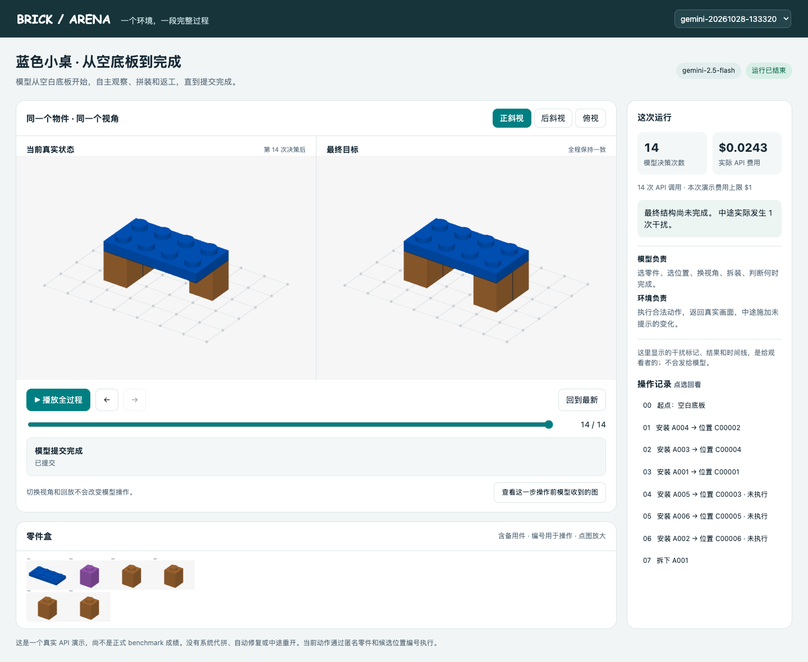

# 动态 Arena：模型全程接管积木

[打开本机 Arena](http://127.0.0.1:8810) · [只看本次真实 API 运行](http://127.0.0.1:8810/?run=gemini-20261028-133320)

点击“播放全过程”，可以看模型从空底板开始，一直操作到提交。可以切换正斜视、后斜视、俯视，点图片放大，或点右侧某一步回看。“查看这一步操作前模型收到的图”展示实际送进 API 的图片。

页面只是观看窗口。操作积木的是 API 模型；观看者切换角度、拖动进度不会改变模型的环境，也不会产生 API 费用。



## 这个例子发生了什么

目标是一张蓝色小桌：四块棕色桌腿，加一块蓝色桌面。零件盒另有一块紫色备用件。起点没有装好任何物件零件，白色底板属于环境。

| 项目 | 本次实际记录 |
|---|---|
| API 模型 | Google Gemini 2.5 Flash，通过 OpenRouter 调用，thinking 关闭 |
| 模型决策 / API 调用 | 14 次 / 14 次 |
| 合法执行的拆装 | 7 次 |
| 被物理规则拒绝的动作 | 6 次：4 次通路阻挡、2 次位置重叠 |
| 模型主动查看说明书或额外视角 | 0 次；每轮已有三个角度 |
| 外部干扰 | 第 8 次决策执行后，移走已装好的 A004 桌腿；模型没有收到通知 |
| 最终状态 | 5 块目标零件中有 4 块正确就位，仍缺 A004，模型已经提交结束 |
| 实际 API 费用 | **$0.02429587**，全部已结算；演示总费用上限 $1 |
| API 用量 | 输入 215,802 tokens；输出 346 tokens |
| 系统代拼 / 自动修复 / 中途重开 | 全部为 0 |

关键过程：

1. 模型先装了两条腿，然后提前装上桌面。
2. 再装其他腿时受到阻挡；模型自行拆下桌面，继续拼装。
3. 第 8 次决策后，系统根据实际场景移走先前装好的 A004。
4. 模型继续拼装，又装上桌面。
5. 第 13 次决策，它尝试补回 A004，但此时桌面挡住了安装通路。
6. 第 14 次决策，它直接提交结束，实际还缺一条腿。

**不能把这次结果简单说成“模型没检测到错误”。** 它确实尝试过补回被移走的件。日志直接支持的结论是：这一次运行没有完成后续返工，并在目标未完成时提交了结束。模型没有输出错误检测判断，因此不推断其内部是否已经完整理解了故障。

另用脚本确认：从模型实际结束状态出发，“拆桌面 → 补桌腿 → 装回桌面”三次动作可以合法完成。这个检查发生在独立验证环境，没有替模型执行，也没有加入模型成绩。

## 为什么这是动态题

这不是预先给模型一串错误图片。模型的动作会真正改变下一步状态，后续能做哪些动作也会跟着改变。

| 控制权 | 内容 |
|---|---|
| 模型 | 装哪块、拆哪块、何时看图或说明书、是否返工、何时提交 |
| 环境 | 检查并执行动作、返回实际画面、在当前实际结构上施加合法干扰 |
| 裁判 | 私下记录干扰、合法性和最终状态；不把答案或修复路线提供给模型 |

每次只装或拆一块。模型的对话、动作记录和积木状态始终连续。干扰后不另开一道题、不清空历史、不自动安排修复步骤。只要最后满足目标，可以采用其他合法顺序。

页面上的干扰标记和最终评分只用于观看和检查，不在模型输入里。模型每轮获得三个同画布的“当前／目标”对照图、零件盒；有前一步时，还会获得对应的前后状态对照图。说明书、额外查看和历史回看由模型主动请求。

## 我们强调“静态到动态”，怎么证明

建议主线表述为：**从看懂一个结构的错误，到在持续行动和环境变化中把结构恢复正确。**

正式实验要在同一批物件、同一套目标和拆装规则下，比较以下三组：

| 组别 | 模型要做什么 | 回答什么问题 |
|---|---|---|
| 静态修复 | 从给定的错误状态开始，把它修好 | 它能不能看懂当前问题并实施修复？ |
| 正常连续拼装 | 从起点接管，一直拼到结束，没有外部干扰 | 它本来能不能完成这个物件？ |
| 动态连续拼装 | 同样全程接管，但中途可能发生未提示变化 | 它能否跟踪变化、调整后续动作，并完成恢复？ |

关注最终完成率、合法动作率、实际触发干扰后的恢复情况、额外拆装和调用费用。只有静态题、正常分支和动态分支的真实模型结果都有了，才能讨论它们之间的能力差距。本次只运行了第三组的一个演示，不能作为这种差距已经被证明的依据。

## 这个演示的边界

- 这是新建的 5 块小物件演示，不加入现有正式题库计数。
- 每个物理零件只有一个登记位置；还没有测试多个候选位置中的定位选择，更没有开放任意坐标编辑。
- 物理合法性遵循当前引擎的连接、碰撞和直线拆装通路规则；不模拟手部操作、重力、摩擦和卡扣力度。
- 模型始终能看三个角度，但单次失败仍不足以证明某个模型的一般能力，也不能替代真人可读性检查。
- 本轮没有运行同物件的静态和正常模型对照，没有计算正式的配对修复成功率。

## 检查记录与启动方式

已完成真实 API 返回动作的逐步重放，状态、干扰和评分一致；API ID、费用和送入模型的图片哈希一致。页面检查覆盖三个角度、回放、步骤跳转、模型输入图、手机布局及只读访问。

[运行核查](audit.json) · [页面检查](ui-evidence/checks.json) · [实际评分和用量](runs/gemini-20261028-133320/result.json)

如果本机链接打不开，双击同目录的 `启动动态Arena.command`。它只启动观看页面，不会再次调用模型。

开发命令，在项目根目录执行：

```bash
# 启动观看页面；本次实际记录已经在 runs/ 下
PYTHONPATH=benchmark/brickplan-repair benchmark/.runtime/mlx-env/bin/python -m dynamic_arena.server

# 检查现有真实记录，不调用模型
PYTHONPATH=benchmark/brickplan-repair benchmark/.runtime/mlx-env/bin/python -m dynamic_arena.audit

# 再次发起真实 API 运行：会消耗该演示账本的剩余额度
PYTHONPATH=benchmark/brickplan-repair benchmark/.runtime/mlx-env/bin/python -m dynamic_arena.run
```

模型可用性与报价已在运行前查询 [OpenRouter 模型目录](https://openrouter.ai/google/gemini-2.5-flash)，实际费用采用 API 返回的 usage.cost，不按网页价格估算。
