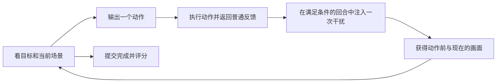

# 动态拼装：每一步到底给什么、做什么

## 真人操作

第一张对照图里，左半是现在，右半是本题唯一 TARGET。操作后另有时间对照图：左半是自己上一步之前，右半是现在。两种对照图都为 1600×636，场景均为 800×600。第一步没有时间对照图；从空底板开始。不要把不同时间或角度的零件加起来。

1. 看目标图，决定先装什么。白色底板固定，不需要安装，也不能拆。
2. 点下面的小零件图片，或选择编号后点“查看这个零件能放哪里”。所有零件页都展开。
3. 候选图中点一张卡片安装。**候选不保证正确，也不保证此刻装得上。** 一次只安装一块；移动需要先拆、再装。
4. 每次操作后都给最新画面。可切换斜视、俯视、背面；目标图可点击放大。查看也计一次决策，但不动积木。
5. 中间可能有额外变化。勾选“没有／有／看不清”，继续修好；不需要写解释。不选会记为未回答，不会自动当成“没有”。
6. 完成后点“我拼好了，提交本题”。程序按最终结构判定；未完成也可以提交并保留失败记录。换题或刷新不丢之前进度。

**左右相同不一定是错误页面。** 例如上一步本应装上一块，之后那块又被拿走，结果会和上一步之前相同。普通静态图片差异不能判定这种情况，需要结合动作记录；这类题单独统计。

## API 模型输入

每个决策收到：

| 信息 | 内容 |
|---|---|
| 固定目标 | 三张“现在／TARGET”对照，当前和唯一目标在同一张图上，同尺度、同相机 |
| 中间状态 | 首轮没有；之后每个视角一张带标题的“上一步动作前／现在”图，画布与目标对照相同 |
| 零件区 | 每页最多十二块，全部页可见；随机编号，包括备用件，不透露哪些属于目标 |
| 候选位置 | 查看零件后提供它的全部候选页，以当前场景为背景；每个候选显示统一轮廓 |
| 上一步和历史 | 自己之前输出的动作、普通动作反馈；回合不中断，不重置 |
| 操作限制 | 已用决策数和总预算；同一物件的预算不随隐藏错误类别变化 |

模型拿不到：题目 ID 中的错误类别、触发时点、私有状态、目标件名单、正确位置列表、修复答案或“刚发生了某种错误”的通知。候选位置编号仅是动作接口，不是答案标签。出题用 JSON 不可以直接发送。

## API 模型输出

每次只返回一个 JSON 对象、一个动作。无需推理文字。

2026-10-23 试跑后补清两点：

- `inspect` 的 `point` 和 `crop` 按“现在”场景内部计算，去掉标题。当前／目标页的“现在”为 `[0,36,800,636]`，像素转为 `[u/800,(v-36)/600]`；时间对照页的“现在”为 `[800,36,1600,636]`，转为 `[(u-800)/800,(v-36)/600]`。`catalogPoint` 仍按整张候选页计算。
- 如果模型在唯一的动作 JSON 前后多写了一句说明，解析器现在仍读取这个明确动作，原回答完整保留。如果有两个动作对象、一个动作数组、缺字段或只有文字，仍判无效；程序不会替模型猜动作或补答案。

查看零件：

```json
{"action":{"type":"inspect","partId":"A01"},"unexpectedChange":false}
```

安装一块：

```json
{"action":{"type":"attach","partId":"A01","candidate":"C037"},"unexpectedChange":false}
```

也可以点击某页候选图：

```json
{"action":{"type":"attach","partId":"A01","catalogPage":2,"catalogPoint":[0.375,0.5]},"unexpectedChange":true}
```

拆一块 / 换视角 / 提交：

```json
{"action":{"type":"detach","partId":"A01"},"unexpectedChange":true}
{"action":{"type":"inspect","view":"rear"},"unexpectedChange":false}
{"action":{"type":"finish"},"unexpectedChange":false}
```

上面三行是三种独立示例，不是允许一次发三个动作。`unexpectedChange` 问的是“这一轮观察是否出现超出自己上一步动作的额外变化”，不是“整个物件还没拼完”。第一步填 false。ID 仅为格式示例，每个回合会重新对应。

动作反馈只报告本次是否成功、是否挡住／碰撞；失败动作不改变现场。反馈 OK 也不保证其他部分没发生变化。任何额外变化都只能通过后续正常观察发现。

## 时间顺序



两个配对分支在同一个动作后分开。主接口不提供“系统推算的正确当前状态”；额外给预期画面的版本只能作为单独诊断实验，不能和主成绩混算。

## 2026-10-23 同画布更新

默认不再分开发送大小不同的单张目标。社区模块说明书改成按需查看；完整约定、图量和统计修复见 [输入与统计修复说明](../brickplan-interface-repair-2026-10-23/README.zh-CN.md)。
