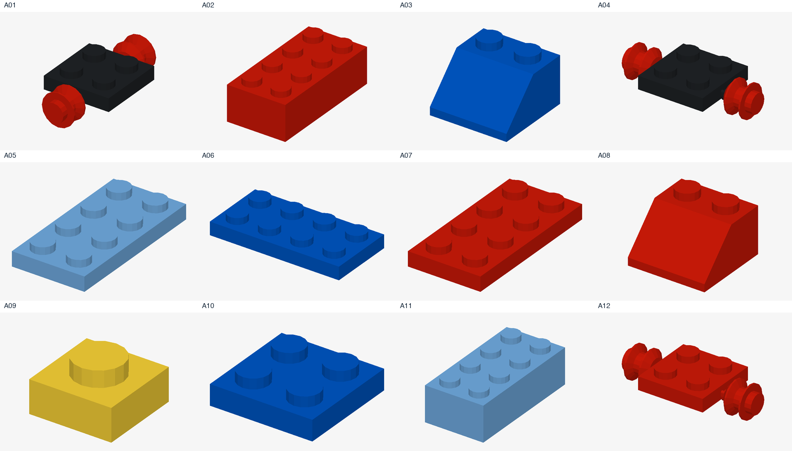
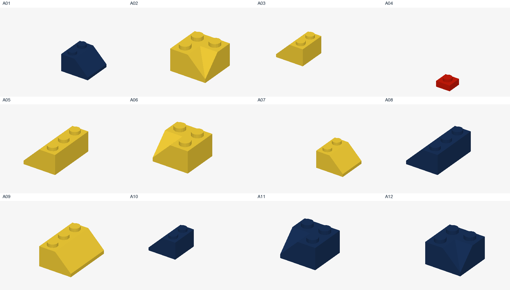

# 人类错误范围调整，以及H18到底给了模型什么

## 已按你的决定调整

| 决定 | 类别 | 当前处理 |
|---|---|---|
| 做 | H01–H11、H13 | 保留对应题目与多次事件 |
| 不做 | H12、H14、H15、H16、H17 | 不进入当前正式题单；H12的旧记录仅供追溯 |
| 待定 | H18 | 不列为已实现的错误类别；不报告H18实验成绩 |

当前统一题单是 **5,793题**：原题当前范围5,100题，加扩展693题。相比之前5,975题，排除D的160道连带掉件题，以及扩展22条同类条件。扩展现有776条接口条件，其中83条复用旧题，不重复算。

## H18的直接答案

**模型能看到全部可选零件，但看不到一张实时更新的“剩余零件清单”。**

| 信息 | 现在是否提供 | 具体含义 |
|---|---|---|
| 全部可选零件的图片和编号 | 有 | 包括尚未装的、已经装上的、备用件；每轮目录保持不变 |
| 已装结构与目标图 | 有 | 模型可以结合画面和自己的动作记录推断哪些已装 |
| 只显示桌上还没装的零件 | 没有 | 库存图不是实时桌面，也不是剩件托盘 |
| 当前还剩多少块／哪些编号未用 | 没有直接提供 | 没有remainingCount或remainingParts这类字段 |
| 哪些件属于多余件、最终必须剩几件 | 没有 | 不把出题者答案当成库存提示 |

所以：**“目录中还显示这块”不等于“这块还没装”。** 已经装上的零件也一直显示。模型可以自己观察、记住操作再推断，但这与直接提供剩件信息不同。

## 用真实输入验证：搭好后库存图是否变化

下面四个例子分别走当前S、D、M、E7接口，从初态执行合法参考动作到目标。初始、第一次动作后、达到目标时的库存图片哈希及操作编号列表完全一致。下表“实际未安装数”由后台审计读取，**没有发给模型**。

| 部分 | 初始已装 | 达标已装 | 目录卡片数（始终） | 达标后实际未安装数（后台） | 库存图随进度减少吗 |
|---|---:|---:|---:|---:|---|
| S | 10 | 11 | 24 | 13 | 不减少，图片相同 |
| D | 0 | 6 | 18 | 12 | 不减少，图片相同 |
| M | 0 | 6 | 13 | 7 | 不减少，图片相同 |
| E7 | 0 | 6 | 13 | 7 | 不减少，图片相同 |

### S：库存第一页对照

| 初始时给模型的库存图 | 达标后给模型的库存图 |
|---|---|
|  |  |

### D：库存第一页对照

| 初始时给模型的库存图 | 达标后给模型的库存图 |
|---|---|
|  |  |

### M：库存第一页对照

| 初始时给模型的库存图 | 达标后给模型的库存图 |
|---|---|
|  |  |

### E7：库存第一页对照

| 初始时给模型的库存图 | 达标后给模型的库存图 |
|---|---|
|  |  |

## H18现在怎么处理

建议先保持待定。现有正常题必须保留，用来判断模型本来会不会拼，以及面对正确结构会不会乱拆乱装；这不等于已经设计了“看见剩件而误判”的独立实验。

如果以后确定做H18，需要明确给出桌上尚未使用的零件，再准备“结构已经正确、却仍有正常备用件”的对照。是否仅因备用件而误判，应与没有额外备用件的条件比较。目前没有新增这种输入或实验。

本次未添加实时剩件提示，也没有重新调用付费模型。现有GT仍按目标结构验收，不要求把库存中的零件全部用完。

[机器核查记录](inventory-audit/audit.json) · [当前范围记录](human-error-scope.json) · [更新后的题目图解](../brickplan-question-showcase/README.zh-CN.md)。
