# 扩充清单：物件、错误、每条条件与配图

所有配图和路线为设计展示；没有伪造模型或真人结果。

## 四层书架 · `v7-long-bookshelf`

部分：D-long；正常拼装／模块全长：21块；来源：`original:v7:long-bookshelf`。

本物件包含：拆上层返修、提前封口、局部多层／重复加件、少件、偏移一格、重复组件漏做、装反、错色、错零件／厚度。

连续干扰：连续：少件 → 错色；连续：少件 → 错色 → 偏移一格；连续：偏移一格 → 局部多层／重复加件；连续：错零件／厚度 → 少件。

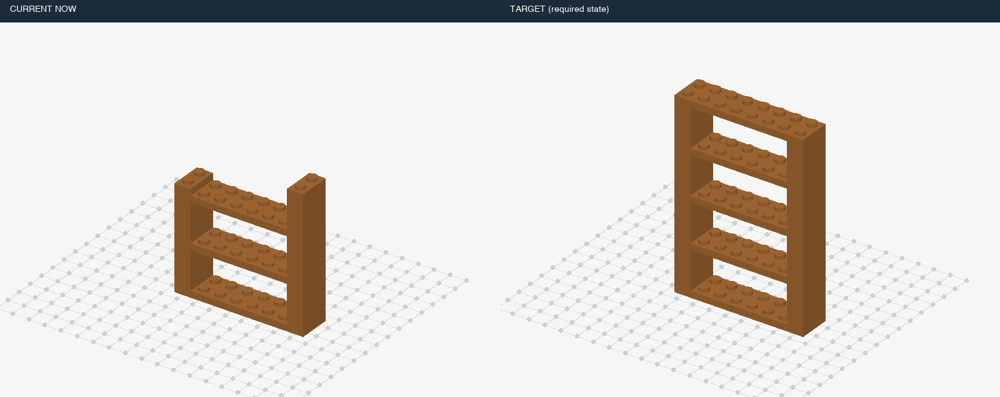

| 条件ID | 静态／动态 | 错误 | 事件数 | 来源类别 | 暂定结构组 | 图片 | 复用旧题 |
|---|---|---|---:|---|---|---|---|
| `v7::v7-long-bookshelf::dynamic::control::t0` | dynamic | 正常 | 0 | 正常 | L2 | [三维画面](assets/v7-long-bookshelf/6d547bc0f9a7e8b01eda9c35f3abf74cb04513959481b2e511295f10effd4f28.png) | 新增 |
| `v7::v7-long-bookshelf::dynamic::missing::t14` | dynamic | 少件 | 1 | H01 | L2 | [三维画面](assets/v7-long-bookshelf/19326af00b43b9b2be030f17f8640f166dd6bfe9c9ab659f0e3b326aa2d58c96.png) | 新增 |
| `v7::v7-long-bookshelf::static::missing::t14` | static | 少件 | 0 | H01 | L1 | [三维画面](assets/v7-long-bookshelf/d5a37180a4a9d32d0c8b5f836e6d5cdf2e02be7fc31258de93027e174545d1bd.png) | 新增 |
| `v7::v7-long-bookshelf::static::control::t14` | static | 正常 | 0 | 正常 | L1 | [三维画面](assets/v7-long-bookshelf/4fb0eb5d6d1160100af08b3d0928b82dfb41f84ec0ac970343f807dba53b5cc0.png) | 新增 |
| `v7::v7-long-bookshelf::dynamic::missing::t20` | dynamic | 少件 | 1 | H01 | L2 | [三维画面](assets/v7-long-bookshelf/14b41ce1ef7155c2c8dc5b7e9d1b8cce6f1705e1c6fa9a39cfc67fbcd53e105a.png) | 新增 |
| `v7::v7-long-bookshelf::static::missing::t20` | static | 少件 | 0 | H01 | L2 | [三维画面](assets/v7-long-bookshelf/662c87af858d71579dc7b7a85476fc9fc958094c48a10d58f23a67afc036a55b.png) | 新增 |
| `v7::v7-long-bookshelf::static::control::t20` | static | 正常 | 0 | 正常 | L2 | [三维画面](assets/v7-long-bookshelf/8fa900d9e52b1b01fbfd85518a87fb01db8a1c418fa595be7b80382e7e078337.png) | 新增 |
| `v7::v7-long-bookshelf::dynamic::wrong-color::t14` | dynamic | 错色 | 1 | H04 | L2 | [三维画面](assets/v7-long-bookshelf/ac1e8783fc2917269437f084c3032610a9e6d7909b681531745bf2c6f0872110.png) | 新增 |
| `v7::v7-long-bookshelf::static::wrong-color::t14` | static | 错色 | 0 | H04 | L1 | [三维画面](assets/v7-long-bookshelf/05fdb01630e33d7969566c792b263f0adbfa2284c39b5644c62e3f38947d02ab.png) | 新增 |
| `v7::v7-long-bookshelf::dynamic::wrong-color::t20` | dynamic | 错色 | 1 | H04 | L2 | [三维画面](assets/v7-long-bookshelf/c92196b410fda39be30fc8d4d2198d99b61cf8fd93ce695f02229d6b857ec991.png) | 新增 |
| `v7::v7-long-bookshelf::static::wrong-color::t20` | static | 错色 | 0 | H04 | L2 | [三维画面](assets/v7-long-bookshelf/5bc2addf4f791f48f698efad00f994ec52e289a221e11a6a60266d705c2d4a91.png) | 新增 |
| `v7::v7-long-bookshelf::dynamic::extra-layer::t7` | dynamic | 局部多层／重复加件 | 1 | H03, H11 | L2 | [三维画面](assets/v7-long-bookshelf/7ba1a93e6596c0c20fcc647fbc2c09b8f106ccbcea2b97ee0cce7b3fd1fa0e32.png) | 新增 |
| `v7::v7-long-bookshelf::static::extra-layer::t7` | static | 局部多层／重复加件 | 0 | H03, H11 | L1 | [三维画面](assets/v7-long-bookshelf/a9e79dc0acd2fd277e0660b66edb46f5a32c3a6b532c77ba84f6b4c37c762637.png) | 新增 |
| `v7::v7-long-bookshelf::static::control::t7` | static | 正常 | 0 | 正常 | L1 | [三维画面](assets/v7-long-bookshelf/b075c91986b71d942e91838417561e4575f3969d7506a5126cd4e4243f2e7bd0.png) | 新增 |
| `v7::v7-long-bookshelf::dynamic::extra-layer::t14` | dynamic | 局部多层／重复加件 | 1 | H03, H11 | L2 | [三维画面](assets/v7-long-bookshelf/f67f728e5b66ef59b69e8dce25218253ea6145100da4543b2ed3af63c80e131c.png) | 新增 |
| `v7::v7-long-bookshelf::static::extra-layer::t14` | static | 局部多层／重复加件 | 0 | H03, H11 | L1 | [三维画面](assets/v7-long-bookshelf/57b36f1ee48753f7378e06a3eb9e7f9d2a775fd1ec1941f680fa681bb042e2ad.png) | 新增 |
| `v7::v7-long-bookshelf::dynamic::offset::t14` | dynamic | 偏移一格 | 1 | H07 | L2 | [三维画面](assets/v7-long-bookshelf/afa7e61d7d04ee13231680958b7c8879647c23d86ec917b4fe3bd6b6062805c6.png) | 新增 |
| `v7::v7-long-bookshelf::static::offset::t14` | static | 偏移一格 | 0 | H07 | L1 | [三维画面](assets/v7-long-bookshelf/4885195a0e36737ae87bd29a51aeac0bed1ec83110ec77fd631cd2ee4abc2df3.png) | 新增 |
| `v7::v7-long-bookshelf::dynamic::offset::t20` | dynamic | 偏移一格 | 1 | H07 | L2 | [三维画面](assets/v7-long-bookshelf/31ca15d62908d7d625ee3120faa975ed289e426c1f278043fb266c141548b940.png) | 新增 |
| `v7::v7-long-bookshelf::static::offset::t20` | static | 偏移一格 | 0 | H07 | L2 | [三维画面](assets/v7-long-bookshelf/468ee62a82145dfdeb56393b38d25c52f7cff14cbfbd56219c33fafc1256be04.png) | 新增 |
| `v7::v7-long-bookshelf::dynamic::rotated::t14` | dynamic | 装反 | 1 | H06 | L2 | [三维画面](assets/v7-long-bookshelf/2bdf82bf2b095c23d70db0ea33c7386f96205b6bbcf1d0612a80ba4460f97565.png) | 新增 |
| `v7::v7-long-bookshelf::static::rotated::t14` | static | 装反 | 0 | H06 | L1 | [三维画面](assets/v7-long-bookshelf/a0f3d71b655820a05da2d405a6ad7a22793d0cd0e23e642b53c737250f97e11f.png) | 新增 |
| `v7::v7-long-bookshelf::dynamic::rotated::t20` | dynamic | 装反 | 1 | H06 | L2 | [三维画面](assets/v7-long-bookshelf/31efa575de40d1cb4472bfaafce773001e57b7d0d1048f84b2087bb5b0a31454.png) | 新增 |
| `v7::v7-long-bookshelf::static::rotated::t20` | static | 装反 | 0 | H06 | L2 | [三维画面](assets/v7-long-bookshelf/7c6827472e8072cb6278741216b0e948d6bc29d83522795cccf015aa75cea107.png) | 新增 |
| `v7::v7-long-bookshelf::dynamic::wrong-part::t14` | dynamic | 错零件／厚度 | 1 | H05 | L2 | [三维画面](assets/v7-long-bookshelf/7c9f1a4e2f0516799e5e0ae7f83d77ca314b3c2ec15c657b84195a5aa959a871.png) | 新增 |
| `v7::v7-long-bookshelf::static::wrong-part::t14` | static | 错零件／厚度 | 0 | H05 | L1 | [三维画面](assets/v7-long-bookshelf/ab6e34d0dcd75b7deb0b909eaa5b27ba06aaeb4f4fc31c1491c01fdb3c0bf134.png) | 新增 |
| `v7::v7-long-bookshelf::dynamic::wrong-part::t20` | dynamic | 错零件／厚度 | 1 | H05 | L2 | [三维画面](assets/v7-long-bookshelf/4b6b75fd75d7c4db89df56abdf3b3881904ce9b595225a35ef28cdeb350de82f.png) | 新增 |
| `v7::v7-long-bookshelf::static::wrong-part::t20` | static | 错零件／厚度 | 0 | H05 | L2 | [三维画面](assets/v7-long-bookshelf/19a94959152bdd0f6a3b92ffa4bf1272da0f56d1c0a0600d3e0b3b36398af301.png) | 新增 |
| `v7::v7-long-bookshelf::dynamic::early-cover::t14` | dynamic | 提前封口 | 1 | H09 | L2 | [三维画面](assets/v7-long-bookshelf/0b7575aa970ba976e3d71e24d27ffe8828799386a7c1e662c6bb7413d387914d.png) | 新增 |
| `v7::v7-long-bookshelf::static::early-cover::t14` | static | 提前封口 | 0 | H09 | L1 | [三维画面](assets/v7-long-bookshelf/b769066b0d264249837499c06d32f89da4b1c4bf60ddbfc4226a2a08ec5f13d0.png) | 新增 |
| `v7::v7-long-bookshelf::dynamic::early-cover::t4` | dynamic | 提前封口 | 1 | H09 | L2 | [三维画面](assets/v7-long-bookshelf/83c1c9d349bde03b55ac290904490f59337b16fe8c3a1bc1a589e6ebe95a6bd3.png) | 新增 |
| `v7::v7-long-bookshelf::static::early-cover::t4` | static | 提前封口 | 0 | H09 | L1 | [三维画面](assets/v7-long-bookshelf/44a47ec39c42df8ac8046da686eaff8ac5ae12cedf886d31695344d4d3d76617.png) | 新增 |
| `v7::v7-long-bookshelf::static::control::t4` | static | 正常 | 0 | 正常 | L1 | [三维画面](assets/v7-long-bookshelf/d64f25d188be8f404cc569422f7de539f7e9d215899cd429349aaf865924e703.png) | 新增 |
| `v7::v7-long-bookshelf::dynamic::buried-repair::t7` | dynamic | 拆上层返修 | 1 | H10 | L3 | [三维画面](assets/v7-long-bookshelf/e42d823467447e4e062b374a22a5253d396bcb4e7f369b4bbc94f2d9b7ee7b1a.png) | 新增 |
| `v7::v7-long-bookshelf::static::buried-repair::t7` | static | 拆上层返修 | 0 | H10 | L2 | [三维画面](assets/v7-long-bookshelf/8307ccbdd092ff3495a1a5305113fe736ff7d0a85763f92b220bd858e70e55fd.png) | 新增 |
| `v7::v7-long-bookshelf::dynamic::buried-repair::t14` | dynamic | 拆上层返修 | 1 | H10 | L3 | [三维画面](assets/v7-long-bookshelf/804faaaf387913c3002930a00243278fec08079e7307321578d314c441bc722b.png) | 新增 |
| `v7::v7-long-bookshelf::static::buried-repair::t14` | static | 拆上层返修 | 0 | H10 | L2 | [三维画面](assets/v7-long-bookshelf/7ffddd9d65208e2a256b2c0c5440287fce47091ef03923cc19768c3fda345f80.png) | 新增 |
| `v7::v7-long-bookshelf::dynamic::repeat-omission::t5` | dynamic | 重复组件漏做 | 1 | H02 | L2 | [三维画面](assets/v7-long-bookshelf/deebde26701af8f666e0dd67442cd655e0537446a1a4e534ecef5387066b4d57.png) | 新增 |
| `v7::v7-long-bookshelf::static::repeat-omission::t5` | static | 重复组件漏做 | 0 | H02 | L1 | [三维画面](assets/v7-long-bookshelf/8877957b04ac10a5e2ca333ede97aaf6463ec48351c78a073ac53bbe75dfd93b.png) | 新增 |
| `v7::v7-long-bookshelf::static::control::t5` | static | 正常 | 0 | 正常 | L1 | [三维画面](assets/v7-long-bookshelf/fbb4072ff9a682e2797be58e13cb614b9f70f6041b4c0d382cb41a3c6877da32.png) | 新增 |
| `v7::v7-long-bookshelf::dynamic::repeat-omission::t10` | dynamic | 重复组件漏做 | 1 | H02 | L2 | [三维画面](assets/v7-long-bookshelf/582b4908f4d08bd9a55da3d13e60b717ddfe79987e307a0f51b99125d1641be0.png) | 新增 |
| `v7::v7-long-bookshelf::static::repeat-omission::t10` | static | 重复组件漏做 | 0 | H02 | L1 | [三维画面](assets/v7-long-bookshelf/dffdcabab78f88a878f0ff20909a20b0be1bb08bf3ac331777ba2395708a2983.png) | 新增 |
| `v7::v7-long-bookshelf::static::control::t10` | static | 正常 | 0 | 正常 | L1 | [三维画面](assets/v7-long-bookshelf/31e6f3e18f6aaec56caf165d7ceb249bb6fa6a76eef45c7f4f6e60eebfa2b6f1.png) | 新增 |
| `v7::v7-long-bookshelf::dynamic::multiple::missingthen-wrong-color` | dynamic | 连续：少件 → 错色 | 2 | H01, H04, H13 | L3 | [三维画面](assets/v7-long-bookshelf/e407cfee3d7c54fd5bc47af84469fab90c7a4cd9f884a0f6db5d157ac14e42fb.png) | 新增 |
| `v7::v7-long-bookshelf::dynamic::multiple::offsetthen-extra-layer` | dynamic | 连续：偏移一格 → 局部多层／重复加件 | 2 | H03, H07, H11, H13 | L3 | [三维画面](assets/v7-long-bookshelf/60fb057b67ec0928db575698aa39c63de1bbed823ce925c3dae2d1ae2398dcc4.png) | 新增 |
| `v7::v7-long-bookshelf::dynamic::multiple::wrong-partthen-missing` | dynamic | 连续：错零件／厚度 → 少件 | 2 | H01, H05, H13 | L3 | [三维画面](assets/v7-long-bookshelf/0f8d846cc8e338730bdcbc3525100b33f23420a96feb6c13932d5d13f8b6e2d7.png) | 新增 |
| `v7::v7-long-bookshelf::dynamic::multiple::missingthen-wrong-colorthen-offset` | dynamic | 连续：少件 → 错色 → 偏移一格 | 3 | H01, H04, H07, H13 | L3 | [三维画面](assets/v7-long-bookshelf/446d61922096cec95defeb79a62c4a2c47b064ba36aa1d3e021be17465fc0080.png) | 新增 |

## 带多排车窗的公共汽车 · `v7-long-city-bus`

部分：D-long；正常拼装／模块全长：32块；来源：`original:v7:long-city-bus`。

本物件包含：拆上层返修、提前封口、局部多层／重复加件、左右互换、少件、偏移一格、重复组件漏做、错色、错零件／厚度。

连续干扰：连续：少件 → 错色；连续：少件 → 错色 → 偏移一格；连续：偏移一格 → 局部多层／重复加件；连续：错零件／厚度 → 少件。

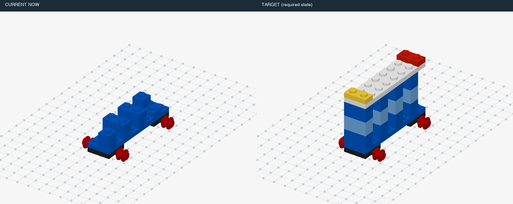

| 条件ID | 静态／动态 | 错误 | 事件数 | 来源类别 | 暂定结构组 | 图片 | 复用旧题 |
|---|---|---|---:|---|---|---|---|
| `v7::v7-long-city-bus::dynamic::control::t0` | dynamic | 正常 | 0 | 正常 | L2 | [三维画面](assets/v7-long-city-bus/901be685fb34f607b3ee31a9f990dc6ff45a0fb3ce4859a8e1bf43c4517f9517.png) | 新增 |
| `v7::v7-long-city-bus::dynamic::missing::t10` | dynamic | 少件 | 1 | H01 | L2 | [三维画面](assets/v7-long-city-bus/b989acf379a65cc15f07bedc1a1505fb8760d17e958e7acd1d3174c06bcdf8a9.png) | 新增 |
| `v7::v7-long-city-bus::static::missing::t10` | static | 少件 | 0 | H01 | L1 | [三维画面](assets/v7-long-city-bus/6888abd677e77ada9ecd342531c71e3560a28cae801c13028d95ceb3c89f06c9.png) | 新增 |
| `v7::v7-long-city-bus::static::control::t10` | static | 正常 | 0 | 正常 | L1 | [三维画面](assets/v7-long-city-bus/aec7235b06fb255536123ce9a75e864051fae2a7432c7fac2a822f9b352c6cf6.png) | 新增 |
| `v7::v7-long-city-bus::dynamic::missing::t21` | dynamic | 少件 | 1 | H01 | L2 | [三维画面](assets/v7-long-city-bus/2ce46e868b1e65776539b19f7da7a1e16e332e4f0983e6d5eb5f73c92a809a65.png) | 新增 |
| `v7::v7-long-city-bus::static::missing::t21` | static | 少件 | 0 | H01 | L2 | [三维画面](assets/v7-long-city-bus/fd00de36b2e648e16816e88cea7971d4fd3682905cb1a022f204092d079f4237.png) | 新增 |
| `v7::v7-long-city-bus::static::control::t21` | static | 正常 | 0 | 正常 | L2 | [三维画面](assets/v7-long-city-bus/cea1162da8d010d25e178669e7fba44c347b1dfdaa836f3c397cc58f6bab66c1.png) | 新增 |
| `v7::v7-long-city-bus::dynamic::wrong-color::t10` | dynamic | 错色 | 1 | H04 | L2 | [三维画面](assets/v7-long-city-bus/e2a70d464979bd6862cae5526bbf24572775b7615ca17780ede77808f029d7cc.png) | 新增 |
| `v7::v7-long-city-bus::static::wrong-color::t10` | static | 错色 | 0 | H04 | L1 | [三维画面](assets/v7-long-city-bus/615347f55559f65c2dc842f2b8e824b073002c30a8676a23fc20d3d09aa8b746.png) | 新增 |
| `v7::v7-long-city-bus::dynamic::wrong-color::t21` | dynamic | 错色 | 1 | H04 | L2 | [三维画面](assets/v7-long-city-bus/d5c6574ce16387440931181768a6ae6702661c182abab82fd050b73955f54d0d.png) | 新增 |
| `v7::v7-long-city-bus::static::wrong-color::t21` | static | 错色 | 0 | H04 | L2 | [三维画面](assets/v7-long-city-bus/8cba33c38886965fce0e3cec5485a23bbea24b6a8d8383d289b443995a5ab8f5.png) | 新增 |
| `v7::v7-long-city-bus::dynamic::extra-layer::t10` | dynamic | 局部多层／重复加件 | 1 | H03, H11 | L2 | [三维画面](assets/v7-long-city-bus/dd7618269cc3857e7904fe2116b9b954c1fefc14168e0e3f51f6b5fee408afc3.png) | 新增 |
| `v7::v7-long-city-bus::static::extra-layer::t10` | static | 局部多层／重复加件 | 0 | H03, H11 | L1 | [三维画面](assets/v7-long-city-bus/aec7235b06fb255536123ce9a75e864051fae2a7432c7fac2a822f9b352c6cf6.png) | 新增 |
| `v7::v7-long-city-bus::dynamic::extra-layer::t21` | dynamic | 局部多层／重复加件 | 1 | H03, H11 | L2 | [三维画面](assets/v7-long-city-bus/f9969181381a547bf36bf84642d3138413d57599452cd49b231bbb27f215ede6.png) | 新增 |
| `v7::v7-long-city-bus::static::extra-layer::t21` | static | 局部多层／重复加件 | 0 | H03, H11 | L2 | [三维画面](assets/v7-long-city-bus/cea1162da8d010d25e178669e7fba44c347b1dfdaa836f3c397cc58f6bab66c1.png) | 新增 |
| `v7::v7-long-city-bus::dynamic::offset::t10` | dynamic | 偏移一格 | 1 | H07 | L2 | [三维画面](assets/v7-long-city-bus/257da3e482d9a7c00b416660e49ab49043000692984d054385a201736891ac04.png) | 新增 |
| `v7::v7-long-city-bus::static::offset::t10` | static | 偏移一格 | 0 | H07 | L1 | [三维画面](assets/v7-long-city-bus/50554a38114ef500f720fe118a9774a7c09a0bbf2ce49a3e52d4311a85717f5d.png) | 新增 |
| `v7::v7-long-city-bus::dynamic::offset::t21` | dynamic | 偏移一格 | 1 | H07 | L2 | [三维画面](assets/v7-long-city-bus/96bd1a3c0f8689898500683d24715c2af67ba4e81589cd7506c55ca82c665fab.png) | 新增 |
| `v7::v7-long-city-bus::static::offset::t21` | static | 偏移一格 | 0 | H07 | L2 | [三维画面](assets/v7-long-city-bus/b7a51fb50bce7e9b36086c7aae23dc7cad3f9cc63fc5b86db51626f891bfe526.png) | 新增 |
| `v7::v7-long-city-bus::dynamic::wrong-part::t10` | dynamic | 错零件／厚度 | 1 | H05 | L2 | [三维画面](assets/v7-long-city-bus/aa60799fdca3266daa214515f68db011716aafff00e83072577ced347499e759.png) | 新增 |
| `v7::v7-long-city-bus::static::wrong-part::t10` | static | 错零件／厚度 | 0 | H05 | L1 | [三维画面](assets/v7-long-city-bus/8fbc5b370fabfabfc28f03fe32eb0124f1bb91782f3cda3cb7b6632b79bca707.png) | 新增 |
| `v7::v7-long-city-bus::dynamic::wrong-part::t21` | dynamic | 错零件／厚度 | 1 | H05 | L2 | [三维画面](assets/v7-long-city-bus/200a4b50f4a3c3583cfe405613b4c50dcf89baeabf1b92001f187ff2438fb1b3.png) | 新增 |
| `v7::v7-long-city-bus::static::wrong-part::t21` | static | 错零件／厚度 | 0 | H05 | L2 | [三维画面](assets/v7-long-city-bus/ef69645fcc639d03d40355049a9dd1e899478c238366f96081d342ecfe147d0f.png) | 新增 |
| `v7::v7-long-city-bus::dynamic::early-cover::t21` | dynamic | 提前封口 | 1 | H09 | L2 | [三维画面](assets/v7-long-city-bus/58b1148e4e8e98e75fb12d4d7ed3b36ea76b68b345472f57a4c4060794902c52.png) | 新增 |
| `v7::v7-long-city-bus::static::early-cover::t21` | static | 提前封口 | 0 | H09 | L2 | [三维画面](assets/v7-long-city-bus/acc3b51e816c875745bb17fb71d0c70caba1842772ac5785a162c96a56345984.png) | 新增 |
| `v7::v7-long-city-bus::dynamic::early-cover::t20` | dynamic | 提前封口 | 1 | H09 | L2 | [三维画面](assets/v7-long-city-bus/a1d6ac85b9a80b000b46f04c071c74c02b91fdc9c36c264ff6275f469124e6c9.png) | 新增 |
| `v7::v7-long-city-bus::static::early-cover::t20` | static | 提前封口 | 0 | H09 | L2 | [三维画面](assets/v7-long-city-bus/600cb57514009e15569e4286d163f76901e57e677299b7e02fbd6bf236f6cea0.png) | 新增 |
| `v7::v7-long-city-bus::static::control::t20` | static | 正常 | 0 | 正常 | L2 | [三维画面](assets/v7-long-city-bus/d79abe9fa2b1fdb151dcb8fa0679fd8999b405303a6bd52f5a2214118f88eb6b.png) | 新增 |
| `v7::v7-long-city-bus::dynamic::buried-repair::t21` | dynamic | 拆上层返修 | 1 | H10 | L3 | [三维画面](assets/v7-long-city-bus/f9969181381a547bf36bf84642d3138413d57599452cd49b231bbb27f215ede6.png) | 新增 |
| `v7::v7-long-city-bus::static::buried-repair::t21` | static | 拆上层返修 | 0 | H10 | L3 | [三维画面](assets/v7-long-city-bus/cea1162da8d010d25e178669e7fba44c347b1dfdaa836f3c397cc58f6bab66c1.png) | 新增 |
| `v7::v7-long-city-bus::dynamic::buried-repair::t31` | dynamic | 拆上层返修 | 1 | H10 | L3 | [三维画面](assets/v7-long-city-bus/c3e59bb2be4216a7cf42bd2ae8733968f9581af8a9f2d4ad377fec2c1243a3fa.png) | 新增 |
| `v7::v7-long-city-bus::static::buried-repair::t31` | static | 拆上层返修 | 0 | H10 | L3 | [三维画面](assets/v7-long-city-bus/b0739b808684b1c0b6805912c94c42fd5276a309904020d7c91ca55ed08b2a4d.png) | 新增 |
| `v7::v7-long-city-bus::static::control::t31` | static | 正常 | 0 | 正常 | L2 | [三维画面](assets/v7-long-city-bus/1e17b02620228cb1288887b216b23e68365db86c1a52696dc93f4ea7abcb6193.png) | 新增 |
| `v7::v7-long-city-bus::dynamic::left-right-swap::t13` | dynamic | 左右互换 | 1 | H08 | L2 | [三维画面](assets/v7-long-city-bus/f7c66fc069b3e6fff10298ef93c5900cb9a9922855bea509cc57fc3dc523feec.png) | 新增 |
| `v7::v7-long-city-bus::static::left-right-swap::t13` | static | 左右互换 | 0 | H08 | L1 | [三维画面](assets/v7-long-city-bus/35856bddc4e5cd3a59eb8eb0df784283be521b53e0d4e3962ccb4ea07e255d57.png) | 新增 |
| `v7::v7-long-city-bus::static::control::t13` | static | 正常 | 0 | 正常 | L1 | [三维画面](assets/v7-long-city-bus/1b1fa1135194f974e7c7e6c8bf4fe54c1afc84319a53527d082429da7e674dbe.png) | 新增 |
| `v7::v7-long-city-bus::dynamic::left-right-swap::t14` | dynamic | 左右互换 | 1 | H08 | L2 | [三维画面](assets/v7-long-city-bus/5cfc08d41c46fd96c848be29047e326f2727729b74d78e412904e15bd536a2c7.png) | 新增 |
| `v7::v7-long-city-bus::static::left-right-swap::t14` | static | 左右互换 | 0 | H08 | L1 | [三维画面](assets/v7-long-city-bus/9008cfaa599ce005d7db032e05c6ae931fbc4295c0a5377f6d2f76147b7b5b22.png) | 新增 |
| `v7::v7-long-city-bus::static::control::t14` | static | 正常 | 0 | 正常 | L1 | [三维画面](assets/v7-long-city-bus/99dfdbf824e1c36a0db9e4381ccd665998865c88add266157076e210a9de6edc.png) | 新增 |
| `v7::v7-long-city-bus::dynamic::repeat-omission::t10` | dynamic | 重复组件漏做 | 1 | H02 | L2 | [三维画面](assets/v7-long-city-bus/dd0957efb87b3f96d2610d95c2a024b89c4545d23468f60836fefcc98518c1d2.png) | 新增 |
| `v7::v7-long-city-bus::static::repeat-omission::t10` | static | 重复组件漏做 | 0 | H02 | L1 | [三维画面](assets/v7-long-city-bus/590211b6ea1c2e18bfd25ba2420259950159841d1f36990825a9328df086dc24.png) | 新增 |
| `v7::v7-long-city-bus::dynamic::repeat-omission::t6` | dynamic | 重复组件漏做 | 1 | H02 | L2 | [三维画面](assets/v7-long-city-bus/2d7090d5d3b6c44a614af2f73707ef2834f86b6d040dca3d10ce43a138820f61.png) | 新增 |
| `v7::v7-long-city-bus::static::repeat-omission::t6` | static | 重复组件漏做 | 0 | H02 | L1 | [三维画面](assets/v7-long-city-bus/93813f784dd3dc484729fab75d087c9aac5aafd730514b5863a9308417a02090.png) | 新增 |
| `v7::v7-long-city-bus::static::control::t6` | static | 正常 | 0 | 正常 | L1 | [三维画面](assets/v7-long-city-bus/36af7b24b7fc376680522bd1d0aba15b7237671d3972e68ea6f024f40a10b83a.png) | 新增 |
| `v7::v7-long-city-bus::dynamic::multiple::missingthen-wrong-color` | dynamic | 连续：少件 → 错色 | 2 | H01, H04, H13 | L3 | [三维画面](assets/v7-long-city-bus/69eae09caf5a3a80753a6820b74a3a37dfbac9a320b512768679d05e0ddd76e7.png) | 新增 |
| `v7::v7-long-city-bus::dynamic::multiple::offsetthen-extra-layer` | dynamic | 连续：偏移一格 → 局部多层／重复加件 | 2 | H03, H07, H11, H13 | L3 | [三维画面](assets/v7-long-city-bus/57d362b4b38ad409bcb6dbf5f55c4b390b11687664daeb13ae0604fd4babb96a.png) | 新增 |
| `v7::v7-long-city-bus::dynamic::multiple::wrong-partthen-missing` | dynamic | 连续：错零件／厚度 → 少件 | 2 | H01, H05, H13 | L3 | [三维画面](assets/v7-long-city-bus/50f82778219a51068b219afb66cafa9b2a312d81d8d4d7ab062dcb952885dfe4.png) | 新增 |
| `v7::v7-long-city-bus::dynamic::multiple::missingthen-wrong-colorthen-offset` | dynamic | 连续：少件 → 错色 → 偏移一格 | 3 | H01, H04, H07, H13 | L3 | [三维画面](assets/v7-long-city-bus/13bd91371dbbb0944ea8933661de9d37a8a9c63605dfaea77613c1cb58d8362c.png) | 新增 |

## 高桥墩步行桥 · `v7-long-stone-bridge`

部分：D-long；正常拼装／模块全长：25块；来源：`original:v7:long-stone-bridge`。

本物件包含：拆上层返修、提前封口、局部多层／重复加件、少件、偏移一格、重复组件漏做、装反、错色、错零件／厚度。

连续干扰：连续：少件 → 错色；连续：少件 → 错色 → 偏移一格；连续：偏移一格 → 局部多层／重复加件；连续：错零件／厚度 → 少件。

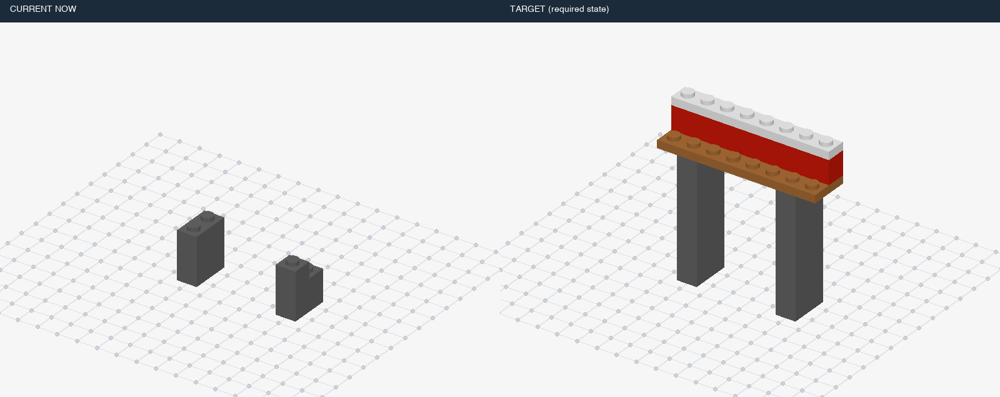

| 条件ID | 静态／动态 | 错误 | 事件数 | 来源类别 | 暂定结构组 | 图片 | 复用旧题 |
|---|---|---|---:|---|---|---|---|
| `v7::v7-long-stone-bridge::dynamic::control::t0` | dynamic | 正常 | 0 | 正常 | L2 | [三维画面](assets/v7-long-stone-bridge/a68d2eb270ddbfd9d7b135e34210f774fbf74b21e17ad82ea47e0a9d3b533e23.png) | 新增 |
| `v7::v7-long-stone-bridge::dynamic::missing::t8` | dynamic | 少件 | 1 | H01 | L2 | [三维画面](assets/v7-long-stone-bridge/5345836acf7ed406b46b151595cd981bd112a70bd6cd1de3e70c52cf6b5b07de.png) | 新增 |
| `v7::v7-long-stone-bridge::static::missing::t8` | static | 少件 | 0 | H01 | L1 | [三维画面](assets/v7-long-stone-bridge/710dead2a5197308891c18d2e780fe11717a3a944d4e16a46f65e9f0746e95d6.png) | 新增 |
| `v7::v7-long-stone-bridge::static::control::t8` | static | 正常 | 0 | 正常 | L1 | [三维画面](assets/v7-long-stone-bridge/57db36b41cde272f05da9d3652746d442da7278d28e75163303f6cceda9efb7c.png) | 新增 |
| `v7::v7-long-stone-bridge::dynamic::missing::t16` | dynamic | 少件 | 1 | H01 | L2 | [三维画面](assets/v7-long-stone-bridge/ca5b21ed1bb7432eea1abfad6e89826464bc29fad4986d8a85e046003a7e7d59.png) | 新增 |
| `v7::v7-long-stone-bridge::static::missing::t16` | static | 少件 | 0 | H01 | L1 | [三维画面](assets/v7-long-stone-bridge/506927962a3a42446fd4eba7c58782c34fe80adab34c056d49a8fb8c523ef2dd.png) | 新增 |
| `v7::v7-long-stone-bridge::static::control::t16` | static | 正常 | 0 | 正常 | L1 | [三维画面](assets/v7-long-stone-bridge/c9a37fa121f50880461b9a932a1b422bc164a2ab7e9e49c2de8b65a317f67dcb.png) | 新增 |
| `v7::v7-long-stone-bridge::dynamic::wrong-color::t8` | dynamic | 错色 | 1 | H04 | L2 | [三维画面](assets/v7-long-stone-bridge/4cf747f14b021a54b77d8d228ece4d7a1d4b5674cfed46fc8b6dc237382b9098.png) | 新增 |
| `v7::v7-long-stone-bridge::static::wrong-color::t8` | static | 错色 | 0 | H04 | L1 | [三维画面](assets/v7-long-stone-bridge/9ff1e83814ecff3e1247b7c536b1be38ba0dfe81535c3a3f6fb745f489d10375.png) | 新增 |
| `v7::v7-long-stone-bridge::dynamic::wrong-color::t16` | dynamic | 错色 | 1 | H04 | L2 | [三维画面](assets/v7-long-stone-bridge/36f6808085877ae19e6b2b6da15fd86dbf8aff7a8189338e6ca84c065a634788.png) | 新增 |
| `v7::v7-long-stone-bridge::static::wrong-color::t16` | static | 错色 | 0 | H04 | L1 | [三维画面](assets/v7-long-stone-bridge/e3c1ab62670a2fc6d3425a292fae2132f0fb6b1ae3f8d8bfad6913a41e1f6012.png) | 新增 |
| `v7::v7-long-stone-bridge::dynamic::extra-layer::t8` | dynamic | 局部多层／重复加件 | 1 | H03, H11 | L2 | [三维画面](assets/v7-long-stone-bridge/7ebfd7be701473a781d774b2afd35644b065e25666139fc57e7c19b48084fc04.png) | 新增 |
| `v7::v7-long-stone-bridge::static::extra-layer::t8` | static | 局部多层／重复加件 | 0 | H03, H11 | L1 | [三维画面](assets/v7-long-stone-bridge/7ce93adb3ab2f8247703c91e7a22fb334efd9c65075f9f544af8da68dbd32e06.png) | 新增 |
| `v7::v7-long-stone-bridge::dynamic::extra-layer::t16` | dynamic | 局部多层／重复加件 | 1 | H03, H11 | L2 | [三维画面](assets/v7-long-stone-bridge/92e69a279dcb1df82906b214b9e5888bdb6c4167c5ba878174b471197aa24ac4.png) | 新增 |
| `v7::v7-long-stone-bridge::static::extra-layer::t16` | static | 局部多层／重复加件 | 0 | H03, H11 | L1 | [三维画面](assets/v7-long-stone-bridge/a6117588a5fc8602fd9eb4868d6bd6e5384bd01dad4919ba182b10519576f856.png) | 新增 |
| `v7::v7-long-stone-bridge::dynamic::offset::t24` | dynamic | 偏移一格 | 1 | H07 | L2 | [三维画面](assets/v7-long-stone-bridge/5ae433feffda16c8f289763c418de0915d07a73b07dcc2f16d6a4226b34b8c65.png) | 新增 |
| `v7::v7-long-stone-bridge::static::offset::t24` | static | 偏移一格 | 0 | H07 | L2 | [三维画面](assets/v7-long-stone-bridge/c00c5fcedd80a00488a44609b52c4f0f031e3004e9a3e1ad95240d280403d466.png) | 新增 |
| `v7::v7-long-stone-bridge::static::control::t24` | static | 正常 | 0 | 正常 | L2 | [三维画面](assets/v7-long-stone-bridge/a8e22acca0d16a37d99a35a42bb04508359d10db1561410ae170f60f92b3adf7.png) | 新增 |
| `v7::v7-long-stone-bridge::dynamic::offset::t3` | dynamic | 偏移一格 | 1 | H07 | L2 | [三维画面](assets/v7-long-stone-bridge/f6f620fd01e94b4c8913f27b9e79721ed314b012e056bc0516d92b98111eaf48.png) | 新增 |
| `v7::v7-long-stone-bridge::static::offset::t3` | static | 偏移一格 | 0 | H07 | L1 | [三维画面](assets/v7-long-stone-bridge/10a0121e72a75c072f0d534d623e552d98bcd99464c67929530ff8a07215fd8d.png) | 新增 |
| `v7::v7-long-stone-bridge::static::control::t3` | static | 正常 | 0 | 正常 | L1 | [三维画面](assets/v7-long-stone-bridge/22a23695c50bc6b0a2f15da2cfc0137fbf5edafcbc5a612c53a1dfa8485eaae5.png) | 新增 |
| `v7::v7-long-stone-bridge::dynamic::rotated::t24` | dynamic | 装反 | 1 | H06 | L2 | [三维画面](assets/v7-long-stone-bridge/b619e34652b232dbde20cef1927ad97037a34e846085b36ba2c5a996fe411a5a.png) | 新增 |
| `v7::v7-long-stone-bridge::static::rotated::t24` | static | 装反 | 0 | H06 | L2 | [三维画面](assets/v7-long-stone-bridge/62272f69fcbf6ced03c25b9513d030e59bfc5ebe1563066ad08a977e059df810.png) | 新增 |
| `v7::v7-long-stone-bridge::dynamic::rotated::t23` | dynamic | 装反 | 1 | H06 | L2 | [三维画面](assets/v7-long-stone-bridge/d342f718c405d9f92bd1df400a1a2332d38a6031285dc46bdfafb9d6120426ab.png) | 新增 |
| `v7::v7-long-stone-bridge::static::rotated::t23` | static | 装反 | 0 | H06 | L2 | [三维画面](assets/v7-long-stone-bridge/631fba4924d0be4b03ff8b102658c87381d01579beb64235a98d1e6451f79a89.png) | 新增 |
| `v7::v7-long-stone-bridge::static::control::t23` | static | 正常 | 0 | 正常 | L2 | [三维画面](assets/v7-long-stone-bridge/09fc54217034054fe4b6c9bc79f01abbd95a907463b858bf47ecca580d1f715b.png) | 新增 |
| `v7::v7-long-stone-bridge::dynamic::wrong-part::t8` | dynamic | 错零件／厚度 | 1 | H05 | L2 | [三维画面](assets/v7-long-stone-bridge/4d753a703d0595501ac9c17138f6f692a8e6096aa3352a7b046a1ab0fa58cbcc.png) | 新增 |
| `v7::v7-long-stone-bridge::static::wrong-part::t8` | static | 错零件／厚度 | 0 | H05 | L1 | [三维画面](assets/v7-long-stone-bridge/f357e5c522b72b5d118b9b02096449c622ecc2f475db5a03dcfd2b3ee756a441.png) | 新增 |
| `v7::v7-long-stone-bridge::dynamic::wrong-part::t16` | dynamic | 错零件／厚度 | 1 | H05 | L2 | [三维画面](assets/v7-long-stone-bridge/368216e71db8152b749dc03b4f9bfdc09eb3d3b95558d66402585412f5551583.png) | 新增 |
| `v7::v7-long-stone-bridge::static::wrong-part::t16` | static | 错零件／厚度 | 0 | H05 | L1 | [三维画面](assets/v7-long-stone-bridge/47ef5501e9d791e308796a933dc82d07fe654904dbcc1fd7501088ddd73b5712.png) | 新增 |
| `v7::v7-long-stone-bridge::dynamic::early-cover::t17` | dynamic | 提前封口 | 1 | H09 | L2 | [三维画面](assets/v7-long-stone-bridge/eb2aa9095f2ea70489de3d563468278ccb082fb8fdadb0a3939a1f323d926cf4.png) | 新增 |
| `v7::v7-long-stone-bridge::static::early-cover::t17` | static | 提前封口 | 0 | H09 | L1 | [三维画面](assets/v7-long-stone-bridge/2d2ca87fd0a2c6165858fd9a719fba7f06848a1e224343fb287377d0b8bd65e5.png) | 新增 |
| `v7::v7-long-stone-bridge::static::control::t17` | static | 正常 | 0 | 正常 | L1 | [三维画面](assets/v7-long-stone-bridge/bf32705347ceba5717805f9cb85a7184b9fca632cfb167ae21aa5d9f0ccda52b.png) | 新增 |
| `v7::v7-long-stone-bridge::dynamic::early-cover::t18` | dynamic | 提前封口 | 1 | H09 | L2 | [三维画面](assets/v7-long-stone-bridge/4aeb8a8e75807a4072bc5e559913d9d7242b849af1d04020e18835c29c30ce91.png) | 新增 |
| `v7::v7-long-stone-bridge::static::early-cover::t18` | static | 提前封口 | 0 | H09 | L1 | [三维画面](assets/v7-long-stone-bridge/7410f9d7f99fcbd39eb4a4dd09260354971e0364143207aa2a7764d750ed02c0.png) | 新增 |
| `v7::v7-long-stone-bridge::static::control::t18` | static | 正常 | 0 | 正常 | L1 | [三维画面](assets/v7-long-stone-bridge/7131aac6eedfaed6290f1030cfc8a41c4809945c834516979530c1e03bb2a7d7.png) | 新增 |
| `v7::v7-long-stone-bridge::dynamic::buried-repair::t8` | dynamic | 拆上层返修 | 1 | H10 | L3 | [三维画面](assets/v7-long-stone-bridge/2ba17af3eb3da467f6bcdcd9d15bb997552b46ff3cf70ae52c8654e8317a3e0c.png) | 新增 |
| `v7::v7-long-stone-bridge::static::buried-repair::t8` | static | 拆上层返修 | 0 | H10 | L2 | [三维画面](assets/v7-long-stone-bridge/00554c5b7a2bd4cc42d2cf0c5cc6175d45260c28ba6e3034e2b6ec45d09b4f9c.png) | 新增 |
| `v7::v7-long-stone-bridge::dynamic::buried-repair::t16` | dynamic | 拆上层返修 | 1 | H10 | L3 | [三维画面](assets/v7-long-stone-bridge/06181d39853a0208c9453506bdbfa3aa178b5df7b132e47bd5c588896b6fded9.png) | 新增 |
| `v7::v7-long-stone-bridge::static::buried-repair::t16` | static | 拆上层返修 | 0 | H10 | L2 | [三维画面](assets/v7-long-stone-bridge/bafcaa33acd1dfb245ffbbf6fd5ebec9e6e910ffd3eb413a149c2243cf136c90.png) | 新增 |
| `v7::v7-long-stone-bridge::dynamic::repeat-omission::t8` | dynamic | 重复组件漏做 | 1 | H02 | L2 | [三维画面](assets/v7-long-stone-bridge/753ae7382e0bc03405e9e88800d4cc1cdfa5600cb88ab187824dc7eef3a208f9.png) | 新增 |
| `v7::v7-long-stone-bridge::static::repeat-omission::t8` | static | 重复组件漏做 | 0 | H02 | L1 | [三维画面](assets/v7-long-stone-bridge/cbc355c7615d2ae531360ddd5f2c94e003fc971459160bbceb197d8e6a223e70.png) | 新增 |
| `v7::v7-long-stone-bridge::dynamic::repeat-omission::t3` | dynamic | 重复组件漏做 | 1 | H02 | L2 | [三维画面](assets/v7-long-stone-bridge/6d17a067c87deea405bd1e9f0c35af6ed2f10798f607565948bfa8a07bb4507a.png) | 新增 |
| `v7::v7-long-stone-bridge::static::repeat-omission::t3` | static | 重复组件漏做 | 0 | H02 | L1 | [三维画面](assets/v7-long-stone-bridge/ddda0f029b5141a2f784223bf1a7ebf3232893e76f05279750651466d5b18295.png) | 新增 |
| `v7::v7-long-stone-bridge::static::control::t6` | static | 正常 | 0 | 正常 | L1 | [三维画面](assets/v7-long-stone-bridge/640eee402d1e4e0cddd71d14736e80d4a1012182fa67a3d68e9e148a215eb1a9.png) | 新增 |
| `v7::v7-long-stone-bridge::dynamic::multiple::missingthen-wrong-color` | dynamic | 连续：少件 → 错色 | 2 | H01, H04, H13 | L3 | [三维画面](assets/v7-long-stone-bridge/5345836acf7ed406b46b151595cd981bd112a70bd6cd1de3e70c52cf6b5b07de.png) | 新增 |
| `v7::v7-long-stone-bridge::dynamic::multiple::offsetthen-extra-layer` | dynamic | 连续：偏移一格 → 局部多层／重复加件 | 2 | H03, H07, H11, H13 | L3 | [三维画面](assets/v7-long-stone-bridge/da4ac51f27f982d40a28a6b3be54e068b655470c730febb1f56c64190fdf8f20.png) | 新增 |
| `v7::v7-long-stone-bridge::dynamic::multiple::wrong-partthen-missing` | dynamic | 连续：错零件／厚度 → 少件 | 2 | H01, H05, H13 | L3 | [三维画面](assets/v7-long-stone-bridge/4d753a703d0595501ac9c17138f6f692a8e6096aa3352a7b046a1ab0fa58cbcc.png) | 新增 |
| `v7::v7-long-stone-bridge::dynamic::multiple::missingthen-wrong-colorthen-offset` | dynamic | 连续：少件 → 错色 → 偏移一格 | 3 | H01, H04, H07, H13 | L3 | [三维画面](assets/v7-long-stone-bridge/c8d41727b24683ed5067a2f425263fa357043ed3e53e3711b51dc0a7a0ddd0c3.png) | 新增 |

## 四柱冲压机 · `v7-long-gantry-press`

部分：D-long；正常拼装／模块全长：24块；来源：`original:v7:long-gantry-press`。

本物件包含：拆上层返修、提前封口、局部多层／重复加件、左右互换、少件、偏移一格、重复组件漏做、装反、错色、错零件／厚度。

连续干扰：连续：少件 → 错色；连续：少件 → 错色 → 偏移一格；连续：偏移一格 → 局部多层／重复加件；连续：错零件／厚度 → 少件。

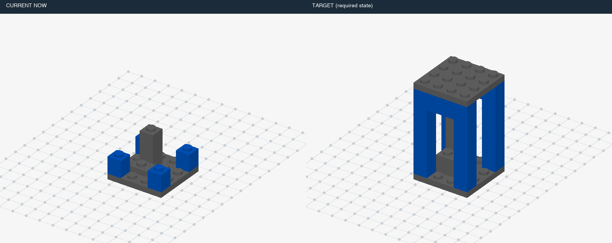

| 条件ID | 静态／动态 | 错误 | 事件数 | 来源类别 | 暂定结构组 | 图片 | 复用旧题 |
|---|---|---|---:|---|---|---|---|
| `v7::v7-long-gantry-press::dynamic::control::t0` | dynamic | 正常 | 0 | 正常 | L2 | [三维画面](assets/v7-long-gantry-press/927ac67b70ea014cf3285f49e6166fe2034c763156766502c67ad1eccc9ba9ab.png) | 新增 |
| `v7::v7-long-gantry-press::dynamic::missing::t8` | dynamic | 少件 | 1 | H01 | L2 | [三维画面](assets/v7-long-gantry-press/48090adaccdce33946ffd3e00bea541067a4e70489b5ec8f89fd80c84fded079.png) | 新增 |
| `v7::v7-long-gantry-press::static::missing::t8` | static | 少件 | 0 | H01 | L1 | [三维画面](assets/v7-long-gantry-press/ee401d08410b655bfae06e00c2b0cbdc0d0828f875daf26cdd38ecc7afba8e7d.png) | 新增 |
| `v7::v7-long-gantry-press::static::control::t8` | static | 正常 | 0 | 正常 | L1 | [三维画面](assets/v7-long-gantry-press/a9fa1a90129d34cf279f88939b09ba5fb0bf1ddae4ea663c1730491978a06bb5.png) | 新增 |
| `v7::v7-long-gantry-press::dynamic::missing::t16` | dynamic | 少件 | 1 | H01 | L2 | [三维画面](assets/v7-long-gantry-press/1e67cae4c4972bdac6f3f89bc11d0a250ce168d4c12c29ce628525b0084fc79f.png) | 新增 |
| `v7::v7-long-gantry-press::static::missing::t16` | static | 少件 | 0 | H01 | L1 | [三维画面](assets/v7-long-gantry-press/e20201e04a83b19ed5923b016bf0566797af8a519a5c9aed888e12e18466b11d.png) | 新增 |
| `v7::v7-long-gantry-press::static::control::t16` | static | 正常 | 0 | 正常 | L1 | [三维画面](assets/v7-long-gantry-press/7dc3c1dfe3814c43144b8eeaaa3a4fd853bddc414c728bfd2e87e5892a6e4c4f.png) | 新增 |
| `v7::v7-long-gantry-press::dynamic::wrong-color::t8` | dynamic | 错色 | 1 | H04 | L2 | [三维画面](assets/v7-long-gantry-press/3f9626be064ee3fb604da8742051af0031406e98b2cf325fa80abb937ba465c4.png) | 新增 |
| `v7::v7-long-gantry-press::static::wrong-color::t8` | static | 错色 | 0 | H04 | L1 | [三维画面](assets/v7-long-gantry-press/0f6c62787bde18f0f57eb167eccec93d7350980a78072c9ee00fc2ae1f4fc38d.png) | 新增 |
| `v7::v7-long-gantry-press::dynamic::wrong-color::t16` | dynamic | 错色 | 1 | H04 | L2 | [三维画面](assets/v7-long-gantry-press/4098a9dcd46b1d1b6c1c673fe66a0abad48dca87062a3bab355821484e0dc9f4.png) | 新增 |
| `v7::v7-long-gantry-press::static::wrong-color::t16` | static | 错色 | 0 | H04 | L1 | [三维画面](assets/v7-long-gantry-press/ae4e9f2421924d6b458b0a2dc0d9751f8a1da18fa7e52b26b7bd4fd9cda6c3e1.png) | 新增 |
| `v7::v7-long-gantry-press::dynamic::extra-layer::t8` | dynamic | 局部多层／重复加件 | 1 | H03, H11 | L2 | [三维画面](assets/v7-long-gantry-press/f547377cc5207bc02b29a8ff7c74b580089b21e475d76a35ebf11c7dd23c1858.png) | 新增 |
| `v7::v7-long-gantry-press::static::extra-layer::t8` | static | 局部多层／重复加件 | 0 | H03, H11 | L1 | [三维画面](assets/v7-long-gantry-press/f58d6eb4d43e11ec437474aa07df3a7c65e9cfb86bffb07f0901b8e67e5dbe74.png) | 新增 |
| `v7::v7-long-gantry-press::dynamic::extra-layer::t16` | dynamic | 局部多层／重复加件 | 1 | H03, H11 | L2 | [三维画面](assets/v7-long-gantry-press/caecbde8d1f180572bb1cbd45aff1d2f610f7f81e08c008a9500cc3fa3998e86.png) | 新增 |
| `v7::v7-long-gantry-press::static::extra-layer::t16` | static | 局部多层／重复加件 | 0 | H03, H11 | L1 | [三维画面](assets/v7-long-gantry-press/8344407f4d74b8e0002db6ba956eff932a3cdbba4f31a238b997ea86b42c2761.png) | 新增 |
| `v7::v7-long-gantry-press::dynamic::offset::t8` | dynamic | 偏移一格 | 1 | H07 | L2 | [三维画面](assets/v7-long-gantry-press/c795a12f2965700bae5a7e01da1a160e8ed1838caeaef4c005f7251e0a440ce1.png) | 新增 |
| `v7::v7-long-gantry-press::static::offset::t8` | static | 偏移一格 | 0 | H07 | L1 | [三维画面](assets/v7-long-gantry-press/f79ff17214d4e53a6fa72a4953f5698ee3c637a8f162ba2e1aa3d3747f1bfb42.png) | 新增 |
| `v7::v7-long-gantry-press::dynamic::offset::t16` | dynamic | 偏移一格 | 1 | H07 | L2 | [三维画面](assets/v7-long-gantry-press/bebd0091da71cdb696ef03f2c34511d28f5c28786b33054b97e050faf7d317a1.png) | 新增 |
| `v7::v7-long-gantry-press::static::offset::t16` | static | 偏移一格 | 0 | H07 | L1 | [三维画面](assets/v7-long-gantry-press/1385713605da6acdc9e01f49e8855f5a18b498605a18eb9c2ade3139655bad97.png) | 新增 |
| `v7::v7-long-gantry-press::dynamic::rotated::t8` | dynamic | 装反 | 1 | H06 | L2 | [三维画面](assets/v7-long-gantry-press/09037492481b23fb2cb27cb709fdbe037e5144011cc282a4c55e43c5a11ea6ac.png) | 新增 |
| `v7::v7-long-gantry-press::static::rotated::t8` | static | 装反 | 0 | H06 | L1 | [三维画面](assets/v7-long-gantry-press/19c2a73f2aa183e5f66bca2c4a203d06799c653ccf77f03f0771b7549309bb3e.png) | 新增 |
| `v7::v7-long-gantry-press::dynamic::rotated::t16` | dynamic | 装反 | 1 | H06 | L2 | [三维画面](assets/v7-long-gantry-press/c26d1f3c007cbaf536e33785c79df894932ddd4edf44e9413422da4bd4e97c94.png) | 新增 |
| `v7::v7-long-gantry-press::static::rotated::t16` | static | 装反 | 0 | H06 | L1 | [三维画面](assets/v7-long-gantry-press/f071e6605d893e5cb0027f9001c15ea32c11d03f7e859ea1edccdc0e8b5b9a57.png) | 新增 |
| `v7::v7-long-gantry-press::dynamic::wrong-part::t8` | dynamic | 错零件／厚度 | 1 | H05 | L2 | [三维画面](assets/v7-long-gantry-press/9abcf1eabb9492d0b92cdb636d6d8016afbf694fa7cb50d8d36f3e2534684ce3.png) | 新增 |
| `v7::v7-long-gantry-press::static::wrong-part::t8` | static | 错零件／厚度 | 0 | H05 | L1 | [三维画面](assets/v7-long-gantry-press/cf9d152918e9f07c883f583fe4f5de33766a284d70c3ebf32f754458f78213c3.png) | 新增 |
| `v7::v7-long-gantry-press::dynamic::wrong-part::t16` | dynamic | 错零件／厚度 | 1 | H05 | L2 | [三维画面](assets/v7-long-gantry-press/7f441d6b9fdc718a8393acb9e0d4019733255fedd97896b2c8d3a8b2beb5e943.png) | 新增 |
| `v7::v7-long-gantry-press::static::wrong-part::t16` | static | 错零件／厚度 | 0 | H05 | L1 | [三维画面](assets/v7-long-gantry-press/91f0f86dfbf8cee0ba2c177951d16bd1437ca20391f17f97edddbee9f3d62681.png) | 新增 |
| `v7::v7-long-gantry-press::dynamic::early-cover::t18` | dynamic | 提前封口 | 1 | H09 | L2 | [三维画面](assets/v7-long-gantry-press/99cf06efe169a1b1448e1b0bc88b38050353d8e7db8b7b9d13851a17c887a929.png) | 新增 |
| `v7::v7-long-gantry-press::static::early-cover::t18` | static | 提前封口 | 0 | H09 | L1 | [三维画面](assets/v7-long-gantry-press/3c40b2fbaa858f58b700a6ffa4484d9693e3139179bf1edd96326dbeb2232a46.png) | 新增 |
| `v7::v7-long-gantry-press::static::control::t18` | static | 正常 | 0 | 正常 | L1 | [三维画面](assets/v7-long-gantry-press/417097055cbef491fcd5135281540dd60dd2e7193c8f51fd53eae99df79666f3.png) | 新增 |
| `v7::v7-long-gantry-press::dynamic::early-cover::t19` | dynamic | 提前封口 | 1 | H09 | L2 | [三维画面](assets/v7-long-gantry-press/e84ec2cde6fbd65565fe87ceb16e92135b3b524ba40a49603e265dcf4bf17049.png) | 新增 |
| `v7::v7-long-gantry-press::static::early-cover::t19` | static | 提前封口 | 0 | H09 | L1 | [三维画面](assets/v7-long-gantry-press/75afd7a733f76d914e1292b05b3da80684598a9b55f3129dfc4598491bd663b8.png) | 新增 |
| `v7::v7-long-gantry-press::static::control::t19` | static | 正常 | 0 | 正常 | L1 | [三维画面](assets/v7-long-gantry-press/7e9da3e32b0dbb139e5dc563b78212dc1e75e307933214d0578e68d21e07bcb9.png) | 新增 |
| `v7::v7-long-gantry-press::dynamic::buried-repair::t8` | dynamic | 拆上层返修 | 1 | H10 | L3 | [三维画面](assets/v7-long-gantry-press/eff56b2922fa426bd7201d64d245f84700d4e357d0e0bbf33cc23ebfd5152254.png) | 新增 |
| `v7::v7-long-gantry-press::static::buried-repair::t8` | static | 拆上层返修 | 0 | H10 | L2 | [三维画面](assets/v7-long-gantry-press/e108fd3d989106c3d10b964f6085c86776e218590925b717560144c7c866f79a.png) | 新增 |
| `v7::v7-long-gantry-press::dynamic::buried-repair::t16` | dynamic | 拆上层返修 | 1 | H10 | L3 | [三维画面](assets/v7-long-gantry-press/189dadb18525d1a84329679fed3ddc7e796c12c52e508e4dbc26d876bda03fc3.png) | 新增 |
| `v7::v7-long-gantry-press::static::buried-repair::t16` | static | 拆上层返修 | 0 | H10 | L2 | [三维画面](assets/v7-long-gantry-press/f00bf1e5543b03a225b72971266ecf320d212315bd6a047f3a8f2c914cceabb4.png) | 新增 |
| `v7::v7-long-gantry-press::dynamic::left-right-swap::t16` | dynamic | 左右互换 | 1 | H08 | L2 | [三维画面](assets/v7-long-gantry-press/9d09763f06290e51f7c3c2a690e35f7b7c60cb2cb20dd016d766fa4d8a0b3ecb.png) | 新增 |
| `v7::v7-long-gantry-press::static::left-right-swap::t16` | static | 左右互换 | 0 | H08 | L1 | [三维画面](assets/v7-long-gantry-press/bd5d04e95a692e30a1a5f15620996bca03e4234a8548d4cdb3b30517a3b09e37.png) | 新增 |
| `v7::v7-long-gantry-press::dynamic::left-right-swap::t5` | dynamic | 左右互换 | 1 | H08 | L2 | [三维画面](assets/v7-long-gantry-press/3945eb58a7aa913ae7ce9f3f805b96b282340d219cccfbe8f1fde16445d26c6d.png) | 新增 |
| `v7::v7-long-gantry-press::static::left-right-swap::t5` | static | 左右互换 | 0 | H08 | L1 | [三维画面](assets/v7-long-gantry-press/60b84dc9156f757658d6278d40c386a29c56a03089f8af964a9adc1f60d9480e.png) | 新增 |
| `v7::v7-long-gantry-press::static::control::t5` | static | 正常 | 0 | 正常 | L1 | [三维画面](assets/v7-long-gantry-press/bda6ae3507bdb8c2e3ef9179713b30db21a3734808385338faf5c58e4997790f.png) | 新增 |
| `v7::v7-long-gantry-press::dynamic::repeat-omission::t8` | dynamic | 重复组件漏做 | 1 | H02 | L2 | [三维画面](assets/v7-long-gantry-press/46362352dda7572282602c76b81625d08b04e11242e1dbcf45434bc98d617936.png) | 新增 |
| `v7::v7-long-gantry-press::static::repeat-omission::t8` | static | 重复组件漏做 | 0 | H02 | L1 | [三维画面](assets/v7-long-gantry-press/afacc561a1284a330fe52bfcf4c180f7fb792d5c405ff2c15cff97838348d93f.png) | 新增 |
| `v7::v7-long-gantry-press::dynamic::repeat-omission::t16` | dynamic | 重复组件漏做 | 1 | H02 | L2 | [三维画面](assets/v7-long-gantry-press/15300b0bcb0d6c5c8235546ade5a8b1b77bec1a9bdd43f11ef8ea919f0f9b5e7.png) | 新增 |
| `v7::v7-long-gantry-press::static::repeat-omission::t16` | static | 重复组件漏做 | 0 | H02 | L1 | [三维画面](assets/v7-long-gantry-press/3503c0c7f756a361667ffe1983898b28334cd47c7328141ebc38e99903c03246.png) | 新增 |
| `v7::v7-long-gantry-press::static::control::t9` | static | 正常 | 0 | 正常 | L1 | [三维画面](assets/v7-long-gantry-press/01d8a057e04d60ddf4cdb18c799e088d8a49a73da5835b54ea80a2df48cc6758.png) | 新增 |
| `v7::v7-long-gantry-press::dynamic::multiple::missingthen-wrong-color` | dynamic | 连续：少件 → 错色 | 2 | H01, H04, H13 | L3 | [三维画面](assets/v7-long-gantry-press/48090adaccdce33946ffd3e00bea541067a4e70489b5ec8f89fd80c84fded079.png) | 新增 |
| `v7::v7-long-gantry-press::dynamic::multiple::offsetthen-extra-layer` | dynamic | 连续：偏移一格 → 局部多层／重复加件 | 2 | H03, H07, H11, H13 | L3 | [三维画面](assets/v7-long-gantry-press/c795a12f2965700bae5a7e01da1a160e8ed1838caeaef4c005f7251e0a440ce1.png) | 新增 |
| `v7::v7-long-gantry-press::dynamic::multiple::wrong-partthen-missing` | dynamic | 连续：错零件／厚度 → 少件 | 2 | H01, H05, H13 | L3 | [三维画面](assets/v7-long-gantry-press/9abcf1eabb9492d0b92cdb636d6d8016afbf694fa7cb50d8d36f3e2534684ce3.png) | 新增 |
| `v7::v7-long-gantry-press::dynamic::multiple::missingthen-wrong-colorthen-offset` | dynamic | 连续：少件 → 错色 → 偏移一格 | 3 | H01, H04, H07, H13 | L3 | [三维画面](assets/v7-long-gantry-press/d291b2eb5186f73cc55741257734e9eef4abcfd326617b10529e1e26587a53fc.png) | 新增 |

## 小屋：墙体与屋面 · `v7-long-cottage`

部分：D-long；正常拼装／模块全长：24块；来源：`original:v7:long-cottage`。

本物件包含：拆上层返修、提前封口、局部多层／重复加件、少件、偏移一格、重复组件漏做、装反、错色、错零件／厚度。

连续干扰：连续：少件 → 错色；连续：少件 → 错色 → 偏移一格；连续：偏移一格 → 局部多层／重复加件；连续：错零件／厚度 → 少件。

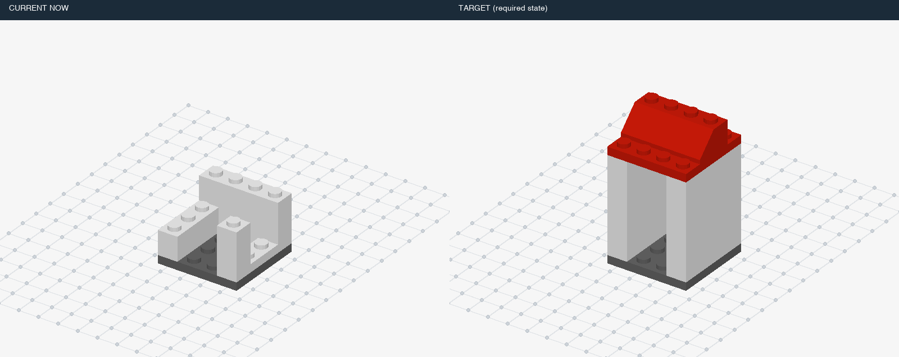

| 条件ID | 静态／动态 | 错误 | 事件数 | 来源类别 | 暂定结构组 | 图片 | 复用旧题 |
|---|---|---|---:|---|---|---|---|
| `v7::v7-long-cottage::dynamic::control::t0` | dynamic | 正常 | 0 | 正常 | L2 | [三维画面](assets/v7-long-cottage/b85d96bccac1f93a0904c374f2b6002b29296579b976a50bc4de711ec229e060.png) | 新增 |
| `v7::v7-long-cottage::dynamic::missing::t8` | dynamic | 少件 | 1 | H01 | L2 | [三维画面](assets/v7-long-cottage/948002ce873aeacebd8f0384d123bac4dc035027a99ddab499016aa59708f42a.png) | 新增 |
| `v7::v7-long-cottage::static::missing::t8` | static | 少件 | 0 | H01 | L1 | [三维画面](assets/v7-long-cottage/8ff352a18b32f94c354917e8aaa843b9b46943f1a9972109a830243a1421ce97.png) | 新增 |
| `v7::v7-long-cottage::static::control::t8` | static | 正常 | 0 | 正常 | L1 | [三维画面](assets/v7-long-cottage/e410ebc058d07f386877be74c5771f03a7982c76373749c16ef005f4e3d8da8f.png) | 新增 |
| `v7::v7-long-cottage::dynamic::missing::t16` | dynamic | 少件 | 1 | H01 | L2 | [三维画面](assets/v7-long-cottage/5d0bd0882e54e2f719492b4f10e5086f4b674c0c0c7df5c9282c54d6517f4c87.png) | 新增 |
| `v7::v7-long-cottage::static::missing::t16` | static | 少件 | 0 | H01 | L1 | [三维画面](assets/v7-long-cottage/bd7fddaf8e6811be00b777989ce4f40dc7ba5a2529af9d765e0873c7b6e0dd83.png) | 新增 |
| `v7::v7-long-cottage::static::control::t16` | static | 正常 | 0 | 正常 | L1 | [三维画面](assets/v7-long-cottage/4c0de9cbda54135e5de9d6e0263ee0d3edc701411d54dd429e06b757734a6273.png) | 新增 |
| `v7::v7-long-cottage::dynamic::wrong-color::t8` | dynamic | 错色 | 1 | H04 | L2 | [三维画面](assets/v7-long-cottage/d4f9c78c53c0b86b101a3049010018a0fb25536eb3fa20a48611f8f03a73a3d5.png) | 新增 |
| `v7::v7-long-cottage::static::wrong-color::t8` | static | 错色 | 0 | H04 | L1 | [三维画面](assets/v7-long-cottage/f25599e2d79ffc7bebd775cc59b1c79193494d99208b672f86c5ed3e650710c5.png) | 新增 |
| `v7::v7-long-cottage::dynamic::wrong-color::t16` | dynamic | 错色 | 1 | H04 | L2 | [三维画面](assets/v7-long-cottage/6636111905ae6d9a16f6e9ddeb232828dfb4fa9d0a6d55e7100d0c99bf0f832f.png) | 新增 |
| `v7::v7-long-cottage::static::wrong-color::t16` | static | 错色 | 0 | H04 | L1 | [三维画面](assets/v7-long-cottage/ac1802075bcf8bbb6fbe3b046cacdd5037bb454b65f2a1f3ddd4149a8be5ca14.png) | 新增 |
| `v7::v7-long-cottage::dynamic::extra-layer::t8` | dynamic | 局部多层／重复加件 | 1 | H03, H11 | L2 | [三维画面](assets/v7-long-cottage/b3f9a117f5661b0075c0ddb232ded47ae44b59a59d2513e0ada0447cbbbaf91a.png) | 新增 |
| `v7::v7-long-cottage::static::extra-layer::t8` | static | 局部多层／重复加件 | 0 | H03, H11 | L1 | [三维画面](assets/v7-long-cottage/7a7b28c68e39741067ff5216b48e36f96d85a96adb460ffa495166f7593a5a09.png) | 新增 |
| `v7::v7-long-cottage::dynamic::extra-layer::t16` | dynamic | 局部多层／重复加件 | 1 | H03, H11 | L2 | [三维画面](assets/v7-long-cottage/122e04ad518442caec7f8e0226c6ad98c9580f56372ceb9222c98f73abb07205.png) | 新增 |
| `v7::v7-long-cottage::static::extra-layer::t16` | static | 局部多层／重复加件 | 0 | H03, H11 | L1 | [三维画面](assets/v7-long-cottage/bab3898a713066508f31aad4ff7f8624a7ff3c6b234e901b6aaa144cf5a86bc2.png) | 新增 |
| `v7::v7-long-cottage::dynamic::offset::t8` | dynamic | 偏移一格 | 1 | H07 | L2 | [三维画面](assets/v7-long-cottage/da66f5046593220b87fa25b6c8e91be719560dd226dee43b16dc69790b37bdbb.png) | 新增 |
| `v7::v7-long-cottage::static::offset::t8` | static | 偏移一格 | 0 | H07 | L1 | [三维画面](assets/v7-long-cottage/37123df3851bf02e467ecb4dc182f1f29bf40119ffe914933b5ae974ba5e860a.png) | 新增 |
| `v7::v7-long-cottage::dynamic::offset::t16` | dynamic | 偏移一格 | 1 | H07 | L2 | [三维画面](assets/v7-long-cottage/0ae00d68e806ec9307bc1dfc9e099943d93557fa37d26d82c0dc5eee580599b6.png) | 新增 |
| `v7::v7-long-cottage::static::offset::t16` | static | 偏移一格 | 0 | H07 | L1 | [三维画面](assets/v7-long-cottage/06640bb84b559201b43169b26d658af2b3bacab11665bb6342ce370feaf25a9c.png) | 新增 |
| `v7::v7-long-cottage::dynamic::rotated::t8` | dynamic | 装反 | 1 | H06 | L2 | [三维画面](assets/v7-long-cottage/f09cfb2a12df98702bfa56575d705506539f322903cbbd820faa95ac88e47e35.png) | 新增 |
| `v7::v7-long-cottage::static::rotated::t8` | static | 装反 | 0 | H06 | L1 | [三维画面](assets/v7-long-cottage/102ee70aa866bda31aad6404f80c3f21bd28d63c43adffac9a2fc5003d2a750b.png) | 新增 |
| `v7::v7-long-cottage::dynamic::rotated::t16` | dynamic | 装反 | 1 | H06 | L2 | [三维画面](assets/v7-long-cottage/1975907d10485c9c0166fe1009f8e514fbeb1865f113d7d0c9acfd97f9e181b5.png) | 新增 |
| `v7::v7-long-cottage::static::rotated::t16` | static | 装反 | 0 | H06 | L1 | [三维画面](assets/v7-long-cottage/7e8707624f89d94829bb181b9a12623d4ed01e3fd8a11d6388babca87bd0d965.png) | 新增 |
| `v7::v7-long-cottage::dynamic::wrong-part::t8` | dynamic | 错零件／厚度 | 1 | H05 | L2 | [三维画面](assets/v7-long-cottage/37e1f6a1e6d93ec2282165a2706098576525f44748b42ec5ec4af136980d5498.png) | 新增 |
| `v7::v7-long-cottage::static::wrong-part::t8` | static | 错零件／厚度 | 0 | H05 | L1 | [三维画面](assets/v7-long-cottage/6622a008e570cbae8029e489f553764d9355e5cfd11550c18fd0f6097e6a304f.png) | 新增 |
| `v7::v7-long-cottage::dynamic::wrong-part::t16` | dynamic | 错零件／厚度 | 1 | H05 | L2 | [三维画面](assets/v7-long-cottage/c071627c87e73aec274d565b2d93539dd90abd353fc2e296564084c35190b523.png) | 新增 |
| `v7::v7-long-cottage::static::wrong-part::t16` | static | 错零件／厚度 | 0 | H05 | L1 | [三维画面](assets/v7-long-cottage/e37c56541d2050735f4d806c3cc6dbc801588c073740bcf1e28dbb9e521db305.png) | 新增 |
| `v7::v7-long-cottage::dynamic::early-cover::t17` | dynamic | 提前封口 | 1 | H09 | L2 | [三维画面](assets/v7-long-cottage/e4c983b8fff27edca9b38425ab6a8d6ecbb30c71c01ac0954117d6ddd78c40bd.png) | 新增 |
| `v7::v7-long-cottage::static::early-cover::t17` | static | 提前封口 | 0 | H09 | L1 | [三维画面](assets/v7-long-cottage/1c2ef05df17d83a5146f63f0fd0a38d11377dfcac527a72ec9f60bab017b78ca.png) | 新增 |
| `v7::v7-long-cottage::static::control::t17` | static | 正常 | 0 | 正常 | L1 | [三维画面](assets/v7-long-cottage/e98b4d056cb97b8860771533b851db35a24b5ab6d0ec68f92a7ae262f05b0f6d.png) | 新增 |
| `v7::v7-long-cottage::dynamic::early-cover::t18` | dynamic | 提前封口 | 1 | H09 | L2 | [三维画面](assets/v7-long-cottage/b35c9b2154596f99abd930bd5a8e6f3c4476cff15a102be92986d6e2f36a5c58.png) | 新增 |
| `v7::v7-long-cottage::static::early-cover::t18` | static | 提前封口 | 0 | H09 | L1 | [三维画面](assets/v7-long-cottage/611a25aa0a80c0079d84e8f43c9808c1099a47539196dd81321b5602532b4a6c.png) | 新增 |
| `v7::v7-long-cottage::static::control::t18` | static | 正常 | 0 | 正常 | L1 | [三维画面](assets/v7-long-cottage/1d51e7533538b91c15d308f37d7874f12e8b2f021d51009e9d7784d95da1ec51.png) | 新增 |
| `v7::v7-long-cottage::dynamic::buried-repair::t8` | dynamic | 拆上层返修 | 1 | H10 | L3 | [三维画面](assets/v7-long-cottage/3228c96c26385a2a5510d9538375266a19a4617f8d64418f3e343ea6d0e9f7f0.png) | 新增 |
| `v7::v7-long-cottage::static::buried-repair::t8` | static | 拆上层返修 | 0 | H10 | L2 | [三维画面](assets/v7-long-cottage/0217aeba514b70a8cca0b5d74ed9d7b7648185655efa3911d507743174af5178.png) | 新增 |
| `v7::v7-long-cottage::dynamic::buried-repair::t16` | dynamic | 拆上层返修 | 1 | H10 | L3 | [三维画面](assets/v7-long-cottage/3a4612ff8c4ec5d99edd544141cb608c69610ccd1d4d96ca43dd8f41747856a6.png) | 新增 |
| `v7::v7-long-cottage::static::buried-repair::t16` | static | 拆上层返修 | 0 | H10 | L2 | [三维画面](assets/v7-long-cottage/2f8cab967e4a0fa1b472af5db8a136efdad9fdc623c3cd7852165ff10a15847f.png) | 新增 |
| `v7::v7-long-cottage::dynamic::repeat-omission::t8` | dynamic | 重复组件漏做 | 1 | H02 | L2 | [三维画面](assets/v7-long-cottage/6b3b63cc05b5dd5b663e483362e8a4df8d4ad836e60b986d6636d91b2709f7f9.png) | 新增 |
| `v7::v7-long-cottage::static::repeat-omission::t8` | static | 重复组件漏做 | 0 | H02 | L1 | [三维画面](assets/v7-long-cottage/ccdb947f927d3e28c1eca18a02d85313b28c24b3c20f2028f1b05e8823e1b588.png) | 新增 |
| `v7::v7-long-cottage::dynamic::repeat-omission::t16` | dynamic | 重复组件漏做 | 1 | H02 | L2 | [三维画面](assets/v7-long-cottage/e8547a03f9a8f19a729591911a7bb9eafb8ddc9411f974b3975d1c2ba22cbb31.png) | 新增 |
| `v7::v7-long-cottage::static::repeat-omission::t16` | static | 重复组件漏做 | 0 | H02 | L1 | [三维画面](assets/v7-long-cottage/bbe9be84ebc92e95acd4cfa2dcd13d1dadbdf7fb951d76acd70c6775ca26aa86.png) | 新增 |
| `v7::v7-long-cottage::dynamic::multiple::missingthen-wrong-color` | dynamic | 连续：少件 → 错色 | 2 | H01, H04, H13 | L3 | [三维画面](assets/v7-long-cottage/948002ce873aeacebd8f0384d123bac4dc035027a99ddab499016aa59708f42a.png) | 新增 |
| `v7::v7-long-cottage::dynamic::multiple::offsetthen-extra-layer` | dynamic | 连续：偏移一格 → 局部多层／重复加件 | 2 | H03, H07, H11, H13 | L3 | [三维画面](assets/v7-long-cottage/da66f5046593220b87fa25b6c8e91be719560dd226dee43b16dc69790b37bdbb.png) | 新增 |
| `v7::v7-long-cottage::dynamic::multiple::wrong-partthen-missing` | dynamic | 连续：错零件／厚度 → 少件 | 2 | H01, H05, H13 | L3 | [三维画面](assets/v7-long-cottage/37e1f6a1e6d93ec2282165a2706098576525f44748b42ec5ec4af136980d5498.png) | 新增 |
| `v7::v7-long-cottage::dynamic::multiple::missingthen-wrong-colorthen-offset` | dynamic | 连续：少件 → 错色 → 偏移一格 | 3 | H01, H04, H07, H13 | L3 | [三维画面](assets/v7-long-cottage/a7e1593c7f36635742ed766c08c9d38892ba162a33a030a15b0add4c63e84563.png) | 新增 |

## 小屋：补完屋顶 · `cottage-roof`

部分：M-expanded；正常拼装／模块全长：6块；来源：`31009`。

原模型作者：Stefan Frenz [smf]；[来源](https://library.ldraw.org/omr/sets/1164)。

本物件包含：拆上层返修、局部多层／重复加件、少件、偏移一格、重复组件漏做、装反、错色、错零件／厚度。

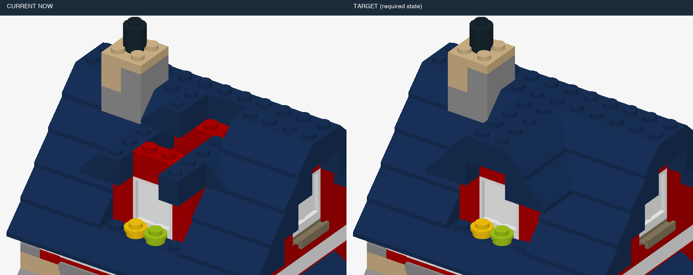

| 条件ID | 静态／动态 | 错误 | 事件数 | 来源类别 | 暂定结构组 | 图片 | 复用旧题 |
|---|---|---|---:|---|---|---|---|
| `v7::cottage-roof::dynamic::control::t0` | dynamic | 正常 | 0 | 正常 | L1 | [三维画面](assets/cottage-roof/1ef4215aa9d788d7f8194b27e1ddc0ef21fc8faf7fc774fb73566215d6bc972a.png) | M:cottage-roof-dynamic-control |
| `v7::cottage-roof::dynamic::missing::t3` | dynamic | 少件 | 1 | H01 | L1 | [三维画面](assets/cottage-roof/a8120424b471cfffb002341ca21735e471f34e61d9b6eeff71b28e7b9a963bd7.png) | M:cottage-roof-dynamic-missing |
| `v7::cottage-roof::static::missing::t3` | static | 少件 | 0 | H01 | L1 | [三维画面](assets/cottage-roof/8b0e4714d68d4737e0aec6519d755d9583649ac952e53dd51c2d07ab6c1fc0d4.png) | M:cottage-roof-static-missing |
| `v7::cottage-roof::static::control::t3` | static | 正常 | 0 | 正常 | L1 | [三维画面](assets/cottage-roof/3a5bf8ce051db7b349ddacb5e3ba94ac6de36302e2365ad136740f1e72aed98e.png) | M:cottage-roof-static-control |
| `v7::cottage-roof::dynamic::missing::t4` | dynamic | 少件 | 1 | H01 | L1 | [三维画面](assets/cottage-roof/6f14953e1ee11e494e91e99afc37b86b8105ea851b3eee356180490289c0fcf8.png) | 新增 |
| `v7::cottage-roof::static::missing::t4` | static | 少件 | 0 | H01 | L1 | [三维画面](assets/cottage-roof/e626383a96abf9fcf13f61a7908a7d182257aa90a5beafe7c8654682e07865b7.png) | 新增 |
| `v7::cottage-roof::static::control::t4` | static | 正常 | 0 | 正常 | L1 | [三维画面](assets/cottage-roof/e14e8534b167a8be2f637f627f394300b972c7e3cbfdd8fe93b4ed46de9b9c17.png) | 新增 |
| `v7::cottage-roof::dynamic::wrong-color::t3` | dynamic | 错色 | 1 | H04 | L1 | [三维画面](assets/cottage-roof/e1d8b9f154a9bbc424c174fdee83422cbb159c166dff349b24e205f211c84c36.png) | M:cottage-roof-dynamic-wrong-color |
| `v7::cottage-roof::static::wrong-color::t3` | static | 错色 | 0 | H04 | L1 | [三维画面](assets/cottage-roof/8ccdc75ae761af6a98c9209b2bc7be2c3c4ef7181c3f0170678f47fdca9ab2e4.png) | M:cottage-roof-static-wrong-color |
| `v7::cottage-roof::dynamic::wrong-color::t4` | dynamic | 错色 | 1 | H04 | L1 | [三维画面](assets/cottage-roof/aad6cb5774bd6d8d9316a28233b4e02e7609f66dbeed3d043df141ef56171b2c.png) | 新增 |
| `v7::cottage-roof::static::wrong-color::t4` | static | 错色 | 0 | H04 | L1 | [三维画面](assets/cottage-roof/295d3c4cea6803cf06bad79306aef07aa125e80293a6393e5f905ff6d08a008c.png) | 新增 |
| `v7::cottage-roof::dynamic::extra-layer::t3` | dynamic | 局部多层／重复加件 | 1 | H03, H11 | L1 | [三维画面](assets/cottage-roof/5587d724b074113d877765779efba5062b34115b1d7ece6157cf0b9c7d6b8129.png) | M:cottage-roof-dynamic-extra-layer |
| `v7::cottage-roof::static::extra-layer::t3` | static | 局部多层／重复加件 | 0 | H03, H11 | L1 | [三维画面](assets/cottage-roof/4dc1e5147200d689c99d9d43cd2881682fe4fdacb3089dd121789510f87564e6.png) | M:cottage-roof-static-extra-layer |
| `v7::cottage-roof::dynamic::extra-layer::t4` | dynamic | 局部多层／重复加件 | 1 | H03, H11 | L1 | [三维画面](assets/cottage-roof/2e8dd5add697ed5f5acebf294b2c3ce03e53605c160de470f8d458691da66316.png) | 新增 |
| `v7::cottage-roof::static::extra-layer::t4` | static | 局部多层／重复加件 | 0 | H03, H11 | L1 | [三维画面](assets/cottage-roof/18f5feed0d43e809666bdeb92f7e4f57dbbeef5e873ffc4b848edb39a47f1aa6.png) | 新增 |
| `v7::cottage-roof::dynamic::offset::t4` | dynamic | 偏移一格 | 1 | H07 | L1 | [三维画面](assets/cottage-roof/a555e82b393ead44ad9266f542bdeb7a6c0f29ca860f38191b58289dd6eebf3a.png) | 新增 |
| `v7::cottage-roof::static::offset::t4` | static | 偏移一格 | 0 | H07 | L1 | [三维画面](assets/cottage-roof/21f306c5225cf293cc0149845791965a567006a662f6fc0eb4d9badbdb2ea7ec.png) | 新增 |
| `v7::cottage-roof::dynamic::offset::t5` | dynamic | 偏移一格 | 1 | H07 | L1 | [三维画面](assets/cottage-roof/7be95201e4444a2f667386b327cc0330a35759694a76c913bc0b90d08d7bdac6.png) | 新增 |
| `v7::cottage-roof::static::offset::t5` | static | 偏移一格 | 0 | H07 | L1 | [三维画面](assets/cottage-roof/6e91a361d550f7ea9516ae4e105142a76f01237132451b21896187b529905abc.png) | 新增 |
| `v7::cottage-roof::static::control::t5` | static | 正常 | 0 | 正常 | L1 | [三维画面](assets/cottage-roof/03fee812a9998bf5f51259e0dba6324628ac28a5c6a80afeb7c0bc27556c8cfb.png) | 新增 |
| `v7::cottage-roof::dynamic::rotated::t3` | dynamic | 装反 | 1 | H06 | L1 | [三维画面](assets/cottage-roof/072be249ab2a210e737cf4bd9e06e583d9034a551689b237daaea1a6b53c3123.png) | 新增 |
| `v7::cottage-roof::static::rotated::t3` | static | 装反 | 0 | H06 | L1 | [三维画面](assets/cottage-roof/e2903b43d3d697baecf59e283c1d9c0ea6cf2add5dd9ab4818e81955d6a23db1.png) | 新增 |
| `v7::cottage-roof::dynamic::rotated::t4` | dynamic | 装反 | 1 | H06 | L1 | [三维画面](assets/cottage-roof/631211ba9757412bf925d7a7390abcc1845a007d4007be6f63202b4aef94c0e2.png) | 新增 |
| `v7::cottage-roof::static::rotated::t4` | static | 装反 | 0 | H06 | L1 | [三维画面](assets/cottage-roof/5c42f66fb292749cfa3cbfa9021febd4eeefcdc65344098b07a0dddddd2c4c78.png) | 新增 |
| `v7::cottage-roof::dynamic::wrong-part::t3` | dynamic | 错零件／厚度 | 1 | H05 | L1 | [三维画面](assets/cottage-roof/510bc19d8532c3963ca160d7799eee1c9ba436a4208e74b3b28960e8fda4303a.png) | 新增 |
| `v7::cottage-roof::static::wrong-part::t3` | static | 错零件／厚度 | 0 | H05 | L1 | [三维画面](assets/cottage-roof/df85135132ca937220c75f629c050b7b51fdfdbd9f96c0b714b2e6593c7c76fa.png) | 新增 |
| `v7::cottage-roof::dynamic::wrong-part::t4` | dynamic | 错零件／厚度 | 1 | H05 | L1 | [三维画面](assets/cottage-roof/db94f4366c7e1ad2db917364c58730fb773696d7a1094d22fc1d8361f04a818d.png) | 新增 |
| `v7::cottage-roof::static::wrong-part::t4` | static | 错零件／厚度 | 0 | H05 | L1 | [三维画面](assets/cottage-roof/d32531ec555e3430caf1344364e4b49fcf3c76e180b6d5d617bf843c4f1de151.png) | 新增 |
| `v7::cottage-roof::dynamic::buried-repair::t4` | dynamic | 拆上层返修 | 1 | H10 | L2 | [三维画面](assets/cottage-roof/19db3c71402d25f983f9997a61cac06ac7ad730c3032d8940e5ac4972e8e9cc5.png) | 新增 |
| `v7::cottage-roof::static::buried-repair::t4` | static | 拆上层返修 | 0 | H10 | L2 | [三维画面](assets/cottage-roof/f3b118043d6341d36bd2caef4a1618a0bd81fb9cb4ed38e1767e0b274972d728.png) | 新增 |
| `v7::cottage-roof::dynamic::buried-repair::t5` | dynamic | 拆上层返修 | 1 | H10 | L2 | [三维画面](assets/cottage-roof/ff4c557e8aa50099abbf3f6b1993248d40fd9aeb54583789a913a954d8a64454.png) | 新增 |
| `v7::cottage-roof::static::buried-repair::t5` | static | 拆上层返修 | 0 | H10 | L2 | [三维画面](assets/cottage-roof/d54e80676f0166252c1962cc00565ca76bf78e780ce5b3e4143ab54514ff2646.png) | 新增 |
| `v7::cottage-roof::dynamic::repeat-omission::t3` | dynamic | 重复组件漏做 | 1 | H02 | L1 | [三维画面](assets/cottage-roof/e10b326118d795973fbd36f06210ce18c8c6f2275dcd4aee244ff53d4937a965.png) | 新增 |
| `v7::cottage-roof::static::repeat-omission::t3` | static | 重复组件漏做 | 0 | H02 | L1 | [三维画面](assets/cottage-roof/7948caf119545cb8ce0ba646e2c726ef0ed09e793cef3bbbeaaf320c48615bfe.png) | 新增 |

## 赛车：补完车身上半部 · `racer-top`

部分：M-expanded；正常拼装／模块全长：11块；来源：`31027`。

原模型作者：Merlijn Wissink [legolijntje]；[来源](https://library.ldraw.org/omr/sets/223)。

本物件包含：拆上层返修、局部多层／重复加件、少件、偏移一格、重复组件漏做、装反、错色、错零件／厚度。

连续干扰：连续：少件 → 错色；连续：偏移一格 → 局部多层／重复加件；连续：错零件／厚度 → 少件。

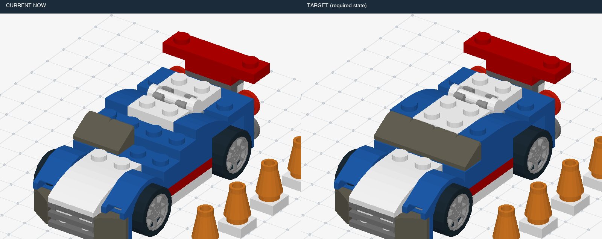

| 条件ID | 静态／动态 | 错误 | 事件数 | 来源类别 | 暂定结构组 | 图片 | 复用旧题 |
|---|---|---|---:|---|---|---|---|
| `v7::racer-top::dynamic::control::t0` | dynamic | 正常 | 0 | 正常 | L1 | [三维画面](assets/racer-top/7164e3a77bd083d3476557352c92689f697d06e63318d832626042f5ee2a0091.png) | M:racer-top-dynamic-control |
| `v7::racer-top::dynamic::missing::t3` | dynamic | 少件 | 1 | H01 | L1 | [三维画面](assets/racer-top/7c8f28c086fc47515e88c91ae3ee99e1313c7cdf29882a242652edb901640d1b.png) | M:racer-top-dynamic-missing |
| `v7::racer-top::static::missing::t3` | static | 少件 | 0 | H01 | L1 | [三维画面](assets/racer-top/5cf9799a2b0af613c568dab537e28da8c0eba7f14b0190a6991a9e37ec169a35.png) | M:racer-top-static-missing |
| `v7::racer-top::static::control::t3` | static | 正常 | 0 | 正常 | L1 | [三维画面](assets/racer-top/1643a2918c05dfe9c8ce446395d2363011a321385647d118f32e70c0fecaf784.png) | M:racer-top-static-control |
| `v7::racer-top::dynamic::missing::t7` | dynamic | 少件 | 1 | H01 | L1 | [三维画面](assets/racer-top/f0940c958a91688f34cc233e1ee8727de8371c6856d80a6b16ebd5185679d912.png) | 新增 |
| `v7::racer-top::static::missing::t7` | static | 少件 | 0 | H01 | L1 | [三维画面](assets/racer-top/10375b125ee99e40c318c26dbc8748a595e8cf1275a43721f54c8219aef3662d.png) | 新增 |
| `v7::racer-top::static::control::t7` | static | 正常 | 0 | 正常 | L1 | [三维画面](assets/racer-top/44873630df40a6fcf42710e0ab7639d5dea3ece8aaff916218fc5772b943cfe1.png) | 新增 |
| `v7::racer-top::dynamic::wrong-color::t3` | dynamic | 错色 | 1 | H04 | L1 | [三维画面](assets/racer-top/c909f15541c335bbdbf4423c3318a6ee5f72f404ca8b3dc155ab7744fc88c8b4.png) | M:racer-top-dynamic-wrong-color |
| `v7::racer-top::static::wrong-color::t3` | static | 错色 | 0 | H04 | L1 | [三维画面](assets/racer-top/a5f2cd6f0c83a2354be78d2b5c9ccf1b28d54dced41b3a163c2168957ee00175.png) | M:racer-top-static-wrong-color |
| `v7::racer-top::dynamic::wrong-color::t7` | dynamic | 错色 | 1 | H04 | L1 | [三维画面](assets/racer-top/b749bf6757841165a97778efb59303cd0dc9c32734dda2bbf9a6c1142256b7a4.png) | 新增 |
| `v7::racer-top::static::wrong-color::t7` | static | 错色 | 0 | H04 | L1 | [三维画面](assets/racer-top/0eee9fc3757adc920a7d5acb4374d5bfbaf0798f3a348e3ff5cc55c8cd4447fb.png) | 新增 |
| `v7::racer-top::dynamic::extra-layer::t3` | dynamic | 局部多层／重复加件 | 1 | H03, H11 | L1 | [三维画面](assets/racer-top/1759fed346c421e16541280700d5a4ee77226c167a99ed76fdd63eb8d8fc72ca.png) | M:racer-top-dynamic-extra-layer |
| `v7::racer-top::static::extra-layer::t3` | static | 局部多层／重复加件 | 0 | H03, H11 | L1 | [三维画面](assets/racer-top/3df5a50b8bbf465a57b555063eb37f74b394d49392abd8a01c3f8742d890a9f2.png) | M:racer-top-static-extra-layer |
| `v7::racer-top::dynamic::extra-layer::t7` | dynamic | 局部多层／重复加件 | 1 | H03, H11 | L1 | [三维画面](assets/racer-top/b3298dd711ae720635b8629f4d96bed01f931642cf3ef26a79436b742d7d4abe.png) | 新增 |
| `v7::racer-top::static::extra-layer::t7` | static | 局部多层／重复加件 | 0 | H03, H11 | L1 | [三维画面](assets/racer-top/ca08f1c050fe8c354da3e45f0539662059aeba0e6e771044ab9a30cde98978c4.png) | 新增 |
| `v7::racer-top::dynamic::offset::t10` | dynamic | 偏移一格 | 1 | H07 | L1 | [三维画面](assets/racer-top/302947ddb2759a603772982402d8dc43d046fd87aa506ccf1fbced7d434cfbf9.png) | 新增 |
| `v7::racer-top::static::offset::t10` | static | 偏移一格 | 0 | H07 | L1 | [三维画面](assets/racer-top/916bbb4e35c584502b9ca1705adf734e779a0809819f0b6154fad64558f475dd.png) | 新增 |
| `v7::racer-top::static::control::t10` | static | 正常 | 0 | 正常 | L1 | [三维画面](assets/racer-top/c094d9ee2e8141b573fd214f81adcd44941b3838bfacabb6161a1e8a8a80ac0b.png) | 新增 |
| `v7::racer-top::dynamic::offset::t5` | dynamic | 偏移一格 | 1 | H07 | L1 | [三维画面](assets/racer-top/64d76d4254ef8d54eccf10e583be33d02403ddd98b84e1933fb4190b88673776.png) | 新增 |
| `v7::racer-top::static::offset::t5` | static | 偏移一格 | 0 | H07 | L1 | [三维画面](assets/racer-top/020ac5686c242afc15b72f0ed9140fb6704e4c8fa5830a3bf7e24a429e9cbb06.png) | 新增 |
| `v7::racer-top::static::control::t5` | static | 正常 | 0 | 正常 | L1 | [三维画面](assets/racer-top/b035606e464f16f57118cdf91698f8e8c4fcf922bb79b9638bcfb3c1c59c8d96.png) | 新增 |
| `v7::racer-top::dynamic::rotated::t3` | dynamic | 装反 | 1 | H06 | L1 | [三维画面](assets/racer-top/13d64a430eb848a68f567df86e6bf95b9f0e63b60c5155b54b3473ab1966471e.png) | 新增 |
| `v7::racer-top::static::rotated::t3` | static | 装反 | 0 | H06 | L1 | [三维画面](assets/racer-top/96d024c63866d6de269526a8696c330c2455fe4e791a01d56260f46135ba1fc6.png) | 新增 |
| `v7::racer-top::dynamic::rotated::t7` | dynamic | 装反 | 1 | H06 | L1 | [三维画面](assets/racer-top/617ac5dfb09bf5cd3285282df38e917588a73358bc65e236ebcb33522ef8dd16.png) | 新增 |
| `v7::racer-top::static::rotated::t7` | static | 装反 | 0 | H06 | L1 | [三维画面](assets/racer-top/6dc564b597eee0d58cd41fad8e1f74f95e4bf734aa79ab9c488a5121cc1dffa6.png) | 新增 |
| `v7::racer-top::dynamic::wrong-part::t7` | dynamic | 错零件／厚度 | 1 | H05 | L1 | [三维画面](assets/racer-top/87607fbe24d7996eecbef91eb4844865f4498c71671f5d51ab0966a19c6370c5.png) | 新增 |
| `v7::racer-top::static::wrong-part::t7` | static | 错零件／厚度 | 0 | H05 | L1 | [三维画面](assets/racer-top/5d5000d0e7fda37e4ae4440f7bbd5189a4ceea456eba5db4f48e0d2c3401fb1e.png) | 新增 |
| `v7::racer-top::dynamic::wrong-part::t10` | dynamic | 错零件／厚度 | 1 | H05 | L1 | [三维画面](assets/racer-top/77a8377d8f3904406473847e42d9a92eab8c46148ce5c88398b5303285b6351a.png) | 新增 |
| `v7::racer-top::static::wrong-part::t10` | static | 错零件／厚度 | 0 | H05 | L1 | [三维画面](assets/racer-top/64c69a8da1429c3e3fd17567ea7bec50a4fbf61a6436fbd4c9be5e211a8cba4c.png) | 新增 |
| `v7::racer-top::dynamic::buried-repair::t3` | dynamic | 拆上层返修 | 1 | H10 | L2 | [三维画面](assets/racer-top/9eb95453615157040f34f9e1e7b432ed42ed3fc36a4b972c1f52b12793b1e614.png) | 新增 |
| `v7::racer-top::static::buried-repair::t3` | static | 拆上层返修 | 0 | H10 | L2 | [三维画面](assets/racer-top/5dfa64dbfb7217d9913b9297fa809d95c92b6f93dd848dc280e1a77dc2bcb379.png) | 新增 |
| `v7::racer-top::dynamic::buried-repair::t7` | dynamic | 拆上层返修 | 1 | H10 | L2 | [三维画面](assets/racer-top/296c331e719b1c57080a833a205115194d6c5deb30efdb9062245a1d537c3581.png) | 新增 |
| `v7::racer-top::static::buried-repair::t7` | static | 拆上层返修 | 0 | H10 | L2 | [三维画面](assets/racer-top/1e4dfbf3e6bae9a218398aa55466775f5a410cd34a87a282fce40ce0ab019907.png) | 新增 |
| `v7::racer-top::dynamic::repeat-omission::t7` | dynamic | 重复组件漏做 | 1 | H02 | L1 | [三维画面](assets/racer-top/5246b1949d390cc203edff0597d23eba92217066e357456f9d94dca903ffcb86.png) | 新增 |
| `v7::racer-top::static::repeat-omission::t7` | static | 重复组件漏做 | 0 | H02 | L1 | [三维画面](assets/racer-top/142f023695ca0d956e41258d7b714bc7e66582e78c5fd542106081e4a0b1387e.png) | 新增 |
| `v7::racer-top::dynamic::repeat-omission::t10` | dynamic | 重复组件漏做 | 1 | H02 | L1 | [三维画面](assets/racer-top/c8026c671d915d9e1a886e63a6ee53a9326cb754984d747fc81ff6cef1a203d9.png) | 新增 |
| `v7::racer-top::static::repeat-omission::t10` | static | 重复组件漏做 | 0 | H02 | L1 | [三维画面](assets/racer-top/2f8f9379cd290a61eeccab44da261d44bb6e8d09e329f57ca431cc887a26ad38.png) | 新增 |
| `v7::racer-top::dynamic::multiple::missingthen-wrong-color` | dynamic | 连续：少件 → 错色 | 2 | H01, H04, H13 | L2 | [三维画面](assets/racer-top/ad63d89ece51694808b54b7f9e9c6b028c18d4e41137f94e43169748814c7ce5.png) | 新增 |
| `v7::racer-top::dynamic::multiple::offsetthen-extra-layer` | dynamic | 连续：偏移一格 → 局部多层／重复加件 | 2 | H03, H07, H11, H13 | L2 | [三维画面](assets/racer-top/64d76d4254ef8d54eccf10e583be33d02403ddd98b84e1933fb4190b88673776.png) | 新增 |
| `v7::racer-top::dynamic::multiple::wrong-partthen-missing` | dynamic | 连续：错零件／厚度 → 少件 | 2 | H01, H05, H13 | L2 | [三维画面](assets/racer-top/58e15d9612edd4e339cd5a57888f5a6beafd36ce211e05ad44f797f9d5ff7215.png) | 新增 |

## 水上飞机：补完尾翼 · `seaplane-tail`

部分：M-expanded；正常拼装／模块全长：7块；来源：`31028`。

原模型作者：Merlijn Wissink [legolijntje]；[来源](https://library.ldraw.org/omr/sets/259)。

本物件包含：拆上层返修、局部多层／重复加件、少件、偏移一格、重复组件漏做、装反、错色。

连续干扰：连续：少件 → 错色；连续：偏移一格 → 局部多层／重复加件。

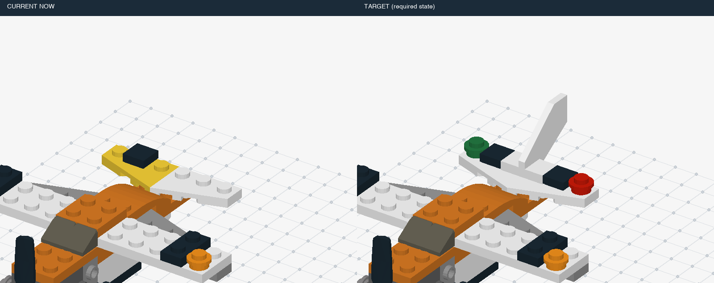

| 条件ID | 静态／动态 | 错误 | 事件数 | 来源类别 | 暂定结构组 | 图片 | 复用旧题 |
|---|---|---|---:|---|---|---|---|
| `v7::seaplane-tail::dynamic::control::t0` | dynamic | 正常 | 0 | 正常 | L1 | [三维画面](assets/seaplane-tail/c2706a6d820aaf399384f2b87ec4ecf0d1e7c8ffcc17d06faf7b64eb14055234.png) | M:seaplane-tail-dynamic-control |
| `v7::seaplane-tail::dynamic::missing::t3` | dynamic | 少件 | 1 | H01 | L1 | [三维画面](assets/seaplane-tail/12c54dae1bb2b7db06b427dda99d69e0c878a3fbea04868142c58119d5bb6e4e.png) | M:seaplane-tail-dynamic-missing |
| `v7::seaplane-tail::static::missing::t3` | static | 少件 | 0 | H01 | L1 | [三维画面](assets/seaplane-tail/cd5915925971be90254b1f1bad91b49ba95ecadc68ff03a3c7f5ac75bf122f23.png) | M:seaplane-tail-static-missing |
| `v7::seaplane-tail::static::control::t3` | static | 正常 | 0 | 正常 | L1 | [三维画面](assets/seaplane-tail/88503f946eca6d4bd359293667568e1015a642fb47e15ad7fe437f1a5aa42dcd.png) | M:seaplane-tail-static-control |
| `v7::seaplane-tail::dynamic::missing::t4` | dynamic | 少件 | 1 | H01 | L1 | [三维画面](assets/seaplane-tail/360fc13284df4412a48e5dedb80c55cff8cb435b57b7846079cc84b25dd9ccba.png) | 新增 |
| `v7::seaplane-tail::static::missing::t4` | static | 少件 | 0 | H01 | L1 | [三维画面](assets/seaplane-tail/3df499ac0e1c7f6397e2849077e8b75ed60dc5bb8ea714459a22c894094d7aa5.png) | 新增 |
| `v7::seaplane-tail::static::control::t4` | static | 正常 | 0 | 正常 | L1 | [三维画面](assets/seaplane-tail/54596a685145f7fe2cf4d1389b75e72a4ae83b7249a39374ecf441c3a3e6674d.png) | 新增 |
| `v7::seaplane-tail::dynamic::wrong-color::t3` | dynamic | 错色 | 1 | H04 | L1 | [三维画面](assets/seaplane-tail/f404cdffb0516a14d918d7a7ff1f1d018b96df6a67ffdbab1576bd9b1a091858.png) | M:seaplane-tail-dynamic-wrong-color |
| `v7::seaplane-tail::static::wrong-color::t3` | static | 错色 | 0 | H04 | L1 | [三维画面](assets/seaplane-tail/dd98231834f57b0ec60a086e060bd86bf2092d2cee61bfec6e69ebfa1f017cc3.png) | M:seaplane-tail-static-wrong-color |
| `v7::seaplane-tail::dynamic::wrong-color::t4` | dynamic | 错色 | 1 | H04 | L1 | [三维画面](assets/seaplane-tail/3450109f51b9b1f3b806536bd70dd1558ff708cd0537a7182051e73eaf8e814e.png) | 新增 |
| `v7::seaplane-tail::static::wrong-color::t4` | static | 错色 | 0 | H04 | L1 | [三维画面](assets/seaplane-tail/26f3be374da7c2497debcd9ff06e02a5410aae7476292fe4bb738b86210bbe2f.png) | 新增 |
| `v7::seaplane-tail::dynamic::extra-layer::t3` | dynamic | 局部多层／重复加件 | 1 | H03, H11 | L1 | [三维画面](assets/seaplane-tail/5328a3afb5d878955d4d265548864b97700a821fdb44d137c5ff6b44b8256d22.png) | M:seaplane-tail-dynamic-extra-layer |
| `v7::seaplane-tail::static::extra-layer::t3` | static | 局部多层／重复加件 | 0 | H03, H11 | L1 | [三维画面](assets/seaplane-tail/6424ad31045660671f1a0775b94525293b139ddcc505b1ec830bf775f99cbbce.png) | M:seaplane-tail-static-extra-layer |
| `v7::seaplane-tail::dynamic::extra-layer::t4` | dynamic | 局部多层／重复加件 | 1 | H03, H11 | L1 | [三维画面](assets/seaplane-tail/45cea24385b430ea1f11a860e710e699e005d1cef72720684ac19d12d6ec9d48.png) | 新增 |
| `v7::seaplane-tail::static::extra-layer::t4` | static | 局部多层／重复加件 | 0 | H03, H11 | L1 | [三维画面](assets/seaplane-tail/ac21ad5bc1d52bc3926f28bd03d605e478fc9d8bffe9b20826055f78ce51e1b9.png) | 新增 |
| `v7::seaplane-tail::dynamic::offset::t3` | dynamic | 偏移一格 | 1 | H07 | L1 | [三维画面](assets/seaplane-tail/9ea75c57723a16df896d40836e170f2506fcddf1f4ae862a209d1a313fb634a5.png) | 新增 |
| `v7::seaplane-tail::static::offset::t3` | static | 偏移一格 | 0 | H07 | L1 | [三维画面](assets/seaplane-tail/3ce96f7814b9e4a038805cd2fc13bdfdc43789c75d33ccb0517a9a23e3221fcb.png) | 新增 |
| `v7::seaplane-tail::dynamic::offset::t4` | dynamic | 偏移一格 | 1 | H07 | L1 | [三维画面](assets/seaplane-tail/24e0e1f7176b619a730031540a7ae93d47b3f41e172233eb40645ab0699bbd74.png) | 新增 |
| `v7::seaplane-tail::static::offset::t4` | static | 偏移一格 | 0 | H07 | L1 | [三维画面](assets/seaplane-tail/f3defb94293a0b5499d4fb34828134d8cdb6f4080d26985b4d88cc801c5a1f05.png) | 新增 |
| `v7::seaplane-tail::dynamic::rotated::t3` | dynamic | 装反 | 1 | H06 | L1 | [三维画面](assets/seaplane-tail/8140ae41055132e0e7edc332d1b5d68db6c58b18700a42b6089a220dcd4dcde6.png) | 新增 |
| `v7::seaplane-tail::static::rotated::t3` | static | 装反 | 0 | H06 | L1 | [三维画面](assets/seaplane-tail/88503f946eca6d4bd359293667568e1015a642fb47e15ad7fe437f1a5aa42dcd.png) | 新增 |
| `v7::seaplane-tail::dynamic::rotated::t4` | dynamic | 装反 | 1 | H06 | L1 | [三维画面](assets/seaplane-tail/796e337cca41e2d915d3577f4733d2e9761c12261af5177edd95ad52df6afe42.png) | 新增 |
| `v7::seaplane-tail::static::rotated::t4` | static | 装反 | 0 | H06 | L1 | [三维画面](assets/seaplane-tail/54596a685145f7fe2cf4d1389b75e72a4ae83b7249a39374ecf441c3a3e6674d.png) | 新增 |
| `v7::seaplane-tail::dynamic::buried-repair::t3` | dynamic | 拆上层返修 | 1 | H10 | L2 | [三维画面](assets/seaplane-tail/bf9af6e7529c9cbbcd80210244e6b26eb6554e1a11556effa4aec26e1d4c6b9a.png) | 新增 |
| `v7::seaplane-tail::static::buried-repair::t3` | static | 拆上层返修 | 0 | H10 | L2 | [三维画面](assets/seaplane-tail/ccd4f3ea22911bb1948b5ad48873f9e19822da36ad7e0eb6886e48f9aa40d178.png) | 新增 |
| `v7::seaplane-tail::dynamic::buried-repair::t4` | dynamic | 拆上层返修 | 1 | H10 | L2 | [三维画面](assets/seaplane-tail/cd9d1f2acb1611b866b92d97e121a3e7ff1941034707b09538d3787c6759287d.png) | 新增 |
| `v7::seaplane-tail::static::buried-repair::t4` | static | 拆上层返修 | 0 | H10 | L2 | [三维画面](assets/seaplane-tail/10ef8582ebeec227e54a4a1c49016269e17bb2b33280d92bf5447459b03cffe9.png) | 新增 |
| `v7::seaplane-tail::dynamic::repeat-omission::t6` | dynamic | 重复组件漏做 | 1 | H02 | L1 | [三维画面](assets/seaplane-tail/94b7afa6d22cd9e3922522090eb1b4a27da6e6177d0db68e40b13e2ba022b53a.png) | 新增 |
| `v7::seaplane-tail::static::repeat-omission::t6` | static | 重复组件漏做 | 0 | H02 | L1 | [三维画面](assets/seaplane-tail/e0b9272437a42fbfe4b4362f8457c364fe7a8978698403db70fe2d8af8855d08.png) | 新增 |
| `v7::seaplane-tail::static::control::t6` | static | 正常 | 0 | 正常 | L1 | [三维画面](assets/seaplane-tail/aa34743d2f02cc7e9aa2c451c8c28afc50f9a8992518a701f5ed91d6a315eae4.png) | 新增 |
| `v7::seaplane-tail::dynamic::multiple::missingthen-wrong-color` | dynamic | 连续：少件 → 错色 | 2 | H01, H04, H13 | L2 | [三维画面](assets/seaplane-tail/12c54dae1bb2b7db06b427dda99d69e0c878a3fbea04868142c58119d5bb6e4e.png) | 新增 |
| `v7::seaplane-tail::dynamic::multiple::offsetthen-extra-layer` | dynamic | 连续：偏移一格 → 局部多层／重复加件 | 2 | H03, H07, H11, H13 | L2 | [三维画面](assets/seaplane-tail/9ea75c57723a16df896d40836e170f2506fcddf1f4ae862a209d1a313fb634a5.png) | 新增 |

## 博物馆：补完长楼屋面 · `museum-roof`

部分：M-expanded；正常拼装／模块全长：12块；来源：`v23-21004`。

原模型作者：Orion Pobursky [OrionP]；[来源](https://library.ldraw.org/omr/sets/12)。

本物件包含：拆上层返修、局部多层／重复加件、少件、偏移一格、重复组件漏做、装反、错色。

连续干扰：连续：少件 → 错色；连续：偏移一格 → 局部多层／重复加件。

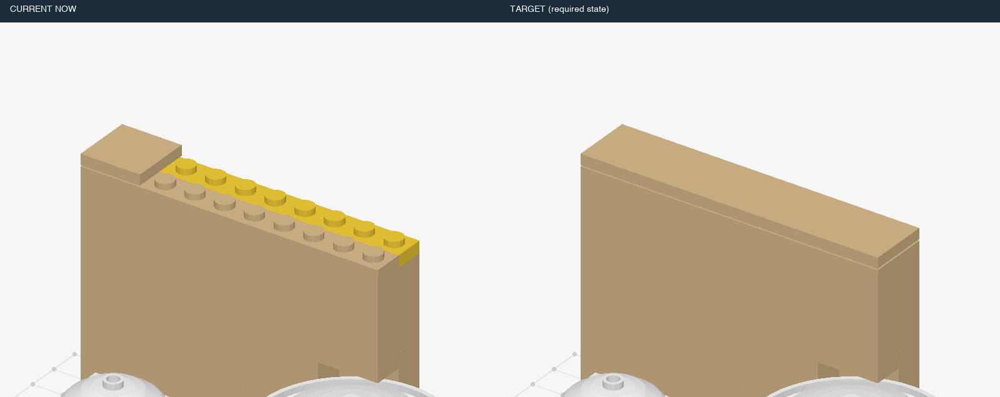

| 条件ID | 静态／动态 | 错误 | 事件数 | 来源类别 | 暂定结构组 | 图片 | 复用旧题 |
|---|---|---|---:|---|---|---|---|
| `v7::museum-roof::dynamic::control::t0` | dynamic | 正常 | 0 | 正常 | L1 | [三维画面](assets/museum-roof/555bb17de1d57d7f31422a7845d42684b0a1b7cba9778027cee8d8ece7a5d009.png) | M:museum-roof-dynamic-control |
| `v7::museum-roof::dynamic::missing::t4` | dynamic | 少件 | 1 | H01 | L1 | [三维画面](assets/museum-roof/7b437d0687e208ef229bb4a83a0c29b1b02959eb26fd9ee599336213b2c266ff.png) | M:museum-roof-dynamic-missing |
| `v7::museum-roof::static::missing::t4` | static | 少件 | 0 | H01 | L1 | [三维画面](assets/museum-roof/d4af15a6cfd830e67c7a697d4616e91527b51267f4cc46a213b7da73f321cd8f.png) | M:museum-roof-static-missing |
| `v7::museum-roof::static::control::t4` | static | 正常 | 0 | 正常 | L1 | [三维画面](assets/museum-roof/b324b1a6188b45ef6570a566c99f5a1abe9a47211dc04a4c10f12c1b222999eb.png) | M:museum-roof-static-control |
| `v7::museum-roof::dynamic::missing::t8` | dynamic | 少件 | 1 | H01 | L1 | [三维画面](assets/museum-roof/b9ddb24a47eda97a8b03add30bf23ac1f7907fe69fde68db14f5c5e7c42cc817.png) | 新增 |
| `v7::museum-roof::static::missing::t8` | static | 少件 | 0 | H01 | L1 | [三维画面](assets/museum-roof/076c2784982b3cd3a42458e9fcd70d2db62e32797c977f783a994cf042e7a10a.png) | 新增 |
| `v7::museum-roof::static::control::t8` | static | 正常 | 0 | 正常 | L1 | [三维画面](assets/museum-roof/bdfb6f1a71e8a598b185808bac01b8d4d3503bd93ce60a8307c29790eb91d045.png) | 新增 |
| `v7::museum-roof::dynamic::wrong-color::t4` | dynamic | 错色 | 1 | H04 | L1 | [三维画面](assets/museum-roof/6da99cb5e45e57d7b3e167f4387be2a43111b086df86617940dff4f285b86d9c.png) | M:museum-roof-dynamic-wrong-color |
| `v7::museum-roof::static::wrong-color::t4` | static | 错色 | 0 | H04 | L1 | [三维画面](assets/museum-roof/97ee9417843254d9e72e311b500c752559c13b8f1f19a0ace9f4958f249d06a4.png) | M:museum-roof-static-wrong-color |
| `v7::museum-roof::dynamic::wrong-color::t8` | dynamic | 错色 | 1 | H04 | L1 | [三维画面](assets/museum-roof/5f1d95400cf2e9ef18620fd9e08803f48bed68e45efeadf809e370996ec522be.png) | 新增 |
| `v7::museum-roof::static::wrong-color::t8` | static | 错色 | 0 | H04 | L1 | [三维画面](assets/museum-roof/b4291c74a1bb6ddee01fdd363b438c1b8a117260858bdedea784164f374adf1f.png) | 新增 |
| `v7::museum-roof::dynamic::extra-layer::t4` | dynamic | 局部多层／重复加件 | 1 | H03, H11 | L1 | [三维画面](assets/museum-roof/e14591894eb41492e9d86e46eba5d3690f6a4bb1b82aa5ca5ea71f63c831ed85.png) | M:museum-roof-dynamic-extra-layer |
| `v7::museum-roof::static::extra-layer::t4` | static | 局部多层／重复加件 | 0 | H03, H11 | L1 | [三维画面](assets/museum-roof/8003044efef503cd9f259354d2cbfd2a3faeb7f900997ac0c7b75b57bf1932c2.png) | M:museum-roof-static-extra-layer |
| `v7::museum-roof::dynamic::extra-layer::t8` | dynamic | 局部多层／重复加件 | 1 | H03, H11 | L1 | [三维画面](assets/museum-roof/8a9234598ade88ddcb00977f722bad9a17b7b14864c71eb8586b2c34186b31f4.png) | 新增 |
| `v7::museum-roof::static::extra-layer::t8` | static | 局部多层／重复加件 | 0 | H03, H11 | L1 | [三维画面](assets/museum-roof/afdb5e9f6f8978059b29b8b3917c571a28b8fe752f27b37ed7d01c36dd215e38.png) | 新增 |
| `v7::museum-roof::dynamic::offset::t4` | dynamic | 偏移一格 | 1 | H07 | L1 | [三维画面](assets/museum-roof/921d8991af2202b1e48f173f1ccba1b77dc19560af69300cd440f034ef1124ba.png) | 新增 |
| `v7::museum-roof::static::offset::t4` | static | 偏移一格 | 0 | H07 | L1 | [三维画面](assets/museum-roof/61b5a6b3d1bcd99e41d1a9919de01e5bffee2bea043597abfdf7c325bb2f26bb.png) | 新增 |
| `v7::museum-roof::dynamic::offset::t8` | dynamic | 偏移一格 | 1 | H07 | L1 | [三维画面](assets/museum-roof/bde54c571e9c4f322a3d90ded03c73b427b62abe9315704c16c5e704fa7daafb.png) | 新增 |
| `v7::museum-roof::static::offset::t8` | static | 偏移一格 | 0 | H07 | L1 | [三维画面](assets/museum-roof/2d68611905c876bd2426feb92271a241e4ff5ab93dc592de4004089e06933ed1.png) | 新增 |
| `v7::museum-roof::dynamic::rotated::t4` | dynamic | 装反 | 1 | H06 | L1 | [三维画面](assets/museum-roof/bfb3b1d9bc56476e98cb3d7ff5291c0aabcaa400265299342d60de688328a37f.png) | 新增 |
| `v7::museum-roof::static::rotated::t4` | static | 装反 | 0 | H06 | L1 | [三维画面](assets/museum-roof/c07b50da1d03e8bf3aed625e0998ffa517afb1cd4e90fdcef8fc55d20b5759ce.png) | 新增 |
| `v7::museum-roof::dynamic::rotated::t8` | dynamic | 装反 | 1 | H06 | L1 | [三维画面](assets/museum-roof/ac258307cf435b774b7b3dab8e01254d938d99454d4686158174546ef2b5861c.png) | 新增 |
| `v7::museum-roof::static::rotated::t8` | static | 装反 | 0 | H06 | L1 | [三维画面](assets/museum-roof/14a8e2e3e9c134fea48935f7d6c157f1cae6098cdcc5eb346126990de49d217b.png) | 新增 |
| `v7::museum-roof::dynamic::buried-repair::t4` | dynamic | 拆上层返修 | 1 | H10 | L2 | [三维画面](assets/museum-roof/ac0fa8bd5f43e27043d213c0732684fe01ebc1e73bc7ad9f2aff39c72d30c2e7.png) | 新增 |
| `v7::museum-roof::static::buried-repair::t4` | static | 拆上层返修 | 0 | H10 | L2 | [三维画面](assets/museum-roof/c9e0159562f6a85655e47e30bd0ce94b7e2451f27001573fae74b7a5026083da.png) | 新增 |
| `v7::museum-roof::dynamic::buried-repair::t3` | dynamic | 拆上层返修 | 1 | H10 | L2 | [三维画面](assets/museum-roof/d51d45754be1698a311c93fc08f97b9b8e9f2823a81762651aab10fa6d681465.png) | 新增 |
| `v7::museum-roof::static::buried-repair::t3` | static | 拆上层返修 | 0 | H10 | L2 | [三维画面](assets/museum-roof/ff12c3f82dbabd45a648a675b0986d9a9532582d890c5e72060f279414ccaaf5.png) | 新增 |
| `v7::museum-roof::static::control::t3` | static | 正常 | 0 | 正常 | L1 | [三维画面](assets/museum-roof/50078985457dcba85967f38b15f1095ae34a1277e02e427c9462b23049290457.png) | 新增 |
| `v7::museum-roof::dynamic::repeat-omission::t8` | dynamic | 重复组件漏做 | 1 | H02 | L1 | [三维画面](assets/museum-roof/e369920fcffdbbb06d95a46a1c2ec91a37e910b3d2ef6ea75452c1432f41c930.png) | 新增 |
| `v7::museum-roof::static::repeat-omission::t8` | static | 重复组件漏做 | 0 | H02 | L1 | [三维画面](assets/museum-roof/3df9ebacf41f05385dd8a6f04e059807fa622a0d8e023905cecff44c15fc7230.png) | 新增 |
| `v7::museum-roof::dynamic::repeat-omission::t11` | dynamic | 重复组件漏做 | 1 | H02 | L1 | [三维画面](assets/museum-roof/d625e8b56b7b34fba13602c61616089d44426e8cae9a4a86947b48cb86b7d439.png) | 新增 |
| `v7::museum-roof::static::repeat-omission::t11` | static | 重复组件漏做 | 0 | H02 | L1 | [三维画面](assets/museum-roof/c2ba7eb7fb76e794f043a4e54b128d950d0623853cc72ab214eddc7819c04e98.png) | 新增 |
| `v7::museum-roof::static::control::t11` | static | 正常 | 0 | 正常 | L1 | [三维画面](assets/museum-roof/6e57ba7dc1345e5dd80840f8dcb12245df9cd84929dae49e87f76cf253053e93.png) | 新增 |
| `v7::museum-roof::dynamic::multiple::missingthen-wrong-color` | dynamic | 连续：少件 → 错色 | 2 | H01, H04, H13 | L2 | [三维画面](assets/museum-roof/7b437d0687e208ef229bb4a83a0c29b1b02959eb26fd9ee599336213b2c266ff.png) | 新增 |
| `v7::museum-roof::dynamic::multiple::offsetthen-extra-layer` | dynamic | 连续：偏移一格 → 局部多层／重复加件 | 2 | H03, H07, H11, H13 | L2 | [三维画面](assets/museum-roof/921d8991af2202b1e48f173f1ccba1b77dc19560af69300cd440f034ef1124ba.png) | 新增 |

## 维修卡车：补车顶灯架 · `repair-truck-cab`

部分：M-expanded；正常拼装／模块全长：5块；来源：`v23-3179`。

原模型作者：Marc Giraudet [Mad_Marc]；[来源](https://library.ldraw.org/omr/sets/1053)。

本物件包含：拆上层返修、局部多层／重复加件、少件、偏移一格、装反、错色。

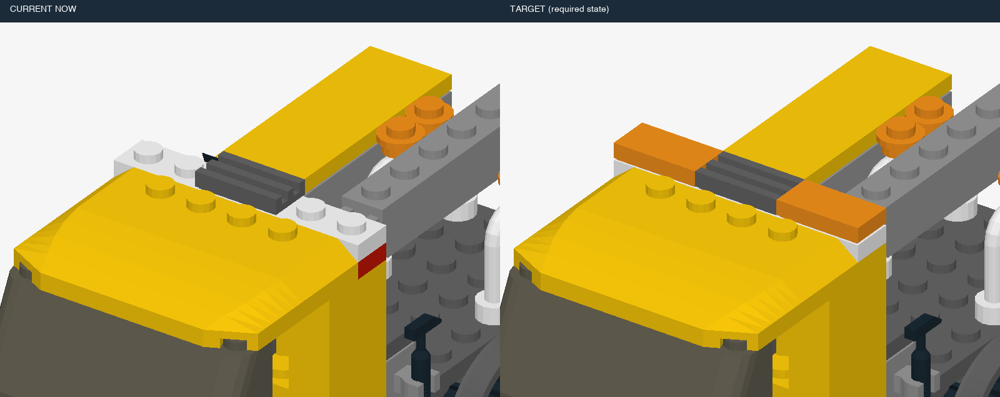

| 条件ID | 静态／动态 | 错误 | 事件数 | 来源类别 | 暂定结构组 | 图片 | 复用旧题 |
|---|---|---|---:|---|---|---|---|
| `v7::repair-truck-cab::dynamic::control::t0` | dynamic | 正常 | 0 | 正常 | L1 | [三维画面](assets/repair-truck-cab/13336d037dbaa5bdbaf18837d0f1900bfea077cec73b9427a9e9e20e4eb1f699.png) | M:repair-truck-cab-dynamic-control |
| `v7::repair-truck-cab::dynamic::missing::t4` | dynamic | 少件 | 1 | H01 | L1 | [三维画面](assets/repair-truck-cab/5df9cf5a017e022d8f8c733461761d2d26bb9828dc02748c3242c03f19c32d57.png) | M:repair-truck-cab-dynamic-missing |
| `v7::repair-truck-cab::static::missing::t4` | static | 少件 | 0 | H01 | L1 | [三维画面](assets/repair-truck-cab/ddb902db65f32a3fabb659deb08ba6c7f3e60fe1529e808fdbefa639c7ab29d5.png) | M:repair-truck-cab-static-missing |
| `v7::repair-truck-cab::static::control::t4` | static | 正常 | 0 | 正常 | L1 | [三维画面](assets/repair-truck-cab/c1b8919897ac6feb8c56d64a4c05b28d5199ff3f90f4df75459a48c58293a248.png) | M:repair-truck-cab-static-control |
| `v7::repair-truck-cab::dynamic::wrong-color::t4` | dynamic | 错色 | 1 | H04 | L1 | [三维画面](assets/repair-truck-cab/a2c99c90d7f0e846f355eb6c83175424b187283f02b7c1ce89c86b25b8eb1bff.png) | M:repair-truck-cab-dynamic-wrong-color |
| `v7::repair-truck-cab::static::wrong-color::t4` | static | 错色 | 0 | H04 | L1 | [三维画面](assets/repair-truck-cab/39487c82d31e5b0dff21c0fc9c84eb535592e011caf658ab8ce007dca1f7b699.png) | M:repair-truck-cab-static-wrong-color |
| `v7::repair-truck-cab::dynamic::extra-layer::t3` | dynamic | 局部多层／重复加件 | 1 | H03, H11 | L1 | [三维画面](assets/repair-truck-cab/b0c2a2d0f67a7f248303c9f3b566077c84fec352502d3d8c1cc3203022843f84.png) | 新增 |
| `v7::repair-truck-cab::static::extra-layer::t3` | static | 局部多层／重复加件 | 0 | H03, H11 | L1 | [三维画面](assets/repair-truck-cab/0161960eecd5027eb5d8e55d3a71764540bf20e0d86fea476833541912c98b56.png) | 新增 |
| `v7::repair-truck-cab::static::control::t3` | static | 正常 | 0 | 正常 | L1 | [三维画面](assets/repair-truck-cab/802c627cf0c4b6c3956cdc82b47389943155334b6ca616abdc367a4f1a26ad9f.png) | 新增 |
| `v7::repair-truck-cab::dynamic::extra-layer::t4` | dynamic | 局部多层／重复加件 | 1 | H03, H11 | L1 | [三维画面](assets/repair-truck-cab/1e871e8ac54175d12f08ed56c41fd06c22ec79a937839134e372d497a3a0381b.png) | M:repair-truck-cab-dynamic-extra-layer |
| `v7::repair-truck-cab::static::extra-layer::t4` | static | 局部多层／重复加件 | 0 | H03, H11 | L1 | [三维画面](assets/repair-truck-cab/6dcd0c4b7903e45570c8d5f98d448b9b90ea02da36f5fc6693b6f8b11c4a2c0c.png) | M:repair-truck-cab-static-extra-layer |
| `v7::repair-truck-cab::dynamic::offset::t4` | dynamic | 偏移一格 | 1 | H07 | L1 | [三维画面](assets/repair-truck-cab/2eb08a119e043ecd81cb0f9fbc8524ca77c43464f0db86850d5025b35da2e2a8.png) | 新增 |
| `v7::repair-truck-cab::static::offset::t4` | static | 偏移一格 | 0 | H07 | L1 | [三维画面](assets/repair-truck-cab/8b61c3903886a0f3c57267ad7efa3fe261654b0f66c8b5d2b2f422180d29d693.png) | 新增 |
| `v7::repair-truck-cab::dynamic::rotated::t4` | dynamic | 装反 | 1 | H06 | L1 | [三维画面](assets/repair-truck-cab/a9d87b170eb712247a4f52664e52b268d42cab04c8ae3482940d7f412ae303d2.png) | 新增 |
| `v7::repair-truck-cab::static::rotated::t4` | static | 装反 | 0 | H06 | L1 | [三维画面](assets/repair-truck-cab/dea5c3bbb8f2c8ce6cc3cd4ce0d66391787374f828d5d6f1c84bd034459e7827.png) | 新增 |
| `v7::repair-truck-cab::dynamic::buried-repair::t3` | dynamic | 拆上层返修 | 1 | H10 | L2 | [三维画面](assets/repair-truck-cab/99385bea219ab7244523355450b9a8b57b31c4ea1cb11328ed083aeb99e6f1b1.png) | 新增 |
| `v7::repair-truck-cab::static::buried-repair::t3` | static | 拆上层返修 | 0 | H10 | L2 | [三维画面](assets/repair-truck-cab/f0e8795362646475941ae3ffe9539d5728c4e561d2c7cbd5c20a69b913cec7e0.png) | 新增 |
| `v7::repair-truck-cab::dynamic::buried-repair::t4` | dynamic | 拆上层返修 | 1 | H10 | L2 | [三维画面](assets/repair-truck-cab/12e7ceff6b5be539675ffb22d3e0a3c57a615bab24efcf15df664acf50072601.png) | 新增 |
| `v7::repair-truck-cab::static::buried-repair::t4` | static | 拆上层返修 | 0 | H10 | L2 | [三维画面](assets/repair-truck-cab/ffcf176c6bbccc290a0bfac7bd797e53a7ccd8da5318c9ad8fac7c5d94c7b541.png) | 新增 |

## 橙色直升机：补尾部 · `orange-helicopter-tail`

部分：M-expanded；正常拼装／模块全长：7块；来源：`v23-30181`。

原模型作者：Merlijn Wissink [legolijntje]；[来源](https://library.ldraw.org/omr/sets/145)。

本物件包含：拆上层返修、局部多层／重复加件、少件、偏移一格、装反、错色。

连续干扰：连续：少件 → 错色；连续：偏移一格 → 局部多层／重复加件。

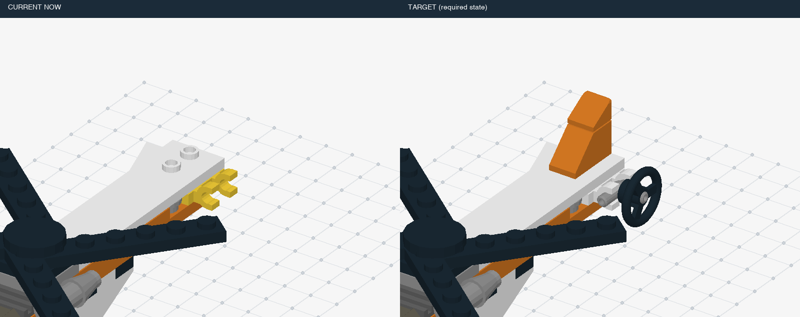

| 条件ID | 静态／动态 | 错误 | 事件数 | 来源类别 | 暂定结构组 | 图片 | 复用旧题 |
|---|---|---|---:|---|---|---|---|
| `v7::orange-helicopter-tail::dynamic::control::t0` | dynamic | 正常 | 0 | 正常 | L1 | [三维画面](assets/orange-helicopter-tail/074074a9c64a518d07ab56a2446d1bb5f87a2ad9cb49599193a5cb7920107e5b.png) | M:orange-helicopter-tail-dynamic-control |
| `v7::orange-helicopter-tail::dynamic::missing::t3` | dynamic | 少件 | 1 | H01 | L1 | [三维画面](assets/orange-helicopter-tail/ffc72247941edc9123b59c6e146a6205c732b86426830f128af452f5e6237e68.png) | M:orange-helicopter-tail-dynamic-missing |
| `v7::orange-helicopter-tail::static::missing::t3` | static | 少件 | 0 | H01 | L1 | [三维画面](assets/orange-helicopter-tail/0ac6a1668a04adc25b62ea703f3a87ccebda392b1db065b45993724f3b19268f.png) | M:orange-helicopter-tail-static-missing |
| `v7::orange-helicopter-tail::static::control::t3` | static | 正常 | 0 | 正常 | L1 | [三维画面](assets/orange-helicopter-tail/dba06d6475dd60c082ed9e4212f511b716aa69265256906d21400ea4904396cd.png) | M:orange-helicopter-tail-static-control |
| `v7::orange-helicopter-tail::dynamic::missing::t6` | dynamic | 少件 | 1 | H01 | L1 | [三维画面](assets/orange-helicopter-tail/67cf1fef67f9b38aeaeca4abad8808817a2982e26e1708ea4410330e03e2e714.png) | 新增 |
| `v7::orange-helicopter-tail::static::missing::t6` | static | 少件 | 0 | H01 | L1 | [三维画面](assets/orange-helicopter-tail/1de63a2ccf923f4c6377784b1855c6eb3c50769562c31b08af6d43fe7bf19bb1.png) | 新增 |
| `v7::orange-helicopter-tail::static::control::t6` | static | 正常 | 0 | 正常 | L1 | [三维画面](assets/orange-helicopter-tail/d91016e9d25f2f57a1c84c302686fe45eb55af11092ed20ecc8fc49ca8bcca6c.png) | 新增 |
| `v7::orange-helicopter-tail::dynamic::wrong-color::t3` | dynamic | 错色 | 1 | H04 | L1 | [三维画面](assets/orange-helicopter-tail/69ff02d74ed220d79f5f91704fd8200ca719809dd2d1b94ecf85e3181a3ea15b.png) | M:orange-helicopter-tail-dynamic-wrong-color |
| `v7::orange-helicopter-tail::static::wrong-color::t3` | static | 错色 | 0 | H04 | L1 | [三维画面](assets/orange-helicopter-tail/0f966dbe0c84ae43e0adecc31310dd3aec521f7183480b894d89b4175bb54753.png) | M:orange-helicopter-tail-static-wrong-color |
| `v7::orange-helicopter-tail::dynamic::wrong-color::t6` | dynamic | 错色 | 1 | H04 | L1 | [三维画面](assets/orange-helicopter-tail/d1b2b4bea717706bb39dd1158793b9bd504d0a1a5a47771a00909c8d4ad4eb59.png) | 新增 |
| `v7::orange-helicopter-tail::static::wrong-color::t6` | static | 错色 | 0 | H04 | L1 | [三维画面](assets/orange-helicopter-tail/086d522194c5e6c2fba837ac7cd1c585fcb3062a7f3324ed462ea2aaaa628e51.png) | 新增 |
| `v7::orange-helicopter-tail::dynamic::extra-layer::t3` | dynamic | 局部多层／重复加件 | 1 | H03, H11 | L1 | [三维画面](assets/orange-helicopter-tail/0c93f7409677f22ee2d50204df609a41282302c83d979117377c5e79d25b1600.png) | M:orange-helicopter-tail-dynamic-extra-layer |
| `v7::orange-helicopter-tail::static::extra-layer::t3` | static | 局部多层／重复加件 | 0 | H03, H11 | L1 | [三维画面](assets/orange-helicopter-tail/d5264d24a810a0d429f8767f874e924a5b488c82ff2f5a15380c2381c418b171.png) | M:orange-helicopter-tail-static-extra-layer |
| `v7::orange-helicopter-tail::dynamic::extra-layer::t6` | dynamic | 局部多层／重复加件 | 1 | H03, H11 | L1 | [三维画面](assets/orange-helicopter-tail/542e72033c3fd63251c0311d8e53edfc03ab61600cb879561d40b74e511bfd1d.png) | 新增 |
| `v7::orange-helicopter-tail::static::extra-layer::t6` | static | 局部多层／重复加件 | 0 | H03, H11 | L1 | [三维画面](assets/orange-helicopter-tail/d0141d9a9c9458f2e337aff4e1cf40de72a826d127287b74a369db9301c2d010.png) | 新增 |
| `v7::orange-helicopter-tail::dynamic::offset::t3` | dynamic | 偏移一格 | 1 | H07 | L1 | [三维画面](assets/orange-helicopter-tail/fdfaff4220b718e7b61c3c758b133c89a28166a65eb752fd693f062d5a5760e8.png) | 新增 |
| `v7::orange-helicopter-tail::static::offset::t3` | static | 偏移一格 | 0 | H07 | L1 | [三维画面](assets/orange-helicopter-tail/5c174aa05b245c647fdf5d51bd2f1d28b5e87c9d76e3476f841c134c31b4f1e4.png) | 新增 |
| `v7::orange-helicopter-tail::dynamic::offset::t6` | dynamic | 偏移一格 | 1 | H07 | L1 | [三维画面](assets/orange-helicopter-tail/405a87e9a191f448a7c0797cdb5324bb77570566987b0213787a7eb9348ff30a.png) | 新增 |
| `v7::orange-helicopter-tail::static::offset::t6` | static | 偏移一格 | 0 | H07 | L1 | [三维画面](assets/orange-helicopter-tail/5336ccf76980dd31281b0779b671c4ea032271d47652b2a87e42ea41900bb888.png) | 新增 |
| `v7::orange-helicopter-tail::dynamic::rotated::t3` | dynamic | 装反 | 1 | H06 | L1 | [三维画面](assets/orange-helicopter-tail/b2568d6d8a1d2ef803238bfc755a61a6615ecdcf3d4999f6ba44a370fa73b42d.png) | 新增 |
| `v7::orange-helicopter-tail::static::rotated::t3` | static | 装反 | 0 | H06 | L1 | [三维画面](assets/orange-helicopter-tail/dba06d6475dd60c082ed9e4212f511b716aa69265256906d21400ea4904396cd.png) | 新增 |
| `v7::orange-helicopter-tail::dynamic::rotated::t6` | dynamic | 装反 | 1 | H06 | L1 | [三维画面](assets/orange-helicopter-tail/65318a5bf87485f5a2b855689a68e64c474dca51a58d1aa6df57c1306c82cff2.png) | 新增 |
| `v7::orange-helicopter-tail::static::rotated::t6` | static | 装反 | 0 | H06 | L1 | [三维画面](assets/orange-helicopter-tail/3b4eca6310afae324f114515b178cc135ac5fec3ed3c17818c18430e2dd5953b.png) | 新增 |
| `v7::orange-helicopter-tail::dynamic::buried-repair::t3` | dynamic | 拆上层返修 | 1 | H10 | L2 | [三维画面](assets/orange-helicopter-tail/a489d6a4ed60a3abb41f754e8ba3a737c3e62be3039e204be89d1dbfcc18b78a.png) | 新增 |
| `v7::orange-helicopter-tail::static::buried-repair::t3` | static | 拆上层返修 | 0 | H10 | L2 | [三维画面](assets/orange-helicopter-tail/f3363c3e0e5ec1cb1b0221c60fb500acd1b842f61c58c9bb3f040594be2f3474.png) | 新增 |
| `v7::orange-helicopter-tail::dynamic::buried-repair::t4` | dynamic | 拆上层返修 | 1 | H10 | L2 | [三维画面](assets/orange-helicopter-tail/12a9be7e8e3e0a2d533209dfccee5ab41b280d051c90fd34964126391b050407.png) | 新增 |
| `v7::orange-helicopter-tail::static::buried-repair::t4` | static | 拆上层返修 | 0 | H10 | L2 | [三维画面](assets/orange-helicopter-tail/c87eaa65b5b65aee589f002b845103d8a22a9ac8c8549eb91b0aad2be7852d40.png) | 新增 |
| `v7::orange-helicopter-tail::static::control::t4` | static | 正常 | 0 | 正常 | L1 | [三维画面](assets/orange-helicopter-tail/084b427649eda6aa9d25f83ad4e71a250590be476078966f39e969796bcc6f70.png) | 新增 |
| `v7::orange-helicopter-tail::static::control::t5` | static | 正常 | 0 | 正常 | L1 | [三维画面](assets/orange-helicopter-tail/c8a6e175d949ee62dbc21503510a2f167bf60c24edb78a17ba444a199d677e1d.png) | 新增 |
| `v7::orange-helicopter-tail::dynamic::multiple::missingthen-wrong-color` | dynamic | 连续：少件 → 错色 | 2 | H01, H04, H13 | L2 | [三维画面](assets/orange-helicopter-tail/ffc72247941edc9123b59c6e146a6205c732b86426830f128af452f5e6237e68.png) | 新增 |
| `v7::orange-helicopter-tail::dynamic::multiple::offsetthen-extra-layer` | dynamic | 连续：偏移一格 → 局部多层／重复加件 | 2 | H03, H07, H11, H13 | L2 | [三维画面](assets/orange-helicopter-tail/fdfaff4220b718e7b61c3c758b133c89a28166a65eb752fd693f062d5a5760e8.png) | 新增 |

## 警用直升机：补机顶与尾鳍 · `police-helicopter-top`

部分：M-expanded；正常拼装／模块全长：10块；来源：`v23-30311`。

原模型作者：Merlijn Wissink [Legolijntje]；[来源](https://library.ldraw.org/omr/sets/344)。

本物件包含：拆上层返修、提前封口、局部多层／重复加件、少件、偏移一格、重复组件漏做、装反、错色。

连续干扰：连续：少件 → 错色；连续：偏移一格 → 局部多层／重复加件。

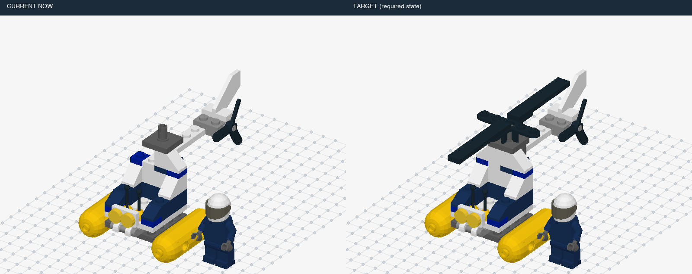

| 条件ID | 静态／动态 | 错误 | 事件数 | 来源类别 | 暂定结构组 | 图片 | 复用旧题 |
|---|---|---|---:|---|---|---|---|
| `v7::police-helicopter-top::dynamic::control::t0` | dynamic | 正常 | 0 | 正常 | L1 | [三维画面](assets/police-helicopter-top/5fd950a952df9f20a9a507e71a69dea1946cb0cddf979d0b3b6f58f4210cbd91.png) | M:police-helicopter-top-dynamic-control |
| `v7::police-helicopter-top::dynamic::missing::t3` | dynamic | 少件 | 1 | H01 | L1 | [三维画面](assets/police-helicopter-top/d0d404e8d24b8ffc4060d671bfa825fdef2d074bd168bd666cb35c2fc59079af.png) | 新增 |
| `v7::police-helicopter-top::static::missing::t3` | static | 少件 | 0 | H01 | L1 | [三维画面](assets/police-helicopter-top/88d7560e7f9892a153635e19871c084b1168ea9d98f0a43b6ed8cbe3cc2117e2.png) | 新增 |
| `v7::police-helicopter-top::static::control::t3` | static | 正常 | 0 | 正常 | L1 | [三维画面](assets/police-helicopter-top/fb6947a57a246dfc9ff538199d9c269fa3faa75f36776a08d1f8f6a71b4ef1df.png) | 新增 |
| `v7::police-helicopter-top::dynamic::missing::t6` | dynamic | 少件 | 1 | H01 | L1 | [三维画面](assets/police-helicopter-top/37cffa62bc63afd7a0e72d914396a37816fbd15e40f0b5271c24229fe0265e21.png) | 新增 |
| `v7::police-helicopter-top::static::missing::t6` | static | 少件 | 0 | H01 | L1 | [三维画面](assets/police-helicopter-top/96e11ea51aeadaeae979d7b9bfe23ed6b2487a65b273e51f285e6ccf5d69afd2.png) | 新增 |
| `v7::police-helicopter-top::static::control::t6` | static | 正常 | 0 | 正常 | L1 | [三维画面](assets/police-helicopter-top/a356a91f63a397900c11654169d25c98ac84bfbbc7a6122c0213dbb26ee2010d.png) | 新增 |
| `v7::police-helicopter-top::dynamic::wrong-color::t3` | dynamic | 错色 | 1 | H04 | L1 | [三维画面](assets/police-helicopter-top/3f7f60c8e682a183f5d463a1d4db3be577878b5f29825d4d388e5f7c5f5de9d8.png) | 新增 |
| `v7::police-helicopter-top::static::wrong-color::t3` | static | 错色 | 0 | H04 | L1 | [三维画面](assets/police-helicopter-top/d235ed519265de65f33e189193c2731d063295f96173f93766c8dca65c3bc3df.png) | 新增 |
| `v7::police-helicopter-top::dynamic::wrong-color::t6` | dynamic | 错色 | 1 | H04 | L1 | [三维画面](assets/police-helicopter-top/0f06a826f984eaedab592ffcbb83d9b0fa9234ba0977db3b641f2c72b5b637cf.png) | 新增 |
| `v7::police-helicopter-top::static::wrong-color::t6` | static | 错色 | 0 | H04 | L1 | [三维画面](assets/police-helicopter-top/cafaeef922cca165b7c8801ab86e0d78bd9bc636fbde7977fe9493d295fbbbb5.png) | 新增 |
| `v7::police-helicopter-top::dynamic::extra-layer::t6` | dynamic | 局部多层／重复加件 | 1 | H03, H11 | L1 | [三维画面](assets/police-helicopter-top/3e153424d2d3db6f143aa168c9ec5a1fa84764b7aac96567bb437f14e6dd86c5.png) | 新增 |
| `v7::police-helicopter-top::static::extra-layer::t6` | static | 局部多层／重复加件 | 0 | H03, H11 | L1 | [三维画面](assets/police-helicopter-top/0c7912eb95f0c6a512e9aa33983408151c2a8fa53af6e2a437b9fd9c5939e551.png) | 新增 |
| `v7::police-helicopter-top::dynamic::extra-layer::t9` | dynamic | 局部多层／重复加件 | 1 | H03, H11 | L1 | [三维画面](assets/police-helicopter-top/e03a8e229e69e9f810d42c25ce127ad03ad6c574e3221dcabc0c8ed6010d3aa2.png) | 新增 |
| `v7::police-helicopter-top::static::extra-layer::t9` | static | 局部多层／重复加件 | 0 | H03, H11 | L1 | [三维画面](assets/police-helicopter-top/964359018e439e43804bd804d9a6319248653186167ea802ddb9b1df54de5bc8.png) | 新增 |
| `v7::police-helicopter-top::static::control::t9` | static | 正常 | 0 | 正常 | L1 | [三维画面](assets/police-helicopter-top/320e0bccc3a232bca6bdd1aef4020a8745164cca1adc03716925b39fa41bc117.png) | 新增 |
| `v7::police-helicopter-top::dynamic::offset::t3` | dynamic | 偏移一格 | 1 | H07 | L1 | [三维画面](assets/police-helicopter-top/712874c564339865cae279378dd56377a61785a5504d7d72c2ec2b8c92fe25cf.png) | 新增 |
| `v7::police-helicopter-top::static::offset::t3` | static | 偏移一格 | 0 | H07 | L1 | [三维画面](assets/police-helicopter-top/165e5860be221f30ec6e67a1cf59bfd50645f1e142037851265303befed506ed.png) | 新增 |
| `v7::police-helicopter-top::dynamic::offset::t6` | dynamic | 偏移一格 | 1 | H07 | L1 | [三维画面](assets/police-helicopter-top/5ab646c389547d017b296511583976ab1c6c7010d54d2285df4c014fb7fe32eb.png) | 新增 |
| `v7::police-helicopter-top::static::offset::t6` | static | 偏移一格 | 0 | H07 | L1 | [三维画面](assets/police-helicopter-top/9c42a821adde5bd67e2b36757cc7c3ae9940a674bc2b0e31ceb7b548d308bfb6.png) | 新增 |
| `v7::police-helicopter-top::dynamic::rotated::t3` | dynamic | 装反 | 1 | H06 | L1 | [三维画面](assets/police-helicopter-top/6e68548719599dc8f2eb238be24c580db1df353a26c7c33b087131bd349e958e.png) | 新增 |
| `v7::police-helicopter-top::static::rotated::t3` | static | 装反 | 0 | H06 | L1 | [三维画面](assets/police-helicopter-top/fd1c24af504c89f5a71c4fed2cb0baf6f5b402d9489fc3ebc4101a2153d4731e.png) | 新增 |
| `v7::police-helicopter-top::dynamic::rotated::t6` | dynamic | 装反 | 1 | H06 | L1 | [三维画面](assets/police-helicopter-top/859ba2b216c4e4d6d8db322875f354fbe89ff31c3cbf80d1fde1156dbd908edd.png) | 新增 |
| `v7::police-helicopter-top::static::rotated::t6` | static | 装反 | 0 | H06 | L1 | [三维画面](assets/police-helicopter-top/0032215c9dd27291b1382de2ddac69a96363896e9cbb4a3251befab4988fb54e.png) | 新增 |
| `v7::police-helicopter-top::dynamic::early-cover::t3` | dynamic | 提前封口 | 1 | H09 | L1 | [三维画面](assets/police-helicopter-top/52bdc5c84edd8e93aec04c9d17ae68becaf36267e4ce81da96a9dbbe77871765.png) | 新增 |
| `v7::police-helicopter-top::static::early-cover::t3` | static | 提前封口 | 0 | H09 | L1 | [三维画面](assets/police-helicopter-top/b17c1d9e5ea9bde68f6878eb8a5cda88e0c403e619bc499c5c67ab8cfa37c2f8.png) | 新增 |
| `v7::police-helicopter-top::dynamic::early-cover::t4` | dynamic | 提前封口 | 1 | H09 | L1 | [三维画面](assets/police-helicopter-top/835cba52a0098e1a88335402a7e08ed074dbc8b26dcf4f75fa10a28210a2554e.png) | 新增 |
| `v7::police-helicopter-top::static::early-cover::t4` | static | 提前封口 | 0 | H09 | L1 | [三维画面](assets/police-helicopter-top/03c7667ea85d188e3500149667cd9ff185bde25586ee69cafd5b8ec8474faef9.png) | 新增 |
| `v7::police-helicopter-top::static::control::t4` | static | 正常 | 0 | 正常 | L1 | [三维画面](assets/police-helicopter-top/4a1f752da68bf8659b9963615b8ce55aa7c483214ec7062b69e0a59f6593e2e8.png) | M:police-helicopter-top-static-control |
| `v7::police-helicopter-top::dynamic::buried-repair::t9` | dynamic | 拆上层返修 | 1 | H10 | L2 | [三维画面](assets/police-helicopter-top/5500143259676832081ff56dd43e66227cdb98ec44f1430c813375a823bf1fe8.png) | 新增 |
| `v7::police-helicopter-top::static::buried-repair::t9` | static | 拆上层返修 | 0 | H10 | L2 | [三维画面](assets/police-helicopter-top/260145abd9da6903e43d94a5ee44074ac653759d55a362511a5535c7129bf25f.png) | 新增 |
| `v7::police-helicopter-top::dynamic::buried-repair::t7` | dynamic | 拆上层返修 | 1 | H10 | L2 | [三维画面](assets/police-helicopter-top/e08dad0396c83c12e002df21ab62d1e5a15ad53d1e59342d2157dcc83e69ca03.png) | 新增 |
| `v7::police-helicopter-top::static::buried-repair::t7` | static | 拆上层返修 | 0 | H10 | L2 | [三维画面](assets/police-helicopter-top/97846865d5188d3089e94cd891540e45841aef1354636ba5026ac096594d4bf4.png) | 新增 |
| `v7::police-helicopter-top::static::control::t7` | static | 正常 | 0 | 正常 | L1 | [三维画面](assets/police-helicopter-top/2efc57e174d63f73537066f83451534a99475305df52be32e74455c734545b91.png) | 新增 |
| `v7::police-helicopter-top::dynamic::repeat-omission::t6` | dynamic | 重复组件漏做 | 1 | H02 | L1 | [三维画面](assets/police-helicopter-top/de45aaa965e9ad047c8cde52ba729823da35f3731f3988393027afc8dd2944c4.png) | 新增 |
| `v7::police-helicopter-top::static::repeat-omission::t6` | static | 重复组件漏做 | 0 | H02 | L1 | [三维画面](assets/police-helicopter-top/e7f720dc510118e9be5f71be51cb82d02d612ccf3c2d163db1b063e38c4fd3e4.png) | 新增 |
| `v7::police-helicopter-top::dynamic::repeat-omission::t5` | dynamic | 重复组件漏做 | 1 | H02 | L1 | [三维画面](assets/police-helicopter-top/9cc3f21cdbddaacdb7473769dab6dbfe689308f977b37545f1c954cc775234a2.png) | 新增 |
| `v7::police-helicopter-top::static::repeat-omission::t5` | static | 重复组件漏做 | 0 | H02 | L1 | [三维画面](assets/police-helicopter-top/b58d99570961a48c77e9128f40782f00b9245fa112cae13cc2e882a8ca5afd8c.png) | 新增 |
| `v7::police-helicopter-top::static::control::t5` | static | 正常 | 0 | 正常 | L1 | [三维画面](assets/police-helicopter-top/b9c4b36de74d12e47d6c7646a533d2dabdd0ea1fd54ae1156169f44d7405b919.png) | 新增 |
| `v7::police-helicopter-top::dynamic::multiple::missingthen-wrong-color` | dynamic | 连续：少件 → 错色 | 2 | H01, H04, H13 | L2 | [三维画面](assets/police-helicopter-top/d0d404e8d24b8ffc4060d671bfa825fdef2d074bd168bd666cb35c2fc59079af.png) | 新增 |
| `v7::police-helicopter-top::dynamic::multiple::offsetthen-extra-layer` | dynamic | 连续：偏移一格 → 局部多层／重复加件 | 2 | H03, H07, H11, H13 | L2 | [三维画面](assets/police-helicopter-top/712874c564339865cae279378dd56377a61785a5504d7d72c2ec2b8c92fe25cf.png) | 新增 |

## 熊猫：补脸部与耳朵 · `panda-head`

部分：M-expanded；正常拼装／模块全长：6块；来源：`v23-30026`。

原模型作者：Takeshi Takahashi [RainbowDolphin]；[来源](https://library.ldraw.org/omr/sets/1406)。

本物件包含：局部多层／重复加件、少件、偏移一格、重复组件漏做、装反、错色。

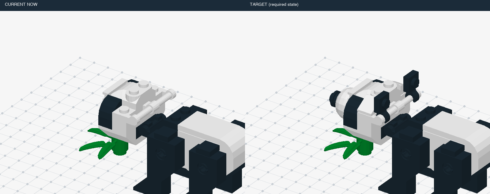

| 条件ID | 静态／动态 | 错误 | 事件数 | 来源类别 | 暂定结构组 | 图片 | 复用旧题 |
|---|---|---|---:|---|---|---|---|
| `v7::panda-head::dynamic::control::t0` | dynamic | 正常 | 0 | 正常 | L1 | [三维画面](assets/panda-head/8134a69befe8f7aa80790428c066dbc8d8411ab3c1a7d05a90e93abcbc92d653.png) | M:panda-head-dynamic-control |
| `v7::panda-head::dynamic::missing::t3` | dynamic | 少件 | 1 | H01 | L1 | [三维画面](assets/panda-head/623683aadb447c1159e4827a4f36a7e0c9a5bd6961448255e05da81d58e1546a.png) | 新增 |
| `v7::panda-head::static::missing::t3` | static | 少件 | 0 | H01 | L1 | [三维画面](assets/panda-head/c044499508ba8b80598e45a5f73dfcabe33e2c99a641e5008f914650a0e0093d.png) | 新增 |
| `v7::panda-head::static::control::t3` | static | 正常 | 0 | 正常 | L1 | [三维画面](assets/panda-head/090987ef07a8febe3aed8836476731de950857e9ad89d68e89ebf068ec978f8e.png) | 新增 |
| `v7::panda-head::dynamic::missing::t4` | dynamic | 少件 | 1 | H01 | L1 | [三维画面](assets/panda-head/0716b9a7c646806ea6659a269741bbadfc4343b0e842322866d3405cb51b7c7b.png) | M:panda-head-dynamic-missing |
| `v7::panda-head::static::missing::t4` | static | 少件 | 0 | H01 | L1 | [三维画面](assets/panda-head/c4356c7b2ae4dd4350d30b565db1048d94e94bc5c381f367d67a29fa9cf1cfcf.png) | M:panda-head-static-missing |
| `v7::panda-head::static::control::t4` | static | 正常 | 0 | 正常 | L1 | [三维画面](assets/panda-head/73a4ffe12c4b3507368e99192d3f64072a8828e288fdce913cf6ee121ae7b9ba.png) | M:panda-head-static-control |
| `v7::panda-head::dynamic::wrong-color::t3` | dynamic | 错色 | 1 | H04 | L1 | [三维画面](assets/panda-head/cc644d10ff15c65cc5bcd8c4d1ec52f55d8f9cc75e9bc3408566f66f198b6359.png) | 新增 |
| `v7::panda-head::static::wrong-color::t3` | static | 错色 | 0 | H04 | L1 | [三维画面](assets/panda-head/7cdc2c9d182bcf5f6de7f9d9b76a2910660e9c8fca6a6d8eeef3e8dd47be14d4.png) | 新增 |
| `v7::panda-head::dynamic::wrong-color::t4` | dynamic | 错色 | 1 | H04 | L1 | [三维画面](assets/panda-head/1089b3ee6381704e7b83467b6b2de70892b200e789bd84fe43d952d79f11af35.png) | M:panda-head-dynamic-wrong-color |
| `v7::panda-head::static::wrong-color::t4` | static | 错色 | 0 | H04 | L1 | [三维画面](assets/panda-head/45048fc8e6f448251f3cd401638fd4bc24b96c932cb47e3bd746950f49ab5266.png) | M:panda-head-static-wrong-color |
| `v7::panda-head::dynamic::extra-layer::t4` | dynamic | 局部多层／重复加件 | 1 | H03, H11 | L1 | [三维画面](assets/panda-head/438ccaee0fb2d09ea2dc66bc223d6d8ef660aab4858886d2801949fbef788517.png) | M:panda-head-dynamic-extra-layer |
| `v7::panda-head::static::extra-layer::t4` | static | 局部多层／重复加件 | 0 | H03, H11 | L1 | [三维画面](assets/panda-head/37a018d29083878f5244b347b5a9bcea0e5a1233c2d7e1de6a3b6ac76e15c88c.png) | M:panda-head-static-extra-layer |
| `v7::panda-head::dynamic::extra-layer::t5` | dynamic | 局部多层／重复加件 | 1 | H03, H11 | L1 | [三维画面](assets/panda-head/fbc03f92c14d266f3659130bcdacc2eb0a07e2b15ec3a7a26f6348ac8148b989.png) | 新增 |
| `v7::panda-head::static::extra-layer::t5` | static | 局部多层／重复加件 | 0 | H03, H11 | L1 | [三维画面](assets/panda-head/03a6cbeb5b59f3166f5f6ad08d46f204c430457b31b01d8b086ac57f4b456541.png) | 新增 |
| `v7::panda-head::static::control::t5` | static | 正常 | 0 | 正常 | L1 | [三维画面](assets/panda-head/f0bafa647e31e3100bf40ca73f8aa80f2ca6f5a126cfd30b33ce6b39dedbfdaf.png) | 新增 |
| `v7::panda-head::dynamic::offset::t4` | dynamic | 偏移一格 | 1 | H07 | L1 | [三维画面](assets/panda-head/09490e3169b5390ec7250412ef2e522b3e6f5fbdb0fa8b6fb540799c4b37c1d8.png) | 新增 |
| `v7::panda-head::static::offset::t4` | static | 偏移一格 | 0 | H07 | L1 | [三维画面](assets/panda-head/b2d08833bd0b1685c904f3e8146490795853d2f939defe097bdf2d9b88d5b3e7.png) | 新增 |
| `v7::panda-head::dynamic::offset::t5` | dynamic | 偏移一格 | 1 | H07 | L1 | [三维画面](assets/panda-head/8660e610d09307a6e78b198d195375c89d3599bb1424e4d76cc9f8db3b8a3610.png) | 新增 |
| `v7::panda-head::static::offset::t5` | static | 偏移一格 | 0 | H07 | L1 | [三维画面](assets/panda-head/1074a57431dd9a05fd4e339964cf8733742f7bacbede6f82999631ef726d9386.png) | 新增 |
| `v7::panda-head::dynamic::rotated::t3` | dynamic | 装反 | 1 | H06 | L1 | [三维画面](assets/panda-head/5a4856ef4b497e25042d92a26390bea67705508a1a1f1231da6f501f9d6c0376.png) | 新增 |
| `v7::panda-head::static::rotated::t3` | static | 装反 | 0 | H06 | L1 | [三维画面](assets/panda-head/8b539672db2457c8937782ea0bd464a7bd00f40184b1f3923304713b21cc8fc4.png) | 新增 |
| `v7::panda-head::dynamic::rotated::t4` | dynamic | 装反 | 1 | H06 | L1 | [三维画面](assets/panda-head/1599ff1dfd0e5451f6a5d63745beaaee5c86aabcef2bf2169c2c424945c1328e.png) | 新增 |
| `v7::panda-head::static::rotated::t4` | static | 装反 | 0 | H06 | L1 | [三维画面](assets/panda-head/833411acc648c06ecc79a24d82796062e337007f330835cdedcee1f5c6960ff7.png) | 新增 |
| `v7::panda-head::dynamic::repeat-omission::t3` | dynamic | 重复组件漏做 | 1 | H02 | L1 | [三维画面](assets/panda-head/ff2cd54dc3c2f57ae80a56ed114db022859bba77618c59d1f73d6e4156e0c301.png) | 新增 |
| `v7::panda-head::static::repeat-omission::t3` | static | 重复组件漏做 | 0 | H02 | L1 | [三维画面](assets/panda-head/462233f0ed522ca6289e4011325f255313bfcc0b5bffd000805eb10cf4f53d95.png) | 新增 |
| `v7::panda-head::dynamic::repeat-omission::t4` | dynamic | 重复组件漏做 | 1 | H02 | L1 | [三维画面](assets/panda-head/ac1fb81f5f34133c39ad8f6775e16ee6a07dd8e886e7c3bf617c5e2bb5cd1f98.png) | 新增 |
| `v7::panda-head::static::repeat-omission::t4` | static | 重复组件漏做 | 0 | H02 | L1 | [三维画面](assets/panda-head/ed36b5454cc6e26777bc1a32441d4b28eb9e3c18e53a25ab6720fa861eb4397c.png) | 新增 |

## 汉堡店：补屋顶与招牌 · `burger-stand-roof`

部分：M-expanded；正常拼装／模块全长：7块；来源：`v23-6683`。

原模型作者：Robert Paciorek [bercik]；[来源](https://library.ldraw.org/omr/sets/642)。

本物件包含：拆上层返修、局部多层／重复加件、少件、偏移一格、重复组件漏做、装反、错色、错零件／厚度。

连续干扰：连续：少件 → 错色；连续：偏移一格 → 局部多层／重复加件；连续：错零件／厚度 → 少件。

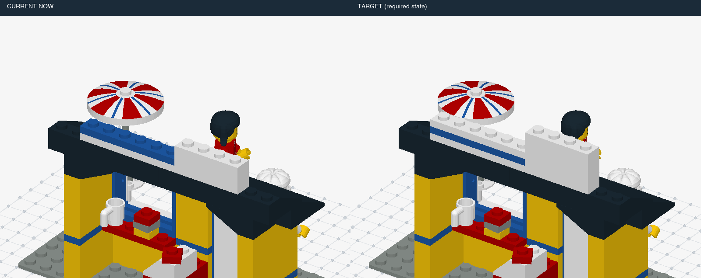

| 条件ID | 静态／动态 | 错误 | 事件数 | 来源类别 | 暂定结构组 | 图片 | 复用旧题 |
|---|---|---|---:|---|---|---|---|
| `v7::burger-stand-roof::dynamic::control::t0` | dynamic | 正常 | 0 | 正常 | L1 | [三维画面](assets/burger-stand-roof/5bc7bf90e4a5e8f244b80c3055aeffd17f833acdf2c7f8f60bf7c16e83c9d82c.png) | M:burger-stand-roof-dynamic-control |
| `v7::burger-stand-roof::dynamic::missing::t3` | dynamic | 少件 | 1 | H01 | L1 | [三维画面](assets/burger-stand-roof/702f5373e78d81cfa311be0c9e376bc3778ae71203dfbeeeb720f60ffc8f82c0.png) | M:burger-stand-roof-dynamic-missing |
| `v7::burger-stand-roof::static::missing::t3` | static | 少件 | 0 | H01 | L1 | [三维画面](assets/burger-stand-roof/18956199f39bec2d50d91f8f981ed6f351f785ee20030359054286d48071bad2.png) | M:burger-stand-roof-static-missing |
| `v7::burger-stand-roof::static::control::t3` | static | 正常 | 0 | 正常 | L1 | [三维画面](assets/burger-stand-roof/5a131a8640e8eb526bef060f26195436903888a9956454ecd17c36839fe3f289.png) | M:burger-stand-roof-static-control |
| `v7::burger-stand-roof::dynamic::missing::t4` | dynamic | 少件 | 1 | H01 | L1 | [三维画面](assets/burger-stand-roof/8e14abdfa5566604233396a36dc7e3ddd34b2531109743729ca0e5791c5e8641.png) | 新增 |
| `v7::burger-stand-roof::static::missing::t4` | static | 少件 | 0 | H01 | L1 | [三维画面](assets/burger-stand-roof/5cddd967a365ae9da47e59f3affbb67466bb0325d9a6b89120f945ffd26bebc5.png) | 新增 |
| `v7::burger-stand-roof::static::control::t4` | static | 正常 | 0 | 正常 | L1 | [三维画面](assets/burger-stand-roof/17f8951d4a80bfc2f2305eee201b0e36c2f138c1c7495729a674ee1bcce0276a.png) | 新增 |
| `v7::burger-stand-roof::dynamic::wrong-color::t3` | dynamic | 错色 | 1 | H04 | L1 | [三维画面](assets/burger-stand-roof/d982fec9b73ba099a79f452f095a7fccdc3e9e461a5e34ce579773623e03bcc3.png) | M:burger-stand-roof-dynamic-wrong-color |
| `v7::burger-stand-roof::static::wrong-color::t3` | static | 错色 | 0 | H04 | L1 | [三维画面](assets/burger-stand-roof/2eae6b7244db1d7b93636e786e7d20d5c73fa96aeaa238f054f80cf71f5f26bb.png) | M:burger-stand-roof-static-wrong-color |
| `v7::burger-stand-roof::dynamic::wrong-color::t4` | dynamic | 错色 | 1 | H04 | L1 | [三维画面](assets/burger-stand-roof/6f328d624484d6223e6f3d39b4465246914eda897a1c2d7bc26b679a1a81adbc.png) | 新增 |
| `v7::burger-stand-roof::static::wrong-color::t4` | static | 错色 | 0 | H04 | L1 | [三维画面](assets/burger-stand-roof/d1619a7c5847895d297a22cb878f99368091837182aff6fc9224fc16e6568241.png) | 新增 |
| `v7::burger-stand-roof::dynamic::extra-layer::t3` | dynamic | 局部多层／重复加件 | 1 | H03, H11 | L1 | [三维画面](assets/burger-stand-roof/d04c4a24df4a83039c4ea8fa41ba9c1a79eb313f5e2f94065fd2ebd39d5cdb4d.png) | M:burger-stand-roof-dynamic-extra-layer |
| `v7::burger-stand-roof::static::extra-layer::t3` | static | 局部多层／重复加件 | 0 | H03, H11 | L1 | [三维画面](assets/burger-stand-roof/211f3541d91ed34f1584ad75c53a1da25333149df40eddd52b64b586d6ba6b9c.png) | M:burger-stand-roof-static-extra-layer |
| `v7::burger-stand-roof::dynamic::extra-layer::t4` | dynamic | 局部多层／重复加件 | 1 | H03, H11 | L1 | [三维画面](assets/burger-stand-roof/a8edff5396c1b5bb08b794a2e6a5ea0bc8501704041616de1da1d5462f184f68.png) | 新增 |
| `v7::burger-stand-roof::static::extra-layer::t4` | static | 局部多层／重复加件 | 0 | H03, H11 | L1 | [三维画面](assets/burger-stand-roof/bdff11c460c983a569192751f8d1dd93369c1297d2175ffb8005a583649526a9.png) | 新增 |
| `v7::burger-stand-roof::dynamic::offset::t3` | dynamic | 偏移一格 | 1 | H07 | L1 | [三维画面](assets/burger-stand-roof/e828bd798cdf9438e7ee9145892041961fc166e5173210aca56521eb05b55361.png) | 新增 |
| `v7::burger-stand-roof::static::offset::t3` | static | 偏移一格 | 0 | H07 | L1 | [三维画面](assets/burger-stand-roof/6cf1318b20418d5ec839d57c7e5f4c383cbd81582d67f14ac84569880da8c828.png) | 新增 |
| `v7::burger-stand-roof::dynamic::offset::t4` | dynamic | 偏移一格 | 1 | H07 | L1 | [三维画面](assets/burger-stand-roof/eefb9ab8e9c567a5a1ab65020e9182286c7fe5006a6aa6401a1c41885eb5a599.png) | 新增 |
| `v7::burger-stand-roof::static::offset::t4` | static | 偏移一格 | 0 | H07 | L1 | [三维画面](assets/burger-stand-roof/07a1bbcbe4c6fefbc44ae84023587836c00c36e325f5fa98d4943ff4d46a6408.png) | 新增 |
| `v7::burger-stand-roof::dynamic::rotated::t3` | dynamic | 装反 | 1 | H06 | L1 | [三维画面](assets/burger-stand-roof/925b48e96995a7f513d260600e3489e429328004bde6f1d4ef515b1d16af4780.png) | 新增 |
| `v7::burger-stand-roof::static::rotated::t3` | static | 装反 | 0 | H06 | L1 | [三维画面](assets/burger-stand-roof/ce37a5f26e03229e5ada6fd105ba3a338f9abc15679313d9c6ba5437d6cd3833.png) | 新增 |
| `v7::burger-stand-roof::dynamic::rotated::t4` | dynamic | 装反 | 1 | H06 | L1 | [三维画面](assets/burger-stand-roof/304bc8c3cf8a9ee877557dc9af14fa766bd8eefde03074cab5a6836cdf61009b.png) | 新增 |
| `v7::burger-stand-roof::static::rotated::t4` | static | 装反 | 0 | H06 | L1 | [三维画面](assets/burger-stand-roof/32c1e69f0318a5959061f64c0e7adab839e896ca2c582572ef1f4ecf5923761d.png) | 新增 |
| `v7::burger-stand-roof::dynamic::wrong-part::t6` | dynamic | 错零件／厚度 | 1 | H05 | L1 | [三维画面](assets/burger-stand-roof/5ae19f4e447fe305807140c7eaac51cf0649ef9f44b42bf0853309babfc54d0d.png) | 新增 |
| `v7::burger-stand-roof::static::wrong-part::t6` | static | 错零件／厚度 | 0 | H05 | L1 | [三维画面](assets/burger-stand-roof/a6e86ef55393e28075393275f9953a1b991dcb2ced25e5e3e800c92f1028f931.png) | 新增 |
| `v7::burger-stand-roof::static::control::t6` | static | 正常 | 0 | 正常 | L1 | [三维画面](assets/burger-stand-roof/427446106f5c58ec0ca15b4b0511aa0e146f58b506b8deee6f1dc9ba9e2844ef.png) | 新增 |
| `v7::burger-stand-roof::dynamic::wrong-part::t5` | dynamic | 错零件／厚度 | 1 | H05 | L1 | [三维画面](assets/burger-stand-roof/1e03df4b52d03d925d00b294855dbb7bde789d43b8b60164db38063b3ba768c6.png) | 新增 |
| `v7::burger-stand-roof::static::wrong-part::t5` | static | 错零件／厚度 | 0 | H05 | L1 | [三维画面](assets/burger-stand-roof/2035fa35ef49343ea21e4e7595e829b7f25f3ed3f8915c78284d6ecbb741a2c2.png) | 新增 |
| `v7::burger-stand-roof::static::control::t5` | static | 正常 | 0 | 正常 | L1 | [三维画面](assets/burger-stand-roof/008d72d5a8644fb8c4d6f00633b29ceac49100c57b08d52bab853e18677b3252.png) | 新增 |
| `v7::burger-stand-roof::dynamic::buried-repair::t3` | dynamic | 拆上层返修 | 1 | H10 | L2 | [三维画面](assets/burger-stand-roof/aa71c6c3909b1b63b9cad84c31839034782c5ba55b4ab8c5f95b2ef837616412.png) | 新增 |
| `v7::burger-stand-roof::static::buried-repair::t3` | static | 拆上层返修 | 0 | H10 | L2 | [三维画面](assets/burger-stand-roof/a7daa932e046b2c29fcd3243e809c10457595cb5c684f444759cf2ddbaa9eaa0.png) | 新增 |
| `v7::burger-stand-roof::dynamic::buried-repair::t4` | dynamic | 拆上层返修 | 1 | H10 | L2 | [三维画面](assets/burger-stand-roof/e037910c2ba0e0d274a558753b583e8339aa267c774719d709c87abbfb64a1e1.png) | 新增 |
| `v7::burger-stand-roof::static::buried-repair::t4` | static | 拆上层返修 | 0 | H10 | L2 | [三维画面](assets/burger-stand-roof/53bcf57fac2cabcff6d8e71e1070c2ba3e58d2846c152ba033483600a95b1dee.png) | 新增 |
| `v7::burger-stand-roof::dynamic::repeat-omission::t6` | dynamic | 重复组件漏做 | 1 | H02 | L1 | [三维画面](assets/burger-stand-roof/901751f18de39b5aa05746dfdce360aaef2dc1b818afba170e301bf2311f19e6.png) | 新增 |
| `v7::burger-stand-roof::static::repeat-omission::t6` | static | 重复组件漏做 | 0 | H02 | L1 | [三维画面](assets/burger-stand-roof/7e2c3969fec01a490748ddd73ade7804966a572492a4469b7445e8350d184406.png) | 新增 |
| `v7::burger-stand-roof::dynamic::repeat-omission::t5` | dynamic | 重复组件漏做 | 1 | H02 | L1 | [三维画面](assets/burger-stand-roof/587a30e5a1f519c0c4cb3aa6d786341c5c27cdae4eb504303c0e9c6ed071ce26.png) | 新增 |
| `v7::burger-stand-roof::static::repeat-omission::t5` | static | 重复组件漏做 | 0 | H02 | L1 | [三维画面](assets/burger-stand-roof/66d99c07003052d8d7d7c5fba504c23663508c52d343708c9b18b10d5864f866.png) | 新增 |
| `v7::burger-stand-roof::dynamic::multiple::missingthen-wrong-color` | dynamic | 连续：少件 → 错色 | 2 | H01, H04, H13 | L2 | [三维画面](assets/burger-stand-roof/702f5373e78d81cfa311be0c9e376bc3778ae71203dfbeeeb720f60ffc8f82c0.png) | 新增 |
| `v7::burger-stand-roof::dynamic::multiple::offsetthen-extra-layer` | dynamic | 连续：偏移一格 → 局部多层／重复加件 | 2 | H03, H07, H11, H13 | L2 | [三维画面](assets/burger-stand-roof/e828bd798cdf9438e7ee9145892041961fc166e5173210aca56521eb05b55361.png) | 新增 |
| `v7::burger-stand-roof::dynamic::multiple::wrong-partthen-missing` | dynamic | 连续：错零件／厚度 → 少件 | 2 | H01, H05, H13 | L2 | [三维画面](assets/burger-stand-roof/1e03df4b52d03d925d00b294855dbb7bde789d43b8b60164db38063b3ba768c6.png) | 新增 |

## 白宫：补烟囱与屋脊 · `white-house-roof`

部分：M-expanded；正常拼装／模块全长：10块；来源：`v23-21006`。

原模型作者：Damien Roux [Darats]；[来源](https://library.ldraw.org/omr/sets/74)。

本物件包含：局部多层／重复加件、少件、偏移一格、重复组件漏做、装反、错色、错零件／厚度。

连续干扰：连续：少件 → 错色；连续：偏移一格 → 局部多层／重复加件；连续：错零件／厚度 → 少件。

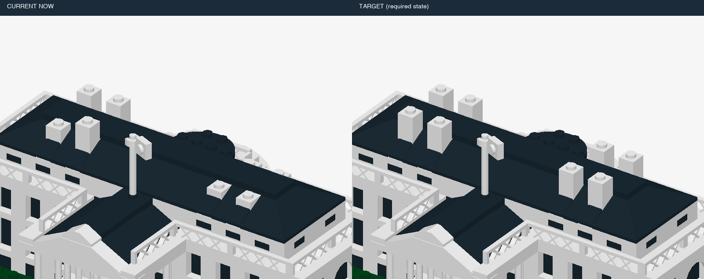

| 条件ID | 静态／动态 | 错误 | 事件数 | 来源类别 | 暂定结构组 | 图片 | 复用旧题 |
|---|---|---|---:|---|---|---|---|
| `v7::white-house-roof::dynamic::control::t0` | dynamic | 正常 | 0 | 正常 | L1 | [三维画面](assets/white-house-roof/0bb717397701c209292c9f5b3d82126f4405ca569fcc33f6818b9fed3502c61a.png) | M:white-house-roof-dynamic-control |
| `v7::white-house-roof::dynamic::missing::t3` | dynamic | 少件 | 1 | H01 | L1 | [三维画面](assets/white-house-roof/0b87194971303cfb133f82c6901878cb2842788ffb8f05451016c7150cfea114.png) | 新增 |
| `v7::white-house-roof::static::missing::t3` | static | 少件 | 0 | H01 | L1 | [三维画面](assets/white-house-roof/c8e6db0a14b3901d1723e8e1f20c712003d010be51e00ffa1cbaeb9d267ffae6.png) | 新增 |
| `v7::white-house-roof::static::control::t3` | static | 正常 | 0 | 正常 | L1 | [三维画面](assets/white-house-roof/895deff004cc5c97198c7742019b614fad231e3578c3b990b3fdd4d4f5c44873.png) | 新增 |
| `v7::white-house-roof::dynamic::missing::t6` | dynamic | 少件 | 1 | H01 | L1 | [三维画面](assets/white-house-roof/82242c1862554977725aa668badfd75a25c83c38e8ceb1f41b8572995cc9d250.png) | 新增 |
| `v7::white-house-roof::static::missing::t6` | static | 少件 | 0 | H01 | L1 | [三维画面](assets/white-house-roof/77f82d1910254f4400646dc53bd938b3124007b693f010cb1baf5faf15e4b5fe.png) | 新增 |
| `v7::white-house-roof::static::control::t6` | static | 正常 | 0 | 正常 | L1 | [三维画面](assets/white-house-roof/771f1da816df19956cd73893b5fb954f34b50840cd053d9415546baa1f90077f.png) | 新增 |
| `v7::white-house-roof::dynamic::wrong-color::t3` | dynamic | 错色 | 1 | H04 | L1 | [三维画面](assets/white-house-roof/a22aa2dc5ecfa40dfd7bc90a6431ac6cea0a276523e772e60229f218c2c9e7ef.png) | 新增 |
| `v7::white-house-roof::static::wrong-color::t3` | static | 错色 | 0 | H04 | L1 | [三维画面](assets/white-house-roof/439a1df40f1d5c921794c2206f2c8ff1bc3e8ef7dd4fb4bf3724c2211a7058ed.png) | 新增 |
| `v7::white-house-roof::dynamic::wrong-color::t6` | dynamic | 错色 | 1 | H04 | L1 | [三维画面](assets/white-house-roof/9f2afbfc01d6ba211d654bb80de389443a6854d773865ecad58e15cb92a2f563.png) | 新增 |
| `v7::white-house-roof::static::wrong-color::t6` | static | 错色 | 0 | H04 | L1 | [三维画面](assets/white-house-roof/69473a7c314b78812b63302d974f2ed9838e54ec13947d59cc0b941a03434814.png) | 新增 |
| `v7::white-house-roof::dynamic::extra-layer::t6` | dynamic | 局部多层／重复加件 | 1 | H03, H11 | L1 | [三维画面](assets/white-house-roof/2bff6520cd2c598e639012db8d88104b0aec050f39cadf7379383bbd9803a20c.png) | 新增 |
| `v7::white-house-roof::static::extra-layer::t6` | static | 局部多层／重复加件 | 0 | H03, H11 | L1 | [三维画面](assets/white-house-roof/79cc2a23c87ac861a7334dd04b697beba6672944ab52e5d38eac61ef6846d555.png) | 新增 |
| `v7::white-house-roof::dynamic::extra-layer::t9` | dynamic | 局部多层／重复加件 | 1 | H03, H11 | L1 | [三维画面](assets/white-house-roof/3040fb8c3154140cf42efa9554198fca2e3bf71584d15f1b140acfdc493592b0.png) | 新增 |
| `v7::white-house-roof::static::extra-layer::t9` | static | 局部多层／重复加件 | 0 | H03, H11 | L1 | [三维画面](assets/white-house-roof/6fe3d9d4c2c44baf16c94846820bf037449777a6b93de93cd531ccc6b0797efe.png) | 新增 |
| `v7::white-house-roof::static::control::t9` | static | 正常 | 0 | 正常 | L1 | [三维画面](assets/white-house-roof/d32d221f938f4f05b6f6616424c32330a8da55a3891b4277c03e9b3df20b2092.png) | 新增 |
| `v7::white-house-roof::dynamic::offset::t3` | dynamic | 偏移一格 | 1 | H07 | L1 | [三维画面](assets/white-house-roof/507e3c6d5dad1b744f30e5dcf710e49fad55c511f3992f71682d6d694d5011c8.png) | 新增 |
| `v7::white-house-roof::static::offset::t3` | static | 偏移一格 | 0 | H07 | L1 | [三维画面](assets/white-house-roof/956730d953e5c4f0f479f8b5e195610313713930dfb641e5b579aba083b0fdd6.png) | 新增 |
| `v7::white-house-roof::dynamic::offset::t6` | dynamic | 偏移一格 | 1 | H07 | L1 | [三维画面](assets/white-house-roof/6ba028fb5727c4c3d22c76075d26ce8acd86c7788863dffe36ee5c2ec4b13103.png) | 新增 |
| `v7::white-house-roof::static::offset::t6` | static | 偏移一格 | 0 | H07 | L1 | [三维画面](assets/white-house-roof/9a2207229a60d1b2c02a12e3fca0f27e6c8009e91a3c9e9afbc06ab6efebb3a3.png) | 新增 |
| `v7::white-house-roof::dynamic::rotated::t3` | dynamic | 装反 | 1 | H06 | L1 | [三维画面](assets/white-house-roof/cacab3ae54a7600df882e4f648c42d7956c924e207a3591141a0d0fc4888c027.png) | 新增 |
| `v7::white-house-roof::static::rotated::t3` | static | 装反 | 0 | H06 | L1 | [三维画面](assets/white-house-roof/77b58b107a85ba938382184fa170b2c010e5fcab0fca07d78480060a4789d208.png) | 新增 |
| `v7::white-house-roof::dynamic::rotated::t6` | dynamic | 装反 | 1 | H06 | L1 | [三维画面](assets/white-house-roof/fc509a91ec5bc031af021edffecfed010e744f1470afcfed75f5a4625e4a1a19.png) | 新增 |
| `v7::white-house-roof::static::rotated::t6` | static | 装反 | 0 | H06 | L1 | [三维画面](assets/white-house-roof/d51d8902ffd7935396ae66011c774f90eda3d8907880803c4b6f0dd012210b9c.png) | 新增 |
| `v7::white-house-roof::dynamic::wrong-part::t6` | dynamic | 错零件／厚度 | 1 | H05 | L1 | [三维画面](assets/white-house-roof/87214ba333469826c60b1361b8b0cc656caea26e5f837af78a0a96f97d9a5ff9.png) | 新增 |
| `v7::white-house-roof::static::wrong-part::t6` | static | 错零件／厚度 | 0 | H05 | L1 | [三维画面](assets/white-house-roof/fcad1ede8357e89860385c54ee8e5b0038f224e45cec0f1c12603c61efefb864.png) | 新增 |
| `v7::white-house-roof::dynamic::wrong-part::t9` | dynamic | 错零件／厚度 | 1 | H05 | L1 | [三维画面](assets/white-house-roof/9c0b7555aa650dda7688c24e1ace2aaac2e07764d9a0cabde02a5eafb34b3775.png) | 新增 |
| `v7::white-house-roof::static::wrong-part::t9` | static | 错零件／厚度 | 0 | H05 | L1 | [三维画面](assets/white-house-roof/bbe0d85cfea6192c71ef7873e4cae9bbe85c5a240cf1b532618e6d91efe249f5.png) | 新增 |
| `v7::white-house-roof::dynamic::repeat-omission::t3` | dynamic | 重复组件漏做 | 1 | H02 | L1 | [三维画面](assets/white-house-roof/af3f5f30d8f649a12f8e342f39422d854d19f67e723c898efff81cf25d99af8e.png) | 新增 |
| `v7::white-house-roof::static::repeat-omission::t3` | static | 重复组件漏做 | 0 | H02 | L1 | [三维画面](assets/white-house-roof/1a6f2ad04e9838ad9cb200bbf97643ba1761bba4bc7f2fe65c19209b37aee601.png) | 新增 |
| `v7::white-house-roof::dynamic::repeat-omission::t6` | dynamic | 重复组件漏做 | 1 | H02 | L1 | [三维画面](assets/white-house-roof/a1743ccb32e58ccf69326ad0414a56598c33c00691772d98747af48688511942.png) | 新增 |
| `v7::white-house-roof::static::repeat-omission::t6` | static | 重复组件漏做 | 0 | H02 | L1 | [三维画面](assets/white-house-roof/1d8aef46088560a59e9af57c794072a45c4c73ea4a72e39cf57b60ba0d87dfb2.png) | 新增 |
| `v7::white-house-roof::dynamic::multiple::missingthen-wrong-color` | dynamic | 连续：少件 → 错色 | 2 | H01, H04, H13 | L2 | [三维画面](assets/white-house-roof/0b87194971303cfb133f82c6901878cb2842788ffb8f05451016c7150cfea114.png) | 新增 |
| `v7::white-house-roof::dynamic::multiple::offsetthen-extra-layer` | dynamic | 连续：偏移一格 → 局部多层／重复加件 | 2 | H03, H07, H11, H13 | L2 | [三维画面](assets/white-house-roof/507e3c6d5dad1b744f30e5dcf710e49fad55c511f3992f71682d6d694d5011c8.png) | 新增 |
| `v7::white-house-roof::dynamic::multiple::wrong-partthen-missing` | dynamic | 连续：错零件／厚度 → 少件 | 2 | H01, H05, H13 | L2 | [三维画面](assets/white-house-roof/6cf41cda6e87995c7e729a49da6530816121f1bb41764b7e7319e28a1948585e.png) | 新增 |

## 洛克菲勒中心：补主塔顶部 · `rockefeller-crown`

部分：M-expanded；正常拼装／模块全长：8块；来源：`v23-21007`。

原模型作者：Damien Roux [Darats]；[来源](https://library.ldraw.org/omr/sets/75)。

本物件包含：拆上层返修、局部多层／重复加件、少件、装反、错色、错零件／厚度。

连续干扰：连续：少件 → 错色；连续：错零件／厚度 → 少件。

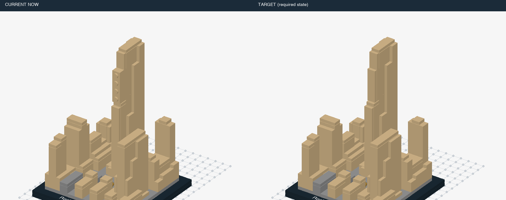

| 条件ID | 静态／动态 | 错误 | 事件数 | 来源类别 | 暂定结构组 | 图片 | 复用旧题 |
|---|---|---|---:|---|---|---|---|
| `v7::rockefeller-crown::dynamic::control::t0` | dynamic | 正常 | 0 | 正常 | L1 | [三维画面](assets/rockefeller-crown/86e3ac131f25a2676adb587337337538414b7a6128b510f36cd4187b49402255.png) | M:rockefeller-crown-dynamic-control |
| `v7::rockefeller-crown::dynamic::missing::t5` | dynamic | 少件 | 1 | H01 | L1 | [三维画面](assets/rockefeller-crown/dd4f8b69d2494296f0daa69af7989e987e34ef8fffe5bb5947bad09f843ffd90.png) | 新增 |
| `v7::rockefeller-crown::static::missing::t5` | static | 少件 | 0 | H01 | L1 | [三维画面](assets/rockefeller-crown/72c0d027f66cf9bffcbfe23078ce301fabeedaa4f47c57c0dff16db434a793bf.png) | 新增 |
| `v7::rockefeller-crown::static::control::t5` | static | 正常 | 0 | 正常 | L1 | [三维画面](assets/rockefeller-crown/0a092cfa19c36444eda9029d4fad455cb23173142dc081cc637f224cdbeb4e7b.png) | 新增 |
| `v7::rockefeller-crown::dynamic::missing::t7` | dynamic | 少件 | 1 | H01 | L1 | [三维画面](assets/rockefeller-crown/6ae9529609b9ffd88881cb16b80d9153ecb50d82cb4d7a1d28606ada51e0e7b0.png) | M:rockefeller-crown-dynamic-missing |
| `v7::rockefeller-crown::static::missing::t7` | static | 少件 | 0 | H01 | L1 | [三维画面](assets/rockefeller-crown/2a014d11f3f155ea3dc9c893a04e0c4059e97f19468280ff62ee8cac4d0adb25.png) | M:rockefeller-crown-static-missing |
| `v7::rockefeller-crown::static::control::t7` | static | 正常 | 0 | 正常 | L1 | [三维画面](assets/rockefeller-crown/7398d8f1554e24abc80c3b16ca5f40fb2f0c66ad2a2e95dc2a525091af1aed4f.png) | M:rockefeller-crown-static-control |
| `v7::rockefeller-crown::dynamic::wrong-color::t5` | dynamic | 错色 | 1 | H04 | L1 | [三维画面](assets/rockefeller-crown/7026ea0efc83f3fab7da39ffb8684516fb78d12801f07e2ab01e7cbd424bf94d.png) | 新增 |
| `v7::rockefeller-crown::static::wrong-color::t5` | static | 错色 | 0 | H04 | L1 | [三维画面](assets/rockefeller-crown/298f99f1f1241c2e787702f7a898d6a848f82ba214ed549882b71fceee1a27e2.png) | 新增 |
| `v7::rockefeller-crown::dynamic::wrong-color::t7` | dynamic | 错色 | 1 | H04 | L1 | [三维画面](assets/rockefeller-crown/708e0430a190695fe3834cfb0e3f149be4c21e75d6e6b3c80aefc5b22b0c9d6a.png) | M:rockefeller-crown-dynamic-wrong-color |
| `v7::rockefeller-crown::static::wrong-color::t7` | static | 错色 | 0 | H04 | L1 | [三维画面](assets/rockefeller-crown/16ece37d0264cff3d6b4b5eeecbf98a1f87d971c73535b815a16b2eef1191955.png) | M:rockefeller-crown-static-wrong-color |
| `v7::rockefeller-crown::dynamic::extra-layer::t7` | dynamic | 局部多层／重复加件 | 1 | H03, H11 | L1 | [三维画面](assets/rockefeller-crown/4d8f18c738df5426e9914e2315d1236e2b9186288c35ae859fca92b1a587ee3d.png) | M:rockefeller-crown-dynamic-extra-layer |
| `v7::rockefeller-crown::static::extra-layer::t7` | static | 局部多层／重复加件 | 0 | H03, H11 | L1 | [三维画面](assets/rockefeller-crown/c2bda91c932476861bbb83d2673b2f19cc8665400c670f265adb5e77bfe1b2d5.png) | M:rockefeller-crown-static-extra-layer |
| `v7::rockefeller-crown::dynamic::extra-layer::t4` | dynamic | 局部多层／重复加件 | 1 | H03, H11 | L1 | [三维画面](assets/rockefeller-crown/e5f0851825397d2970f852a6f879128ec63690de6dfb0c680d31f808fde8972b.png) | 新增 |
| `v7::rockefeller-crown::static::extra-layer::t4` | static | 局部多层／重复加件 | 0 | H03, H11 | L1 | [三维画面](assets/rockefeller-crown/bf6e912191a3d310860d466cba9222bee55636889c52e584cc0c8d57a7cb6e51.png) | 新增 |
| `v7::rockefeller-crown::static::control::t4` | static | 正常 | 0 | 正常 | L1 | [三维画面](assets/rockefeller-crown/a1d12a463685b7a1038f27d6bc99642318c9409f33fb2cd258aada54a874f6e4.png) | 新增 |
| `v7::rockefeller-crown::dynamic::rotated::t5` | dynamic | 装反 | 1 | H06 | L1 | [三维画面](assets/rockefeller-crown/32a6776c1d42581c68ad4cde2a3b815dbe54c14758eda684157b09d0f38ab301.png) | 新增 |
| `v7::rockefeller-crown::static::rotated::t5` | static | 装反 | 0 | H06 | L1 | [三维画面](assets/rockefeller-crown/0a092cfa19c36444eda9029d4fad455cb23173142dc081cc637f224cdbeb4e7b.png) | 新增 |
| `v7::rockefeller-crown::dynamic::rotated::t7` | dynamic | 装反 | 1 | H06 | L1 | [三维画面](assets/rockefeller-crown/98521baa331f6d8b4f6a1cbe7813888dae9554ee9b2e004176669b5ddab0da08.png) | 新增 |
| `v7::rockefeller-crown::static::rotated::t7` | static | 装反 | 0 | H06 | L1 | [三维画面](assets/rockefeller-crown/7398d8f1554e24abc80c3b16ca5f40fb2f0c66ad2a2e95dc2a525091af1aed4f.png) | 新增 |
| `v7::rockefeller-crown::dynamic::wrong-part::t7` | dynamic | 错零件／厚度 | 1 | H05 | L1 | [三维画面](assets/rockefeller-crown/4cee3d11929c5073673aa56646b8c93d77143805c583eea57a559ac1bb59c0cc.png) | 新增 |
| `v7::rockefeller-crown::static::wrong-part::t7` | static | 错零件／厚度 | 0 | H05 | L1 | [三维画面](assets/rockefeller-crown/0a0d5e1db1581afefe5ca7a4bb64e8e35a8247859d717109c6b7d9866d9e10d1.png) | 新增 |
| `v7::rockefeller-crown::dynamic::buried-repair::t3` | dynamic | 拆上层返修 | 1 | H10 | L2 | [三维画面](assets/rockefeller-crown/48a64824978805a14ab4971fb07ea1210339ba543a1ed69e04dc21d7059ef5bb.png) | 新增 |
| `v7::rockefeller-crown::static::buried-repair::t3` | static | 拆上层返修 | 0 | H10 | L2 | [三维画面](assets/rockefeller-crown/464c4e4665f4dbf6bfe3ae4bd86563ba356be2062ce98b0581db2dd712840ffc.png) | 新增 |
| `v7::rockefeller-crown::static::control::t3` | static | 正常 | 0 | 正常 | L1 | [三维画面](assets/rockefeller-crown/d75272bf98093b6aaf6e2f7fde8686a79c32b13b899f63a5784881df9091fe05.png) | 新增 |
| `v7::rockefeller-crown::dynamic::buried-repair::t5` | dynamic | 拆上层返修 | 1 | H10 | L2 | [三维画面](assets/rockefeller-crown/cbf0b814219df077b93deeb2ed884cd36822dd674c8ebeaee13dda26bb603036.png) | 新增 |
| `v7::rockefeller-crown::static::buried-repair::t5` | static | 拆上层返修 | 0 | H10 | L2 | [三维画面](assets/rockefeller-crown/b493919d0f60d257bb563aca468cbf8d6fd33f0102f38a88d6bd09fd628576f3.png) | 新增 |
| `v7::rockefeller-crown::dynamic::multiple::missingthen-wrong-color` | dynamic | 连续：少件 → 错色 | 2 | H01, H04, H13 | L2 | [三维画面](assets/rockefeller-crown/dd4f8b69d2494296f0daa69af7989e987e34ef8fffe5bb5947bad09f843ffd90.png) | 新增 |
| `v7::rockefeller-crown::dynamic::multiple::wrong-partthen-missing` | dynamic | 连续：错零件／厚度 → 少件 | 2 | H01, H05, H13 | L2 | [三维画面](assets/rockefeller-crown/4cee3d11929c5073673aa56646b8c93d77143805c583eea57a559ac1bb59c0cc.png) | 新增 |

## 勃兰登堡门：补顶部装饰 · `brandenburg-top`

部分：M-expanded；正常拼装／模块全长：10块；来源：`v23-21011`。

原模型作者：Orion Pobursky [OrionP]；[来源](https://library.ldraw.org/omr/sets/16)。

本物件包含：拆上层返修、局部多层／重复加件、少件、偏移一格、重复组件漏做、装反、错色。

连续干扰：连续：少件 → 错色；连续：偏移一格 → 局部多层／重复加件。

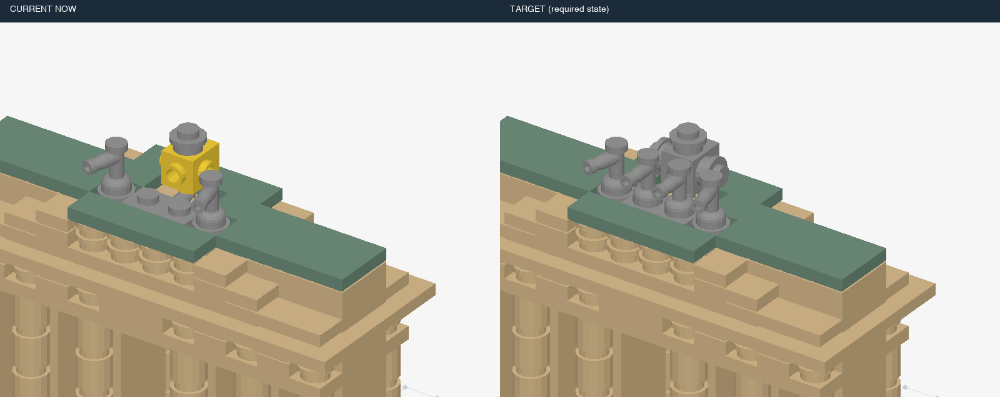

| 条件ID | 静态／动态 | 错误 | 事件数 | 来源类别 | 暂定结构组 | 图片 | 复用旧题 |
|---|---|---|---:|---|---|---|---|
| `v7::brandenburg-top::dynamic::control::t0` | dynamic | 正常 | 0 | 正常 | L1 | [三维画面](assets/brandenburg-top/092a77af8170717811bff0f9012e3aaad529a42b4d1c7c4a506d0784eb141ab4.png) | M:brandenburg-top-dynamic-control |
| `v7::brandenburg-top::dynamic::missing::t3` | dynamic | 少件 | 1 | H01 | L1 | [三维画面](assets/brandenburg-top/9e79022d19ed73a3332a8016ce3716edbcaec0ca0716cf78fbda65276b307d21.png) | 新增 |
| `v7::brandenburg-top::static::missing::t3` | static | 少件 | 0 | H01 | L1 | [三维画面](assets/brandenburg-top/3c0546bfdf4d52636d1b224cb51ae289efe78d5fb8bdbaa115b1e5cfea33d9f4.png) | 新增 |
| `v7::brandenburg-top::static::control::t3` | static | 正常 | 0 | 正常 | L1 | [三维画面](assets/brandenburg-top/889266484e01bbd15ceefb7932ee238029669f85ef301809c2a28b7bf1e84386.png) | 新增 |
| `v7::brandenburg-top::dynamic::missing::t6` | dynamic | 少件 | 1 | H01 | L1 | [三维画面](assets/brandenburg-top/e749c0e6cf32a2d576b62bdefc212c198d97e26193e836ffd00e61a08ba5d84b.png) | M:brandenburg-top-dynamic-missing |
| `v7::brandenburg-top::static::missing::t6` | static | 少件 | 0 | H01 | L1 | [三维画面](assets/brandenburg-top/0eed14ec8c8a44862f997b10c5d15928247719cfb3b4f5c731e7653346111016.png) | M:brandenburg-top-static-missing |
| `v7::brandenburg-top::static::control::t6` | static | 正常 | 0 | 正常 | L1 | [三维画面](assets/brandenburg-top/65c2a1eaadc8f2a7ad70f280925d6bd520afd9fea036873b1b853f225974489c.png) | M:brandenburg-top-static-control |
| `v7::brandenburg-top::dynamic::wrong-color::t3` | dynamic | 错色 | 1 | H04 | L1 | [三维画面](assets/brandenburg-top/a9a00eb84a686ccc059aa880bf56746aa16070bbddb423a122dba476ecbc75aa.png) | 新增 |
| `v7::brandenburg-top::static::wrong-color::t3` | static | 错色 | 0 | H04 | L1 | [三维画面](assets/brandenburg-top/d86dd2bd7c83043f4821f8bddeb48c4d6125105cfd472d19cc4823ac9d11c88e.png) | 新增 |
| `v7::brandenburg-top::dynamic::wrong-color::t6` | dynamic | 错色 | 1 | H04 | L1 | [三维画面](assets/brandenburg-top/36abfe4569124870da01a889edf620f2561ff86e6a94431958c47da4ec0837a4.png) | M:brandenburg-top-dynamic-wrong-color |
| `v7::brandenburg-top::static::wrong-color::t6` | static | 错色 | 0 | H04 | L1 | [三维画面](assets/brandenburg-top/c08aed271af0c368e22bbcdc2092d31a09638effca10e58e6369ce8d01d1045a.png) | M:brandenburg-top-static-wrong-color |
| `v7::brandenburg-top::dynamic::extra-layer::t6` | dynamic | 局部多层／重复加件 | 1 | H03, H11 | L1 | [三维画面](assets/brandenburg-top/793f68b8b12cd79d74850087741ef62b683bd531b2becd4a5f1be682297d7316.png) | M:brandenburg-top-dynamic-extra-layer |
| `v7::brandenburg-top::static::extra-layer::t6` | static | 局部多层／重复加件 | 0 | H03, H11 | L1 | [三维画面](assets/brandenburg-top/f5e7227169963349fb71d37e258f8a1b4c137da18ae44e1df16367f67832f440.png) | M:brandenburg-top-static-extra-layer |
| `v7::brandenburg-top::dynamic::extra-layer::t9` | dynamic | 局部多层／重复加件 | 1 | H03, H11 | L1 | [三维画面](assets/brandenburg-top/a53917d3835d96b2112e5dc692ab6543a9191dd3eca3031c8bbdc9d2a5728f0c.png) | 新增 |
| `v7::brandenburg-top::static::extra-layer::t9` | static | 局部多层／重复加件 | 0 | H03, H11 | L1 | [三维画面](assets/brandenburg-top/86aa4a521a0c1cb9b6f1aeeae82a3e75632907f76b98ece01be438f699758f05.png) | 新增 |
| `v7::brandenburg-top::static::control::t9` | static | 正常 | 0 | 正常 | L1 | [三维画面](assets/brandenburg-top/7b31aa4b475599a00b596e2f4c4c171876798d208a3b1953ef4311d6715d49af.png) | 新增 |
| `v7::brandenburg-top::dynamic::offset::t3` | dynamic | 偏移一格 | 1 | H07 | L1 | [三维画面](assets/brandenburg-top/7569d1b51552c72757f0d86d8e50e8589ad7525b521b636510cae17ae8e89e89.png) | 新增 |
| `v7::brandenburg-top::static::offset::t3` | static | 偏移一格 | 0 | H07 | L1 | [三维画面](assets/brandenburg-top/a189c97deab6feb91bff6b72ad688d3611c9bd5fb82622ac20fec7709f7a6de2.png) | 新增 |
| `v7::brandenburg-top::dynamic::offset::t6` | dynamic | 偏移一格 | 1 | H07 | L1 | [三维画面](assets/brandenburg-top/87d2867f59475684af2ac1093714bdde23efc3e2e3fe6dce39869272a9a34049.png) | 新增 |
| `v7::brandenburg-top::static::offset::t6` | static | 偏移一格 | 0 | H07 | L1 | [三维画面](assets/brandenburg-top/d4f8629711b50e1d002c074a7e579a6421e211b0545d05d353495dc78400fa73.png) | 新增 |
| `v7::brandenburg-top::dynamic::rotated::t3` | dynamic | 装反 | 1 | H06 | L1 | [三维画面](assets/brandenburg-top/a19edfc35a4fa70290d3f409e3f3e9d89e234fc369a6926a9d535dad8200eee2.png) | 新增 |
| `v7::brandenburg-top::static::rotated::t3` | static | 装反 | 0 | H06 | L1 | [三维画面](assets/brandenburg-top/889266484e01bbd15ceefb7932ee238029669f85ef301809c2a28b7bf1e84386.png) | 新增 |
| `v7::brandenburg-top::dynamic::rotated::t6` | dynamic | 装反 | 1 | H06 | L1 | [三维画面](assets/brandenburg-top/8b9b7d2f457a6a2aaf8afc2938b72560dc49e7fc1cf168ca25ce27392c2b551f.png) | 新增 |
| `v7::brandenburg-top::static::rotated::t6` | static | 装反 | 0 | H06 | L1 | [三维画面](assets/brandenburg-top/65c2a1eaadc8f2a7ad70f280925d6bd520afd9fea036873b1b853f225974489c.png) | 新增 |
| `v7::brandenburg-top::dynamic::buried-repair::t6` | dynamic | 拆上层返修 | 1 | H10 | L2 | [三维画面](assets/brandenburg-top/3da83083193e16789fea22f48309c317d4bc5bc55c85a86ab69bf4ba90f7e7a9.png) | 新增 |
| `v7::brandenburg-top::static::buried-repair::t6` | static | 拆上层返修 | 0 | H10 | L2 | [三维画面](assets/brandenburg-top/66ef6102d5755d69f987bf685cb4220d4b7bf3cfac8845b36116aec95ad551ee.png) | 新增 |
| `v7::brandenburg-top::dynamic::buried-repair::t9` | dynamic | 拆上层返修 | 1 | H10 | L2 | [三维画面](assets/brandenburg-top/0ddc98cf1ac7905cbfc2de1d9c192587c34d19785587c7a08806dfa231ebd8e4.png) | 新增 |
| `v7::brandenburg-top::static::buried-repair::t9` | static | 拆上层返修 | 0 | H10 | L2 | [三维画面](assets/brandenburg-top/1a7b689342311d9387f0873f66a45e395e9cc49441539cb674153ca7ddb358e9.png) | 新增 |
| `v7::brandenburg-top::dynamic::repeat-omission::t3` | dynamic | 重复组件漏做 | 1 | H02 | L1 | [三维画面](assets/brandenburg-top/1a4c1e83fed7035f7322297734b4864ac4b80af39bd17d7151d908fa531dd9fe.png) | 新增 |
| `v7::brandenburg-top::static::repeat-omission::t3` | static | 重复组件漏做 | 0 | H02 | L1 | [三维画面](assets/brandenburg-top/8aaf1996728e90a86b174e7c28d46170dd63d611901357f6697e50fe677d22f3.png) | 新增 |
| `v7::brandenburg-top::dynamic::repeat-omission::t6` | dynamic | 重复组件漏做 | 1 | H02 | L1 | [三维画面](assets/brandenburg-top/95cd23a4bae398ca5b30f00372b7947fa8ebead2e6986f08b382838e78fd958e.png) | 新增 |
| `v7::brandenburg-top::static::repeat-omission::t6` | static | 重复组件漏做 | 0 | H02 | L1 | [三维画面](assets/brandenburg-top/43e7993c625cacd91f1ccb9b4d5965b1e38650d4f4a51e3c5eb65ee43d5dae8b.png) | 新增 |
| `v7::brandenburg-top::dynamic::multiple::missingthen-wrong-color` | dynamic | 连续：少件 → 错色 | 2 | H01, H04, H13 | L2 | [三维画面](assets/brandenburg-top/9e79022d19ed73a3332a8016ce3716edbcaec0ca0716cf78fbda65276b307d21.png) | 新增 |
| `v7::brandenburg-top::dynamic::multiple::offsetthen-extra-layer` | dynamic | 连续：偏移一格 → 局部多层／重复加件 | 2 | H03, H07, H11, H13 | L2 | [三维画面](assets/brandenburg-top/7569d1b51552c72757f0d86d8e50e8589ad7525b521b636510cae17ae8e89e89.png) | 新增 |

## 博物馆：补完长楼屋面：扩大操作模块 · `museum-roof-long`

部分：M-long；正常拼装／模块全长：16块；来源：`v23-21004`。

原模型作者：Orion Pobursky [OrionP]；[来源](https://library.ldraw.org/omr/sets/12)。

本物件包含：拆上层返修、提前封口、局部多层／重复加件、少件、偏移一格、重复组件漏做、装反、错色、错零件／厚度。

连续干扰：连续：少件 → 错色；连续：少件 → 错色 → 偏移一格。

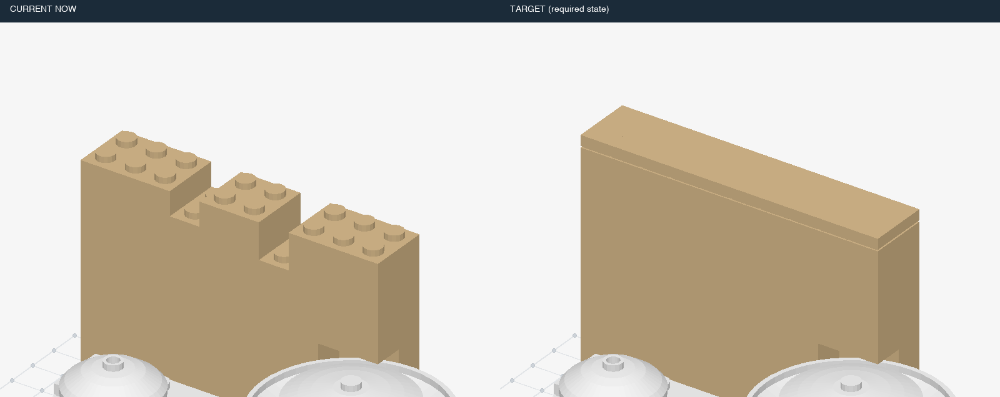

| 条件ID | 静态／动态 | 错误 | 事件数 | 来源类别 | 暂定结构组 | 图片 | 复用旧题 |
|---|---|---|---:|---|---|---|---|
| `v7::museum-roof-long::dynamic::control::t0` | dynamic | 正常 | 0 | 正常 | L1 | [三维画面](assets/museum-roof-long/ebeb45b8a397eef2687dab812f9cb70c49364e8adbd1d23429374ad336f3a8ad.png) | 新增 |
| `v7::museum-roof-long::dynamic::missing::t10` | dynamic | 少件 | 1 | H01 | L1 | [三维画面](assets/museum-roof-long/e708403104ee55c6795510c3cc83798d5994fc46cd74b4ad7778b2cbedd195b1.png) | 新增 |
| `v7::museum-roof-long::static::missing::t10` | static | 少件 | 0 | H01 | L1 | [三维画面](assets/museum-roof-long/b08843d305f24191a78b0ff49ff44cf7c8dc0362b2baebc67c54fa8f1b3f8b6f.png) | 新增 |
| `v7::museum-roof-long::static::control::t10` | static | 正常 | 0 | 正常 | L1 | [三维画面](assets/museum-roof-long/b1044293ed2a0abf61b6ef1fca1b95afc7655bfc07c71764aba5f8755ebed344.png) | 新增 |
| `v7::museum-roof-long::dynamic::missing::t15` | dynamic | 少件 | 1 | H01 | L1 | [三维画面](assets/museum-roof-long/5c6132bbf540ca07253c5d331cd8b0069e0d8c48f06eb6145847ad0b464a5fd2.png) | 新增 |
| `v7::museum-roof-long::static::missing::t15` | static | 少件 | 0 | H01 | L1 | [三维画面](assets/museum-roof-long/fe13b27b6946b79d000ba085c32e1bf609bcaf0e56abce6bce9493957fc20942.png) | 新增 |
| `v7::museum-roof-long::static::control::t15` | static | 正常 | 0 | 正常 | L1 | [三维画面](assets/museum-roof-long/e530c7f2cc7ced7bf3b65d6980c677173d4be5e88d668aecc431d107fe54cc07.png) | 新增 |
| `v7::museum-roof-long::dynamic::wrong-color::t10` | dynamic | 错色 | 1 | H04 | L1 | [三维画面](assets/museum-roof-long/37a1af264b8f1544a0cc549b8075d37289870eca8bd2584f48bf7ffab09aa505.png) | 新增 |
| `v7::museum-roof-long::static::wrong-color::t10` | static | 错色 | 0 | H04 | L1 | [三维画面](assets/museum-roof-long/3bdf4e72050d16e95ee02f46ebda77acf80292019f01f0c6f266e673acc79113.png) | 新增 |
| `v7::museum-roof-long::dynamic::wrong-color::t15` | dynamic | 错色 | 1 | H04 | L1 | [三维画面](assets/museum-roof-long/ef6f2ef2abce539b99dd954833b96b457a8064f2ffe9ba9f00302e8b52c9052f.png) | 新增 |
| `v7::museum-roof-long::static::wrong-color::t15` | static | 错色 | 0 | H04 | L1 | [三维画面](assets/museum-roof-long/0e03ab1feb11a039e917be131641312063df6be240ba5f48d1b94b2e979c3094.png) | 新增 |
| `v7::museum-roof-long::dynamic::extra-layer::t5` | dynamic | 局部多层／重复加件 | 1 | H03, H11 | L1 | [三维画面](assets/museum-roof-long/3571014134ad9b4dc954306c2c4d18eec4e13f17a1cd1e5cd5b9169c51b58f7c.png) | 新增 |
| `v7::museum-roof-long::static::extra-layer::t5` | static | 局部多层／重复加件 | 0 | H03, H11 | L1 | [三维画面](assets/museum-roof-long/e2b0436b25afd2b1be7dda4319be21e9e8d8a5171360295914aa78aa795a878a.png) | 新增 |
| `v7::museum-roof-long::static::control::t5` | static | 正常 | 0 | 正常 | L1 | [三维画面](assets/museum-roof-long/ed26c8b30daf3967223447d6dff46df5cc5b63d7d2ff34339f787c80e9306f47.png) | 新增 |
| `v7::museum-roof-long::dynamic::extra-layer::t3` | dynamic | 局部多层／重复加件 | 1 | H03, H11 | L1 | [三维画面](assets/museum-roof-long/a6cca0f35e1aef0da50ab4cd3cbd8dd34f3077056b9cf0bde32dd91dc98ba92e.png) | 新增 |
| `v7::museum-roof-long::static::extra-layer::t3` | static | 局部多层／重复加件 | 0 | H03, H11 | L1 | [三维画面](assets/museum-roof-long/c5f4fafae72f85b3c12db4b31d149df1608899051c7bc9b334ffd75c1df0790c.png) | 新增 |
| `v7::museum-roof-long::static::control::t3` | static | 正常 | 0 | 正常 | L1 | [三维画面](assets/museum-roof-long/f562d45b74ed1ba3ce736b6ccbe4c963c2ccfd9704404d05614adf55813661d9.png) | 新增 |
| `v7::museum-roof-long::dynamic::offset::t10` | dynamic | 偏移一格 | 1 | H07 | L1 | [三维画面](assets/museum-roof-long/429f9adf209e16e1dd615ddce8342ca5e0ecf666826007ecbade0d6f50cd6487.png) | 新增 |
| `v7::museum-roof-long::static::offset::t10` | static | 偏移一格 | 0 | H07 | L1 | [三维画面](assets/museum-roof-long/60938d90243101f03381b05c703e01d2359ff8e2cfcea11a8113c9a4796856b2.png) | 新增 |
| `v7::museum-roof-long::dynamic::offset::t15` | dynamic | 偏移一格 | 1 | H07 | L1 | [三维画面](assets/museum-roof-long/ea16d7af956f4b0a32dbd5945113fa760260812ff4cf04ad25612f54a7f657e4.png) | 新增 |
| `v7::museum-roof-long::static::offset::t15` | static | 偏移一格 | 0 | H07 | L1 | [三维画面](assets/museum-roof-long/8d6a0ce3ac4a012110b92ea7f93d752f1c4e897e543c6255e38eec4b9968a7f2.png) | 新增 |
| `v7::museum-roof-long::dynamic::rotated::t10` | dynamic | 装反 | 1 | H06 | L1 | [三维画面](assets/museum-roof-long/9d75f31bbd646c5210ce942287dbed155f1b542e1d2073c071917d181b76352d.png) | 新增 |
| `v7::museum-roof-long::static::rotated::t10` | static | 装反 | 0 | H06 | L1 | [三维画面](assets/museum-roof-long/6bdd34bbca2eac5ec00f1707522ab837771cc75ef20bb7c0028bdddb0dec268a.png) | 新增 |
| `v7::museum-roof-long::dynamic::rotated::t15` | dynamic | 装反 | 1 | H06 | L1 | [三维画面](assets/museum-roof-long/21718e9ac547bef457cd0d1c433588c542e84c9bae846e829e8cd785fa396585.png) | 新增 |
| `v7::museum-roof-long::static::rotated::t15` | static | 装反 | 0 | H06 | L1 | [三维画面](assets/museum-roof-long/298beae7a802f42ea33ac2a5c64286ef88047493469e0b7fde6573080cb5514f.png) | 新增 |
| `v7::museum-roof-long::dynamic::wrong-part::t3` | dynamic | 错零件／厚度 | 1 | H05 | L1 | [三维画面](assets/museum-roof-long/633e7b18d4a2dc906707708fbc1b00f49999a9610b27bdd51165720f70910d4c.png) | 新增 |
| `v7::museum-roof-long::static::wrong-part::t3` | static | 错零件／厚度 | 0 | H05 | L1 | [三维画面](assets/museum-roof-long/5649816c3d432005d628180c815a350600311b44e38b062d6734f3ca189ae996.png) | 新增 |
| `v7::museum-roof-long::dynamic::wrong-part::t4` | dynamic | 错零件／厚度 | 1 | H05 | L1 | [三维画面](assets/museum-roof-long/bcd5f6c62504e72050409e193db08ce83625583143a4f76775943faef0fa327f.png) | 新增 |
| `v7::museum-roof-long::static::wrong-part::t4` | static | 错零件／厚度 | 0 | H05 | L1 | [三维画面](assets/museum-roof-long/c483a41d98f408f2e0078c917a3f7becc60a786c1085eef48b04aaf2e70e68e7.png) | 新增 |
| `v7::museum-roof-long::static::control::t4` | static | 正常 | 0 | 正常 | L1 | [三维画面](assets/museum-roof-long/77cf73751a9c0825024605cb09734a0b2e8fb6ce9c15e953eabbc7ba0a684c4f.png) | 新增 |
| `v7::museum-roof-long::dynamic::early-cover::t5` | dynamic | 提前封口 | 1 | H09 | L1 | [三维画面](assets/museum-roof-long/2889cb37d8c348a65c529b8bdfa097b29e2c0fc90b7fee3e753f64c7ac37f1f8.png) | 新增 |
| `v7::museum-roof-long::static::early-cover::t5` | static | 提前封口 | 0 | H09 | L1 | [三维画面](assets/museum-roof-long/0839c76a9fcceeef77b3d7551cbfa352c63e8e0ebd7c3a7005be6d453d9b73cc.png) | 新增 |
| `v7::museum-roof-long::dynamic::early-cover::t3` | dynamic | 提前封口 | 1 | H09 | L1 | [三维画面](assets/museum-roof-long/ada612066b44a9d87ec4b1e62249b387c772c2b7e82ae91232861113dd2bb67d.png) | 新增 |
| `v7::museum-roof-long::static::early-cover::t3` | static | 提前封口 | 0 | H09 | L1 | [三维画面](assets/museum-roof-long/69ae71580fa211be3a0cfda30e8f36de949bfbe7c628a386e1c16aca97f6b90c.png) | 新增 |
| `v7::museum-roof-long::dynamic::buried-repair::t5` | dynamic | 拆上层返修 | 1 | H10 | L2 | [三维画面](assets/museum-roof-long/19e382d97fee0c3660ad2646f7c68b8f24ddca2e3d0ae18d68a3852a47a0bd2b.png) | 新增 |
| `v7::museum-roof-long::static::buried-repair::t5` | static | 拆上层返修 | 0 | H10 | L2 | [三维画面](assets/museum-roof-long/f3d11e68bd2e84d42b1e2dbe47c043387c16243ea7a699a773e1380e1bd262da.png) | 新增 |
| `v7::museum-roof-long::dynamic::buried-repair::t10` | dynamic | 拆上层返修 | 1 | H10 | L2 | [三维画面](assets/museum-roof-long/7620b2efdcaf5b234740c87938ef3fe0a89186889a4c69ebad04c8d0636ad567.png) | 新增 |
| `v7::museum-roof-long::static::buried-repair::t10` | static | 拆上层返修 | 0 | H10 | L2 | [三维画面](assets/museum-roof-long/c1a77b2dd7b5e8c5ed684c0cca47852650a9c69a718c8ac6eecd56733fa9260a.png) | 新增 |
| `v7::museum-roof-long::dynamic::repeat-omission::t10` | dynamic | 重复组件漏做 | 1 | H02 | L1 | [三维画面](assets/museum-roof-long/31a707d9e4f24f8b8df42f86097fae6c11f280f304654715ab41c6d77b12898e.png) | 新增 |
| `v7::museum-roof-long::static::repeat-omission::t10` | static | 重复组件漏做 | 0 | H02 | L1 | [三维画面](assets/museum-roof-long/de625a5000c962cae359ffa7f9792b48c4768eb99f084da2c93195ac3947661a.png) | 新增 |
| `v7::museum-roof-long::dynamic::repeat-omission::t15` | dynamic | 重复组件漏做 | 1 | H02 | L1 | [三维画面](assets/museum-roof-long/b5dfd436d24762d8ed0cbfff1b3de6dbd095733c269c3dba5ce085c9a19b1210.png) | 新增 |
| `v7::museum-roof-long::static::repeat-omission::t15` | static | 重复组件漏做 | 0 | H02 | L1 | [三维画面](assets/museum-roof-long/1644c6707463ca7fb5b805e67ebdb2a16c28f0357857a3219fc0cf82deb0c6b4.png) | 新增 |
| `v7::museum-roof-long::dynamic::multiple::missingthen-wrong-color` | dynamic | 连续：少件 → 错色 | 2 | H01, H04, H13 | L2 | [三维画面](assets/museum-roof-long/9aa5fba7e4b9ed96f17e7c6bbdebd8338f0ef8341462a2a97ac688f5258de81f.png) | 新增 |
| `v7::museum-roof-long::dynamic::multiple::missingthen-wrong-colorthen-offset` | dynamic | 连续：少件 → 错色 → 偏移一格 | 3 | H01, H04, H07, H13 | L2 | [三维画面](assets/museum-roof-long/ff7d5479ea01b14511065312b3470b7fdea4e6dbafe5927e2392a468508ff4ab.png) | 新增 |

## 绿色客运车厢：局部补装 · `new-10015-1`

部分：M-new-source；正常拼装／模块全长：19块；来源：`v7-omr-10015-1`。

原模型作者：TotalyWicked [TotalyWicked]；[来源](https://library.ldraw.org/library/omr/10015-1.mpd)。

本物件包含：拆上层返修、提前封口、局部多层／重复加件、左右互换、少件、偏移一格、重复组件漏做、装反、错色。

连续干扰：连续：少件 → 错色；连续：少件 → 错色 → 偏移一格；连续：偏移一格 → 局部多层／重复加件。

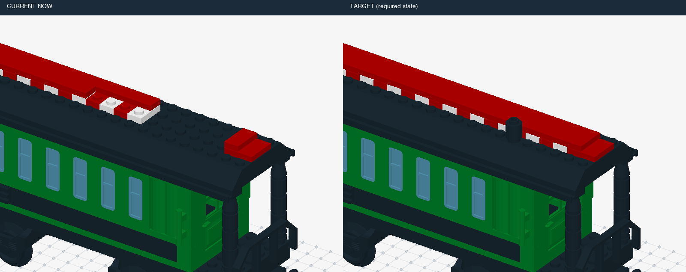

| 条件ID | 静态／动态 | 错误 | 事件数 | 来源类别 | 暂定结构组 | 图片 | 复用旧题 |
|---|---|---|---:|---|---|---|---|
| `v7::new-10015-1::dynamic::control::t0` | dynamic | 正常 | 0 | 正常 | L1 | [三维画面](assets/new-10015-1/6cae6688256c9c2d28f356e37b369fc3f190c22f82a3bc255a13f512eb2ff123.png) | 新增 |
| `v7::new-10015-1::dynamic::missing::t6` | dynamic | 少件 | 1 | H01 | L1 | [三维画面](assets/new-10015-1/eb72ef5cf1316a37953819c8c6bac8c3f470d86b92083186299f0b5bad724cfc.png) | 新增 |
| `v7::new-10015-1::static::missing::t6` | static | 少件 | 0 | H01 | L1 | [三维画面](assets/new-10015-1/d7d3607c41dc31aba3573b943d4a93b664b6fde973c7248ae65cc6a882c9a7d5.png) | 新增 |
| `v7::new-10015-1::static::control::t6` | static | 正常 | 0 | 正常 | L1 | [三维画面](assets/new-10015-1/097a38b9fcb22465b8bdd7e0e00c1878fa7522d73d7afb75c3723620f7d8a032.png) | 新增 |
| `v7::new-10015-1::dynamic::missing::t12` | dynamic | 少件 | 1 | H01 | L1 | [三维画面](assets/new-10015-1/cfc32996c39bf6f547d662c415ecd3b579adb6c05cab55a01ae9b3d07eca55ec.png) | 新增 |
| `v7::new-10015-1::static::missing::t12` | static | 少件 | 0 | H01 | L1 | [三维画面](assets/new-10015-1/d8f1c2f5cac0f5ae7351ee63f155e95ce69dde5d408c30fa3542adf4708870a3.png) | 新增 |
| `v7::new-10015-1::static::control::t12` | static | 正常 | 0 | 正常 | L1 | [三维画面](assets/new-10015-1/c897b41826959eba5f3e285a09796af0d65db54e57038f42571e529868298337.png) | 新增 |
| `v7::new-10015-1::dynamic::wrong-color::t6` | dynamic | 错色 | 1 | H04 | L1 | [三维画面](assets/new-10015-1/7265303c10d3d26ee0d2b794707b3caf228ec5228ef5236a6ee9e2ea7f02c465.png) | 新增 |
| `v7::new-10015-1::static::wrong-color::t6` | static | 错色 | 0 | H04 | L1 | [三维画面](assets/new-10015-1/ee2939a8f6fe857250635dc4b2492dabf344213b43b58f6d0b3eff5d1c27b565.png) | 新增 |
| `v7::new-10015-1::dynamic::wrong-color::t12` | dynamic | 错色 | 1 | H04 | L1 | [三维画面](assets/new-10015-1/e3c22511ae20798ebe03867d5539720dd49269a2f084ccc1dfdf436877fc8998.png) | 新增 |
| `v7::new-10015-1::static::wrong-color::t12` | static | 错色 | 0 | H04 | L1 | [三维画面](assets/new-10015-1/dfa7579ea9105b8970ff44947e93bc91cf0779f89a6cc37163a329499e44687f.png) | 新增 |
| `v7::new-10015-1::dynamic::extra-layer::t6` | dynamic | 局部多层／重复加件 | 1 | H03, H11 | L1 | [三维画面](assets/new-10015-1/9018619743863dd7464e6f6711b9c4bde7b86e3f38dd5f23d01a2a6443716ded.png) | 新增 |
| `v7::new-10015-1::static::extra-layer::t6` | static | 局部多层／重复加件 | 0 | H03, H11 | L1 | [三维画面](assets/new-10015-1/176c57fc6b3a2ea42da0b868ceabbcab7538e778ac0a7c8880f5ee936cc55e50.png) | 新增 |
| `v7::new-10015-1::dynamic::extra-layer::t18` | dynamic | 局部多层／重复加件 | 1 | H03, H11 | L1 | [三维画面](assets/new-10015-1/113ac8d013d374368f52982a92bfa91c197681c17eb613b8af7291c13af79238.png) | 新增 |
| `v7::new-10015-1::static::extra-layer::t18` | static | 局部多层／重复加件 | 0 | H03, H11 | L1 | [三维画面](assets/new-10015-1/7db122aee7ff23c6b460798de480eeaf777a44099e668c9e08209c04ec8275d0.png) | 新增 |
| `v7::new-10015-1::static::control::t18` | static | 正常 | 0 | 正常 | L1 | [三维画面](assets/new-10015-1/2127e77eb269693ffd326bd2b682602195a729d02e8b9df1ba713070e1cc2dbe.png) | 新增 |
| `v7::new-10015-1::dynamic::offset::t6` | dynamic | 偏移一格 | 1 | H07 | L1 | [三维画面](assets/new-10015-1/7d7a4d1b715c4e7f958d395d49a8cfce79c41ea2cf5f3bf03bf45b9f65206cbc.png) | 新增 |
| `v7::new-10015-1::static::offset::t6` | static | 偏移一格 | 0 | H07 | L1 | [三维画面](assets/new-10015-1/fdefaa6005358bd03668a4cdea0329f0fd56842ee858b0e266297bfa8994d6df.png) | 新增 |
| `v7::new-10015-1::dynamic::offset::t12` | dynamic | 偏移一格 | 1 | H07 | L1 | [三维画面](assets/new-10015-1/9c67e5667ae707bc2c01687f510ede45928d390bf1636e462ddcbc23ee100727.png) | 新增 |
| `v7::new-10015-1::static::offset::t12` | static | 偏移一格 | 0 | H07 | L1 | [三维画面](assets/new-10015-1/575c7145a7a4319965c9169302bb45c7535e4ccf02b778ef49707b538c2c2194.png) | 新增 |
| `v7::new-10015-1::dynamic::rotated::t6` | dynamic | 装反 | 1 | H06 | L1 | [三维画面](assets/new-10015-1/b97f0532a24baef7e0a97f6878711f54ee4c2341062226368fa8e4d6145500e0.png) | 新增 |
| `v7::new-10015-1::static::rotated::t6` | static | 装反 | 0 | H06 | L1 | [三维画面](assets/new-10015-1/760a97420e214455072efcbc6f6016c0e6860e9f4824b117de4e7c67617eb736.png) | 新增 |
| `v7::new-10015-1::dynamic::rotated::t12` | dynamic | 装反 | 1 | H06 | L1 | [三维画面](assets/new-10015-1/48108ee3fd344bd29ec174fc2943d98bb9109988059d53fe60a0a377ad0161e4.png) | 新增 |
| `v7::new-10015-1::static::rotated::t12` | static | 装反 | 0 | H06 | L1 | [三维画面](assets/new-10015-1/05d80ef0bdd91e968b9bdb8be6f2a52945d0617c62b4104c78c4a54a2f58440b.png) | 新增 |
| `v7::new-10015-1::dynamic::early-cover::t6` | dynamic | 提前封口 | 1 | H09 | L1 | [三维画面](assets/new-10015-1/3b644b2fe77c63adac44a64ce644369077e134e2bf25f771e52b4b9b35d8cd71.png) | 新增 |
| `v7::new-10015-1::static::early-cover::t6` | static | 提前封口 | 0 | H09 | L1 | [三维画面](assets/new-10015-1/4a66fc1dcfc0b6457d09210625bf393cbaba83d8a374af41eb67a3375ffc8025.png) | 新增 |
| `v7::new-10015-1::dynamic::early-cover::t3` | dynamic | 提前封口 | 1 | H09 | L1 | [三维画面](assets/new-10015-1/6ceb507f0f764c9d3332fb3f78f44f2bb6a3148dc80d4b1396a9a4f71f228cd8.png) | 新增 |
| `v7::new-10015-1::static::early-cover::t3` | static | 提前封口 | 0 | H09 | L1 | [三维画面](assets/new-10015-1/f1d4d41379edb4a32bd089383d6a4bfbe6ad2d9def163a9789dbb0b451b7d031.png) | 新增 |
| `v7::new-10015-1::static::control::t3` | static | 正常 | 0 | 正常 | L1 | [三维画面](assets/new-10015-1/3ef286f992b6b07fdec10100ae2484e26eb98906054b64fde9e06007e13778da.png) | 新增 |
| `v7::new-10015-1::dynamic::buried-repair::t6` | dynamic | 拆上层返修 | 1 | H10 | L2 | [三维画面](assets/new-10015-1/8158654a8e9563e074e04a7bbbcd2e9d4a6cb6d3a34840779a20d4089876a9d5.png) | 新增 |
| `v7::new-10015-1::static::buried-repair::t6` | static | 拆上层返修 | 0 | H10 | L2 | [三维画面](assets/new-10015-1/609571c35bed2427e171d1494ba36897d94407a6b2dcd1667140a522bbfb345c.png) | 新增 |
| `v7::new-10015-1::dynamic::buried-repair::t12` | dynamic | 拆上层返修 | 1 | H10 | L2 | [三维画面](assets/new-10015-1/278c046278d92c7bd20aae6f39e811f550319dbbfac27bc4808e8f1d21a040cd.png) | 新增 |
| `v7::new-10015-1::static::buried-repair::t12` | static | 拆上层返修 | 0 | H10 | L2 | [三维画面](assets/new-10015-1/c897b41826959eba5f3e285a09796af0d65db54e57038f42571e529868298337.png) | 新增 |
| `v7::new-10015-1::dynamic::left-right-swap::t5` | dynamic | 左右互换 | 1 | H08 | L1 | [三维画面](assets/new-10015-1/edff0a0f5bd4943ae435d2d717a63dbf7b6feacd866e9d39a4062c786ad63f9b.png) | 新增 |
| `v7::new-10015-1::static::left-right-swap::t5` | static | 左右互换 | 0 | H08 | L1 | [三维画面](assets/new-10015-1/68d1d9866dca6387cdb9b77f9b3a20bf8c9c32a8f14c3afbab35febbdd4de425.png) | 新增 |
| `v7::new-10015-1::static::control::t5` | static | 正常 | 0 | 正常 | L1 | [三维画面](assets/new-10015-1/328d9a3f223c59de0fbc358126b9c10954c2aa7e586f82277a1af088cb45b42f.png) | 新增 |
| `v7::new-10015-1::dynamic::left-right-swap::t15` | dynamic | 左右互换 | 1 | H08 | L1 | [三维画面](assets/new-10015-1/ec963a2c239b4e60c235ec062703c9a094a40a5cb8eea049290f8c031cba90cd.png) | 新增 |
| `v7::new-10015-1::static::left-right-swap::t15` | static | 左右互换 | 0 | H08 | L1 | [三维画面](assets/new-10015-1/ae603b8f9a55689068261977f14ce780fb41bc77a22970715bfa1b385473454a.png) | 新增 |
| `v7::new-10015-1::static::control::t15` | static | 正常 | 0 | 正常 | L1 | [三维画面](assets/new-10015-1/c595f727563a64c01260bf67ca5b2b434f60ee588b97827b66063fcb30eda7d9.png) | 新增 |
| `v7::new-10015-1::dynamic::repeat-omission::t12` | dynamic | 重复组件漏做 | 1 | H02 | L1 | [三维画面](assets/new-10015-1/127ae3f8ee20b0ba1fc279349a8ba5d17d87b0902f737beb0ba74eb41a4a2158.png) | 新增 |
| `v7::new-10015-1::static::repeat-omission::t12` | static | 重复组件漏做 | 0 | H02 | L1 | [三维画面](assets/new-10015-1/9b52a3d2c3171064c752e5f8cfece922cad88276586175f1409bd7c7d69ee2df.png) | 新增 |
| `v7::new-10015-1::dynamic::repeat-omission::t18` | dynamic | 重复组件漏做 | 1 | H02 | L1 | [三维画面](assets/new-10015-1/e27fcb5d5dc171dcc55e22c156bda61229b4a4b2d4944e2d3810e03e73e3ca71.png) | 新增 |
| `v7::new-10015-1::static::repeat-omission::t18` | static | 重复组件漏做 | 0 | H02 | L1 | [三维画面](assets/new-10015-1/e2d5ff2e55323e1df438e85818b310c367b1d71fa913c984bb4a21d97a3098e6.png) | 新增 |
| `v7::new-10015-1::dynamic::multiple::missingthen-wrong-color` | dynamic | 连续：少件 → 错色 | 2 | H01, H04, H13 | L2 | [三维画面](assets/new-10015-1/eb72ef5cf1316a37953819c8c6bac8c3f470d86b92083186299f0b5bad724cfc.png) | 新增 |
| `v7::new-10015-1::dynamic::multiple::offsetthen-extra-layer` | dynamic | 连续：偏移一格 → 局部多层／重复加件 | 2 | H03, H07, H11, H13 | L2 | [三维画面](assets/new-10015-1/7d7a4d1b715c4e7f958d395d49a8cfce79c41ea2cf5f3bf03bf45b9f65206cbc.png) | 新增 |
| `v7::new-10015-1::dynamic::multiple::missingthen-wrong-colorthen-offset` | dynamic | 连续：少件 → 错色 → 偏移一格 | 3 | H01, H04, H07, H13 | L2 | [三维画面](assets/new-10015-1/c11b7b55d885a2bafc43a0d2457f790fa3b2e95b0b20dfd81fd3eca2ec043c01.png) | 新增 |

## 铁路罐车：局部补装 · `new-10016-1`

部分：M-new-source；正常拼装／模块全长：7块；来源：`v7-omr-10016-1`。

原模型作者：TotalyWicked [TotalyWicked]；[来源](https://library.ldraw.org/library/omr/10016-1.mpd)。

本物件包含：拆上层返修、提前封口、局部多层／重复加件、少件、偏移一格、装反、错色、错零件／厚度。

连续干扰：连续：偏移一格 → 局部多层／重复加件。

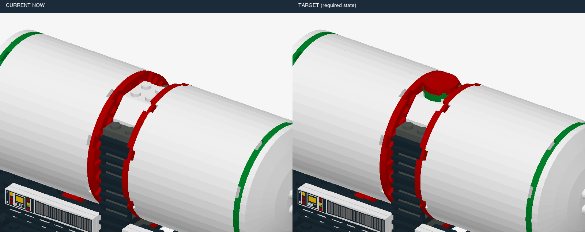

| 条件ID | 静态／动态 | 错误 | 事件数 | 来源类别 | 暂定结构组 | 图片 | 复用旧题 |
|---|---|---|---:|---|---|---|---|
| `v7::new-10016-1::dynamic::control::t0` | dynamic | 正常 | 0 | 正常 | L1 | [三维画面](assets/new-10016-1/b388733e09f69084f5a96a8438ae09f3e3f85ac7c4d4647c98ef5e9ec9a2604b.png) | 新增 |
| `v7::new-10016-1::dynamic::missing::t5` | dynamic | 少件 | 1 | H01 | L1 | [三维画面](assets/new-10016-1/b1d16235b8b70187a37b110631f40768fa0f4a27087afdaac464fda0dea64faf.png) | 新增 |
| `v7::new-10016-1::static::missing::t5` | static | 少件 | 0 | H01 | L1 | [三维画面](assets/new-10016-1/77b3c0c3b0a5a46c4ff43fa37c032203f2c077eb97628c6f66518fd782b73a7a.png) | 新增 |
| `v7::new-10016-1::static::control::t5` | static | 正常 | 0 | 正常 | L1 | [三维画面](assets/new-10016-1/d08ddc5812bcfa4b6f359e2499211d0c631d30e8c38a400387cf265818678e9b.png) | 新增 |
| `v7::new-10016-1::dynamic::wrong-color::t5` | dynamic | 错色 | 1 | H04 | L1 | [三维画面](assets/new-10016-1/bbdbec952bbce811eca855268551da890936d1554d583c50f2d5b11d3b57e1dd.png) | 新增 |
| `v7::new-10016-1::static::wrong-color::t5` | static | 错色 | 0 | H04 | L1 | [三维画面](assets/new-10016-1/3b0f887507519bf867e0deedd53e138ccc27c7ddbc323939a8dd2123f1801903.png) | 新增 |
| `v7::new-10016-1::dynamic::extra-layer::t4` | dynamic | 局部多层／重复加件 | 1 | H03, H11 | L1 | [三维画面](assets/new-10016-1/ad94e8e672595853b10e2a17da98a55231530f9adc7120a06dc5904eabfc6537.png) | 新增 |
| `v7::new-10016-1::static::extra-layer::t4` | static | 局部多层／重复加件 | 0 | H03, H11 | L1 | [三维画面](assets/new-10016-1/4b829031cc7670f9e497718b39479c0565941434ac8321121b083b7baf89cd20.png) | 新增 |
| `v7::new-10016-1::static::control::t4` | static | 正常 | 0 | 正常 | L1 | [三维画面](assets/new-10016-1/6b02ba9461829ac1219c8ede71b1e8760ca55de276cb576e736243fba7588d0e.png) | 新增 |
| `v7::new-10016-1::dynamic::extra-layer::t6` | dynamic | 局部多层／重复加件 | 1 | H03, H11 | L1 | [三维画面](assets/new-10016-1/a8c4c8ad1598b4a1fa88a07cb740191a73bcbb2f0478385c2735796d4bfbfb81.png) | 新增 |
| `v7::new-10016-1::static::extra-layer::t6` | static | 局部多层／重复加件 | 0 | H03, H11 | L1 | [三维画面](assets/new-10016-1/8d84aac213999746b03cd22f5598c0be602366cfe59f40fc7ccc77f183c34456.png) | 新增 |
| `v7::new-10016-1::static::control::t6` | static | 正常 | 0 | 正常 | L1 | [三维画面](assets/new-10016-1/ea9f04c8c161003f6945ad133de823344ddf2539976c43aab507d6ba9a9621d3.png) | 新增 |
| `v7::new-10016-1::dynamic::offset::t5` | dynamic | 偏移一格 | 1 | H07 | L1 | [三维画面](assets/new-10016-1/1a4ed1f16a834de6f1ddea78907d13603c5fe478d485c10551eb5aaead6e6fa3.png) | 新增 |
| `v7::new-10016-1::static::offset::t5` | static | 偏移一格 | 0 | H07 | L1 | [三维画面](assets/new-10016-1/866bbcefaf507130f9a7f942240689e2fed8af0b8a353914461aaa5e0ed92d16.png) | 新增 |
| `v7::new-10016-1::dynamic::rotated::t5` | dynamic | 装反 | 1 | H06 | L1 | [三维画面](assets/new-10016-1/f5e636aeac30466e5c0e4a6f4d86e72836136dfefb0fba1bbad881db6f853de3.png) | 新增 |
| `v7::new-10016-1::static::rotated::t5` | static | 装反 | 0 | H06 | L1 | [三维画面](assets/new-10016-1/d75fb46979db75cb95f68640a2fbb1dff94c3da56b066f5788175092d891f29f.png) | 新增 |
| `v7::new-10016-1::dynamic::wrong-part::t5` | dynamic | 错零件／厚度 | 1 | H05 | L1 | [三维画面](assets/new-10016-1/8507e0bd256ef6299c9b559ab955a69f3b457c666ec40c47b46c62df8b8c8284.png) | 新增 |
| `v7::new-10016-1::static::wrong-part::t5` | static | 错零件／厚度 | 0 | H05 | L1 | [三维画面](assets/new-10016-1/d08ddc5812bcfa4b6f359e2499211d0c631d30e8c38a400387cf265818678e9b.png) | 新增 |
| `v7::new-10016-1::dynamic::early-cover::t4` | dynamic | 提前封口 | 1 | H09 | L1 | [三维画面](assets/new-10016-1/70a0c5a4eab209945cde01cc9eb9700d337624cc910e90322d83ae0ff5d6c0e1.png) | 新增 |
| `v7::new-10016-1::static::early-cover::t4` | static | 提前封口 | 0 | H09 | L1 | [三维画面](assets/new-10016-1/11e9abc71ca5f26e65ad69822cfb7c3a75faca9c495eec0b0b9cbd27a2a1680d.png) | 新增 |
| `v7::new-10016-1::dynamic::buried-repair::t3` | dynamic | 拆上层返修 | 1 | H10 | L2 | [三维画面](assets/new-10016-1/fda29c27d1070fb0a3d8dce58b1dac4ef71a7b387e54ce27e86dc3f6f37ca387.png) | 新增 |
| `v7::new-10016-1::static::buried-repair::t3` | static | 拆上层返修 | 0 | H10 | L2 | [三维画面](assets/new-10016-1/bd9c06b0f2c863458f922c6dd5d07b480c2e94266199a53bc927c23149c22ca8.png) | 新增 |
| `v7::new-10016-1::static::control::t3` | static | 正常 | 0 | 正常 | L1 | [三维画面](assets/new-10016-1/5bdf9ebf8a5ede90c685fb1e0f209f3fb75c3f17ab1e1b05b0ba99a071a8edc3.png) | 新增 |
| `v7::new-10016-1::dynamic::buried-repair::t4` | dynamic | 拆上层返修 | 1 | H10 | L2 | [三维画面](assets/new-10016-1/c79dc8308cc291359b93a2c235a0194f8951f9fa7256516c9c323bb555b41668.png) | 新增 |
| `v7::new-10016-1::static::buried-repair::t4` | static | 拆上层返修 | 0 | H10 | L2 | [三维画面](assets/new-10016-1/ede16ca94d08d1c4cf97f8207d206f38163937d7087534aacd8dedada86d15f6.png) | 新增 |
| `v7::new-10016-1::dynamic::multiple::offsetthen-extra-layer` | dynamic | 连续：偏移一格 → 局部多层／重复加件 | 2 | H03, H07, H11, H13 | L2 | [三维画面](assets/new-10016-1/1a4ed1f16a834de6f1ddea78907d13603c5fe478d485c10551eb5aaead6e6fa3.png) | 新增 |

## 敞篷货运车厢：局部补装 · `new-10013-1`

部分：M-new-source；正常拼装／模块全长：6块；来源：`v7-omr-10013-1`。

原模型作者：TotalyWicked [TotalyWicked]；[来源](https://library.ldraw.org/library/omr/10013-1.mpd)。

本物件包含：局部多层／重复加件、少件、重复组件漏做、装反、错色。

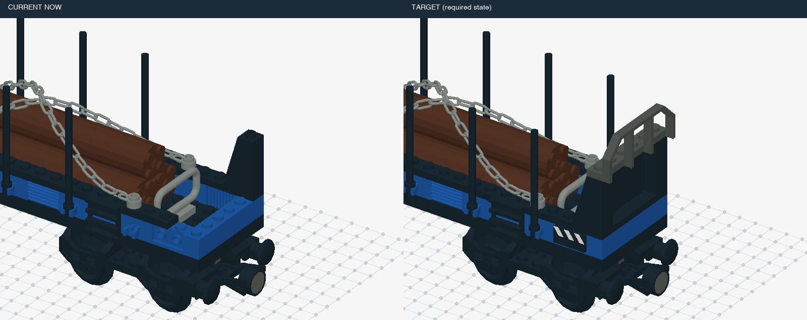

| 条件ID | 静态／动态 | 错误 | 事件数 | 来源类别 | 暂定结构组 | 图片 | 复用旧题 |
|---|---|---|---:|---|---|---|---|
| `v7::new-10013-1::dynamic::control::t0` | dynamic | 正常 | 0 | 正常 | L1 | [三维画面](assets/new-10013-1/d3b4fcb51f1111c266986e7ae1e12244669d9c822f4ddb256b8e3e54a663ada1.png) | 新增 |
| `v7::new-10013-1::dynamic::missing::t3` | dynamic | 少件 | 1 | H01 | L1 | [三维画面](assets/new-10013-1/a739d41eaa42ef9a7d694bf86174f14d937d9bdd1074a2aab1d684207559e301.png) | 新增 |
| `v7::new-10013-1::static::missing::t3` | static | 少件 | 0 | H01 | L1 | [三维画面](assets/new-10013-1/7c4eed334a2752743e7a27857ae0d824d2c5d54190075853322b96710cdde290.png) | 新增 |
| `v7::new-10013-1::static::control::t3` | static | 正常 | 0 | 正常 | L1 | [三维画面](assets/new-10013-1/da4d4095266941bdb62798e986e45151bc24b6b40181aebbf88a154aec280f75.png) | 新增 |
| `v7::new-10013-1::dynamic::missing::t4` | dynamic | 少件 | 1 | H01 | L1 | [三维画面](assets/new-10013-1/cdec5587f649156a46a0ab486d29ab8c56977cb902b33f684fce6803b50cd698.png) | 新增 |
| `v7::new-10013-1::static::missing::t4` | static | 少件 | 0 | H01 | L1 | [三维画面](assets/new-10013-1/a590322e31469885a3821a4c69bff386e436f91da86db09aad5d2945ee998e25.png) | 新增 |
| `v7::new-10013-1::static::control::t4` | static | 正常 | 0 | 正常 | L1 | [三维画面](assets/new-10013-1/100573c715fcf28ad7b5dac7cfc5247c1c9b99eda17e7ef1c1096f230cbbad23.png) | 新增 |
| `v7::new-10013-1::dynamic::wrong-color::t3` | dynamic | 错色 | 1 | H04 | L1 | [三维画面](assets/new-10013-1/17f2a8fd08c2147262cb5937b895fdb07fe6cb43c450d48327078bd2613657cc.png) | 新增 |
| `v7::new-10013-1::static::wrong-color::t3` | static | 错色 | 0 | H04 | L1 | [三维画面](assets/new-10013-1/3ed426ca8fde9a5fefd18e1c0099d26db761b61bbb92d5a026cd2ce6aff8d084.png) | 新增 |
| `v7::new-10013-1::dynamic::wrong-color::t4` | dynamic | 错色 | 1 | H04 | L1 | [三维画面](assets/new-10013-1/7a55cea897c55cba454f871d090dd50ba96730ffbe51653afc4620a9eaa7e8bc.png) | 新增 |
| `v7::new-10013-1::static::wrong-color::t4` | static | 错色 | 0 | H04 | L1 | [三维画面](assets/new-10013-1/8ec8449cd37e88df77795a9012197785577d580a59d5bee3d4f8256601909e7f.png) | 新增 |
| `v7::new-10013-1::dynamic::extra-layer::t5` | dynamic | 局部多层／重复加件 | 1 | H03, H11 | L1 | [三维画面](assets/new-10013-1/1d2ff75978ad90db1cd4bbbfaf973e8d0a851f6400277322a60ab31964664bda.png) | 新增 |
| `v7::new-10013-1::static::extra-layer::t5` | static | 局部多层／重复加件 | 0 | H03, H11 | L1 | [三维画面](assets/new-10013-1/33e05049d432ec22eb82f10b5c2090c98ca06add5c085e5e099bb5893629df80.png) | 新增 |
| `v7::new-10013-1::static::control::t5` | static | 正常 | 0 | 正常 | L1 | [三维画面](assets/new-10013-1/23df8b7c809327e6b56fc838e83000f65aa9a8f3f317c70aec2f99eddf4553c1.png) | 新增 |
| `v7::new-10013-1::dynamic::rotated::t3` | dynamic | 装反 | 1 | H06 | L1 | [三维画面](assets/new-10013-1/9ec9b2025032a60533580577c24f8e64a3018c48fe262ae13cb4d8115e103935.png) | 新增 |
| `v7::new-10013-1::static::rotated::t3` | static | 装反 | 0 | H06 | L1 | [三维画面](assets/new-10013-1/da4d4095266941bdb62798e986e45151bc24b6b40181aebbf88a154aec280f75.png) | 新增 |
| `v7::new-10013-1::dynamic::rotated::t4` | dynamic | 装反 | 1 | H06 | L1 | [三维画面](assets/new-10013-1/b46ae7b32b921aa8125b85ac378aef3f0b42f4f397811a0302f76903be0c0970.png) | 新增 |
| `v7::new-10013-1::static::rotated::t4` | static | 装反 | 0 | H06 | L1 | [三维画面](assets/new-10013-1/100573c715fcf28ad7b5dac7cfc5247c1c9b99eda17e7ef1c1096f230cbbad23.png) | 新增 |
| `v7::new-10013-1::dynamic::repeat-omission::t3` | dynamic | 重复组件漏做 | 1 | H02 | L1 | [三维画面](assets/new-10013-1/a4c28dbdccaf8d0ce12e89e761fcfd510ebe231059c15bc77a7f260b79d9beba.png) | 新增 |
| `v7::new-10013-1::static::repeat-omission::t3` | static | 重复组件漏做 | 0 | H02 | L1 | [三维画面](assets/new-10013-1/1a25a67ae14e822fe72725aa80a99197eed0d5c9b9d2d0646385382b20d87370.png) | 新增 |
| `v7::new-10013-1::dynamic::repeat-omission::t4` | dynamic | 重复组件漏做 | 1 | H02 | L1 | [三维画面](assets/new-10013-1/129db999f43aa393cd6e7998ee2e342d7e57c63a9f552aab37745afe062bf7c4.png) | 新增 |
| `v7::new-10013-1::static::repeat-omission::t4` | static | 重复组件漏做 | 0 | H02 | L1 | [三维画面](assets/new-10013-1/4821addf8209e8853468b730cdd40920811f4607fda0c8c6fd8aedf81fbd9d05.png) | 新增 |
