# A反馈后的修复：放大位置、三个角度、更多不同物件

更新：2026-10-27。**本轮没有调用付费模型，API费用为 $0。**

[打开A检查页](http://127.0.0.1:8808/A) · [直接看新增机器人](http://127.0.0.1:8808/A?task=N003) · [B入口](http://127.0.0.1:8808/B) · [C入口](http://127.0.0.1:8808/C)

## 1. A的反馈，以及本次改了什么

A共提交71题：50题选GT正确，20题选看不清，1题选GT有问题。原记录完整保留。新版默认列出这21道待复查题，加上20道新物件示例，共41题；原来的其他题仍在“全部题目”里。

| 问题 | 已做的修改 |
|---|---|
| 大房子、大建筑看不清操作位置 | 默认放大本题修复位置；旁边给整件物品小图，用青框标出放大的区域；可随时点“看整体”。场景里的其他零件仍参与遮挡。 |
| 一个角度被挡住 | 同时列出三个立体角度缩略图；初始选择更能看出变化的一侧；当前、GT结果、目标同步换角度和比例。 |
| 拆完好像没拆，步骤看不明白 | 点任一步，直接并排看操作前和操作后；只在实际移动件所在的那一侧描边。每一步继续放大该操作件周围。 |
| Q003书架的GT有异议 | 修复了阶段识别：这题只要求第7步的7块状态，不要求装成完整21块书架。10个参考拆装动作另做独立几何复核，均一致；仍保留A的异议，等待真人复查。 |
| 反复审同一个物件 | 新增10个不同来源物件的收尾模块，每个只做5个case，审查页各展示1静态、1动态。 |
| 程序说有错，图却一样 | 新增可见性筛查。狮子最初选到的转向错误三个角度都无变化，已换成另一处真正可见、可合法修回的转向错误。 |

**页面仍然只需要选一个：GT正确 / GT有问题 / 看不清或无法判断。无需拼装，也无需写文字。**

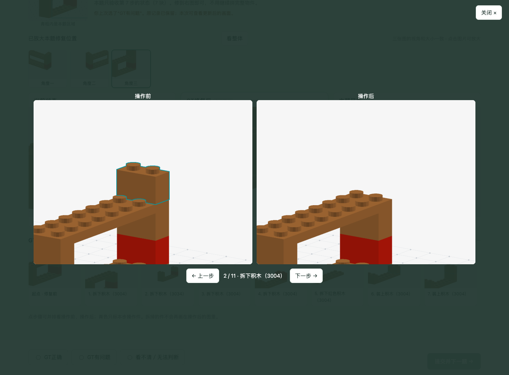

### 21道待复查题

以下不是“自动判为修好了”。程序与画面已更新，是否足够清楚、GT是否可信，仍由新的真人提交确认。

| 题号 | 物件 | A上次判断 | 本次复查重点 |
|---|---|---|---|
| [Q003](http://127.0.0.1:8808/A?task=Q003) | 四层书架 | GT有问题 | 第7步目标；拆上层、换内部件、装回 |
| [Q004](http://127.0.0.1:8808/A?task=Q004) | 小屋：补完屋顶 | 看不清 | 放大的修复位置、三个角度及操作前后 |
| [Q014](http://127.0.0.1:8808/A?task=Q014) | 小屋：补完屋顶 | 看不清 | 无错题允许不操作；看清当前阶段 |
| [Q019](http://127.0.0.1:8808/A?task=Q019) | 小屋屋顶 | 看不清 | 放大的修复位置、三个角度及操作前后 |
| [Q025](http://127.0.0.1:8808/A?task=Q025) | 熊猫：补脸部与耳朵 | 看不清 | 放大的修复位置、三个角度及操作前后 |
| [Q026](http://127.0.0.1:8808/A?task=Q026) | 白宫：补烟囱与屋脊 | 看不清 | 放大的修复位置、三个角度及操作前后 |
| [Q028](http://127.0.0.1:8808/A?task=Q028) | 洛克菲勒中心：补主塔顶部 | 看不清 | 放大的修复位置、三个角度及操作前后 |
| [Q029](http://127.0.0.1:8808/A?task=Q029) | 勃兰登堡门：补顶部装饰 | 看不清 | 放大的修复位置、三个角度及操作前后 |
| [Q040](http://127.0.0.1:8808/A?task=Q040) | 博物馆屋顶 | 看不清 | 放大的修复位置、三个角度及操作前后 |
| [Q044](http://127.0.0.1:8808/A?task=Q044) | 小屋屋顶 | 看不清 | 放大的修复位置、三个角度及操作前后 |
| [Q046](http://127.0.0.1:8808/A?task=Q046) | 博物馆屋顶 | 看不清 | 放大的修复位置、三个角度及操作前后 |
| [Q047](http://127.0.0.1:8808/A?task=Q047) | 小屋屋顶 | 看不清 | 放大的修复位置、三个角度及操作前后 |
| [Q052](http://127.0.0.1:8808/A?task=Q052) | 汉堡摊屋顶 | 看不清 | 放大的修复位置、三个角度及操作前后 |
| [Q053](http://127.0.0.1:8808/A?task=Q053) | 白宫屋顶 | 看不清 | 放大的修复位置、三个角度及操作前后 |
| [Q054](http://127.0.0.1:8808/A?task=Q054) | 洛克菲勒大厦顶部 | 看不清 | 放大的修复位置、三个角度及操作前后 |
| [Q058](http://127.0.0.1:8808/A?task=Q058) | 汉堡摊屋顶 | 看不清 | 放大的修复位置、三个角度及操作前后 |
| [Q059](http://127.0.0.1:8808/A?task=Q059) | 白宫屋顶 | 看不清 | 放大的修复位置、三个角度及操作前后 |
| [Q061](http://127.0.0.1:8808/A?task=Q061) | 汉堡摊屋顶 | 看不清 | 放大的修复位置、三个角度及操作前后 |
| [Q062](http://127.0.0.1:8808/A?task=Q062) | 白宫屋顶 | 看不清 | 放大的修复位置、三个角度及操作前后 |
| [Q064](http://127.0.0.1:8808/A?task=Q064) | 洛克菲勒大厦顶部 | 看不清 | 放大的修复位置、三个角度及操作前后 |
| [Q065](http://127.0.0.1:8808/A?task=Q065) | 勃兰登堡门顶部 | 看不清 | 放大的修复位置、三个角度及操作前后 |

## 2. 新增10个不同物件

这些物件来自[LDraw官方模型库](https://library.ldraw.org/omr)。完整原模型都保留在场景中；题目让模型完成明确的收尾部分，例如车顶、鹿角和驾驶舱。**这次新增的是10个有完整物件背景的收尾模块，不是10套从零搭完整套装的任务。**

其中6个源文件是本轮新下载，另4个来自此前已保存的社区源文件。这里的“新增”指新增可操作的模块；同一套装可能在旧静态库出现过，划分训练、调试、测试时继续按原套装合并分组。

| 物件／LDraw套装 | 完整源模型件数 | 本题操作件数 | 两种错误 | 真人示例 |
|---|---:|---:|---|---|
| [小卡车：车顶和排气管 · 30024-1](https://library.ldraw.org/library/omr/30024-1.mpd) | 56 | 12 | 少件；装反／方向错误 | [静态N001](http://127.0.0.1:8808/A?task=N001) / [动态N101](http://127.0.0.1:8808/A?task=N101) |
| [驯鹿：鹿角收尾 · 30027-1](https://library.ldraw.org/library/omr/30027-1.mpd) | 66 | 8 | 少件；位置偏移 | [静态N002](http://127.0.0.1:8808/A?task=N002) / [动态N102](http://127.0.0.1:8808/A?task=N102) |
| [小机器人：头部和背部喷口 · 4917-1](https://library.ldraw.org/library/omr/4917-1.mpd) | 77 | 7 | 少件；装反／方向错误 | [静态N003](http://127.0.0.1:8808/A?task=N003) / [动态N103](http://127.0.0.1:8808/A?task=N103) |
| [蒸汽火车：烟囱和阀门 · 7810-1](https://library.ldraw.org/library/omr/7810-1.mpd) | 100 | 9 | 少件；换错颜色 | [静态N004](http://127.0.0.1:8808/A?task=N004) / [动态N104](http://127.0.0.1:8808/A?task=N104) |
| [小狮子：头顶鬃毛 · 4903-1](https://library.ldraw.org/library/omr/4903-1.mpd) | 42 | 9 | 少件；装反／方向错误 | [静态N005](http://127.0.0.1:8808/A?task=N005) / [动态N105](http://127.0.0.1:8808/A?task=N105) |
| [小象：额头和眼睛 · 4904-1](https://library.ldraw.org/library/omr/4904-1.mpd) | 32 | 6 | 少件；换错颜色 | [静态N006](http://127.0.0.1:8808/A?task=N006) / [动态N106](http://127.0.0.1:8808/A?task=N106) |
| [挖掘机：驾驶室顶盖 · 4915-1](https://library.ldraw.org/library/omr/4915-1.mpd) | 67 | 5 | 少件；位置偏移 | [静态N007](http://127.0.0.1:8808/A?task=N007) / [动态N107](http://127.0.0.1:8808/A?task=N107) |
| [黄色飞机：驾驶舱和机头 · 7808-1](https://library.ldraw.org/library/omr/7808-1.mpd) | 34 | 6 | 少件；位置偏移 | [静态N008](http://127.0.0.1:8808/A?task=N008) / [动态N108](http://127.0.0.1:8808/A?task=N108) |
| [绿色小赛车：驾驶舱与车身 · 4016-1](https://library.ldraw.org/library/omr/4016-1.mpd) | 19 | 5 | 少件；换错零件 | [静态N009](http://127.0.0.1:8808/A?task=N009) / [动态N109](http://127.0.0.1:8808/A?task=N109) |
| [螺旋桨飞机：机翼与驾驶舱 · 4019-1](https://library.ldraw.org/library/omr/4019-1.mpd) | 17 | 6 | 少件；装反／方向错误 | [静态N010](http://127.0.0.1:8808/A?task=N010) / [动态N110](http://127.0.0.1:8808/A?task=N110) |

每个物件只有5个case：1个正常拼装、2个静态修复、2个动态干扰修复。共50个case：20静态、30动态（其中10个无干扰对照）。各题每次只装或拆一块；GT只是一种合法修法，换合法顺序、同种零件换编号，不按中间顺序判错。

### 输入、输出和难度

| 项目 | 内容 |
|---|---|
| 静态输入 | 已经出现错误的当前状态、本题阶段目标、可用零件；可按需看说明和位置预览。未来成品不是本题目标。 |
| 动态输入 | 已搭好的主体、待完成模块目标、可用零件；逐件操作，每步能看实际状态，过程中发生一次未提示的变化。 |
| 模型输出 | inspect查看，attach安装，detach拆下，finish结束。每次最多改变一块。 |
| GT与评分 | 每次操作合法，结束状态与本题目标物理等价。没触发事故的运行单列，不算修复失败；修复主结论还需要正常分支成功。 |
| 这批的级别 | 模块5–12块，参考局部修复1–2步，一次事故；属于短模块、短返修。补的是物件多样性，不能据此声称补足高难度。原有长过程、内部返修、多次事故仍保留。 |

**真人GT检查页额外展示答案、修复位置和更有帮助的初始角度。这些提示只用于检查题目，不会偷偷放入模型输入，也不能当作真人盲做成功率。**

## 3. 每个物件的实际图与case

图片直接由本题原始几何状态渲染。完整成品用于认识物件；静态题右图是当前阶段目标，可能还没有装完收尾部分。点击图片可查看原分辨率。

### 1. 小卡车：车顶和排气管

驾驶室顶部的盖板、两根排气管和警示灯。

| 完整物件 | 本题当前状态（局部） | 本题阶段目标／GT结果（局部） |
|---|---|---|
| 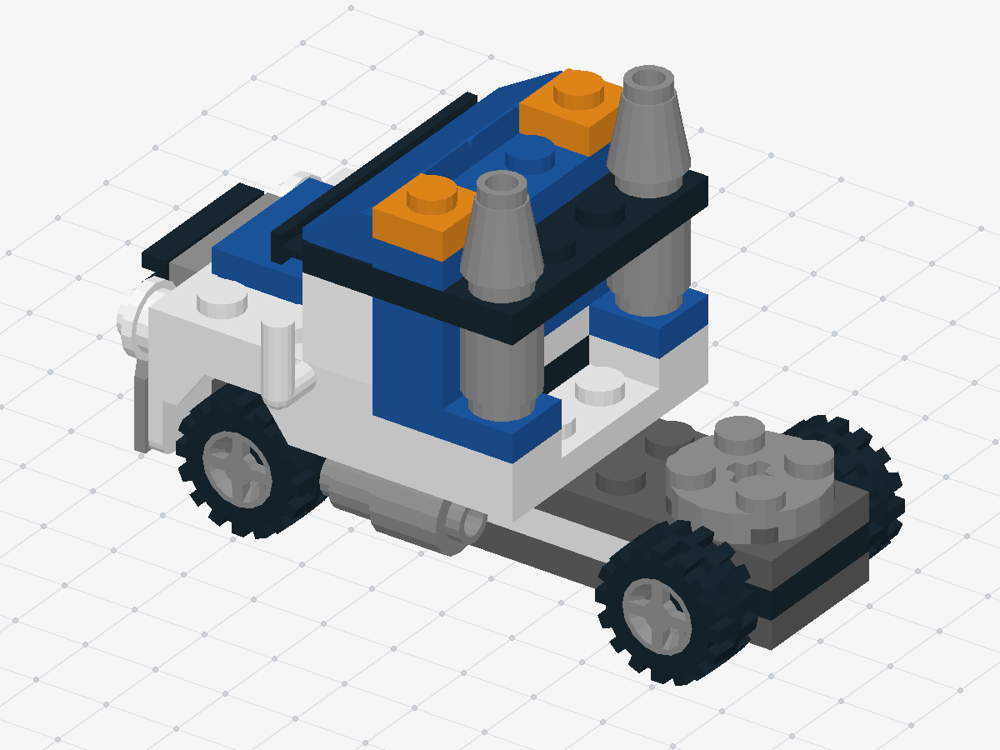 |  | 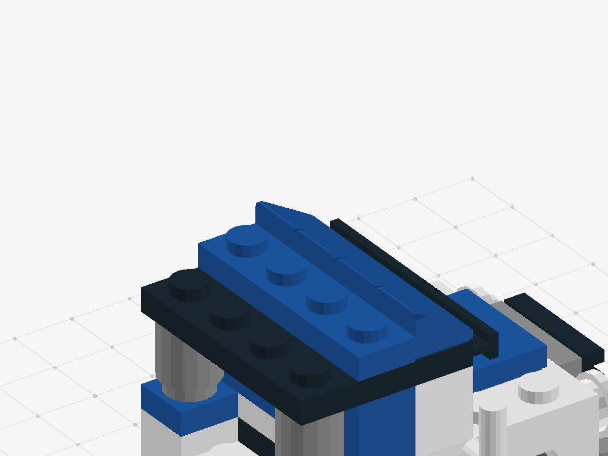 |

| case后缀 | 题型 | 开始状态／干扰位置 | GT参考动作数 |
|---|---|---|---:|
| `dynamic::control` | 正常对照 | 主体预装好，从收尾模块起点完成 | 12 |
| `static::missing` | 静态修复 | 修到说明第8步的目标 | 1 |
| `dynamic::missing` | 动态修复 | 正常参考路线装到8块后出现变化 | 13 |
| `static::rotated` | 静态修复 | 修到说明第8步的目标 | 2 |
| `dynamic::rotated` | 动态修复 | 正常参考路线装到8块后出现变化 | 14 |

完整case ID前缀：`QN:truck-cab-30024::`。作者：Takeshi Takahashi [RainbowDolphin]。原文件许可：Redistributable under CCAL version 2.0 : see CAreadme.txt。

### 2. 驯鹿：鹿角收尾

头顶两侧的鹿角和中间连接板。

| 完整物件 | 本题当前状态（局部） | 本题阶段目标／GT结果（局部） |
|---|---|---|
| 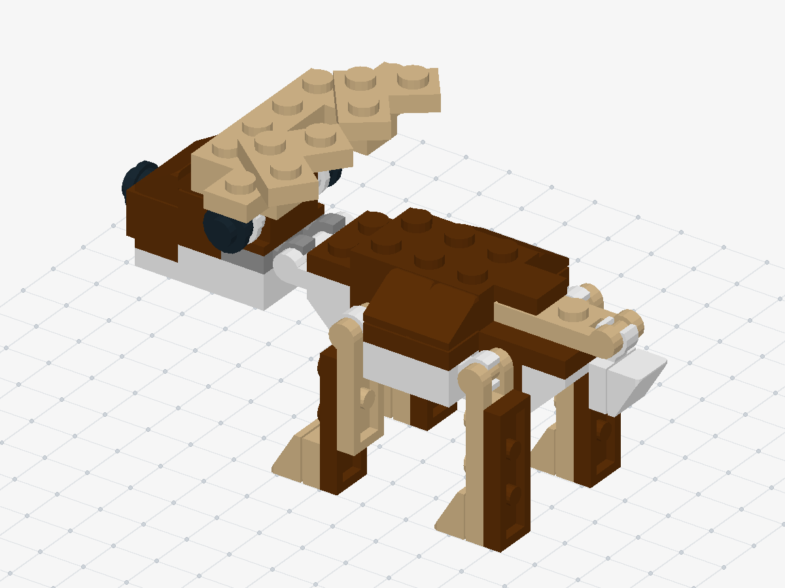 |  | 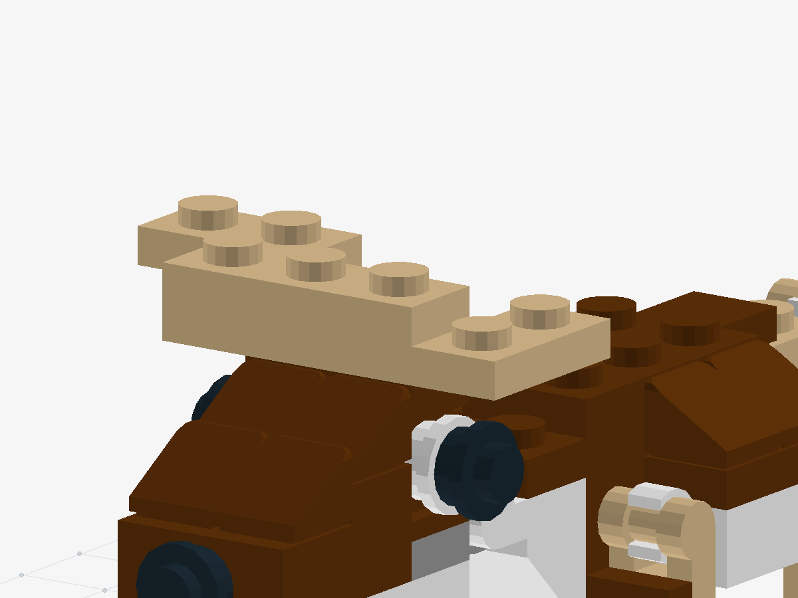 |

| case后缀 | 题型 | 开始状态／干扰位置 | GT参考动作数 |
|---|---|---|---:|
| `dynamic::control` | 正常对照 | 主体预装好，从收尾模块起点完成 | 8 |
| `static::missing` | 静态修复 | 修到说明第5步的目标 | 1 |
| `dynamic::missing` | 动态修复 | 正常参考路线装到5块后出现变化 | 9 |
| `static::offset` | 静态修复 | 修到说明第5步的目标 | 2 |
| `dynamic::offset` | 动态修复 | 正常参考路线装到5块后出现变化 | 10 |

完整case ID前缀：`QN:reindeer-antlers-30027::`。作者：Takeshi Takahashi [RainbowDolphin]。原文件许可：Redistributable under CCAL version 2.0 : see CAreadme.txt。

### 3. 小机器人：头部和背部喷口

头部圆顶、眼部灯和背部的两个锥形喷口。

| 完整物件 | 本题当前状态（局部） | 本题阶段目标／GT结果（局部） |
|---|---|---|
| 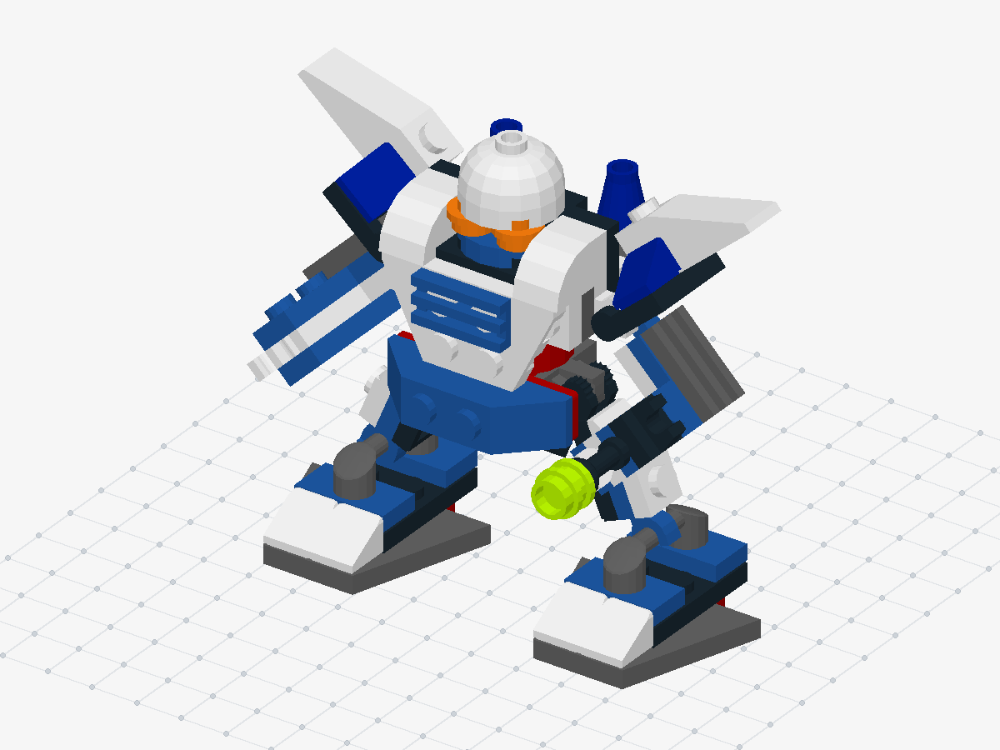 | 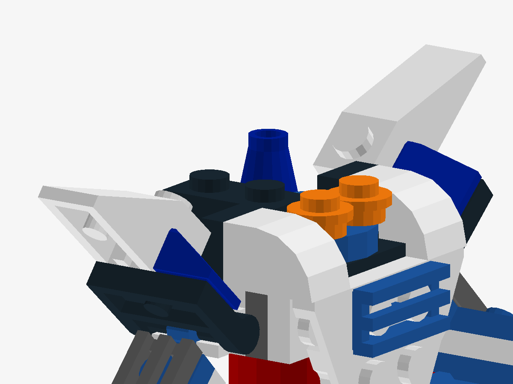 | 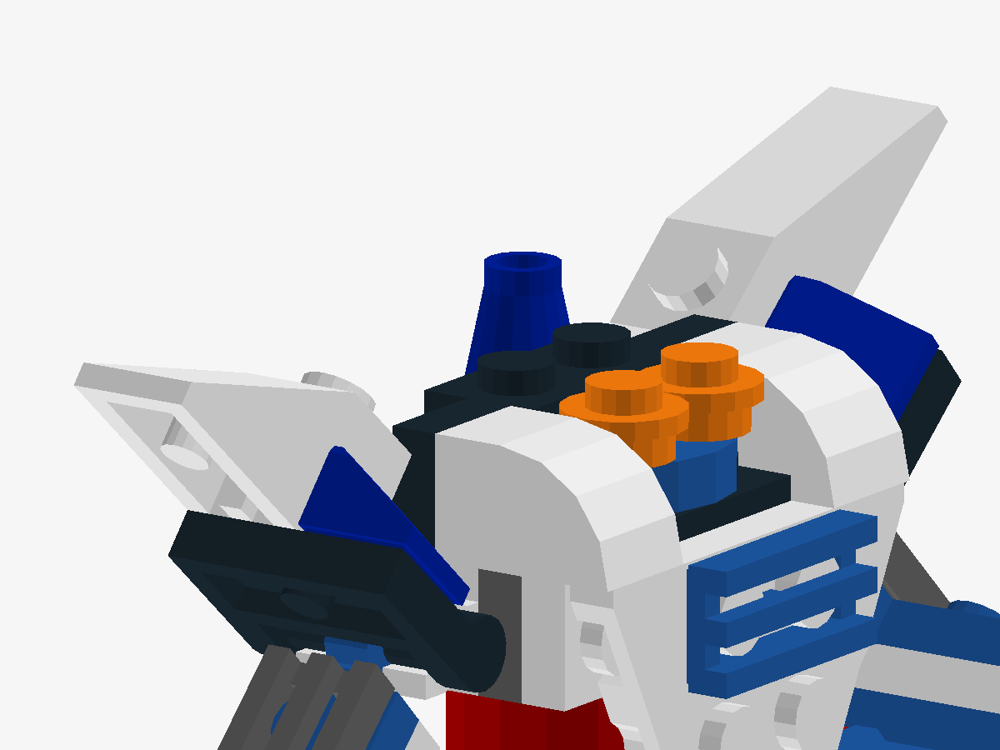 |

| case后缀 | 题型 | 开始状态／干扰位置 | GT参考动作数 |
|---|---|---|---:|
| `dynamic::control` | 正常对照 | 主体预装好，从收尾模块起点完成 | 7 |
| `static::missing` | 静态修复 | 修到说明第5步的目标 | 1 |
| `dynamic::missing` | 动态修复 | 正常参考路线装到5块后出现变化 | 8 |
| `static::rotated` | 静态修复 | 修到说明第5步的目标 | 2 |
| `dynamic::rotated` | 动态修复 | 正常参考路线装到5块后出现变化 | 9 |

完整case ID前缀：`QN:robot-head-4917::`。作者：Marc Giraudet [Mad_Marc]。原文件许可：Redistributable under CCAL version 2.0 : see CAreadme.txt。

### 4. 蒸汽火车：烟囱和阀门

锅炉上方的烟囱、圆顶阀门和支撑板。

| 完整物件 | 本题当前状态（局部） | 本题阶段目标／GT结果（局部） |
|---|---|---|
| 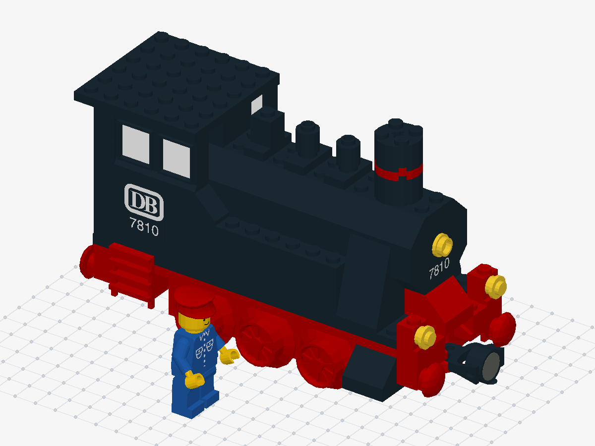 | 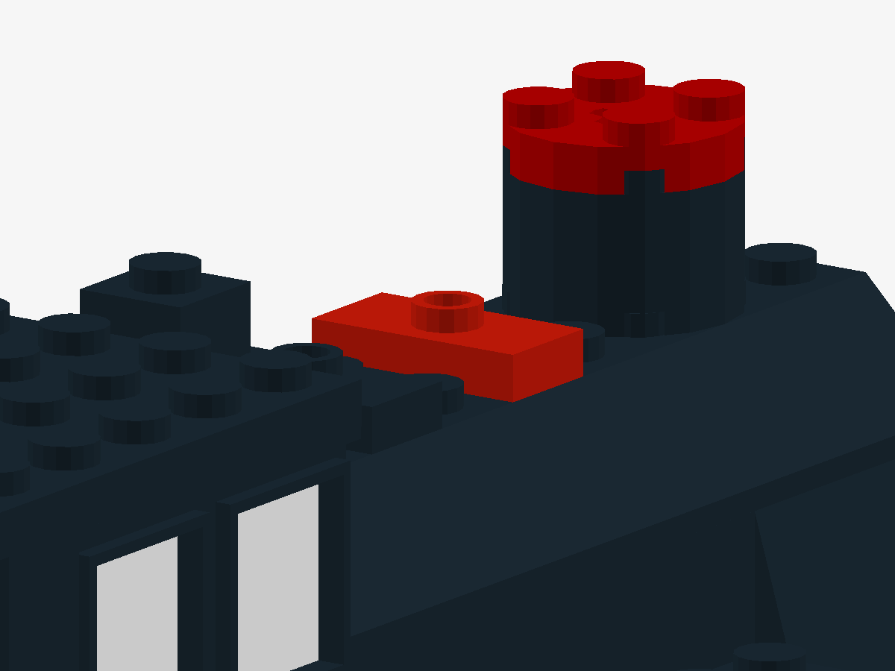 | 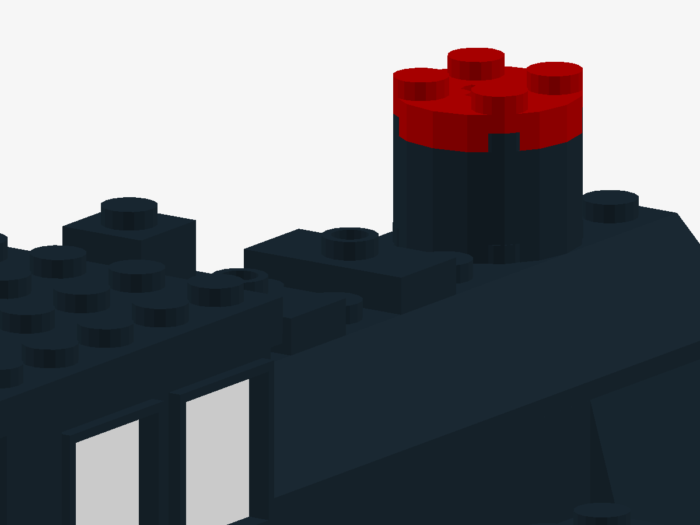 |

| case后缀 | 题型 | 开始状态／干扰位置 | GT参考动作数 |
|---|---|---|---:|
| `dynamic::control` | 正常对照 | 主体预装好，从收尾模块起点完成 | 9 |
| `static::missing` | 静态修复 | 修到说明第6步的目标 | 1 |
| `dynamic::missing` | 动态修复 | 正常参考路线装到6块后出现变化 | 10 |
| `static::wrong-color` | 静态修复 | 修到说明第6步的目标 | 2 |
| `dynamic::wrong-color` | 动态修复 | 正常参考路线装到6块后出现变化 | 11 |

完整case ID前缀：`QN:steam-engine-roof-7810::`。作者：TotalyWicked [TotalyWicked]。原文件许可：Redistributable under CCAL version 2.0 : see CAreadme.txt。

### 5. 小狮子：头顶鬃毛

头部两侧鬃毛、眼睛和头顶盖板。

| 完整物件 | 本题当前状态（局部） | 本题阶段目标／GT结果（局部） |
|---|---|---|
| 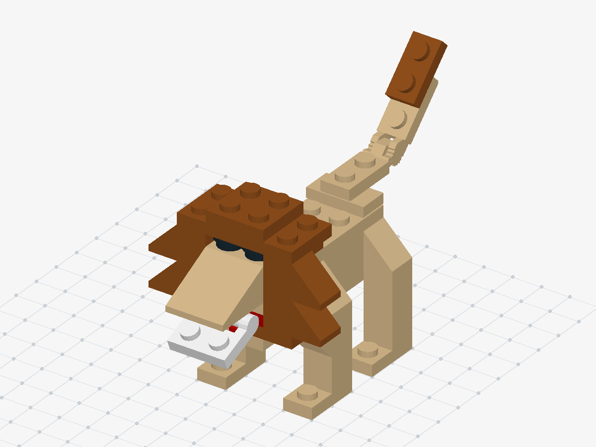 | 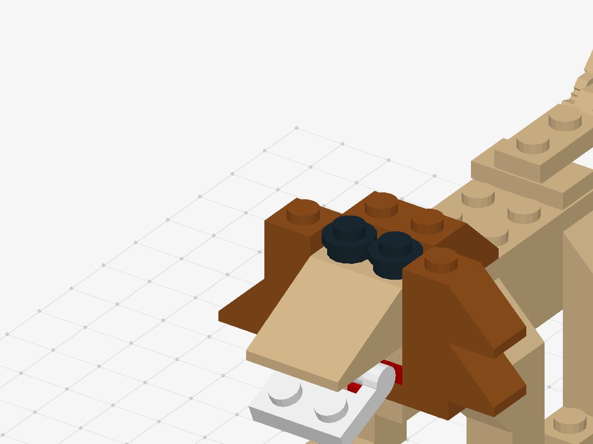 | 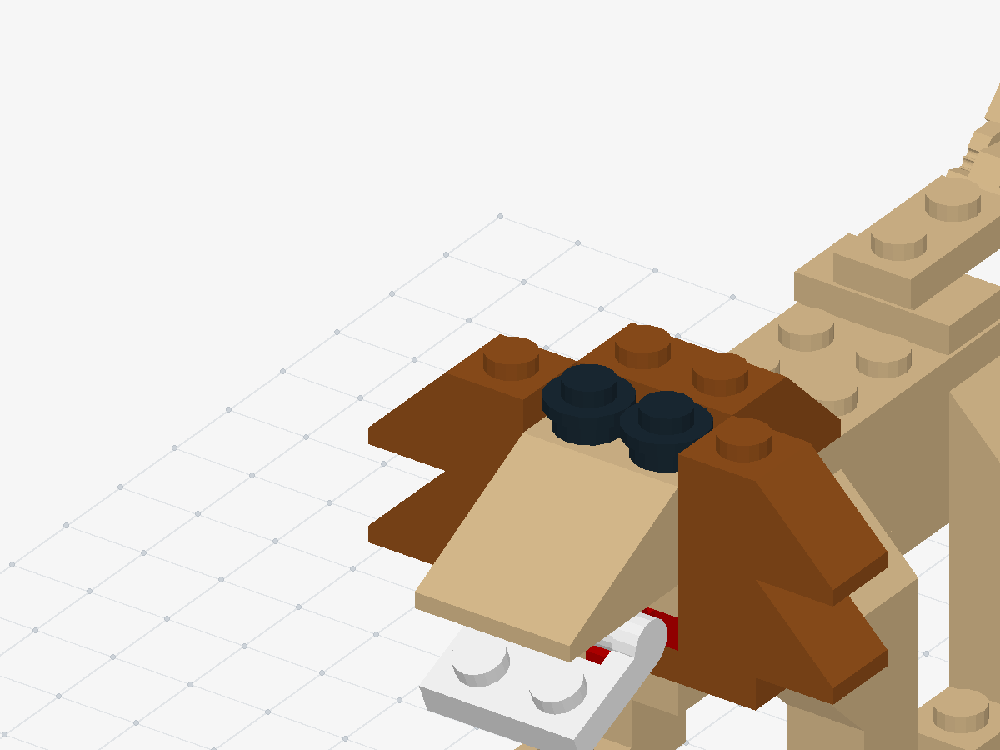 |

| case后缀 | 题型 | 开始状态／干扰位置 | GT参考动作数 |
|---|---|---|---:|
| `dynamic::control` | 正常对照 | 主体预装好，从收尾模块起点完成 | 9 |
| `static::missing` | 静态修复 | 修到说明第6步的目标 | 1 |
| `dynamic::missing` | 动态修复 | 正常参考路线装到6块后出现变化 | 10 |
| `static::rotated` | 静态修复 | 修到说明第6步的目标 | 2 |
| `dynamic::rotated` | 动态修复 | 正常参考路线装到6块后出现变化 | 11 |

完整case ID前缀：`QN:lion-mane-4903::`。作者：Merlijn Wissink [legolijntje]。原文件许可：Redistributable under CCAL version 2.0 : see CAreadme.txt。

### 6. 小象：额头和眼睛

双眼、额头斜面和头顶盖板。

| 完整物件 | 本题当前状态（局部） | 本题阶段目标／GT结果（局部） |
|---|---|---|
| 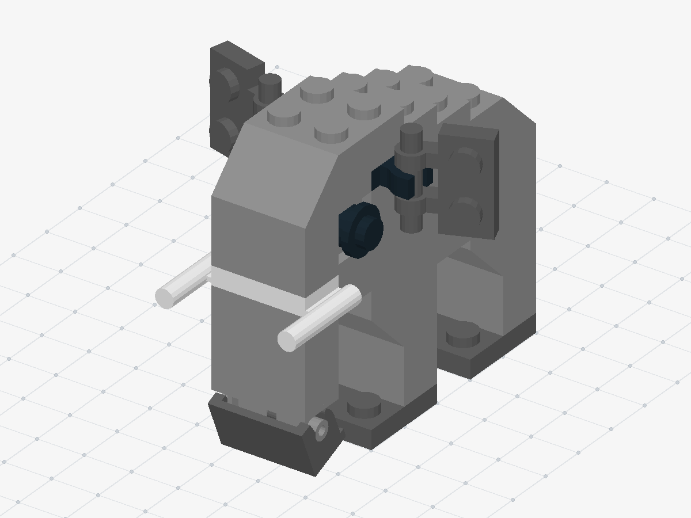 | 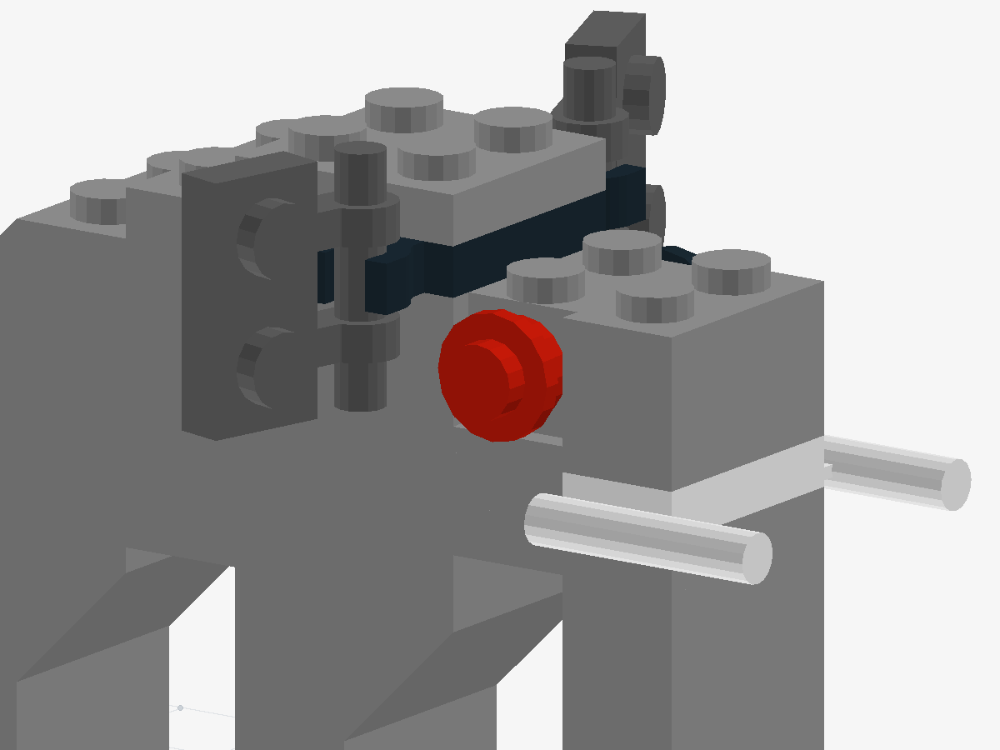 | 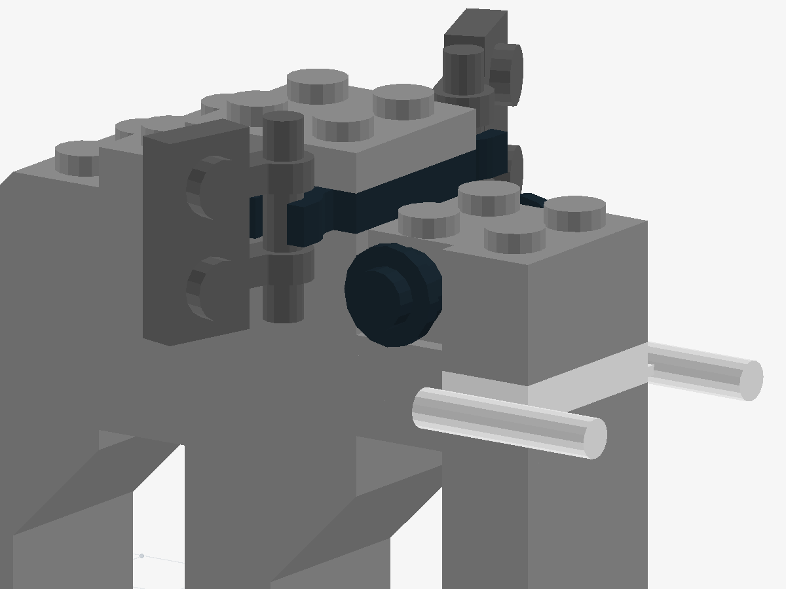 |

| case后缀 | 题型 | 开始状态／干扰位置 | GT参考动作数 |
|---|---|---|---:|
| `dynamic::control` | 正常对照 | 主体预装好，从收尾模块起点完成 | 6 |
| `static::missing` | 静态修复 | 修到说明第4步的目标 | 1 |
| `dynamic::missing` | 动态修复 | 正常参考路线装到4块后出现变化 | 7 |
| `static::wrong-color` | 静态修复 | 修到说明第4步的目标 | 2 |
| `dynamic::wrong-color` | 动态修复 | 正常参考路线装到4块后出现变化 | 8 |

完整case ID前缀：`QN:elephant-head-4904::`。作者：Merlijn Wissink [legolijntje]。原文件许可：Redistributable under CCAL version 2.0 : see CAreadme.txt。

### 7. 挖掘机：驾驶室顶盖

驾驶室支撑、顶盖、前窗和排气管。

| 完整物件 | 本题当前状态（局部） | 本题阶段目标／GT结果（局部） |
|---|---|---|
| 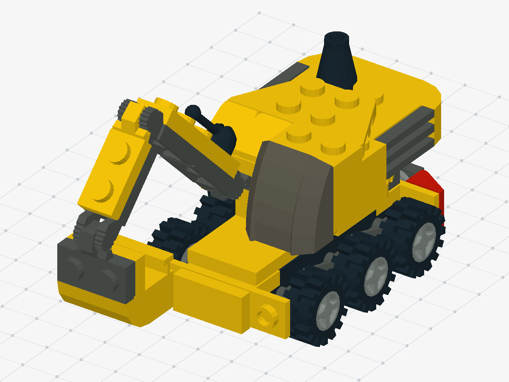 | 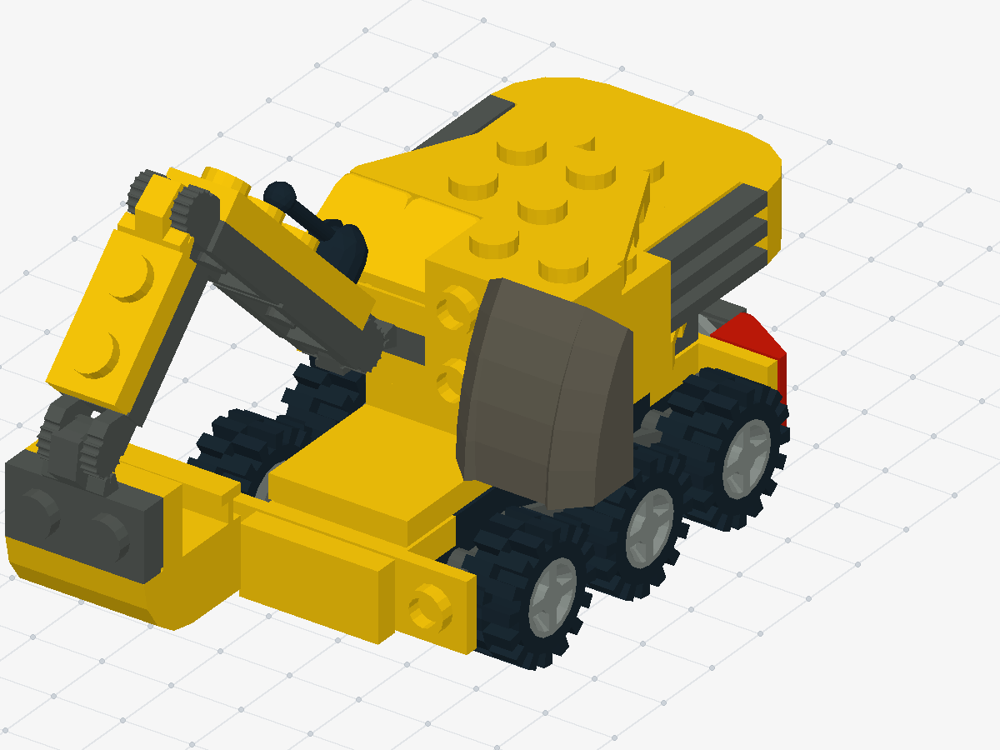 | 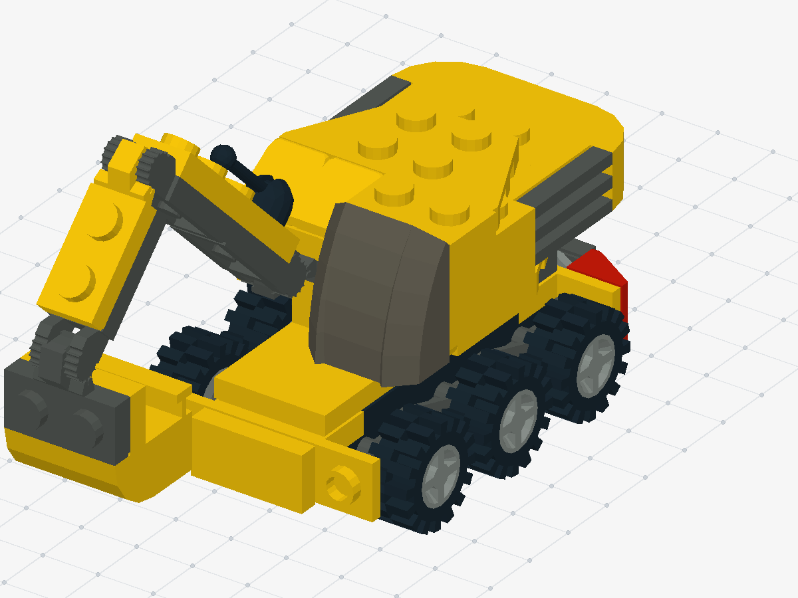 |

| case后缀 | 题型 | 开始状态／干扰位置 | GT参考动作数 |
|---|---|---|---:|
| `dynamic::control` | 正常对照 | 主体预装好，从收尾模块起点完成 | 5 |
| `static::missing` | 静态修复 | 修到说明第4步的目标 | 1 |
| `dynamic::missing` | 动态修复 | 正常参考路线装到4块后出现变化 | 6 |
| `static::offset` | 静态修复 | 修到说明第4步的目标 | 2 |
| `dynamic::offset` | 动态修复 | 正常参考路线装到4块后出现变化 | 7 |

完整case ID前缀：`QN:excavator-cab-4915::`。作者：Ken Drew [Ken]。原文件许可：Redistributable under CCAL version 2.0 : see CAreadme.txt。

### 8. 黄色飞机：驾驶舱和机头

驾驶舱风挡和机头两侧白色盖板。

| 完整物件 | 本题当前状态（局部） | 本题阶段目标／GT结果（局部） |
|---|---|---|
| 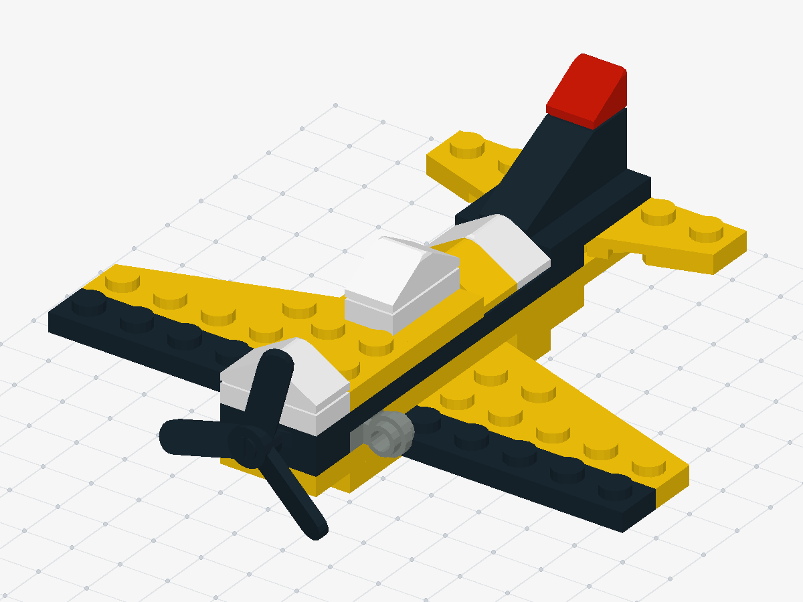 | 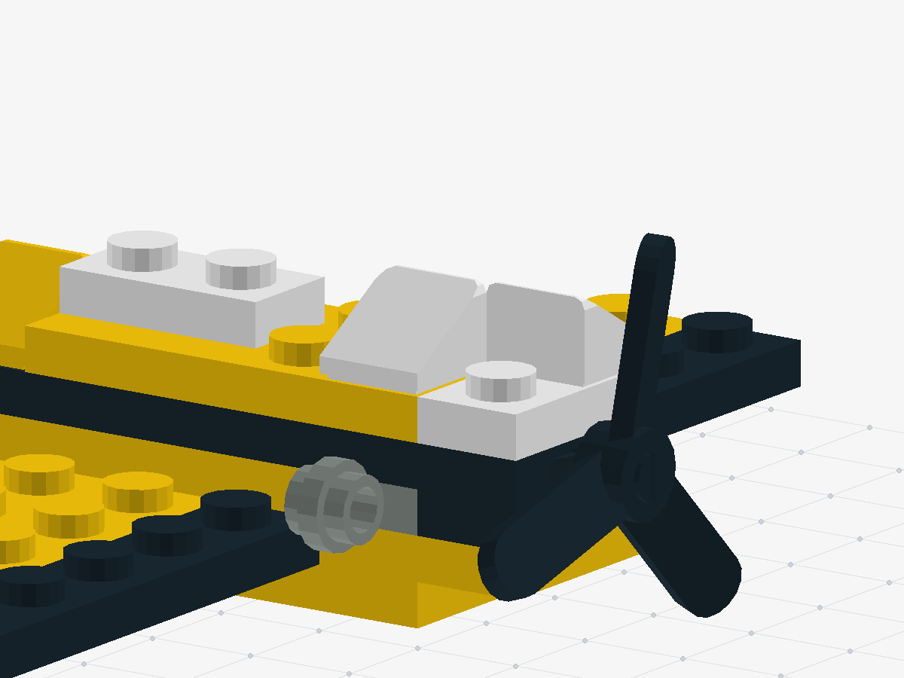 | 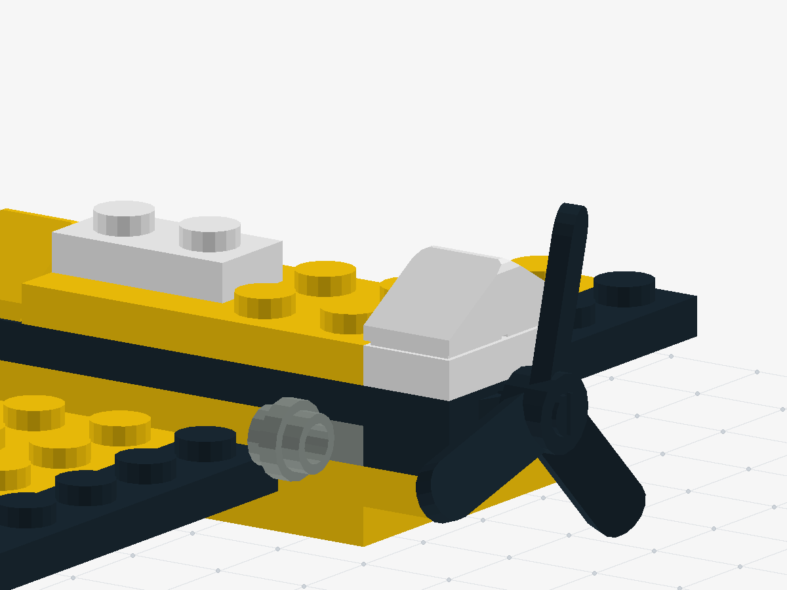 |

| case后缀 | 题型 | 开始状态／干扰位置 | GT参考动作数 |
|---|---|---|---:|
| `dynamic::control` | 正常对照 | 主体预装好，从收尾模块起点完成 | 6 |
| `static::missing` | 静态修复 | 修到说明第4步的目标 | 1 |
| `dynamic::missing` | 动态修复 | 正常参考路线装到4块后出现变化 | 7 |
| `static::offset` | 静态修复 | 修到说明第4步的目标 | 2 |
| `dynamic::offset` | 动态修复 | 正常参考路线装到4块后出现变化 | 8 |

完整case ID前缀：`QN:airplane-tail-7808::`。作者：Johann Eisner [technicbasics]。原文件许可：Redistributable under CCAL version 2.0 : see CAreadme.txt。

### 9. 绿色小赛车：驾驶舱与车身

底盘和车轮已装好，只补驾驶舱与后盖。

| 完整物件 | 本题当前状态（局部） | 本题阶段目标／GT结果（局部） |
|---|---|---|
| 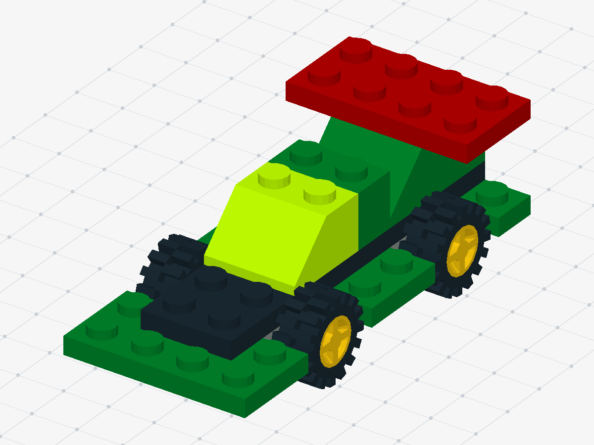 | 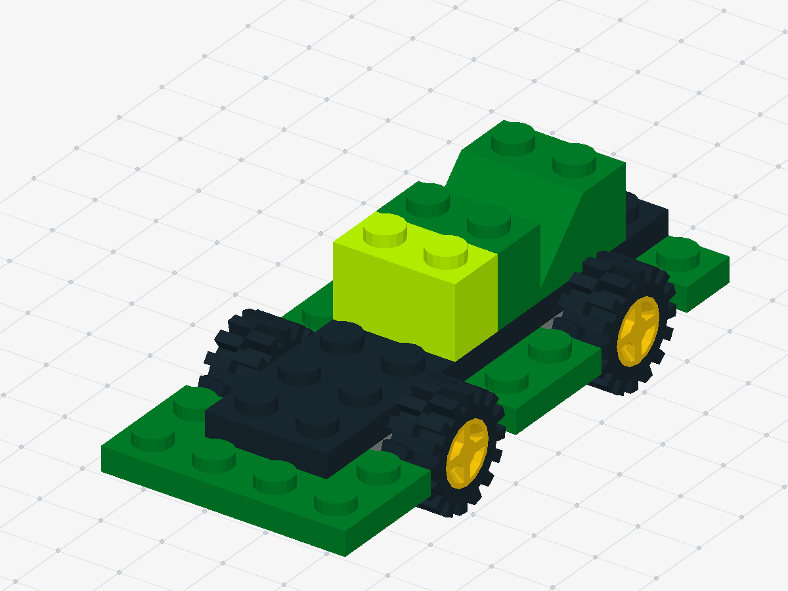 | 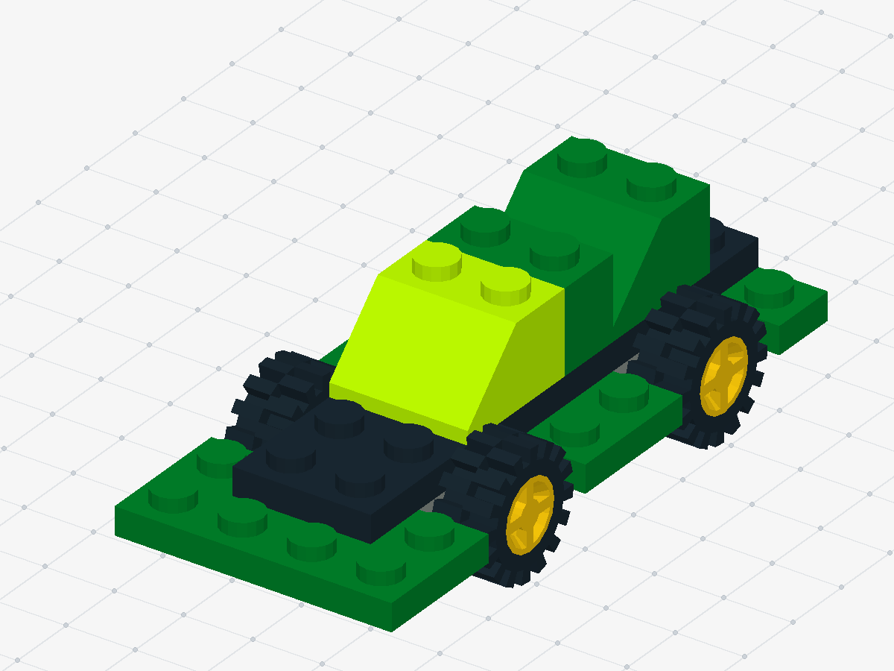 |

| case后缀 | 题型 | 开始状态／干扰位置 | GT参考动作数 |
|---|---|---|---:|
| `dynamic::control` | 正常对照 | 主体预装好，从收尾模块起点完成 | 5 |
| `static::missing` | 静态修复 | 修到说明第3步的目标 | 1 |
| `dynamic::missing` | 动态修复 | 正常参考路线装到3块后出现变化 | 6 |
| `static::wrong-part` | 静态修复 | 修到说明第3步的目标 | 2 |
| `dynamic::wrong-part` | 动态修复 | 正常参考路线装到3块后出现变化 | 7 |

完整case ID前缀：`QN:racer-cockpit-4016::`。作者：Merlijn Wissink [Legolijntje]。原文件许可：Redistributable under CCAL version 2.0 : see CAreadme.txt。

### 10. 螺旋桨飞机：机翼与驾驶舱

机身和轮子已装好，补主翼、驾驶舱和尾翼。

| 完整物件 | 本题当前状态（局部） | 本题阶段目标／GT结果（局部） |
|---|---|---|
| 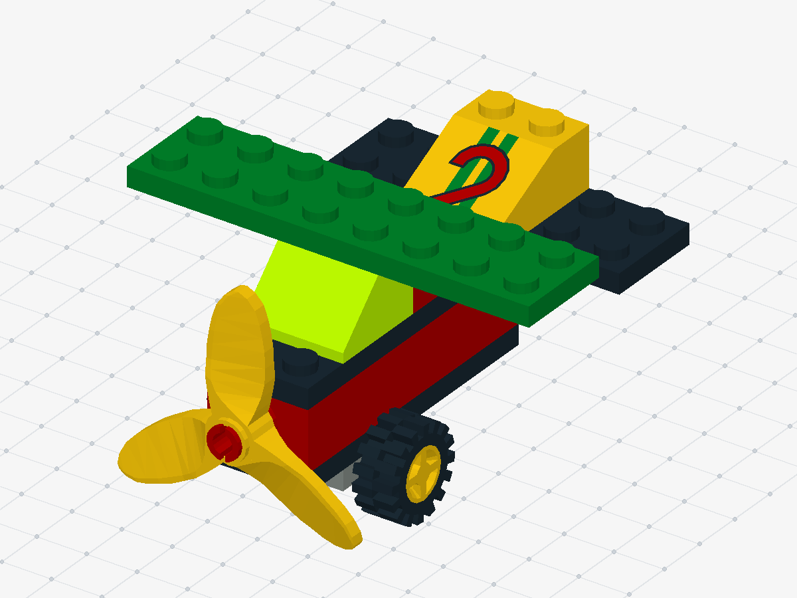 | 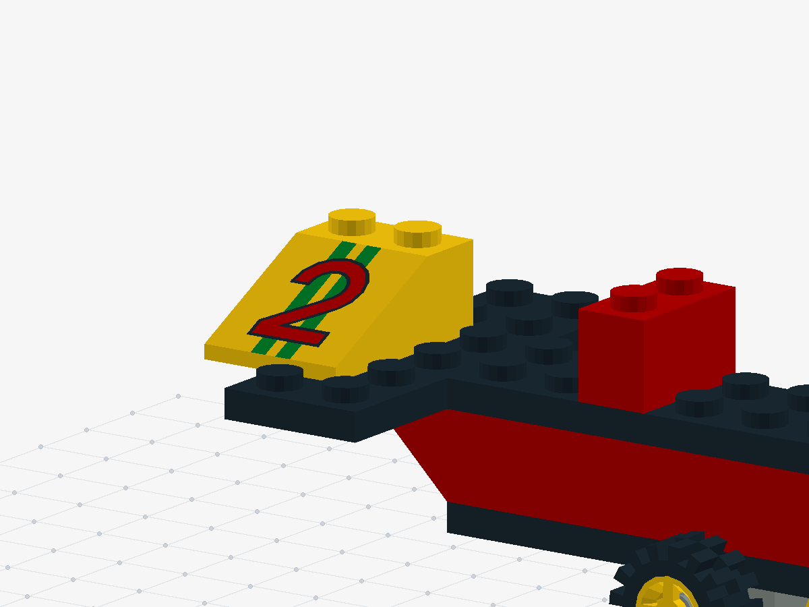 | 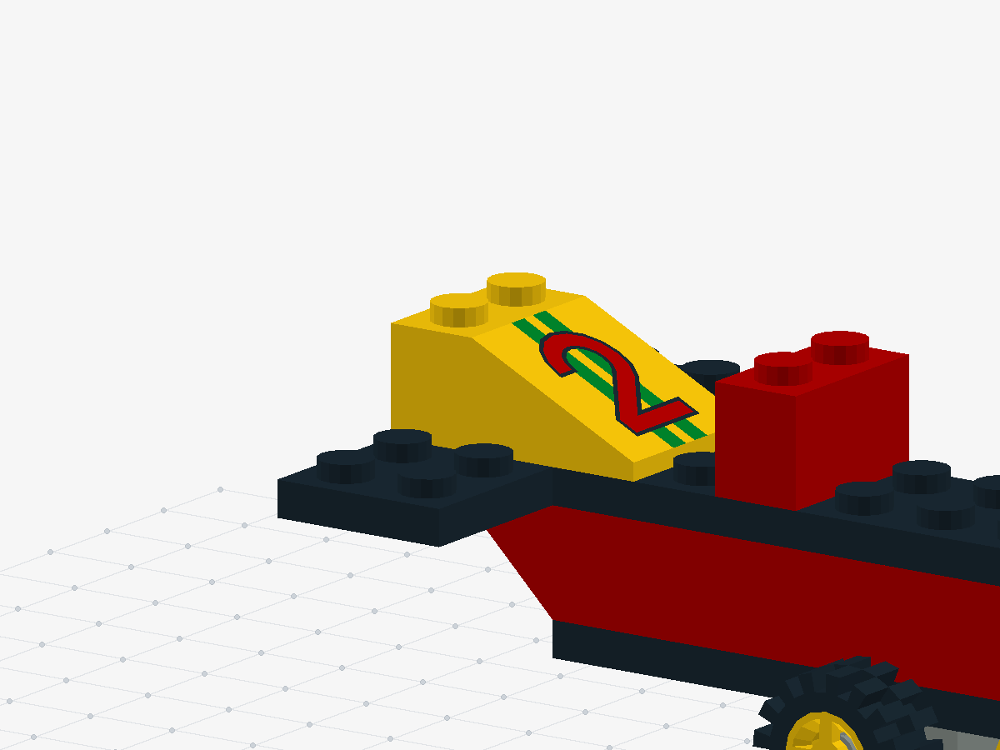 |

| case后缀 | 题型 | 开始状态／干扰位置 | GT参考动作数 |
|---|---|---|---:|
| `dynamic::control` | 正常对照 | 主体预装好，从收尾模块起点完成 | 6 |
| `static::missing` | 静态修复 | 修到说明第4步的目标 | 1 |
| `dynamic::missing` | 动态修复 | 正常参考路线装到4块后出现变化 | 7 |
| `static::rotated` | 静态修复 | 修到说明第4步的目标 | 2 |
| `dynamic::rotated` | 动态修复 | 正常参考路线装到4块后出现变化 | 8 |

完整case ID前缀：`QN:prop-plane-top-4019::`。作者：Merlijn Wissink [Legolijntje]。原文件许可：Redistributable under CCAL version 2.0 : see CAreadme.txt。

## 4. 已检查到哪一步，还有什么不能宣称

- 新增50个case全部通过实际运行器回放；20次动态事故确实发生。没有付费模型成绩。
- 新增静态GT共30个拆装动作，用另一套布尔几何算法复核，结论均与运行器一致。范围只含这些参考动作，不代表所有候选动作均被独立穷举验证，也不模拟摩擦、卡扣力度或真实手部操作。
- 20个静态错误在三个审查角度中至少一面可见；普通模型输入的模块图也通过可见差异筛查。筛查只检查图像是否存在足够差异，不代替真人判断。
- 新增动态题在实际发生事故时再次检查可见性，换合法顺序也适用；没有合适的可见错误时延后触发，最终未触发则保持单独统计。
- 91个人工检查页面的GT均能正常回放，待复查项与新增示例的画面已逐项检查可见差异。原有正确对照允许图像一致。
- 新增物件的源文件、模型清单和依赖零件哈希均核对一致；原作者和许可保留，源几何未修改。
- A原来的71份GT提交仍然保留。新版本还没有真人重新确认，21道问题题和20道新增例子仍待检查。
- 旧物理抽查P024（关联Q021熊猫）仍缺少可靠的背景碰撞信息，不能宣称已经解决。
- 原正式目录仍为5,720题（5,452主任务、268诊断）。本轮50个新增case单独存放，等待真人检查后再决定纳入；不把扩充数字冒充已验证题数。

### 可追溯记录

[A逐题反馈](A-feedback-resolution.json) · [50题回放](source-expansion/native-replay-check.json) · [独立几何](source-expansion/independent-geometry-check.json) · [可见性](source-expansion/visibility-check.json) · [来源核验](source-expansion/provenance-check.json) · [91题预览核验](feedback-preview-validation.json) · [Q003复核](q003-feedback-audit.json)
