# 多角度输入、移除两个物件、库存调配新题

更新：2026-10-28。新增12道题，均已通过运行器检查；仍需真人看图检查。本轮API费用为 **$0**。

[直接看三块2×1返工题 I005](http://127.0.0.1:8808/A?task=I005) · [竖直返工题 I011](http://127.0.0.1:8808/A?task=I011) · [动态库存题 I006](http://127.0.0.1:8808/A?task=I006)

## 1. 多角度图到底怎么给模型

**默认直接给，不需要先调用。** 每轮同一条模型请求中，直接附上三个角度的当前／目标对照图：立体、后方、俯视。三个角度拍的是同一个状态，不是三个不同阶段。左边始终是当前状态，右边始终是唯一验收目标；两边场景的尺寸和比例一致。

| 何时给 | 模型直接收到什么 | 是否需要调用 |
|---|---|---|
| 开始 | 3张当前／目标对照图＋零件库图片 | 自动 |
| 执行一步后 | 上述图片更新，再加3张操作前／当前对照图 | 自动 |
| 想再看角度 | `{"type":"inspect","view":"top"}`；新库存题也可请求`front`正面 | 模型按需调用 |
| 想知道某块如何放 | inspect指定零件，得到所有登记位置的中性预览；预览不会安装 | 模型按需调用 |
| 想看说明书 | 有说明书的旧题用inspect请求具体页；新库存题无指定拼法、无必读说明书 | 模型按需调用 |

发送到API的是图片本身：每张PNG的实际字节以base64图片内容放进多模态请求，不是让模型自己打开本机文件路径。已做不付费的请求构造检查，确认图像数量、字节与哈希对应。

新库存题通常首轮4张图，操作后7张图：每张对照图含两个场景。额外检查会增加相应图片。真人GT页面的三个立体角度、答案提示和参考步骤用于审题，不等同于模型收到的默认视角及内容。

## 2. 移除哪些题

洛克菲勒大厦和博物馆屋顶已从当前有效题单、真人检查入口和运行入口移除。同一来源的旧接口与旧屋顶版本也一并移除，避免换个名字又出现。原始来源和历史提交作为档案保留。

原目录撤下140道不同任务；剩5,580道，其中5,312道主任务候选、268道诊断题。另有50道上一批新增题和本批12道库存题等待真人确认，不混入已验证数量。

[当前有效旧题单 JSONL](current-release/active-questions.jsonl) · [待确认新增题 JSONL](current-release/pending-additions.jsonl) · [移除统计](current-release/selection.json)

## 3. 新题允许怎么拼

**目标图表达要做出的外形、颜色和高度，内部接缝可以不同。** 这个规则明确写进模型输入。工作台可以用一块2×4标准砖，也可以用四块2×1标准砖铺满同样的位置；两种结果都能成功。

竖直方向也可替代：三块2×2薄板叠起来，与一块2×2标准砖等高。厚砖高度等于三层薄板。高度不等、颜色不对、重叠、越界、没填满或不能连接，都不能算成功。

每个零件编号只对应一块真实积木。每次返回的零件库都说明哪些已装、哪些可用、哪些不可用；安装后不会凭空补回库存，拆下后才能重新使用。目标图中的示意大块不会被偷偷加入库存。

新题检查的是可实际拆装、最终连接成立的几何替代；没有据此声称不同拼法承重、刚度或卡扣力度相同。旧题继续按各自的准确零件和位置目标判分。

## 4. 12道题的清单

| 编号 | 物件／方向 | 题型 | 库存与起点 | GT参考动作 |
|---|---|---|---|---|
| [I001](http://127.0.0.1:8808/A?task=I001) | 工作台：2×4台面 | 小块不够，选大块 | 2×4标准砖：已装0块，剩余1块；2×1标准砖：已装0块，剩余3块 | 1步 |
| [I002](http://127.0.0.1:8808/A?task=I002) | 工作台：2×4台面 | 没有大块，用足量小块 | 2×1标准砖：已装0块，剩余4块 | 4步 |
| [I003](http://127.0.0.1:8808/A?task=I003) | 工作台：2×4台面 | 大小／薄厚混合调配 | 2×2标准砖：已装0块，剩余1块；2×1标准砖：已装0块，剩余2块 | 3步 |
| [I004](http://127.0.0.1:8808/A?task=I004) | 工作台：2×4台面 | 两种拼法都接受 | 2×4标准砖：已装0块，剩余1块；2×1标准砖：已装0块，剩余4块 | 1步，也接受4块小件的拼法 |
| [I005](http://127.0.0.1:8808/A?task=I005) | 工作台：2×4台面 | 已拼小块但库存不够，拆掉重拼 | 2×4标准砖：已装0块，剩余1块；2×1标准砖：已装3块，剩余0块 | 4步 |
| [I006](http://127.0.0.1:8808/A?task=I006) | 工作台：2×4台面 | 过程中备用件减少，重新调配 | 2×4标准砖：已装0块，剩余1块；2×1标准砖：已装3块，剩余0块，另有1块不可用 | 7步全程；变化后4步 |
| [I007](http://127.0.0.1:8808/A?task=I007) | 展示台：三薄板高的立柱 | 小块不够，选大块 | 2×2标准砖：已装0块，剩余1块；2×2薄板：已装0块，剩余2块 | 1步 |
| [I008](http://127.0.0.1:8808/A?task=I008) | 展示台：三薄板高的立柱 | 没有大块，用足量小块 | 2×2薄板：已装0块，剩余3块 | 3步 |
| [I009](http://127.0.0.1:8808/A?task=I009) | 展示台：三薄板高的立柱 | 大小／薄厚混合调配 | 2×1标准砖：已装0块，剩余1块；2×1薄板：已装0块，剩余3块 | 4步 |
| [I010](http://127.0.0.1:8808/A?task=I010) | 展示台：三薄板高的立柱 | 两种拼法都接受 | 2×2标准砖：已装0块，剩余1块；2×2薄板：已装0块，剩余3块 | 1步，也接受3块小件的拼法 |
| [I011](http://127.0.0.1:8808/A?task=I011) | 展示台：三薄板高的立柱 | 已拼小块但库存不够，拆掉重拼 | 2×2标准砖：已装0块，剩余1块；2×2薄板：已装2块，剩余0块 | 3步 |
| [I012](http://127.0.0.1:8808/A?task=I012) | 展示台：三薄板高的立柱 | 过程中备用件减少，重新调配 | 2×2标准砖：已装0块，剩余1块；2×2薄板：已装2块，剩余0块，另有1块不可用 | 5步全程；变化后3步 |

这些是短过程的新能力题，主要补库存意识和返工规划，不把它们包装成高难度长过程题。

### 分类和评分

| 类别 | 编号 | 主要检查 |
|---|---|---|
| S2／C01 | 静态库存分配 | 开始就看清库存，选择能完成目标的零件组合。 |
| S3／P04 | 静态库存返工 | 起点已有部分正确几何，但原拼法缺料，需要合法拆掉再拼。 |
| D3／P04 | 动态库存返工 | 拼装过程中减少一块尚未使用的备用件；库存图更新，场景可能不变。之后重新完成目标。 |

最终成功率看目标体积格、颜色和连接是否满足；另外报告填满比例（cellCoverage）、库存拒绝次数（resourceRejections）、合法动作比例、实际动作数和相对参考动作数。体积格是一格凸点宽、深，乘一层薄板高的检查单位。内部空腔和承重不在这项等价定义内。

动态库存变化独立验证：确实从备用件中减去一块、原小块方案库存确实不够、仍有大块方案可完成。恢复指标看是否利用剩余库存合法完成目标。先选大块而未触发库存变化的运行标为“未触发”，不算修复失败；正式修复比较仍需相同起点和相同过程的成功正常分支。

不同传感画面版本和不同目标规则分开汇总。库存题的体积格分数不能拿来冒充旧题的准确零件位置分数。

## 5. 三块小积木必须看得出是三块

显示线来自当前画面中实际相邻的两个零件，只画可见边界；没有把答案位置、隐藏轮廓或三角网格画进去。三块2×1并排会显示两条接缝；一整块内部没有这两条线。横向、竖直、目标、当前和步骤图使用同一套显示规则。

| 四块2×1铺满 | 一块2×4铺满 |
|---|---|
|  |  |

| 三层薄板 | 一块等高标准砖 |
|---|---|
| 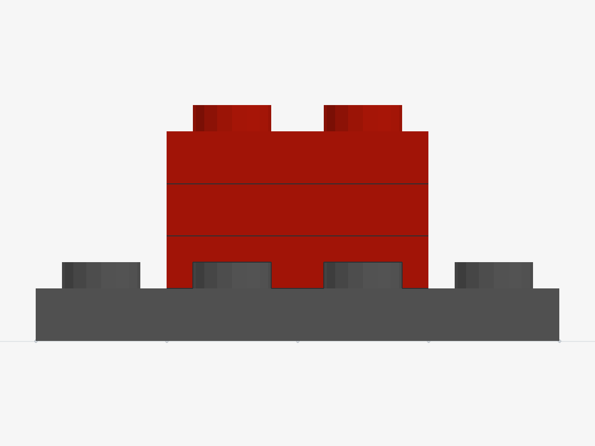 | 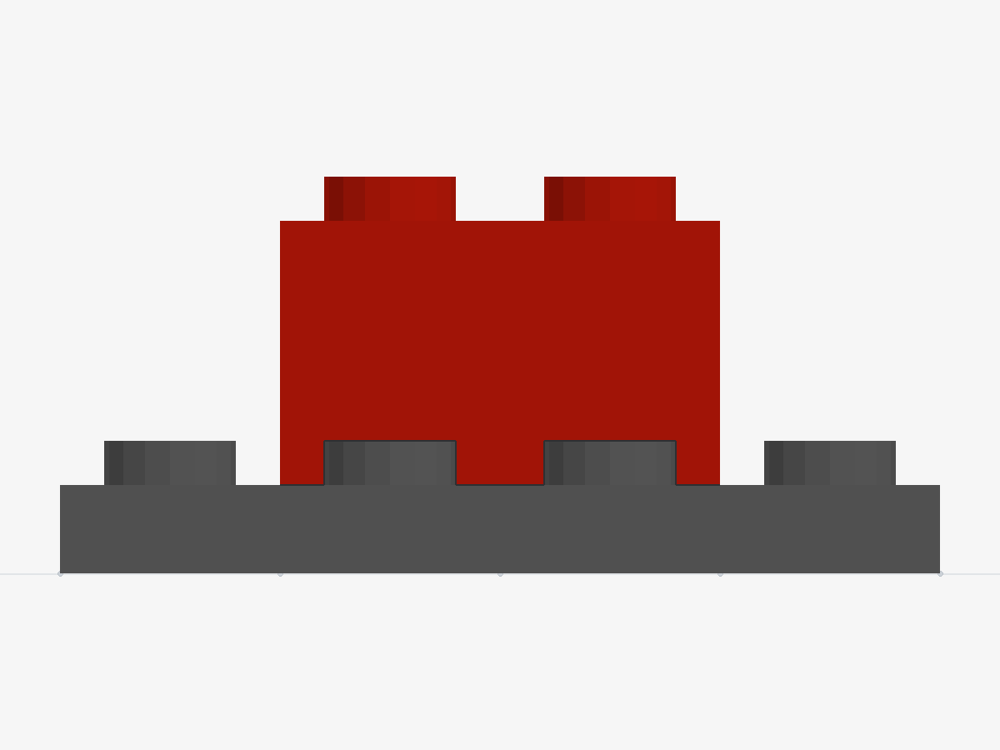 |

## 6. 每题的实际输入状态、GT结果和目标

下面全部是从运行器的实际几何状态生成的图。动态题展示库存变化后的状态；首轮从未完成的目标区域开始。GT是一种合法做法，允许其他满足目标的组合及合法顺序。

### I001 · 小块不够，选大块

工作台：2×4台面。2×4标准砖：已装0块，剩余1块；2×1标准砖：已装0块，剩余3块。

| 当前 | GT结果 | 目标外形示意 |
|---|---|---|
|  |  |  |

**参考步骤：** 装上2×4标准砖。

任务ID：`QI:horizontal::large-required`。

### I002 · 没有大块，用足量小块

工作台：2×4台面。2×1标准砖：已装0块，剩余4块。

| 当前 | GT结果 | 目标外形示意 |
|---|---|---|
|  | 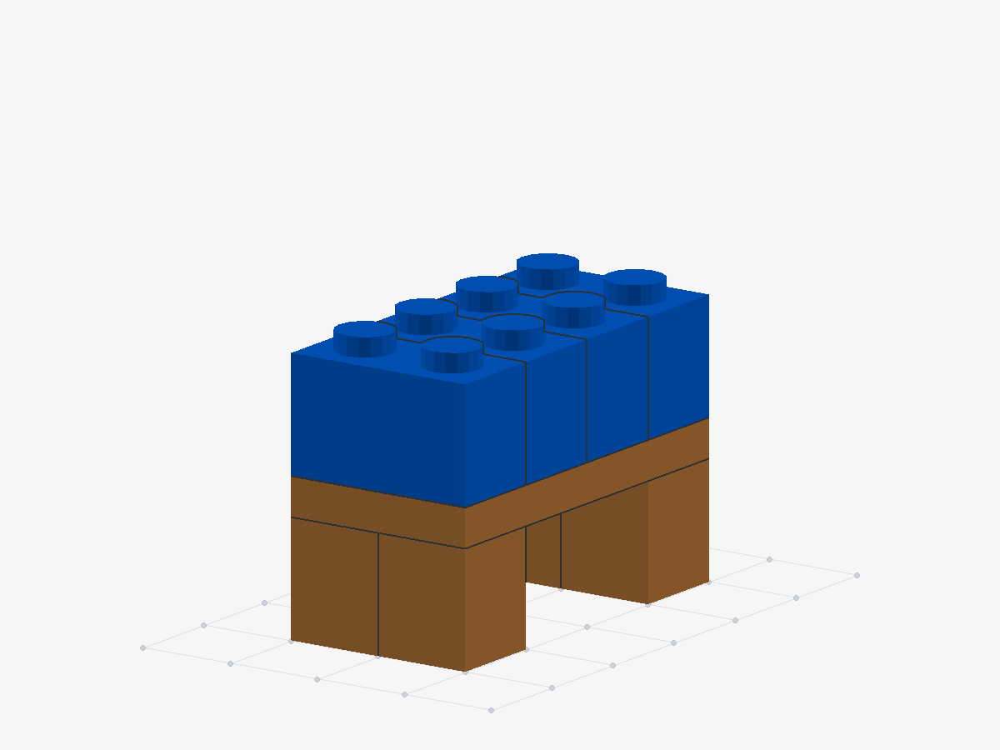 |  |

**参考步骤：** 装上2×1标准砖（第1块） → 装上2×1标准砖（第2块） → 装上2×1标准砖（第3块） → 装上2×1标准砖（第4块）。

任务ID：`QI:horizontal::small-required`。

### I003 · 大小／薄厚混合调配

工作台：2×4台面。2×2标准砖：已装0块，剩余1块；2×1标准砖：已装0块，剩余2块。

| 当前 | GT结果 | 目标外形示意 |
|---|---|---|
| 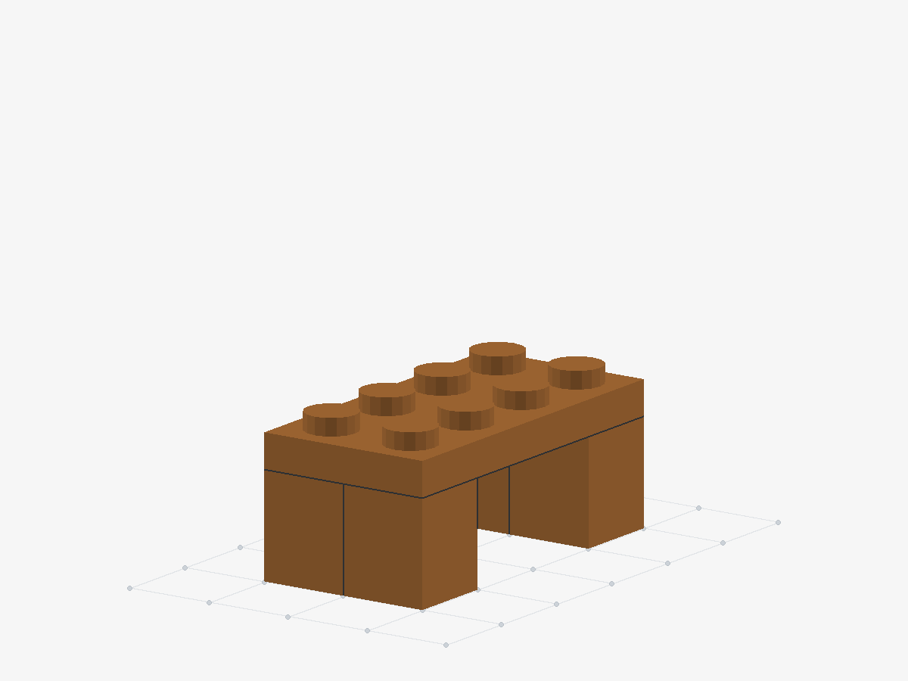 |  |  |

**参考步骤：** 装上积木（3003） → 装上2×1标准砖（第1块） → 装上2×1标准砖（第2块）。

任务ID：`QI:horizontal::mixed`。

### I004 · 两种拼法都接受

工作台：2×4台面。2×4标准砖：已装0块，剩余1块；2×1标准砖：已装0块，剩余4块。

| 当前 | GT结果 | 目标外形示意 |
|---|---|---|
|  |  |  |

**参考步骤：** 装上2×4标准砖。

任务ID：`QI:horizontal::either`。

### I005 · 已拼小块但库存不够，拆掉重拼

工作台：2×4台面。2×4标准砖：已装0块，剩余1块；2×1标准砖：已装3块，剩余0块。

| 当前 | GT结果 | 目标外形示意 |
|---|---|---|
| 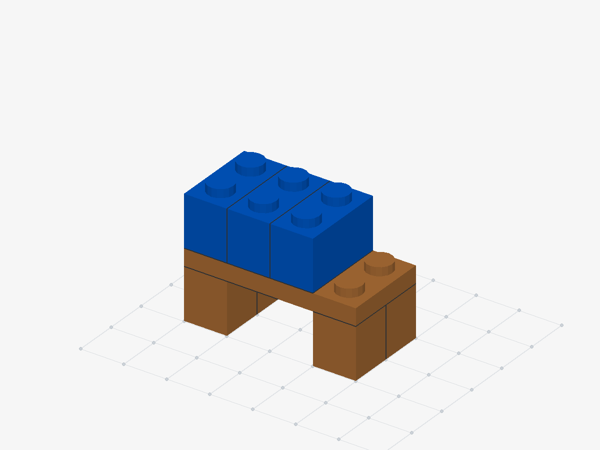 |  |  |

**参考步骤：** 拆下2×1标准砖（第3块） → 拆下2×1标准砖（第2块） → 拆下2×1标准砖（第1块） → 装上2×4标准砖。

任务ID：`QI:horizontal::repair`。

### I006 · 过程中备用件减少，重新调配

工作台：2×4台面。2×4标准砖：已装0块，剩余1块；2×1标准砖：已装3块，剩余0块，另有1块不可用。

| 当前 | GT结果 | 目标外形示意 |
|---|---|---|
|  | 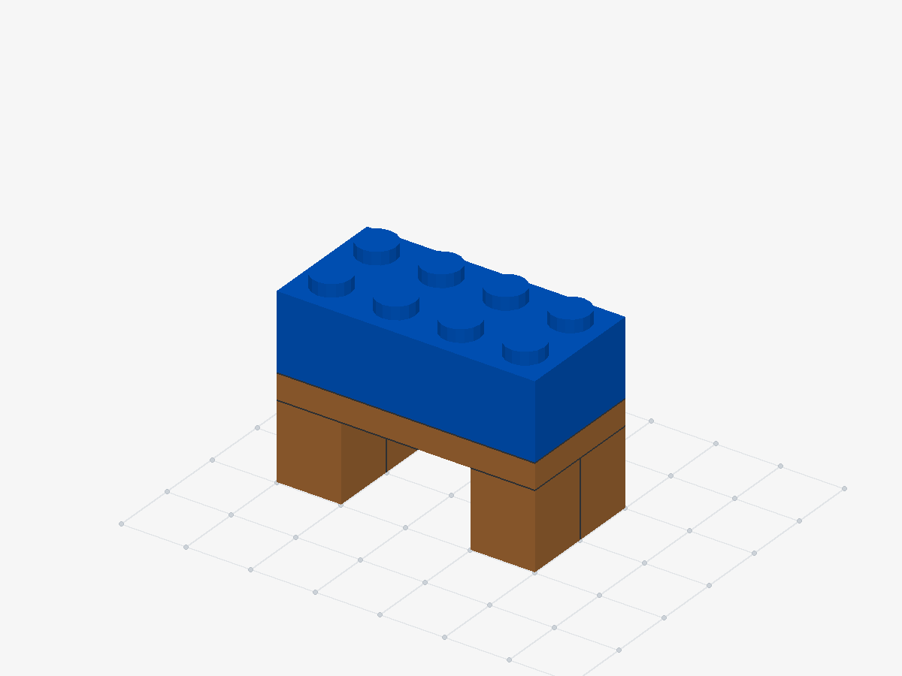 |  |

**参考步骤：** 拆下2×1标准砖（第3块） → 拆下2×1标准砖（第2块） → 拆下2×1标准砖（第1块） → 装上2×4标准砖。

任务ID：`QI:horizontal::dynamic-shortage`。

### I007 · 小块不够，选大块

展示台：三薄板高的立柱。2×2标准砖：已装0块，剩余1块；2×2薄板：已装0块，剩余2块。

| 当前 | GT结果 | 目标外形示意 |
|---|---|---|
|  |  |  |

**参考步骤：** 装上2×2标准砖。

任务ID：`QI:vertical::large-required`。

### I008 · 没有大块，用足量小块

展示台：三薄板高的立柱。2×2薄板：已装0块，剩余3块。

| 当前 | GT结果 | 目标外形示意 |
|---|---|---|
|  | 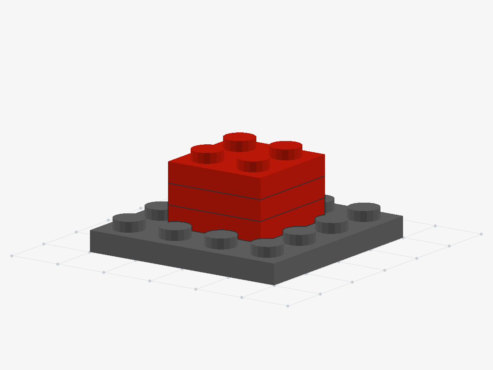 |  |

**参考步骤：** 装上2×2薄板（第1块） → 装上2×2薄板（第2块） → 装上2×2薄板（第3块）。

任务ID：`QI:vertical::small-required`。

### I009 · 大小／薄厚混合调配

展示台：三薄板高的立柱。2×1标准砖：已装0块，剩余1块；2×1薄板：已装0块，剩余3块。

| 当前 | GT结果 | 目标外形示意 |
|---|---|---|
| 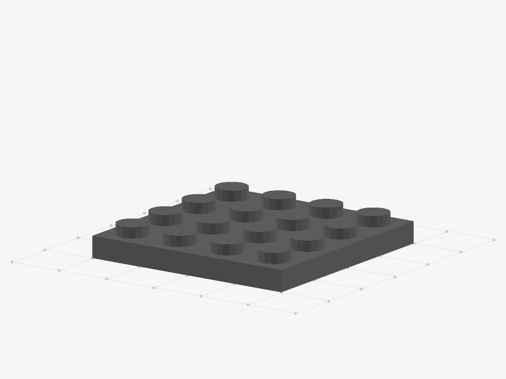 | 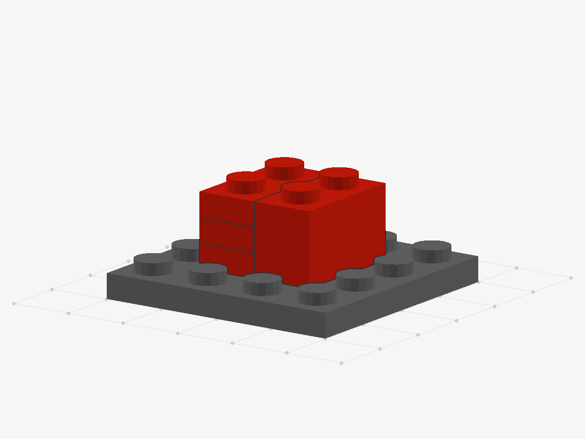 |  |

**参考步骤：** 装上积木（3004） → 装上积木（3023） → 装上积木（3023） → 装上积木（3023）。

任务ID：`QI:vertical::mixed`。

### I010 · 两种拼法都接受

展示台：三薄板高的立柱。2×2标准砖：已装0块，剩余1块；2×2薄板：已装0块，剩余3块。

| 当前 | GT结果 | 目标外形示意 |
|---|---|---|
|  |  |  |

**参考步骤：** 装上2×2标准砖。

任务ID：`QI:vertical::either`。

### I011 · 已拼小块但库存不够，拆掉重拼

展示台：三薄板高的立柱。2×2标准砖：已装0块，剩余1块；2×2薄板：已装2块，剩余0块。

| 当前 | GT结果 | 目标外形示意 |
|---|---|---|
| 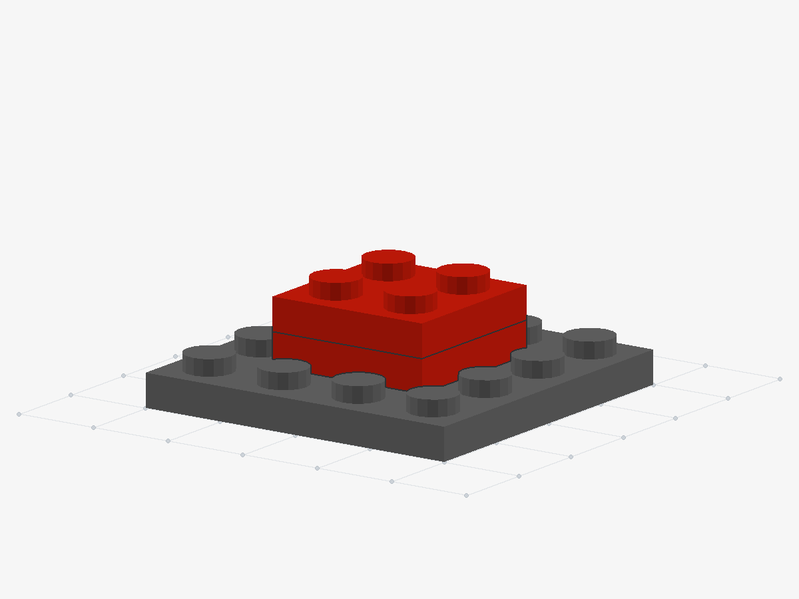 |  |  |

**参考步骤：** 拆下2×2薄板（第2块） → 拆下2×2薄板（第1块） → 装上2×2标准砖。

任务ID：`QI:vertical::repair`。

### I012 · 过程中备用件减少，重新调配

展示台：三薄板高的立柱。2×2标准砖：已装0块，剩余1块；2×2薄板：已装2块，剩余0块，另有1块不可用。

| 当前 | GT结果 | 目标外形示意 |
|---|---|---|
| 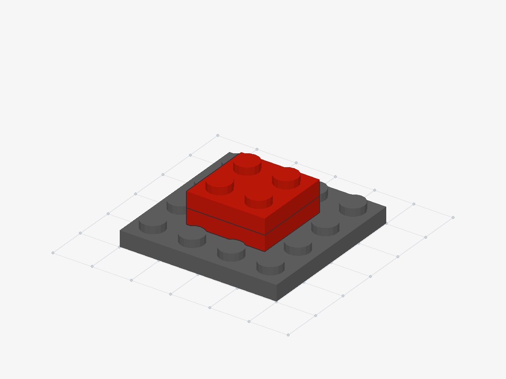 | 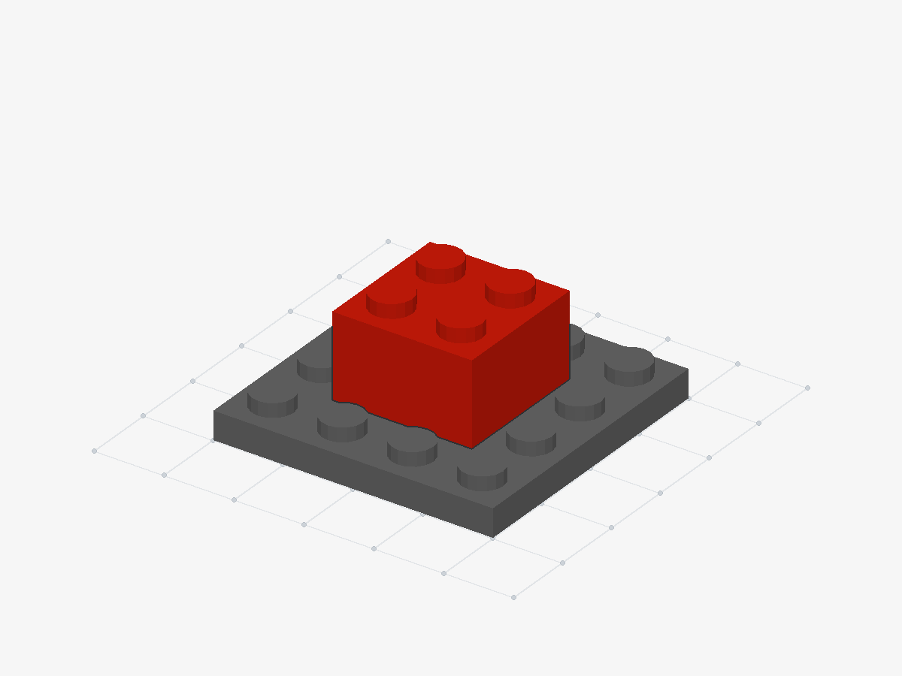 |  |

**参考步骤：** 拆下2×2薄板（第2块） → 拆下2×2薄板（第1块） → 装上2×2标准砖。

任务ID：`QI:vertical::dynamic-shortage`。

## 7. 检查到哪一步

- 12条参考路线全部通过真实运行器，2条动态路线实际触发库存变化。
- 两种分块方案都成功；横向换合法顺序也成功；库存不足、重复使用同一块、没填满、错误高度／位置均不能混过验收。
- 两个返工例子逐块尝试少拆一次，均无法完成；需要拆的才放进GT。
- 对小块完整拼装和返工中的14个动作做独立布尔几何复核，通过。仍使用相同源网格，不等于实体积木力学实验。
- 两个动态例子的正常／变化分支在同一前缀上核对输入与动作，恢复判分通过；未触发情况另外检查。
- 真实API请求格式已构造检查，未调用付费API；真人还需看清图、库存和参考步骤后提交。

[12题与行为检查记录](inventory-equivalence/validation.json) · [横向配对检查](inventory-equivalence/horizontal-paired-check.json) · [竖直配对检查](inventory-equivalence/vertical-paired-check.json)
