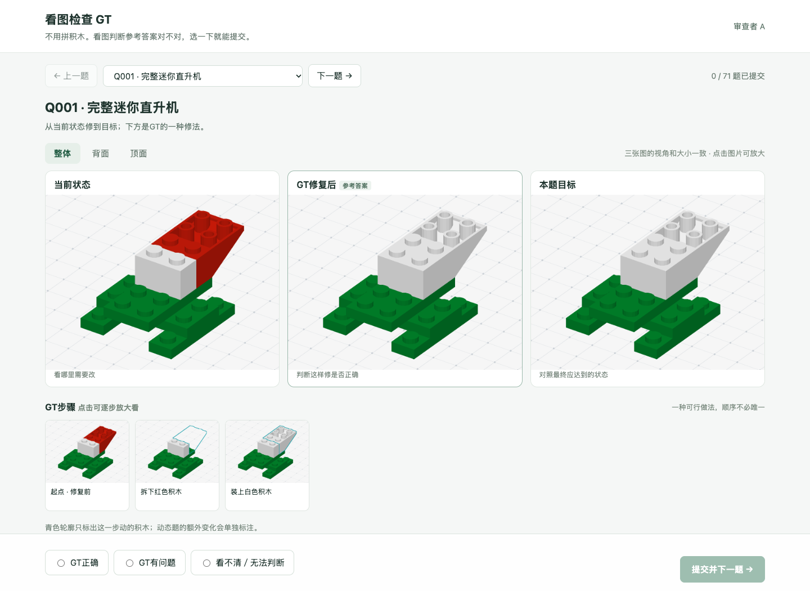

# 关键题目清单：检查什么、给什么、怎样算完成

**新版页面用于看图检查GT，不需要亲自拼装。** 默认展示当前、GT结果和本题目标；只选GT正确、有问题或看不清。模型实验和旧版盲做仍使用各自的原协议，本页不计盲做成绩。

## 先看6道重点题

| 页面题号 | 检查重点 | 为什么保留 |
|---|---|---|
| [Q001](http://127.0.0.1:8808/A?task=Q001) | 原有完整物件的错色静态修复 | 检查当前图、目标图和选位置能否看懂。 |
| [Q002](http://127.0.0.1:8808/A?task=Q002) | 原有完整物件的无错静态对照 | 左右一样时允许直接结束，不能诱导多拆多装。 |
| [Q003](http://127.0.0.1:8808/A?task=Q003) | 书架内部返修 | 检查遮挡、拆上层、换内部件和装回。 |
| [Q004](http://127.0.0.1:8808/A?task=Q004) | 小屋屋顶正常拼装 | 检查没有事故时，能否按说明和实际状态完成。 |
| [Q005](http://127.0.0.1:8808/A?task=Q005) | 书架修到一半又有事故 | 检查两个问题重叠时，记录与返修是否正确。 |
| [Q006](http://127.0.0.1:8808/A?task=Q006) | 连续三次事故 | 检查修过之后是否仍能继续观察、恢复、完成。 |

上面链接以A为例。B、C使用自己的入口再选同一题，答案不会互相复制。每题单独提交，不要求做完整个列表。以下输入输出表描述原题；看GT的审查页会额外展示参考修复结果和步骤。

## 题目的输入、操作与GT

| 项目 | 具体内容 |
|---|---|
| 输入 | 左边当前状态，右边本题唯一目标；相同画布的多个视角；全部零件；按需查看的说明和位置假设图。 |
| 中间操作 | 一次装一块或拆一块；可以换视角、点当前积木、查看该零件全部位置、看说明；过程不会插入“是否发现故障”的问卷。 |
| 输出 | 真人点按钮完成动作，最后结束并选择检查选项；模型调用相同动作接口。 |
| GT | 最终可操作部分的形状、颜色和位置与目标物理等价，且每个动作合法。相同零件换编号、合法顺序改变，不扣分。 |
| 参考动作 | 证明存在一种合法做法；不代表唯一顺序，也不保证最短。下表的动作数不含查看和结束。 |
| 事故时刻 | 由当前安装情况和动作间隔触发。下表给出参考运行里实际发生的位置，不要求参与者按此步数操作。 |
| 未触发 | 单列“不适用”；没有经历事故，不能算漏检或修复失败。 |
| 连续事故 | 记录每次事故后到下一次事故前是否修复，同时独立记录最终是否拼好。 |

## 级别用人话解释

- B1：目标不超过12块；B2：13–24块；B3：超过24块。固定背景不计入操作目标。
- R1：参考返修较短；R2：需要多步；R3：要拆正确的盖件，或参考返修至少7步。
- T1/T2/T3：一轮中安排1/2/3次事故。
- G1/G2/G3：按件数、返修和事故数得到的结构级别；不是已经由真人或模型验证的简单／中等／困难。
- 实际难度还要结合真人完成率、耗时、查看次数和模型运行结果判断。

## 16个物件／模块

| 物件 | 内容范围 | 本轮条件数 | 可操作目标件数 |
|---|---|---:|---:|
| 勃兰登堡门顶部（`brandenburg-top`） | 有完整物件背景的命名模块 | 1 | 10 |
| 汉堡摊屋顶（`burger-stand-roof`） | 有完整物件背景的命名模块 | 3 | 7 |
| 小屋屋顶（`cottage-roof`） | 有完整物件背景的命名模块 | 3 | 6 |
| 博物馆屋顶（`museum-roof-long`） | 有完整物件背景的命名模块 | 3 | 16 |
| 熊猫头（`panda-head`） | 有完整物件背景的命名模块 | 2 | 6 |
| 警用直升机顶部（`police-helicopter-top`） | 有完整物件背景的命名模块 | 3 | 10 |
| 赛车上部（`racer-top`） | 有完整物件背景的命名模块 | 3 | 11 |
| 维修车驾驶室（`repair-truck-cab`） | 有完整物件背景的命名模块 | 2 | 5 |
| 洛克菲勒大厦顶部（`rockefeller-crown`） | 有完整物件背景的命名模块 | 2 | 8 |
| 水上飞机尾部（`seaplane-tail`） | 有完整物件背景的命名模块 | 2 | 7 |
| 书架（`v7-long-bookshelf`） | 完整物件 | 3 | 21 |
| 城市巴士（`v7-long-city-bus`） | 完整物件 | 3 | 32 |
| 小屋（`v7-long-cottage`） | 完整物件 | 4 | 24 |
| 龙门压力机（`v7-long-gantry-press`） | 完整物件 | 4 | 24 |
| 石桥（`v7-long-stone-bridge`） | 完整物件 | 3 | 25 |
| 白宫屋顶（`white-house-roof`） | 有完整物件背景的命名模块 | 3 | 10 |

## 第二次事故发生在第一次修复尚未完成时（6题）

| 页面 | 物件 | 实际错误顺序 | 件数 | 级别 B/R/T/G | 参考总动作数 | 参考事故动作点 | 前错未修完又出错 |
|---|---|---|---:|---|---:|---|---|
| [Q005](http://127.0.0.1:8808/A?task=Q005) | 书架 | 位置偏移 → 偷偷多装一层 | 21 | B2/R1/T2/G2 | 24 | 8、9 | 是 |
| [Q036](http://127.0.0.1:8808/A?task=Q036) | 城市巴士 | 位置偏移 → 偷偷多装一层 | 32 | B3/R1/T2/G3 | 35 | 10、11 | 是 |
| [Q037](http://127.0.0.1:8808/A?task=Q037) | 石桥 | 位置偏移 → 偷偷多装一层 | 25 | B3/R1/T2/G3 | 28 | 23、24 | 是 |
| [Q038](http://127.0.0.1:8808/A?task=Q038) | 龙门压力机 | 位置偏移 → 偷偷多装一层 | 24 | B2/R1/T2/G2 | 27 | 8、9 | 是 |
| [Q039](http://127.0.0.1:8808/A?task=Q039) | 小屋 | 位置偏移 → 偷偷多装一层 | 24 | B2/R1/T2/G2 | 27 | 8、9 | 是 |
| [Q040](http://127.0.0.1:8808/A?task=Q040) | 博物馆屋顶 | 位置偏移 → 偷偷多装一层 | 16 | B2/R1/T2/G2 | 19 | 6、7 | 是 |

## 拆开上层返修时又出现新错误（6题）

| 页面 | 物件 | 实际错误顺序 | 件数 | 级别 B/R/T/G | 参考总动作数 | 参考事故动作点 | 前错未修完又出错 |
|---|---|---|---:|---|---:|---|---|
| [Q018](http://127.0.0.1:8808/A?task=Q018) | 石桥 | 内部错色，需要拆上层返修 → 换错颜色 | 25 | B3/R3/T2/G3 | 33 | 7、8 | 是 |
| [Q041](http://127.0.0.1:8808/A?task=Q041) | 龙门压力机 | 内部错色，需要拆上层返修 → 换错颜色 | 24 | B2/R3/T2/G3 | 30 | 8、9 | 是 |
| [Q042](http://127.0.0.1:8808/A?task=Q042) | 小屋 | 内部错色，需要拆上层返修 → 换错颜色 | 24 | B2/R3/T2/G3 | 30 | 7、8 | 是 |
| [Q043](http://127.0.0.1:8808/A?task=Q043) | 博物馆屋顶 | 内部错色，需要拆上层返修 → 换错颜色 | 16 | B2/R3/T2/G3 | 26 | 7、8 | 是 |
| [Q044](http://127.0.0.1:8808/A?task=Q044) | 小屋屋顶 | 内部错色，需要拆上层返修 → 换错颜色 | 6 | B1/R3/T2/G3 | 14 | 5、6 | 是 |
| [Q045](http://127.0.0.1:8808/A?task=Q045) | 赛车上部 | 内部错色，需要拆上层返修 → 换错颜色 | 11 | B1/R3/T2/G3 | 23 | 7、8 | 是 |

## 连续三次不同事故，修好后继续完成（6题）

| 页面 | 物件 | 实际错误顺序 | 件数 | 级别 B/R/T/G | 参考总动作数 | 参考事故动作点 | 前错未修完又出错 |
|---|---|---|---:|---|---:|---|---|
| [Q006](http://127.0.0.1:8808/A?task=Q006) | 小屋 | 少件 → 换错颜色 → 位置偏移 | 24 | B2/R1/T3/G3 | 29 | 8、10、12 | 否 |
| [Q046](http://127.0.0.1:8808/A?task=Q046) | 博物馆屋顶 | 少件 → 换错颜色 → 位置偏移 | 16 | B2/R1/T3/G3 | 21 | 6、9、11 | 否 |
| [Q047](http://127.0.0.1:8808/A?task=Q047) | 小屋屋顶 | 少件 → 换错颜色 → 位置偏移 | 6 | B1/R1/T3/G3 | 11 | 3、5、7 | 否 |
| [Q048](http://127.0.0.1:8808/A?task=Q048) | 赛车上部 | 少件 → 换错颜色 → 位置偏移 | 11 | B1/R1/T3/G3 | 16 | 3、5、7 | 否 |
| [Q049](http://127.0.0.1:8808/A?task=Q049) | 水上飞机尾部 | 少件 → 换错颜色 → 位置偏移 | 7 | B1/R1/T3/G3 | 12 | 3、5、7 | 否 |
| [Q050](http://127.0.0.1:8808/A?task=Q050) | 维修车驾驶室 | 少件 → 换错颜色 → 位置偏移 | 5 | B1/R1/T3/G3 | 10 | 4、6、8 | 否 |

## 接近完成时发现错件并再次缺件（6题）

| 页面 | 物件 | 实际错误顺序 | 件数 | 级别 B/R/T/G | 参考总动作数 | 参考事故动作点 | 前错未修完又出错 |
|---|---|---|---:|---|---:|---|---|
| [Q019](http://127.0.0.1:8808/A?task=Q019) | 小屋屋顶 | 换错零件 → 少件 | 6 | B1/R1/T2/G2 | 9 | 4、6 | 否 |
| [Q051](http://127.0.0.1:8808/A?task=Q051) | 赛车上部 | 换错零件 → 少件 | 11 | B1/R1/T2/G2 | 14 | 9、11 | 否 |
| [Q052](http://127.0.0.1:8808/A?task=Q052) | 汉堡摊屋顶 | 换错零件 → 少件 | 7 | B1/R1/T2/G2 | 10 | 5、7 | 否 |
| [Q053](http://127.0.0.1:8808/A?task=Q053) | 白宫屋顶 | 换错零件 → 少件 | 10 | B1/R1/T2/G2 | 13 | 8、10 | 否 |
| [Q054](http://127.0.0.1:8808/A?task=Q054) | 洛克菲勒大厦顶部 | 换错零件 → 少件 | 8 | B1/R1/T2/G2 | 11 | 7、9 | 否 |
| [Q055](http://127.0.0.1:8808/A?task=Q055) | 书架 | 换错零件 → 少件 | 21 | B2/R1/T2/G2 | 24 | 19、21 | 否 |

## 修好后再次出现同类错误（6题）

| 页面 | 物件 | 实际错误顺序 | 件数 | 级别 B/R/T/G | 参考总动作数 | 参考事故动作点 | 前错未修完又出错 |
|---|---|---|---:|---|---:|---|---|
| [Q020](http://127.0.0.1:8808/A?task=Q020) | 水上飞机尾部 | 换错颜色 → 换错颜色 | 7 | B1/R1/T2/G2 | 11 | 3、6 | 否 |
| [Q056](http://127.0.0.1:8808/A?task=Q056) | 维修车驾驶室 | 换错颜色 → 换错颜色 | 5 | B1/R1/T2/G2 | 9 | 4、7 | 否 |
| [Q057](http://127.0.0.1:8808/A?task=Q057) | 熊猫头 | 换错颜色 → 换错颜色 | 6 | B1/R1/T2/G2 | 10 | 3、6 | 否 |
| [Q058](http://127.0.0.1:8808/A?task=Q058) | 汉堡摊屋顶 | 换错颜色 → 换错颜色 | 7 | B1/R1/T2/G2 | 11 | 3、6 | 否 |
| [Q059](http://127.0.0.1:8808/A?task=Q059) | 白宫屋顶 | 换错颜色 → 换错颜色 | 10 | B1/R1/T2/G2 | 14 | 3、6 | 否 |
| [Q060](http://127.0.0.1:8808/A?task=Q060) | 警用直升机顶部 | 换错颜色 → 换错颜色 | 10 | B1/R1/T2/G2 | 14 | 3、6 | 否 |

## 方向异常与后续缺件的连续修复（6题）

| 页面 | 物件 | 实际错误顺序 | 件数 | 级别 B/R/T/G | 参考总动作数 | 参考事故动作点 | 前错未修完又出错 |
|---|---|---|---:|---|---:|---|---|
| [Q021](http://127.0.0.1:8808/A?task=Q021) | 熊猫头 | 装反／方向错误 → 少件 | 6 | B1/R1/T2/G2 | 9 | 3、5 | 否 |
| [Q061](http://127.0.0.1:8808/A?task=Q061) | 汉堡摊屋顶 | 装反／方向错误 → 少件 | 7 | B1/R1/T2/G2 | 10 | 3、5 | 否 |
| [Q062](http://127.0.0.1:8808/A?task=Q062) | 白宫屋顶 | 装反／方向错误 → 少件 | 10 | B1/R1/T2/G2 | 13 | 3、5 | 否 |
| [Q063](http://127.0.0.1:8808/A?task=Q063) | 警用直升机顶部 | 装反／方向错误 → 少件 | 10 | B1/R1/T2/G2 | 13 | 3、5 | 否 |
| [Q064](http://127.0.0.1:8808/A?task=Q064) | 洛克菲勒大厦顶部 | 装反／方向错误 → 少件 | 8 | B1/R1/T2/G2 | 11 | 5、7 | 否 |
| [Q065](http://127.0.0.1:8808/A?task=Q065) | 勃兰登堡门顶部 | 装反／方向错误 → 少件 | 10 | B1/R1/T2/G2 | 13 | 3、5 | 否 |

## 提前封口后重新安排安装路线（6题）

| 页面 | 物件 | 实际错误顺序 | 件数 | 级别 B/R/T/G | 参考总动作数 | 参考事故动作点 | 前错未修完又出错 |
|---|---|---|---:|---|---:|---|---|
| [Q022](http://127.0.0.1:8808/A?task=Q022) | 警用直升机顶部 | 提前封口挡路 → 少件 | 10 | B1/R1/T2/G2 | 12 | 3、4 | 否 |
| [Q066](http://127.0.0.1:8808/A?task=Q066) | 书架 | 提前封口挡路 → 少件 | 21 | B2/R1/T2/G2 | 23 | 9、10 | 否 |
| [Q067](http://127.0.0.1:8808/A?task=Q067) | 城市巴士 | 提前封口挡路 → 少件 | 32 | B3/R1/T2/G3 | 34 | 20、21 | 否 |
| [Q068](http://127.0.0.1:8808/A?task=Q068) | 石桥 | 提前封口挡路 → 少件 | 25 | B3/R1/T2/G3 | 27 | 17、18 | 否 |
| [Q069](http://127.0.0.1:8808/A?task=Q069) | 龙门压力机 | 提前封口挡路 → 少件 | 24 | B2/R1/T2/G2 | 26 | 18、19 | 否 |
| [Q070](http://127.0.0.1:8808/A?task=Q070) | 小屋 | 提前封口挡路 → 少件 | 24 | B2/R1/T2/G2 | 26 | 17、18 | 否 |

## 可交换位置的不同零件被互换（2题）

| 页面 | 物件 | 实际错误顺序 | 件数 | 级别 B/R/T/G | 参考总动作数 | 参考事故动作点 | 前错未修完又出错 |
|---|---|---|---:|---|---:|---|---|
| [Q023](http://127.0.0.1:8808/A?task=Q023) | 城市巴士 | 不同零件互换位置 | 32 | B3/R2/T1/G3 | 36 | 13 | 否 |
| [Q071](http://127.0.0.1:8808/A?task=Q071) | 龙门压力机 | 不同零件互换位置 | 24 | B2/R2/T1/G2 | 28 | 9 | 否 |

## 已检查与待检查

- 44题均通过真实运行器回放；92次事故全部实际触发，并通过效果核验。参考动作使用答案，不能当作模型成绩。
- 独立布尔几何算法抽查32个动作：31项在相应几何范围内结论一致，1项信息不足，保持待查。
- 这32个动作不是对44题所有合法／非法动作的穷举；没有抽查到的动作不能据此自动通过。
- 44个新增条件目前全部等待真人和相应独立复核，未计入原5,720题的正式目录。
- 无真人提交时只显示待审；看不懂、不会操作、判断分歧、没有完成，均留下具体记录再检查。

| 待查项 | 关联盲做题 | 具体原因 | 当前处理 |
|---|---|---|---|
| P024 | Q021，熊猫头 | U51背景件缺少可靠碰撞体，且其范围与待查路径相交 | 暂停本项纳入；补可靠网格或第三方／实物证据。 |

## 页面截图

下面是隔离测试账户的界面截图，模拟答案不计入真人统计。每道题的实际图像在对应页面中查看。

