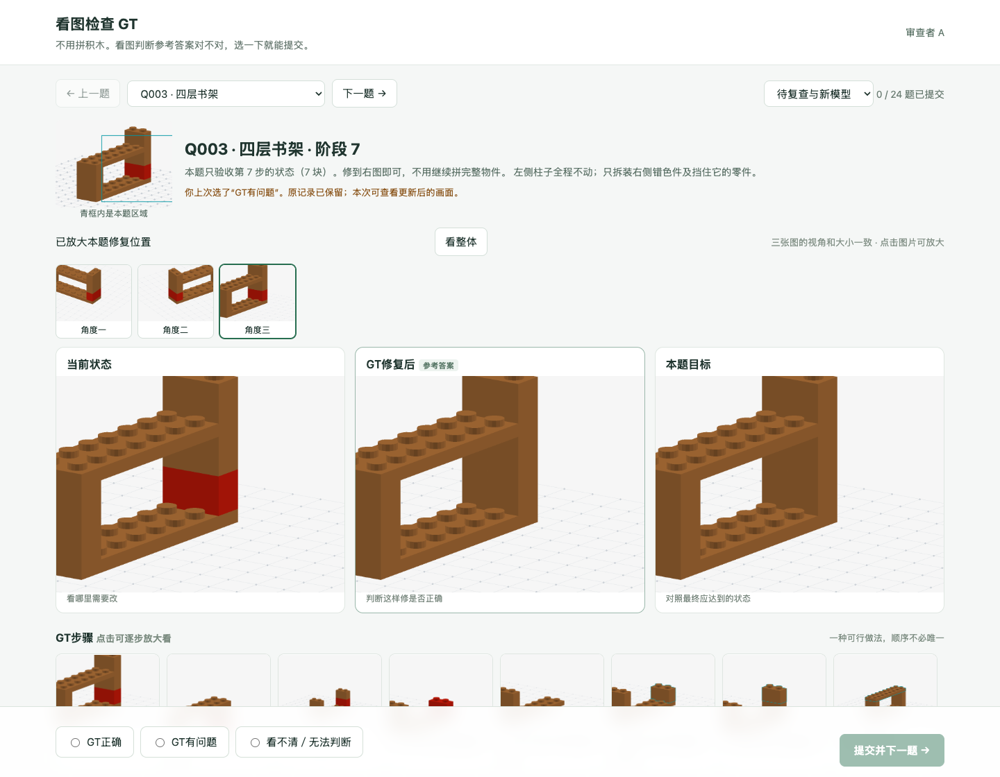

# Q003：删除多余的左柱拆装

更新：2026-10-28。

**A指出的问题成立：右柱下段颜色错了，旧GT却额外拆下、装回左柱。** 上一轮只检查了动作能否执行，没有检查动作是否必要，把这条反馈解释为阶段目标不清楚是不准确的。

[打开修正后的Q003](http://127.0.0.1:8808/A?task=Q003)

## 现在怎么修

参考动作由10步改成8步，左柱上下两块全程保持原样：

1. 拆下右侧最上方棕色块。
2. 拆下挡住下面柱子的横隔板。
3. 拆下右柱上段棕色块。
4. 拆下右柱下段红色错件。
5. 装上右柱下段棕色正确件。
6. 装回右柱上段棕色块。
7. 装回横隔板。
8. 装回右侧最上方棕色块。

删除的是原来的第3步“拆下左柱上段”和第8步“装回左柱上段”。横隔板仍需要临时移开，因为它挡住了右柱的取放路径；左侧柱子不用拆。

## 以前为什么会多拆

生成程序按顺序尝试拆上层零件，找到能修内部错误的方法就停止了。它保留了搜索过程中顺手拆掉的左柱，没有再试“这两步能否直接省略”。

现在增加了检查：把拆下又原位装回的正确零件作为候选，尝试省去整对动作，重新验证剩余动作是否都合法、最终状态是否完全一样。只有验证通过才删去；不会为了缩短步骤而放行穿模或不合法拆装。

这项规则也用于后续生成的内部返修题。运行器与真人GT页面读取同一份修正后的参考步骤。

## 顺带检查了多少

检查了现有78条同类“拆上层修内部”的参考路线，其中31条能够省去多余拆装：14条静态、17条动态。这里也包括原本就单列的诊断题，没有把它们改成正式主任务。

题目的起始状态、目标和干扰安排保持不变。旧参考文件和真人提交保留，修正记录另存，方便对照。

## 验证依据

- 修正后的31条路线通过实际运行器回放；动态题仍实际触发要求的事件。
- Q003的8个动作另外用独立几何算法复核，通过；每一步都检查了左柱没有变化。
- 当前评分读取修正后的参考动作数。成功仍以合法操作及最终状态正确为准，不强制照这8步操作。
- 这里证明了旧路线有可省略的动作，**没有宣称所有题都找到了全局最短解**。
- A的原始“GT有问题”记录保留，不会被自动改成“正确”。

[78条路线检查记录](reference-roundtrip-audit.json) · [31条实际回放](reference-revision-replay-check.json) · [Q003独立复核](q003-reference-correction-check.json)

