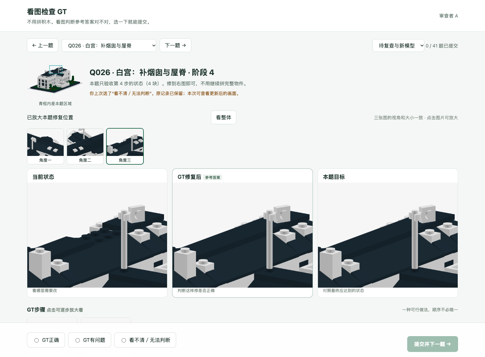

# 看图检查GT：不用自己拼积木

**本次更新：[多角度输入、移除两个物件、12道库存调配新题与GT图](INVENTORY-AND-VIEWS.zh-CN.md)。**

更新：2026-10-28。

**Q003已修正：[删除多余的左柱拆装，10步改为8步](Q003-GT-CORRECTION.zh-CN.md)。左柱全程不动，A原来的异议记录保留。**

[审查者A](http://127.0.0.1:8808/A) · [审查者B](http://127.0.0.1:8808/B) · [审查者C](http://127.0.0.1:8808/C)

打不开时，双击[打开真人检查.command](打开真人检查.command)。

## 每题只做这一件事

1. 并排看三张图：**当前状态 → GT修复后 → 本题目标**。
2. 默认放大修复位置，旁边有整件小图。可以在三个立体角度之间切换；三张图会一起换视角，也可点“看整体”。
3. 下方有GT步骤，点击后并排看“操作前／操作后”。不需要自己装或拆。动态题从第一次出问题后开始展示。
4. 只选一个：**GT正确 / GT有问题 / 看不清或无法判断**。
5. 点“提交并下一题”。每题单独保存；回看、刷新会恢复自己的选择。

当前题数以页面列表为准：洛克菲勒和博物馆题已移除；保留其他旧题和10个LDraw物件的20道示例，另加12道库存调配题。

默认列表根据最新反馈显示待复查题，并加入20道新示例；其他旧题仍在“全部题目”里。原答案及后续提交完整保留。本次改过的GT需要重新检查，旧判断不会自动算作新版通过。

**[本轮修复说明＋10个新物件的图、题目与GT](A-FEEDBACK-REPAIRS.zh-CN.md)**

可以检查任意几题，不用全部完成，不用写文字或JSON。

## 怎么看提交结果

双击[打开组织者汇总.command](打开组织者汇总.command)。页面只列每题有几人认为GT正确、有问题、看不清。

有异议或看不清的题保留待查；三人都认为正确才显示一致通过GT检查。**这是看过参考答案的检查，不会算成真人自己拼装成功。** 旧版已填写的操作记录保留，和这次判断分开存放。

[详细题目清单](KEY-CASES.zh-CN.md) · [上轮裁判、几何检查与旧版操作说明](README-operation-2026-10-26.zh-CN.md)

