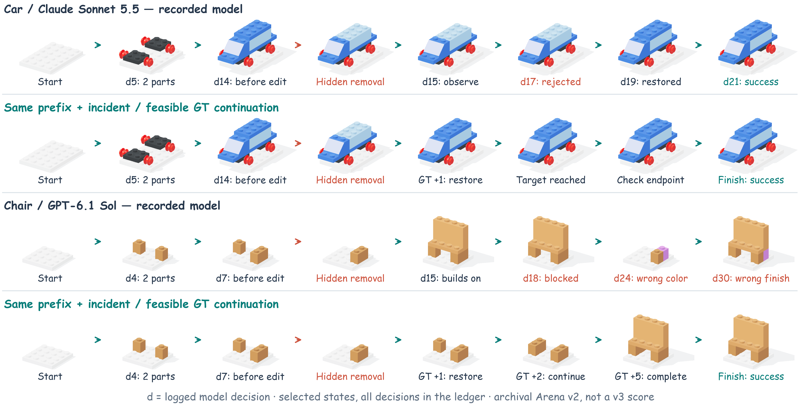
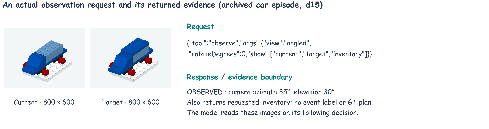

# 真实 Arena 过程与 GT 对照

这两个例子来自旧版 Arena v2。原日志是真实 API 调用；本次只重放和制图，没有再次调用模型。不能把它们记成新版 Arena v3 的正式成绩。



每行 8 个画面；d 是模型真实决策编号，不只是拼装次数。为了让整段过程放在一行，图中选了关键帧；没有展示的决策全部在下表。GT 前四格沿用同一模型的实际前缀与事故现场，之后用已验证的参考动作继续。GT 有答案信息，不是另一个模型，也不声称最少步数。

## 实际输入输出



图中的两个场景是原始模型收到的图片。高清过程图则是同一状态的论文重渲染。两者有明确区别，不能用论文图冒充模型当时看见的图。

下面是小汽车第 15 轮的真实工具请求；当前图、目标图和库存由模型主动要来，环境不把隐藏事故或 GT 告诉它。

```json
{
  "tool": "observe",
  "args": {
    "view": "angled",
    "rotateDegrees": 0,
    "show": [
      "current",
      "target",
      "inventory"
    ]
  }
}
```

响应（图片地址和哈希保留在证据 JSON）：

```json
{
  "code": "OBSERVED",
  "camera": {
    "azimuthDegrees": 35,
    "elevationDegrees": 30
  },
  "images": [
    {
      "role": "current",
      "url": "/assets/b76b187353fab79e6e2434ebf83ae421c1f8ce52b82849e70ba1eed71c44997d.png",
      "sha256": "b76b187353fab79e6e2434ebf83ae421c1f8ce52b82849e70ba1eed71c44997d",
      "width": 800,
      "height": 600,
      "camera": {
        "azimuthDegrees": 35,
        "elevationDegrees": 30
      }
    },
    {
      "role": "target",
      "url": "/assets/fa3b79985b3dfeb00e82457f4e576a5c5ab7ebe230169f864eedbb95046d1310.png",
      "sha256": "fa3b79985b3dfeb00e82457f4e576a5c5ab7ebe230169f864eedbb95046d1310",
      "width": 800,
      "height": 600,
      "camera": {
        "azimuthDegrees": 35,
        "elevationDegrees": 30
      }
    },
    {
      "role": "inventory",
      "url": "/assets/d43f4f285501dbe6799db9c5528def6f41ed9b52447438e524abd8f2d6677903.png",
      "sha256": "d43f4f285501dbe6799db9c5528def6f41ed9b52447438e524abd8f2d6677903",
      "width": 1600,
      "height": 608,
      "camera": {
        "azimuthDegrees": 35,
        "elevationDegrees": 30
      }
    }
  ],
  "environmentDecision": 15
}
```

## 小汽车：Claude Sonnet 5.5 成功

原始运行：`incident-anthropic-claude-sonnet-5-5-obj-city-car-20261028-154133`。正常拼装前测已成功。

模型：21 次决策，9 次观察，7 次成功拆装。事故发生在第 14 次决策后。

GT 从这个事故现场开始的实际动作如下；末尾还需 `finish`。这些是评估器内部零件标识，不是发给模型的公开位置编号。

```json
[
  {
    "actor": "P005",
    "candidate": "P005:goal",
    "type": "attach"
  },
  {
    "type": "finish"
  }
]
```

| 轮次 | 模型提交的完整动作 JSON | 环境反馈 | 隐藏事件 |
|---|---|---|---|
| 1 | `{"tool":"observe","args":{"view":"angled","rotateDegrees":0,"show":["current","target","inventory"]}}` | OBSERVED | — |
| 2 | `{"tool":"invalid","args":{}}` | INVALID_TOOL_REQUEST | — |
| 3 | `{"tool":"attach","args":{"partId":"A001","candidate":"C00003"}}` | OK | — |
| 4 | `{"tool":"observe","args":{"view":"angled","rotateDegrees":0,"show":["current","target","inventory"]}}` | OBSERVED | — |
| 5 | `{"tool":"attach","args":{"partId":"A005","candidate":"C00004"}}` | OK | — |
| 6 | `{"tool":"observe","args":{"view":"angled","rotateDegrees":0,"show":["current","target","inventory"]}}` | OBSERVED | — |
| 7 | `{"tool":"attach","args":{"partId":"A006","candidate":"C00001"}}` | OK | — |
| 8 | `{"tool":"observe","args":{"view":"angled","rotateDegrees":0,"show":["current","target","inventory"]}}` | OBSERVED | — |
| 9 | `{"tool":"attach","args":{"partId":"A004","candidate":"C00005"}}` | OK | — |
| 10 | `{"tool":"observe","args":{"view":"angled","rotateDegrees":0,"show":["current","target","inventory"]}}` | OBSERVED | — |
| 11 | `{"tool":"invalid","args":{}}` | INVALID_TOOL_REQUEST | — |
| 12 | `{"tool":"attach","args":{"partId":"A002","candidate":"C00007"}}` | OK | — |
| 13 | `{"tool":"observe","args":{"view":"angled","rotateDegrees":0,"show":["current","target","inventory"]}}` | OBSERVED | — |
| 14 | `{"tool":"attach","args":{"partId":"A007","candidate":"C00006"}}` | OK | 发生移除 |
| 15 | `{"tool":"observe","args":{"view":"angled","rotateDegrees":0,"show":["current","target","inventory"]}}` | OBSERVED | — |
| 16 | `{"tool":"invalid","args":{}}` | INVALID_TOOL_REQUEST | — |
| 17 | `{"tool":"attach","args":{"partId":"A003","candidate":"C00002"}}` | ENDPOINT_COLLISION | — |
| 18 | `{"tool":"observe","args":{"view":"angled","rotateDegrees":0,"show":["current","target","inventory"]}}` | OBSERVED | — |
| 19 | `{"tool":"attach","args":{"partId":"A002","candidate":"C00007"}}` | OK | — |
| 20 | `{"tool":"observe","args":{"view":"angled","rotateDegrees":0,"show":["current","target","inventory"]}}` | OBSERVED | — |
| 21 | `{"tool":"finish","args":{}}` | FINISHED | — |

[本地原始完整日志](../../deliverables/brickplan-dynamic-arena/runs/incident-anthropic-claude-sonnet-5-5-obj-city-car-20261028-154133/log.json)。逐轮前后状态、来源哈希及完整 GT 状态也在 [本次核对记录](evidence/arena-traces.json)。

## 椅子：GPT-6.1 Sol 提交错误结果

原始运行：`incident-openai-gpt-6-1-sol-obj-chair-20261028-153755`。正常拼装前测已成功。

模型：30 次决策，7 次观察，17 次成功拆装。事故发生在第 7 次决策后。

GT 从这个事故现场开始的实际动作如下；末尾还需 `finish`。这些是评估器内部零件标识，不是发给模型的公开位置编号。

```json
[
  {
    "actor": "P002",
    "candidate": "P002:goal",
    "type": "attach"
  },
  {
    "type": "attach",
    "partId": "F001",
    "candidate": "F001:goal"
  },
  {
    "type": "attach",
    "partId": "P004",
    "candidate": "P004:goal"
  },
  {
    "type": "attach",
    "partId": "P005",
    "candidate": "P005:goal"
  },
  {
    "type": "attach",
    "partId": "P006",
    "candidate": "P006:goal"
  },
  {
    "type": "finish"
  }
]
```

| 轮次 | 模型提交的完整动作 JSON | 环境反馈 | 隐藏事件 |
|---|---|---|---|
| 1 | `{"tool":"observe","args":{"view":"angled","rotateDegrees":0,"show":["current","target","inventory"]}}` | OBSERVED | — |
| 2 | `{"tool":"attach","args":{"partId":"A007","candidate":"C00001"}}` | OK | — |
| 3 | `{"tool":"observe","args":{"view":"angled","rotateDegrees":0,"show":["current","target","inventory"]}}` | OBSERVED | — |
| 4 | `{"tool":"attach","args":{"partId":"A004","candidate":"C00002"}}` | OK | — |
| 5 | `{"tool":"attach","args":{"partId":"A003","candidate":"C00003"}}` | ENDPOINT_COLLISION | — |
| 6 | `{"tool":"observe","args":{"view":"angled","rotateDegrees":0,"show":["current","target","inventory"]}}` | OBSERVED | — |
| 7 | `{"tool":"attach","args":{"partId":"A006","candidate":"C00004"}}` | OK | 发生移除 |
| 8 | `{"tool":"observe","args":{"view":"angled","rotateDegrees":90,"show":["current","target","inventory"]}}` | OBSERVED | — |
| 9 | `{"tool":"attach","args":{"partId":"A001","candidate":"C00005"}}` | OK | — |
| 10 | `{"tool":"attach","args":{"partId":"A008","candidate":"C00006"}}` | NO_CONNECTION | — |
| 11 | `{"tool":"attach","args":{"partId":"A002","candidate":"C00007"}}` | OK | — |
| 12 | `{"tool":"observe","args":{"view":"angled","rotateDegrees":0,"show":["current","target","inventory"]}}` | OBSERVED | — |
| 13 | `{"tool":"attach","args":{"partId":"A005","candidate":"C00008"}}` | OK | — |
| 14 | `{"tool":"observe","args":{"view":"angled","rotateDegrees":0,"show":["current","target","inventory"]}}` | OBSERVED | — |
| 15 | `{"tool":"attach","args":{"partId":"A008","candidate":"C00006"}}` | OK | — |
| 16 | `{"tool":"observe","args":{"view":"angled","rotateDegrees":0,"show":["current","target","inventory"]}}` | OBSERVED | — |
| 17 | `{"tool":"attach","args":{"partId":"A003","candidate":"C00003"}}` | ENDPOINT_COLLISION | — |
| 18 | `{"tool":"detach","args":{"partId":"A004"}}` | PATH_BLOCKED | — |
| 19 | `{"tool":"detach","args":{"partId":"A008"}}` | OK | — |
| 20 | `{"tool":"detach","args":{"partId":"A005"}}` | OK | — |
| 21 | `{"tool":"detach","args":{"partId":"A002"}}` | OK | — |
| 22 | `{"tool":"detach","args":{"partId":"A001"}}` | OK | — |
| 23 | `{"tool":"detach","args":{"partId":"A004"}}` | OK | — |
| 24 | `{"tool":"attach","args":{"partId":"A003","candidate":"C00003"}}` | OK | — |
| 25 | `{"tool":"attach","args":{"partId":"A004","candidate":"C00002"}}` | ENDPOINT_COLLISION | — |
| 26 | `{"tool":"attach","args":{"partId":"A001","candidate":"C00005"}}` | OK | — |
| 27 | `{"tool":"attach","args":{"partId":"A002","candidate":"C00007"}}` | OK | — |
| 28 | `{"tool":"attach","args":{"partId":"A005","candidate":"C00008"}}` | OK | — |
| 29 | `{"tool":"attach","args":{"partId":"A008","candidate":"C00006"}}` | OK | — |
| 30 | `{"tool":"finish","args":{}}` | FINISHED | — |

[本地原始完整日志](../../deliverables/brickplan-dynamic-arena/runs/incident-openai-gpt-6-1-sol-obj-chair-20261028-153755/log.json)。逐轮前后状态、来源哈希及完整 GT 状态也在 [本次核对记录](evidence/arena-traces.json)。

## 可以得出什么

- 小汽车虽然最后修好，中间仍有无效输出和碰撞，应该同时报告成功与效率。
- 椅子多次观察和拆装之后仍然拼错；“有动作”“看了新角度”都不等于修好。
- 不能由失败推断模型一定没检测到，也不能拿不同物件上的这两次结果排列模型强弱。
- 正式论文结论还需要同一新版协议、相同题目和预算下的完整实验。

## 新增正常拼装与错误总览

[查看模型真实拼好小汽车和椅子的每一步、34 轮完整动作，以及全部试跑错误统计](MODEL-ERRORS-AND-MODALITIES.zh-CN.md)。本页原有两条事故对照仍保留；所有旧版结果均不计入新版正式模型成绩。
