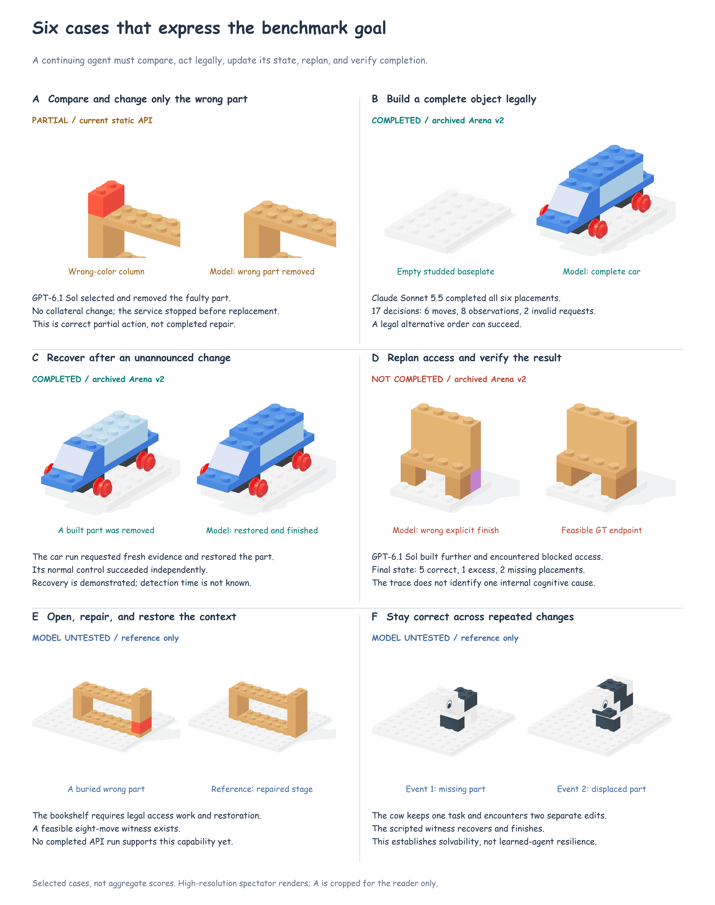
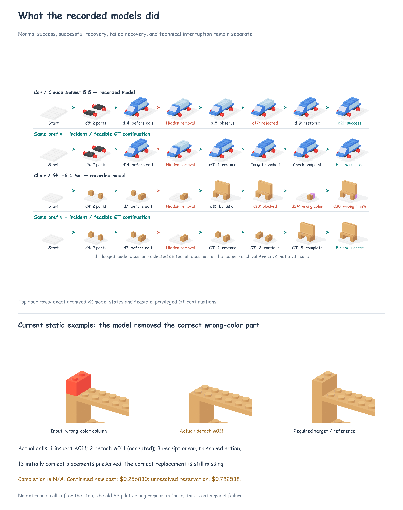
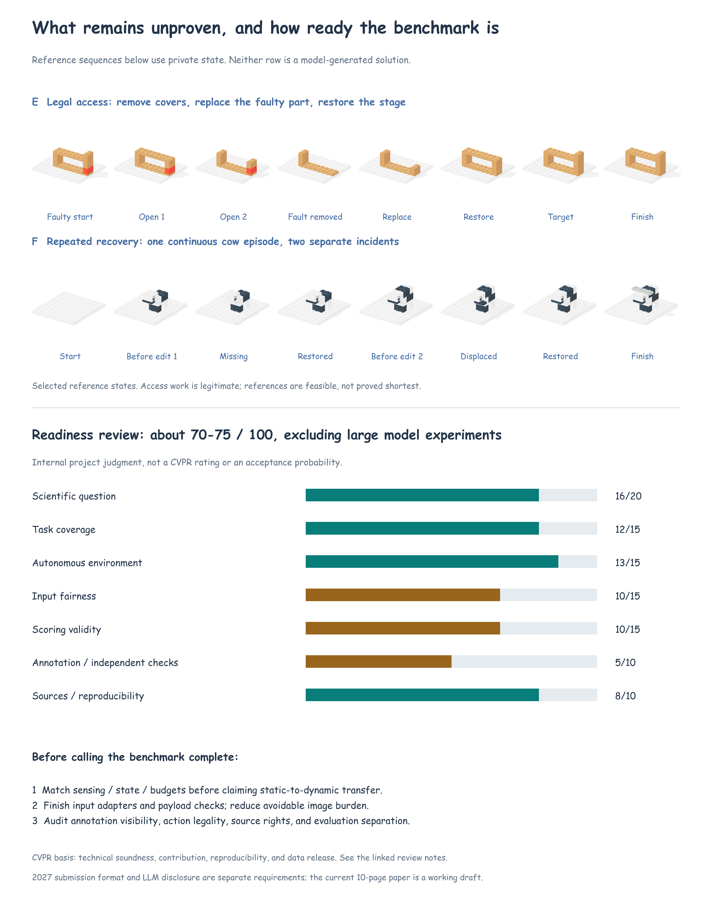

# 代表例子、模型能力证据，以及离“80 分”还有什么差距

更新：2026-10-29。

## 先回答你的判断题

**我现在不会说“除了实验，已经非常完备，达到 CVPR 80 分了”。**

如果只是看题库、动态环境、评分和展示这些组成，我们已经有了比较完整的骨架。但如果把“完备”理解成：别人能独立使用，而且能相信测出来的失败确实来自模型，**我的自评约为 70–75 分**。下面的分项合计是 74 分，仅是内部项目判断，**不是 CVPR 官方评分，也不是录取概率**。这里没有因为缺少大规模模型成绩扣分；扣的是输入公平性、评分的外部验证、标注质量和复现证据。

**方向值得继续做；下一步应补可信度，不是继续堆到更多物件和更多题。**

CVPR 的官方审稿指导强调技术可靠性、贡献、影响和可复现性，不能用题量或排版漂亮代替。数据集大小也应结合所测问题判断，而非越大越好。[审稿指导](https://cvpr.thecvf.com/Conferences/2026/ReviewerGuidelines)、[审稿培训材料](https://cvpr.thecvf.com/Conferences/2026/ReviewerTrainingMaterial)

## 一、最能代表我们目标的六个例子



**我们的核心目标可以表述为：模型能否在自己控制观察和拆装的持续环境里，发现现实状态已经变化，重新安排合法动作，最后把任务正确完成。**

图中的颜色只给读者标注证据状态，不发给模型。高清场景是记录状态的展示图；A 的局部放大也只用于阅读，不是偷偷给模型更清晰的新输入。

| 编号 | 例子 | 要测的能力 | 有什么真实证据 | 现在还不能说什么 |
|---|---|---|---|---|
| A | 书架右侧柱子错色，只修那一块 | 比较现场与目标，选对零件，保护正确部分 | 本次 GPT-6.1 Sol 先检查 A011，再正确拆下错色件；其他 13 个正确位置保留 | 第三次请求服务回执异常，补件未完成；不能判它修复失败，也不能判成功 |
| B | 从白色凸点底板拼好小汽车 | 基本空间定位、合法安装、完整结束 | 已有 Claude Sonnet 5.5 日志：6 次成功安装，最后成功 | 只说明这个案例能做，不说明全部汽车都会做 |
| C | 小汽车已拼了一部分，偷偷拆掉一块 | 主动取得新信息、更新现场判断、恢复并继续完成 | 已有 Claude 事故运行恢复并完成；独立正常分支也成功 | 不能把第一次看图的时间当成发现错误的时间，也不是严格因果配对 |
| D | 椅子遭到拆件后继续加上层，后来拆卸受阻，最后交错成品 | 返修顺序、访问内部零件、完成前检查 | 已有 GPT 运行：正常椅子能拼好，事故运行最终只有 5 个正确位置、1 个多余、2 个缺失 | 不能单凭这条轨迹断言一定是“没看懂”；可能还涉及更新、定位、排序和停止判断 |
| E | 书架里面的件错了，必须先打开再修，之后恢复外围 | 拆装依赖、返修范围、保护与恢复 | 当前题有 8 步合法参考方案 | 没有完整 API 结果；它是重要待测能力，不是已经证明的模型弱点 |
| F | 小牛先少件，修复后又发生偏移 | 持续更新、反复恢复、修好后保持正确 | 当前 D2 题可由脚本连续处理两次事故并完成 | 脚本通过不是模型有韧性；尚无有效 API 实测结论 |

B、C、D 来自明确标注的旧版 Arena v2；A 来自本次当前静态接口。E、F 是当前正式题目的参考验证。**三种证据不混在一起算成功率。**

### 为什么选它们

这组例子沿着同一条能力链：

**知道哪里不对 → 找到能执行的动作 → 合法完成 → 发现后来发生的变化 → 重新安排拆装 → 判断是否真的结束。**

A 与 E 对比“能直接换”和“必须先拆开”；B 与 C/D 对比“正常会拼”和“变化后能否修”；C 与 F 对比“修一次”和“多次事故后仍能保持正确”。这些对比比单纯列“错色、少件、偏移”更能说明 benchmark 测什么。

但目前它们只是代表性例子，不是已经做好的严格配对实验。例如 B、C、D 的模型、物件和运行条件并不全相同，不能直接用分数相减得到某一种能力差距。

## 二、模型目前做到和没做到什么



### 已有行为证据

- **能完整拼好一些简单物件。** 小汽车和椅子都有真正的 API 成功记录，允许合法替代顺序。
- **有时能在事故后恢复。** 小汽车存在恢复成功的轨迹。
- **能够选对待修零件并执行局部操作。** 本次书架只拆了错色柱子，没有重复之前 GT 多拆左侧柱子的问题。

### 这次确实没有做到的

- 椅子事故运行最终没有恢复到正确成品，并且错误地提交了完成。
- 过程中出现了受阻拆卸、无连接安装、碰撞和格式错误；这些要分别记录。
- 正常能拼好，不能自动推出事故后也能成功。

### 尚不能判断的

- 内部返修、多次事故、长过程是否能稳定完成。
- 失败究竟主要是认不出来、位置选错、拆装顺序错误，还是没有检查结束条件。
- 新接口相对旧接口是否改善了这些能力。
- 文字、图片、图文三种输入谁更好；三套严格适配器尚未接完。

因此，“目前达不到”应写成**在给定案例、接口和预算下没有完成**，不能写成所有模型都没有这种能力。

## 三、本次新增真实调用：发生了什么

事前选定四个条件：书架错色、小汽车正常、小汽车事故、书架内部返修。事故条件必须先正常成功；不根据结果换成更容易的题。

| 条件 | 实际执行情况 |
|---|---|
| GPT-6.1 Sol / 书架错色 | 收到 2 个有效动作；第 3 次请求缺少可核验的计费回执，技术中断 |
| Claude / 小汽车正常 | 费用预留后剩余额度不足，未运行 |
| Claude / 小汽车事故 | 没有本轮成功正常对照，未运行 |
| GPT / 书架内部返修 | 剩余额度不足，未运行 |

两个有效动作：

```json
{"type":"inspect","view":"isometric","partId":"A011"}
{"type":"detach","partId":"A011"}
```

A011 对应错色柱子；拆卸被接受。逐步重放确认前后状态和反馈一致。终态仍缺一件，因此只报告“正确拆掉了错件”，完成结果记为不适用。

**新增确认费用：$0.2568295。** 第三次请求保留 **$0.782538** 的最坏情况预留，不能当作零费用，也不能把它说成已实际扣费。本轮确认＋预留上界为 **$1.0393675**。沿用的旧试跑账本目前确认＋预留为 **$2.90424327 / $3**，没有扩大预算，也没有在停机后追加请求。

这次还发现了两处与“能否放心测”有关的问题：

1. **静态输入仍偏重。** 三次请求分别发送了 **9、18、12 张图**（第三次没有可评分动作）。第一次是三张当前/目标对照页和六页零件卡；第二次还多了前后状态、零件特写和候选位置页。正式实验前需要明确固定视图、库存分页和按需查询规则，并记录实际图数与 token；不能让大量重复材料主导预算。
2. **异常回执应先保存，再检查费用。** 原代码在缺少费用时直接抛错，没有先保留完整服务商响应。现已修复：先保存响应与可用的生成编号，再验证计费；异常请求仍保留全额预留。两个离线测试通过。已经丢失的那次原始响应无法倒推补出，故保持“待核对”。

## 四、不是“题少”，而是还有这些非成绩问题



| 方面 | 内部自评 | 现有优点 | 离更可靠还差什么 |
|---|---:|---|---|
| 科学问题是否清楚 | 16/20 | 静态修复到持续动态恢复的主线已清楚 | 需要用同一故障现场控制输入、历史和剩余预算，才可拆开解释差距 |
| 题目覆盖 | 12/15 | 310 个物件、4,685 题，多类错误和单次/多次事件 | 长过程只有 20 个物件；253 个是收尾任务，57 个是完整拼装；题量不能等同独立难题量 |
| 动态自主环境 | 13/15 | 模型自主观察、拆装、回看、提交，事件改变真实状态 | 还要检验更多偏离参考路线后的事件可触发性、可见性和可恢复性 |
| 输入是否公平清楚 | 10/15 | 唯一验收目标、匹配视图、匿名动作编号已有规则 | 静态自动给图、动态主动要图不是同一种输入；三模态适配器待实现；分页和信息负担需统一 |
| 裁判是否可靠 | 10/15 | 替代合法顺序可接受；无事件、技术故障不混入修复失败 | 需要更完整的独立动作判断；完成、识别、定位和规划不能互相代替当标签 |
| 标注和质量验证 | 5/10 | 全题参考回放、图像检查、已有显示 GT 的真人反馈 | 当前版本独立盲操作证据不足；像素有变化不代表人或模型一定看得清 |
| 来源和可复现 | 8/10 | 234 来源组、来源分组无重叠，文件与图有追溯记录 | 需整理来源授权和可发布范围，验证干净环境运行，并记录哪些来源用于模型/提示调试 |
| **合计** | **74/100** | **骨架成立** | **不能据此推断 CVPR 录取** |

### 两个需要说准确的地方

**不是完全没有独立几何检查。** 仓库已有另一个 Boolean 后端的两批检查：一批 32 个动作探针（其中 1 个待复核），另一批 30 条来源扩展检查报告一致。它们共享部分输入网格，也没有验证连接语义、重力或真实扣合力。需要说明覆盖了哪些当前题，而不能升级成“310 个模型的真实物理都已独立验证”。

**作者出题时看过来源，不等于数据泄漏。** 当前来源组分隔是有价值的。真正需要记录和隔离的是：哪些物件/来源被用于提示词、模型设置或失败后的反复调试，哪些留给最终评估。现有 `authoringExposed` 标记本身既不能证明泄漏，也不能证明未见泛化。新增完全没参与调试的来源，是更强的验证方式，不是唯一合法做法。

## 五、要接近“80 分”，先做哪几件

### 第一：把主结论的对照真正接成可执行任务

选同一个已经发生故障的现场，一份交给新的解题模型，一份让原来的模型继续；目标、库存、允许动作、可见信息和剩余预算相同。这样才能讨论持续执行带来的困难。先把运行与计分流程接好，再花钱测。这部分不是多跑几十个模型可以替代的。

### 第二：统一并核对模型真正收到的材料

明确每一步给几张图、能查几页库存、候选位置怎样查看、什么时候更新状态。文字组若有精确坐标，就承认它获得额外状态帮助；另设相同事实的文字/图片卡片对照。三模态如果作为贡献，就需要实现和审计；如果暂列未来扩展，就不要作为已经完成的优势。

### 第三：补题目质量证据

把盲操作与看 GT 审核分开。重点覆盖相似重复件、被遮挡部位、收尾区域、内部返修和连续事故，不需要一开始让人做完全部 4,685 题。发现错误后要记录影响范围，修正同类生成规则。人的检查也是 benchmark 质量建设，不能因为说“先不算实验”就跳过。

### 第四：明确世界规则并检查边界

主张“在我们定义的、可验证的拆装规则里修复”是合理的。无需为了完备而实现整套真实机器人力学。但在所声明的规则内，合法动作不能误拒，穿模动作不能放行；连接、抽出路径、支撑和固定背景的边界要讲清楚。

### 第五：做一份别人能独立运行的正式发布包

包括题单、版本、来源和许可、公开输入、独立评分、完整运行日志格式、有效/无效结果的处理方式、最小示例和安装说明。用干净环境跑一次；不要只验证作者电脑上的代码或论文 ZIP 能编译。

完成上述工作后，我会更愿意把**非大规模实测部分**评为接近 80。之后的模型实验负责证明结论有价值，而不是替存在歧义的题目和接口背书。

## 六、CVPR 投稿层面还有两个明确事项

这是作者自己的提交前审查，不是受邀审稿结论。当前官方 2027 要求正文最多 8 页（图表计入），允许另加参考文献和 LLM Usage Statement；声明应放在正文后、参考文献前，披露工具及使用范围。现有 10 页仍按你的要求保留为工作稿，提交前再压缩并补声明。[CVPR 2027 作者指南](https://cvpr.thecvf.com/Conferences/2027/AuthorGuidelines)

这些属于稿件准备，不用于上面 benchmark 的 74 分。论文是否有录取竞争力，最终还取决于可信的新发现、与近邻工作的区别及实验结果，无法靠内部打分保证。

## 文件与复现

- [三页高清图册 PDF](capability-atlas.pdf)
- [事前选例与本轮运行结果](evidence/capability-pilot.json)
- [书架逐动作复核与每次请求图数](evidence/capability-static-audit.json)
- [图册来源、图片哈希和自评分项](evidence/capability-atlas.json)
- [参考拆装和两次事故的状态记录](evidence/capability-reference-scenes.json)
- [来源、实际请求图片、动作回放和 PDF 检查](evidence/capability-atlas-verification.json)

只重建图册，不会调用 API：

```bash
PYTHONPATH=benchmark/brickplan-repair benchmark/.runtime/mlx-env/bin/python paper/brickplan-cvpr/capability_assets.py
.tools/node-v22.23.2-darwin-arm64/bin/node paper/brickplan-cvpr/render_publication.mjs --capability
benchmark/.runtime/mlx-env/bin/python paper/brickplan-cvpr/capability_atlas.py
PYTHONPATH=benchmark/brickplan-repair benchmark/.runtime/mlx-env/bin/python paper/brickplan-cvpr/verify_capability_atlas.py
```

`capability_pilot.py` 是付费调用脚本，发现已有报告会拒绝重复运行；图册构建与论文构建不会调用它。
