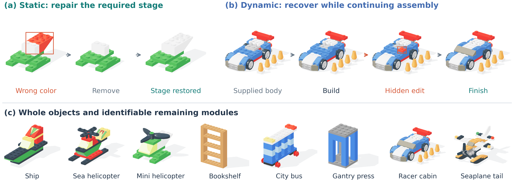
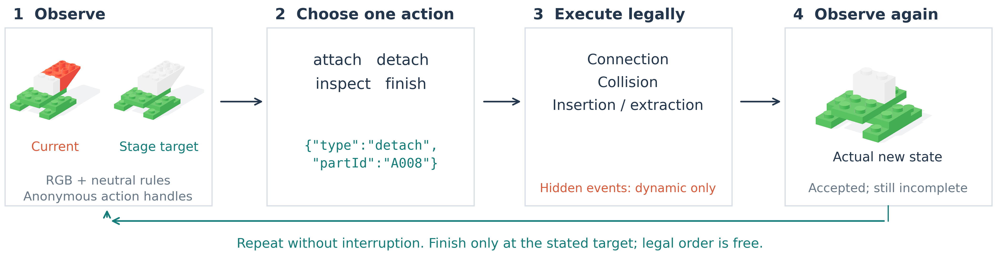
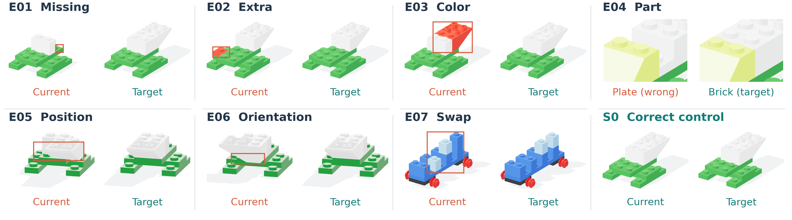
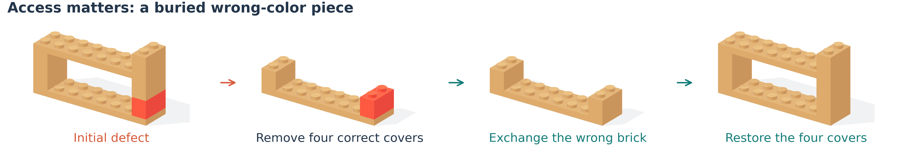
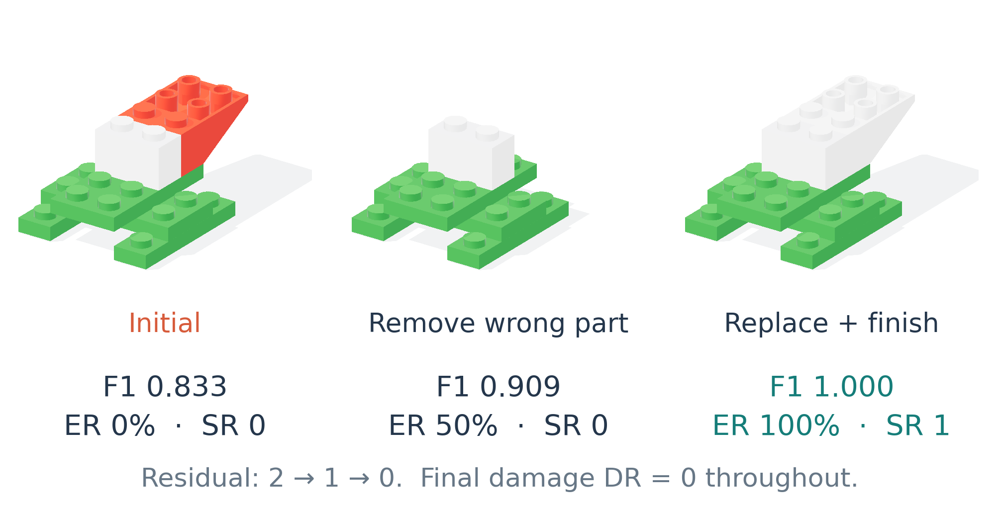
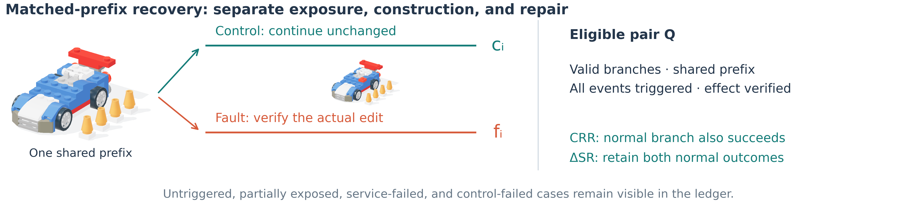
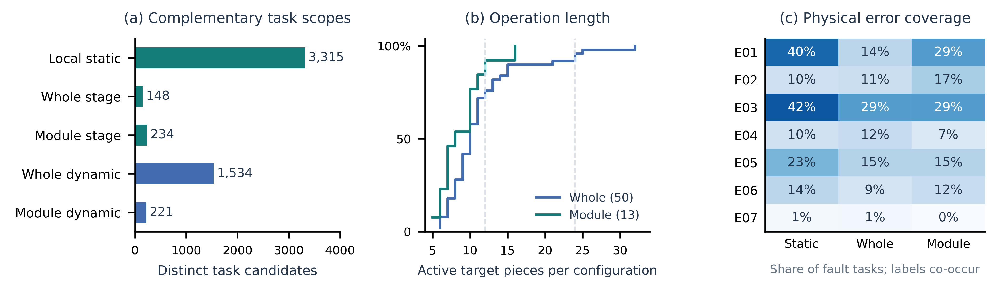
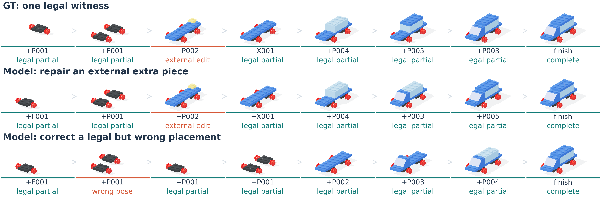
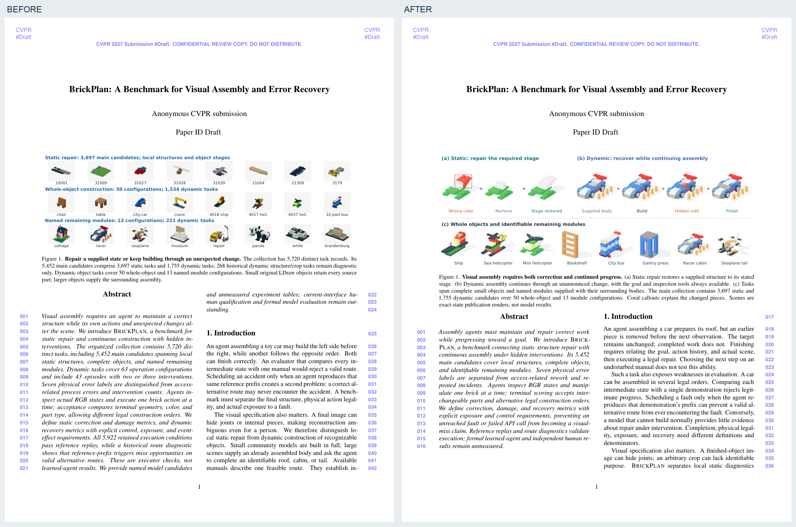
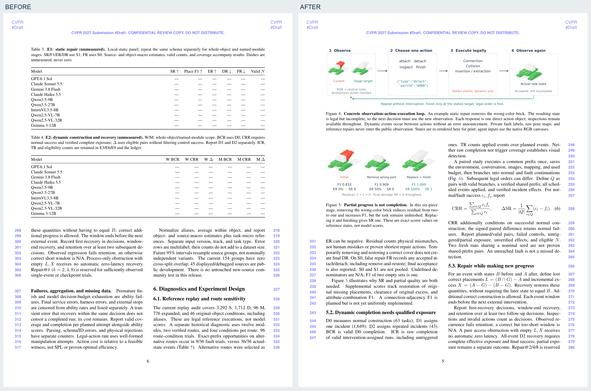

# 对照正式论文后的图形与版面修改

更新：2026-10-25。这里解释这一轮为什么改、具体改了哪里；末尾有实际页面的前后对比。

## 1. 实际对照了哪些论文

下载原始PDF，查看了主图、数据介绍、方法、统计、结果表和案例页面。第三方论文的截图只留在本地检查目录，没有放进我们的论文冒充内容。

| 原始论文 | 看到的做法 | 这次用到我们论文里的改动 |
|---|---|---|
| [BrickNet，CVPR 2026](https://openaccess.thecvf.com/content/CVPR2026/papers/Kulits_BrickNet_Graph-Backed_Generative_Brick_Assembly_CVPR_2026_paper.pdf) | 白底原生模型、连接细节特写、物件和程序并排；统计图与定性图各自说明问题。 | 用真实LDraw几何做材质、光照、阴影；保留完整主体；错误要能在图里看出来，不只贴小缩略图。 |
| [BrickGPT，ICCV 2025](https://openaccess.thecvf.com/content/ICCV2025/papers/Pun_Generating_Physically_Stable_and_Buildable_Brick_Structures_from_Text_ICCV_2025_paper.pdf) | 主图串起目标、逐步构建、检查和结果；方法图与正文互相解释。 | 主图讲静态／动态任务；流程图展示真实状态、一个动作、合法性检查和下一状态。我们没有借用其真实机器人实验结论。 |
| [VSI-Bench，CVPR 2025](https://openaccess.thecvf.com/content/CVPR2025/papers/Yang_Thinking_in_Space_How_Multimodal_Large_Language_Models_See_Remember_CVPR_2025_paper.pdf) | 任务示例明确展示输入、问题与回答；数据组成、实验和案例分析有层次。 | 加入具体动作示例、真实计分例子、任务数量／操作长度／错误覆盖统计；图表围绕读者的问题组织。 |
| [Spatial457，CVPR 2025](https://openaccess.thecvf.com/content/CVPR2025/papers/Wang_Spatial457_A_Diagnostic_Benchmark_for_6D_Spatial_Reasoning_of_Large_CVPR_2025_paper.pdf) | 能力分类、任务级别、对照表和案例共同解释测什么。 | 明确结构长度、返工和事故次数；补充与其他任务的输入输出对照，以及预先设计的受控实验表。我们的G等级仍未实测校准。 |

这些是版式与组织方式的参考。别人的模型分数、真人结果和曲线没有成为我们的实验数据。

## 2. 图重新做了什么

### 总览：先看懂任务，再看物件种类

前一版首页主要堆放24个小物件，读者看不出静态和动态到底怎么操作。现在上排直接展示错误、拆卸、修好，以及从已有主体继续、被干扰、完成；下排8个物件展示范围。

### 输入输出：给出一个能理解的真实例子

一张图说明当前图、唯一阶段目标、直接动作对象、执行器和更新后的状态。示例拆掉错色件后，状态合法但仍未完成，需要继续补装。

### 错误与返修：展示差异和操作负担

错误对照使用相同相机和灯光；厚度差用局部特写，偏移／装反用更易看清的后侧视角。橙色细框仅用于论文解释，不进入模型输入。

### 指标：用实际状态计算，不只写缩写

### 数据分析：有数据的图才放正文

正文的统计图来自当前题库：题目范围、63个配置的安装量、错误标签覆盖。没有把未测模型画成曲线。空雷达图已移出当前稿。

### 真实轨迹：保留每排8个状态

GT与历史模型轨迹用同一组相机和取景，颜色细线区分外部事故、模型自身错误和正确进展。注明旧接口与选帧范围，不当作新模型成绩。

## 3. 正文与补充材料怎么重新分工

- 正文围绕研究问题、相关任务、数据集、交互方式、评估、真实数据分析与诊断、实验设计展开。
- 版本迁移、重复记录明细、旧实验分配等细节集中到补充材料。
- 十个AI候选仍在正文列明；正文用一张表说明要比较什么、控制什么、看什么指标。
- 19张未测结果表完整保留在补充材料，等待填入正式实验。
- 42个原有完整物件、13个收尾配置、9个新增配置展示和26个诊断结构的图册统一重渲染；160个原有静态配置清单保留。
- 真人操作与API可复制对话不是同一种配对。正文和表格已明确：独立真人先报完成／触发情况；系统给定前半段的任务标为C，不能直接套用模型的配对修复率。

## 4. 图片本身怎么保证清楚

- 使用题目证书里的真实几何、颜色、位置和状态，不用AI生成假积木。
- 原生3200×2400，多重采样抗锯齿；组合图600dpi，文字、箭头和图表保留矢量。
- 相同对照组共享相机、灯光和取景，裁掉画布留白时保持几何比例。
- 使用材质、环境光和接触阴影，补充必要的细节视角和标注。
- 这些是**论文展示图**；答题时的800×600场景、完整背景和输入输出规则不变。
- 逐页检查图文位置、文字大小、标题与标注间距、页末留白、图中文字是否被切掉。

## 5. 实际页面前后对比

### 首页

### 原来放空成绩表的一页与新的内容页

本轮改进的是论文的图形、排版、组织和解释质量。正式模型和独立真人实验仍需执行；程序诊断与参考路线不能替代这些结果。
