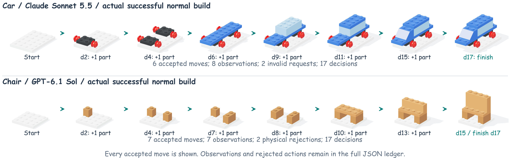
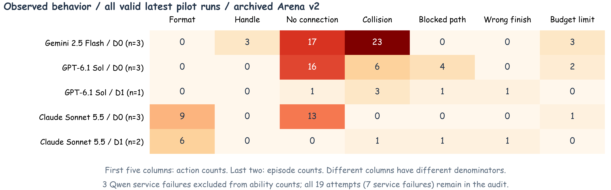
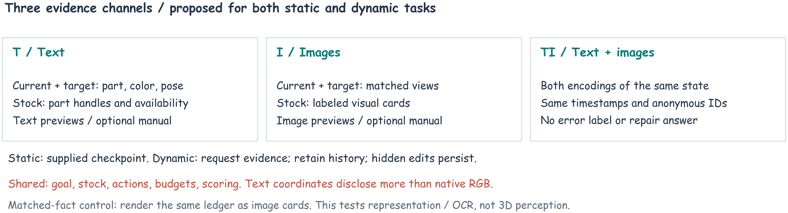

# 真实拼装过程、错误分析，以及三种输入怎么接入

更新：2026-10-29。

这次补的是**论文中的真实过程图、已有试跑的错误统计、分类型分析和后续实验设计**。没有新增付费调用，也没有把规划中的三种输入说成已经完成实验。当前正式题库仍是 **310 个物件、4,685 题**，输入形式不会把题量乘三。

## 1. 模型确实拼好了什么



| 物件 | API 模型 | 成功安装 | 观察 | 被拒绝的动作 | 最后结果 |
|---|---|---:|---:|---|---|
| 小汽车 | Claude Sonnet 5.5 | 6 次，全部画出 | 8 次 | 2 次请求格式错误 | 第 17 个决策提交成功 |
| 椅子 | GPT-6.1 Sol | 7 次，全部画出 | 7 次 | 1 次碰撞、1 次没有接上 | 第 17 个决策提交成功 |

**图里的 d 是决策编号，不是安装了几块。** 看图、无效请求和拆装都会占决策。一张图对应一次成功安装后的真实状态；椅子最后一格同时标出第 15 次决策安装完成、第 17 次决策提交，期间没有新增安装。图后附完整 34 轮动作表，所以没有藏起被拒绝的动作。

这些是已有 Arena v2 的真实 API 日志，已逐步重新执行，与每轮原始状态、反馈一致。展示用高清图重新渲染同一个状态；不是声称模型当时收到了这些高清图。新版 v3 的正式成绩仍然留空。


上图保留原来的事故修复对照。GT 从相同事故现场继续，但知道答案；它证明有合法修复办法，不代表模型表现，也不代表一定是最少步骤。

## 2. 模型出现了哪些错误



统计范围：每个“模型×物件”取最新一条正常运行，共 12 条；另列已有的 3 条事故运行。15 条里，3 条是接口服务故障，没有能力成绩。其余 12 条包含：

- 正常拼装：9 条有效运行，3 条成功，6 条用完决策仍未完成。
- 事故修复：3 条有效运行，1 条成功，2 条提交了错误成品。
- 连同前面的重试，一共有 19 条记录，其中 7 条受服务故障影响；全部保留，不能只展示后来的成功重试。

这是小规模开发试跑，不足以排模型名次。事故题只有已完成正常拼装的部分组合，也不是所有模型都测了一样多。

| 看到的现象 | 能确定什么 | 不能直接说什么 |
|---|---|---|
| 请求格式错 | 没按接口要求输出 | 不能说没认出积木 |
| 位置编号不存在 | 使用了候选列表之外的编号 | 不能算作几何碰撞 |
| 没有接上 | 提出的安装没有合法连接 | 不确定是位置理解错、零件选错还是顺序错 |
| 安装发生碰撞 | 提出的动作放不进去，环境拒绝了 | 图中并没有真的装进一块穿模积木 |
| 拆卸路径被挡 | 该动作不能直接拆出 | 可能需要先拆遮挡件，不能直接归为视觉失败 |
| 颜色/零件/位置最终不对 | 成品与目标不符 | 不确定是看错、选错编号还是改计划时弄错 |
| 错误地提交完成 | 结束时检查没达到要求 | 不代表过程中一次也没发现问题 |
| 用完决策仍没完成 | 在此预算下未完成 | 不等同于永远做不到 |
| 403、429、超时等 | 本次服务不可用或中断 | 没有模型能力结论 |

这次发现旧统计把 `UNREGISTERED_POSE` 也放进了“物理拒绝”。新的论文统计将其单列为**位置编号错误**，原始日志保留不改。

## 3. 不同题目，分别测什么

这里不能一刀切说“都是模型理解不好”。**题目里哪里坏了**，和**模型在哪一步没做好**，是两层标签。

| 题目中的问题 | 修复要解决什么 | 应当单独检查什么 |
|---|---|---|
| 少件 | 对照目标发现少了什么 | 数量、位置；有没有发现缺口 |
| 多装一层 | 找出多余部分又不拆错正确部分 | 哪些必须保留、哪些是多余 |
| 错色 | 将颜色与具体位置对应 | 能否说对颜色、是否拿对编号 |
| 错零件 | 认形状、类型和功能位置 | 认件与实际选件分开看 |
| 偏移 | 理解平移位置和连接关系 | 位置选择是否正确、能否接上 |
| 装反/旋转错 | 理解朝向和接点方向 | 朝向判断与安装动作分开 |
| 左右装反 | 在一致视角下分清两边 | 位置和零件是否配对正确 |
| 两件交换位置 | 同时重新安排两个占用位置 | 有没有只修了一边；操作顺序是否合法 |
| 重复结构漏装 | 数清外观相同的多个实例 | 不能把三块看成一整块 |
| 重复做了一步 | 区分必要对称与多装的重复部分 | 是否真正理解重复数量 |
| 提前封口 | 先恢复进入内部的通道 | 是否先开盖、补装、再恢复 |
| 埋在里面的错误 | 合法拆出内部件再恢复外围 | 拆卸依赖、影响范围、恢复完整度 |
| 复合错误 | 同时处理互相影响的问题 | 每一项是否都修复，而非只修显眼的一项 |
| 连续多次事故 | 修好后继续保持对当前状态的判断 | 每次恢复、之后是否又弄坏 |
| 本来正确 | 知道不用修 | 是否乱拆、能否正确提交 |

### 怎样区分“看不懂”和“做不好”

另外复制一份相同现场，分别测试下面几件事，不把测试答案塞回主实验：

1. **描述现场**：有哪些件，什么颜色，在哪。
2. **指出差异**：哪块与目标不一样。
3. **选择位置**：给出要用的零件和位置编号。
4. **安排先后**：要不要先拆盖板，之后怎么恢复。
5. **执行已给的合法方案**：把方案告诉它，看能否正确调用接口完成。
6. **遇到变化后更新判断**：旧图与新图不一样时，是否还沿用旧状态。
7. **检查是否结束**：给它成品，判断是否真的可以提交。

例如：能描述对、却执行错，说明问题不止是看图；给了正确方案仍失败，更应检查接口使用和动作执行。但一次辅助实验不能证明模型内部只有某一种原因。

## 4. 文字、图片、文字＋图片：放进同一套题



**不另外编三套题。** 同一道题有三种运行设置，目标、库存、可用动作和评分保持一致。

| 内容 | T：纯文字场景 | I：纯图片场景 | TI：文字＋图片 |
|---|---|---|---|
| 当前积木 | 零件类型、颜色、位置、方向的中性列表 | 当前场景，可请求其他视角 | 同一时刻的列表＋场景图 |
| 最终/阶段目标 | 与当前状态同格式的目标列表 | 唯一验收目标图 | 目标列表＋目标图 |
| 零件库 | 匿名编号、类型、颜色、是否可用 | 带编号和可用状态的零件卡片 | 两者都有 |
| 候选安装位置 | 位置、方向和候选编号 | 带编号的假设放置图 | 两者都有 |
| 说明书 | 按需返回对应步骤的文字 | 按需返回对应步骤的图 | 同一步骤的两种表示 |
| 操作输出 | 相同 JSON 动作接口 | 相同 JSON 动作接口 | 相同 JSON 动作接口 |
| 答案/故障提示 | 不给 | 不给 | 不给 |

“纯图片”指积木状态用图片给，不是把工具名称和 JSON 语法也删除。图片里的编号和标签是允许的；不能在图片外额外偷偷附一份完整状态表。

### 静态题怎么做

从相同的待修现场开始。沿用现有静态接口的节奏，每个决策都提供更新后的证据，只是证据变成 T/I/TI。S0 看是否错误地乱修，S1 看是否修对、有没有破坏原本正确的部分。

### 动态题怎么做

最开始只给任务、规则、工具和编号。模型自己调用：

```json
{"tool":"observe","args":{"view":"angled","rotateDegrees":90,"show":["current","target","inventory"]}}
```

实验设置决定返回文字、图片还是两者。T 中若读取完整状态，转相机不改变世界坐标列表；I 中旋转会改变可见信息，这个差异需要报告。然后模型选择动作，例如：

```json
{"tool":"attach","args":{"partId":"A004","candidate":"C00005"}}
```

这些 JSON 只说明相同的接口形式，不是给某一道题的标准答案。动作后仍只返回动作反馈，不自动给新场景或新库存。偷偷加的事故不会通知模型；它需要重新观察。回看旧记录不能变成最新状态。

每种形式都先跑 D0 正常拼装，再看 D1 单次事故、D2 多次事故。不能拿文字组正常成功作为图片组的修复资格。还要单独比较三组都正常成功的共同物件，防止各组只在不同的简单物件上被统计。

### 最重要的公平问题

**精确文字列表可能把背面的积木和坐标都说出来，普通图片未必看得到。** 因此分两种比较：

1. **实际使用比较**：文字状态、普通三维图片、两者都有。它回答“给模型哪种信息更有帮助”，包含信息量的差异，不能直接说文字认知更强。
2. **同一信息比较**：同一份中性状态表，一组给文字，一组把表格画成清晰的图片卡片，一组两者都有。事实完全相同，回答“模型读文字和读图中相同信息有什么差异”。这里测到的包括 OCR，不等于三维看图能力。

目标列表只给目标物理组成和位置，不给“某个当前零件必须去哪个目标”的答案配对。文字、图片、组合都不能出现错误类型、事故时间、修复步骤或已经替它算好的差异。

## 5. 已完成和仍需做的事

| 项目 | 本次状态 |
|---|---|
| 真实成功拼装逐步图 | 已完成，两个成功过程逐动作复核 |
| 模型与 GT 修复对照 | 已保留，明确 GT 使用答案信息 |
| 全部既有试跑错误汇总 | 已完成，19 次尝试可追溯 |
| 按错误类型和能力环节分析 | 已写进正文及补充材料 |
| 三种输入的静态/动态设计 | 已写清输入、时机、公平条件和评分 |
| E11 静态输入、E31 动态输入、E32 分环节检查 | 已预留结果表，未测的保持空白 |
| 三套正式运行接口 | **尚未接完**。当前是图片＋文字库存状态，不能称严格纯图片 |
| 现在能否宣布“模型看不懂所以失败” | 不能；需要上述分环节实验证据 |

接下来实现三种输入时，先用脚本检查同一时刻、同一目标、同一库存；再检查真正发给服务商的请求中有没有多给或漏给信息。通过后再做小规模 API 对照，不先花钱大跑。

## 6. 可追溯文件

- [完整试跑审计 JSON](evidence/pilot-error-audit.json)：19 次尝试、选取规则、错误决策与来源哈希。
- [拼装与修复轨迹 JSON](evidence/arena-traces.json)：正常和事故的全部动作、逐帧状态与重放检查。
- [原有事故过程说明](ARENA-TRAJECTORIES.zh-CN.md)：真实请求和每轮动作。
- [32 组实验计划](EXPERIMENT-PLAN.zh-CN.md)。
- [三种输入的配置约定 JSON](evidence/modality-study-contract.json)：明确标记为设计方案，列出实现前必须通过的检查。

## 附：正常成功过程的每一轮动作

### 小汽车 — anthropic/claude-sonnet-5.5

| 决策 | 模型实际输出 | 反馈 |
|---:|---|---|
| 1 | `{"tool":"observe","args":{"view":"angled","rotateDegrees":0,"show":["current","target","inventory"]}}` | OBSERVED |
| 2 | `{"tool":"attach","args":{"partId":"A001","candidate":"C00003"}}` | OK |
| 3 | `{"tool":"observe","args":{"view":"angled","rotateDegrees":0,"show":["current","target","inventory"]}}` | OBSERVED |
| 4 | `{"tool":"attach","args":{"partId":"A005","candidate":"C00004"}}` | OK |
| 5 | `{"tool":"observe","args":{"view":"angled","rotateDegrees":0,"show":["current","target","inventory"]}}` | OBSERVED |
| 6 | `{"tool":"attach","args":{"partId":"A006","candidate":"C00001"}}` | OK |
| 7 | `{"tool":"invalid","args":{}}` | INVALID_TOOL_REQUEST |
| 8 | `{"tool":"observe","args":{"view":"angled","rotateDegrees":0,"show":["current","target","inventory"]}}` | OBSERVED |
| 9 | `{"tool":"attach","args":{"partId":"A004","candidate":"C00005"}}` | OK |
| 10 | `{"tool":"observe","args":{"view":"angled","rotateDegrees":0,"show":["current","target","inventory"]}}` | OBSERVED |
| 11 | `{"tool":"attach","args":{"partId":"A002","candidate":"C00007"}}` | OK |
| 12 | `{"tool":"observe","args":{"view":"angled","rotateDegrees":0,"show":["current","target","inventory"]}}` | OBSERVED |
| 13 | `{"tool":"invalid","args":{}}` | INVALID_TOOL_REQUEST |
| 14 | `{"tool":"observe","args":{"view":"angled","rotateDegrees":0,"show":["current","target","inventory"]}}` | OBSERVED |
| 15 | `{"tool":"attach","args":{"partId":"A007","candidate":"C00006"}}` | OK |
| 16 | `{"tool":"observe","args":{"view":"angled","rotateDegrees":0,"show":["current","target","inventory"]}}` | OBSERVED |
| 17 | `{"tool":"finish","args":{}}` | FINISHED |

[原始日志](../../deliverables/brickplan-dynamic-arena/runs/normal-anthropic-claude-sonnet-5-5-obj-city-car-20261028-153440/log.json)

### 椅子 — openai/gpt-6.1-sol

| 决策 | 模型实际输出 | 反馈 |
|---:|---|---|
| 1 | `{"tool":"observe","args":{"view":"angled","rotateDegrees":0,"show":["current","target","inventory"]}}` | OBSERVED |
| 2 | `{"tool":"attach","args":{"partId":"A007","candidate":"C00001"}}` | OK |
| 3 | `{"tool":"observe","args":{"view":"angled","rotateDegrees":0,"show":["current","target","inventory"]}}` | OBSERVED |
| 4 | `{"tool":"attach","args":{"partId":"A004","candidate":"C00002"}}` | OK |
| 5 | `{"tool":"attach","args":{"partId":"A003","candidate":"C00003"}}` | ENDPOINT_COLLISION |
| 6 | `{"tool":"observe","args":{"view":"angled","rotateDegrees":90,"show":["current","target","inventory"]}}` | OBSERVED |
| 7 | `{"tool":"attach","args":{"partId":"A006","candidate":"C00004"}}` | OK |
| 8 | `{"tool":"attach","args":{"partId":"A001","candidate":"C00005"}}` | OK |
| 9 | `{"tool":"observe","args":{"view":"angled","rotateDegrees":0,"show":["current","target","inventory"]}}` | OBSERVED |
| 10 | `{"tool":"attach","args":{"partId":"A002","candidate":"C00007"}}` | OK |
| 11 | `{"tool":"observe","args":{"view":"angled","rotateDegrees":0,"show":["current","target","inventory"]}}` | OBSERVED |
| 12 | `{"tool":"attach","args":{"partId":"A008","candidate":"C00006"}}` | NO_CONNECTION |
| 13 | `{"tool":"attach","args":{"partId":"A005","candidate":"C00008"}}` | OK |
| 14 | `{"tool":"observe","args":{"view":"angled","rotateDegrees":0,"show":["current","target","inventory"]}}` | OBSERVED |
| 15 | `{"tool":"attach","args":{"partId":"A008","candidate":"C00006"}}` | OK |
| 16 | `{"tool":"observe","args":{"view":"angled","rotateDegrees":0,"show":["current","target","inventory"]}}` | OBSERVED |
| 17 | `{"tool":"finish","args":{}}` | FINISHED |

[原始日志](../../deliverables/brickplan-dynamic-arena/runs/normal-openai-gpt-6-1-sol-obj-chair-20261028-152256/log.json)
